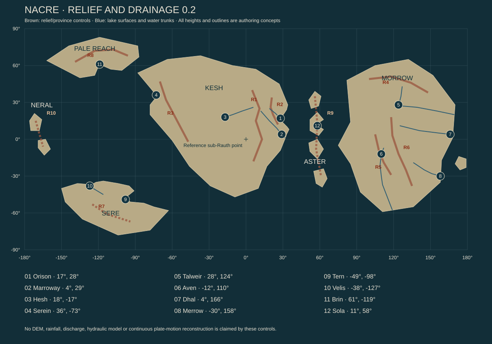

# Volume 01b — The ground remembers differently

Working geographic canon, edition 0.2, 13 October 2026. This volume extends the [physical foundation](Drafts/PHYSICAL_FOUNDATION_REVIEW.md) and the [regional atlas](07_REGIONAL_ATLAS.md). It establishes geological provinces, drainage relationships, deep-time evidence and the design of land and water. These are original fictional choices constrained by physical reasoning. They are not results from a completed tectonic, erosion or climate simulation, and they are not constructed Unreal terrain.

The [relief and water map](Atlas/nacre_relief_and_water.svg), [control register](Atlas/GEOGRAPHY_CONTROLS.md) and [source data](Atlas/nacre_geography.json) make the major relationships inspectable. Edition 0.2 refines coastal approaches around unchanged city coordinates; the broad outlines of edition 0.1 had placed several intended ports too far inland. It also gives the Talweir trunk explicit flat lake reaches at Namar and Iren, rather than drawing a continuously sloping river through level water.

## A landscape is an argument made slowly

From an aircraft, the Glassback Range appears to be a wall. From a pass, it becomes a collection of arguments: a hard pale ridge resisting erosion, a softer seam cut into a valley, a river borrowing a fault, a road taking a longer line because the apparent shortcut has fallen away three times. At a distance the mountains divide two colors on a map. On foot they divide kinds of weather, memories of routes and the price of a bag of flour.

Nacre must possess this difference between viewing and knowing. A planetary map can reveal almost every large mountain while leaving an immense amount undiscovered. It cannot tell a traveler whether a ledge remains stable after rain, why a small lake has no visible outlet, or which of two bridges residents stopped trusting. Orbital knowledge and local knowledge are complementary. Neither makes the other obsolete.

The geography has three records. Rocks preserve processes without caring what people called them. Organisms preserve relationships through descent, migration and survival. People preserve selected accounts, often with names that describe what mattered when the name was given. Those records can agree without matching perfectly. A place called the Dry Gate may be wet now. A forest may occupy an old lake floor. A harbor can keep a name after its river changes course.

## Datum, scale and the limits of this edition

The atlas uses a reference sphere of radius 5,900 km. Coordinates are latitude and east-positive longitude in a body-fixed frame. The zero meridian passes through the reference sub-Rauth point. Elevation is expressed in meters above the planning sea-level datum. That datum is a simplification of a real surface affected by the permanent tidal figure, rotation, geology and changing water. It is sufficient for the current world bible, but future terrain cannot mix it silently with arbitrary local scene heights.

The surface area is approximately 437.435 million square kilometers. A degree of latitude is about 102.974 km. A degree of longitude becomes shorter toward the poles. A small symbol on the world map can cover an entire city or a long day's ground journey. The atlas must therefore change level of detail explicitly instead of pretending the same drawing is accurate at every scale.

The first coast polygons locate continental masses and sea passages. They do not establish final coast length, exact land fraction, shelf depth, harbor geometry or the number of islands. The relief controls introduced in this pass locate major ridges, basin floors, lake surfaces and river sequences. They are constraints for later terrain authoring, not measurements sampled from a finished global height field.

All geological ages below use millions or billions of **standard Earth years**, with a Julian year of 365.25 standard days. They do not use the shorter AL orbital year. Human historical dates retain AL. A geological exhibit may translate these units for visitors, but the authoring data must retain them.

## What research contributes

Earth research supplies mechanisms and questions rather than a ready-made Nacre. USGS distinguishes spreading, convergence, lateral fault motion and broad deformation zones. That supports giving different mountain and basin provinces different causes. It does not establish that a particular fictional moon sustains plate tectonics. Active mantle-driven tectonics is a setting assumption to be tested for broad plausibility, not a result inferred from the word rocky. [USGS: understanding plate motions](https://pubs.usgs.gov/gip/dynamic/understanding.html)

A watershed is organized around where water flows, with divides separating surface drainage and groundwater complicating simple boundaries. The design implication is to draw upstream dependencies before placing water disputes or river trade. A political border cannot make an upstream discharge cease to matter downstream. [USGS: watersheds and drainage basins](https://www.usgs.gov/water-science-school/science/watersheds-and-drainage-basins)

Closed basins have no surface outlet. That informs Hesh's need to account for salts and residual water; it does not specify its rainfall, evaporation or lake chemistry. Those values must be chosen together later. [USGS: drainage area and closed basins](https://water.usgs.gov/themes/hydrofabric/drainage-area/)

NOAA distinguishes wind-driven upper-ocean movement from density-related deep circulation. Nacre therefore needs wind, temperature, salinity, bathymetry and connected passages before exact current arrows can be treated as authoritative. Earth's conveyor geometry and circulation times are not copied into this world. [NOAA: thermohaline circulation](https://oceanservice.noaa.gov/education/tutorial_currents/05conveyor1.html/)

The following provinces and chronology are invented. Their value lies in how consistently they connect landscapes, biology, material culture and travel, not in the number of scientific terms they contain.

## Deep time as known by the inhabitants

### The old grains

The oldest widely accepted dated mineral populations in the fictional record are approximately 4.2 billion standard years old. Their host rocks have often been melted, buried, fractured and incorporated into much younger formations. A grain's age is not automatically the age of the mountain in which it is found. School exhibitions sometimes obscure that distinction because an oldest mountain makes a better label than a younger mountain containing very old material.

These grains do not settle Nacre's capture history. Some isotopic interpretations favor extensive early heating and later volatile addition; others emphasize how incomplete the surviving sample is. The bible does not canonize an exact capture event merely to end the argument. It establishes that the inhabited surface and biosphere are vastly older than human settlement, and that the current low-eccentricity orbit does not describe every stage of the world's past.

The Pale Reach preserves several important exposed assemblages. Their scientific value does not require spectacular appearance. A dull inclusion in an ordinary hand specimen may matter more than a glittering cliff. This allows a research journey to reward knowledge without turning every valuable material into a luminous collectible.

### The dark laminations

Protected sedimentary sequences in western Kesh preserve thin dark layers interpreted as evidence of ancient microbial communities. The working fictional age bracket is 2.8–3.1 billion standard years. Some structures are securely biological within the setting; others remain disputed because physical deposition can also make repeated patterns.

These records do not reveal one planetary ancestor with a modern face. They establish long histories of chemical cycling and environmental change. Museums reconstruct them differently, from cautious diagrams to beautiful speculative chambers. A reconstruction can be artistically valuable while its label honestly identifies uncertainty.

Later oxygen-related changes appear in mineral deposits and biological diversification. Their precise timing and mechanisms remain a specialist debate inside the fiction. The atmosphere was not installed by the arrival ships, and modern humans did not terraform every native forest into existence. This is a world whose life already altered its air.

### The joined lands

Several hundred million standard years before settlement, the ancestors of today's continental blocks occupied different arrangements. The **Joined Lands** is a popular name for one reconstructed configuration, not a claim that all land formed a single neat puzzle-piece continent at one moment. Reconstructions differ at their margins and across poorly sampled ocean floors.

The useful authorial commitment is that major native clades can predate the separation of Kesh and Morrow. Related folding producers, ribbon movers and cup colonies may therefore occur on both without sharing modern species. Long separation, climatic change, local extinction and dispersal barriers explain why Morrow should feel related to Nacre's life but biologically distinct from Orison.

A classroom map often draws migrating animals across a bridge of land. The actual record may support only similar fossils in rocks of overlapping ages. The world should contain both the confident classroom story and the patient correction, without making uncertainty an excuse to invent any convenient distribution.

### Opening and collision

The current arrangement developed through multiple episodes of rifting, ocean opening, collision and lateral displacement. For working geological history, the principal separation between ancestral Kesh and Morrow predates modern terrestrial species by many tens of millions of years. The major Glassback collision phase is assigned a broad fictional interval of approximately 55–95 million standard years before the present, with later uplift and deformation continuing locally.

Those numbers are authoring choices, not outputs of a complete plate reconstruction. They prevent two errors: giving a human institution credit for continental geography, and treating every mountain as having the same age or origin. Rocks formed in an ancient sea can be lifted into a young ridge; an old mountain core can be re-exposed by recent erosion.

The opening ocean created long isolation. The Aster island arc later provided stepping stones for some life, but not a universal bridge. A floating propagule, a gliding animal and a freshwater grazer face different barriers. The arc's role must be argued species by species.

### Recent ice, water and impact

Cool periods and regional glaciation altered high ground and northern coasts repeatedly. The Pale Reach's inlets include eroded valleys later occupied by the sea, but not every inlet has that origin. Sere's exposed shores include tectonic and erosional structures as well as ice-modified terrain. This distinction gives coastlines different silhouettes and deposits.

Orison's crater is assigned an approximate working age of **36 million standard years**, subject to future geological detail. It has endured erosion, sedimentation, fault reactivation and coastal change. Its rim is incomplete; its interior is not a fresh bowl with a perfectly preserved central peak. The modern sea breach is younger than the impact. Observed thermal water depends on deeper heat and circulation, not residual heat from that ancient collision. Its sustainable electrical potential remains unproven; the city power budget does not count it as verified generation.

The last few hundred thousand standard years changed river courses, shorelines, dunes, ice margins and biological ranges. These are large changes on a human scale without requiring a continent to move during the settlement period. Human arrival encountered one moment in an already changing world.

## The structural provinces

### Kesh: an old interior and a repeatedly worked eastern edge

Western Kesh contains extensive old continental material, locally covered by younger sediments and volcanic deposits. Its large-scale relief is more subdued than the highest Glassback ridges, though individual escarpments can be dramatic. The Serein coast cuts across several histories: resistant headlands, softer embayments, uplifted terraces and coastal deposits. It should not be modeled as one uninterrupted cliff of one rock.

The Glassback belt runs through eastern Kesh as a curved series of uplands, roughly from northern latitudes through the equatorial region toward the south. It is a broad zone containing valleys and basins, not a single knife-edge ridge. The highest reference summits in this edition approach 5,800 m; most travel and settlement occupy much lower ground. Elevation alone does not determine access. A 1,200 m escarpment with few breaks can be a greater obstacle than a 3,000 m plateau reached by a gentle valley.

To the west, mountain-fed water reaches the Red Ledger system and several separate interior basins. To the east, shorter, steeper catchments feed coastal plains, including the Neris network and Orison's regional feeder. The divide is not identical to a political border. Groundwater and human diversions create additional connections that must be recorded individually.

The Saffron Escarpment occupies a younger coastal deformation province beside this older structural framework. Faults provide possible fluid pathways and material contrasts. They also introduce maintenance and seismic considerations. A productive geothermal well is evidence of a particular reservoir, not proof that every crack in the region yields usable heat.

Southward, the Foldwood Marches spread across lower relief with seasonal drainage corridors and older upland remnants. The Cairn Steppe occupies a different combination of interior elevation, seasonal water and cool exposure to the north. These open regions must not share one generic rolling-noise landscape merely because both permit long views.

### Morrow: waters held, then released

Morrow combines an old eastern lowland foundation with younger interior uplift and a northern mountain province. The **Morrow Crown** contains high catchments and complex exposed rock. Its waters feed lakes and eastward rivers; some also take routes beyond the current six-region focus. A continental atlas cannot make every northern drop arrive at Talweir simply because Talweir is a major city.

The **Talweir Lake Country** occupies inherited depressions modified by fault movement, sediment and past ice. Lakes differ in depth, chemistry and residence time. The two named planning lakes are **Namar**, with a nominal surface at 180 m, and **Iren**, downstream at 176 m. The intervening strait and channels explain why a transfer city can grow there. Their broad outlines remain concepts until a terrain model defines shores and sills.

The **Aven Uplands** include high basins, accessible plateaus and passes between drainage systems. The city planning elevation is approximately 1,650 m. This creates a different environment from nearby lowlands without requiring people to live at the world's maximum height. Managed cultivation can occupy favorable benches while steeper or wetter ground supports native communities.

Eastward, the **Green Vault** occupies lowland catchments supplied by interior rain and runoff. Deep weathering, sediment movement and stable surfaces coexist. A forest floor is not uniformly soft mud: old terraces, active channels, exposed roots, rocky rises and seasonal pools produce different travel conditions.

The **Merrow Estuaries** receive water from a separate southeastern catchment. They are not simply the outlet of every Morrow lake. The **White Reed Savannas** contain open seasonal systems south and west of the main interior uplands. Some waters feed persistent corridors; others end in temporary basins or leave the region by different outlets. Distinct drainage creates distinct freshwater life.

### Sere: sheltered edges around a restless interior

Sere contains old blocks separated and reworked by younger deformation. The **Ember Fault** is a rift province with multiple basins, faults and local volcanic or geothermal systems. It is not one glowing crack from coast to coast. Some sections are dormant at human timescales, others release heat without visible lava, and a few can support hazardous active processes.

The **Tern Storm Coast** occupies deeply indented and structurally varied southern maritime terrain. The city's harbor is protected because the approach and enclosing land create shelter; its name does not mean a permanent storm sits on the roof. A chain of headlands and refuge inlets matters more to travelers than a continuous decorative mountain wall.

The **Velis Cold Gardens** lie in a different estuary and catchment toward the northwest. Lower, sheltered terrain supports managed agriculture and dense local movement. The route between Velis and Tern crosses enough distance and different exposure that it should feel like a regional journey, not a short drive between two art kits.

Warm ground in the Ember Fault can feed local industry, public bathing and native chemical ecosystems. Those uses have different requirements. A pool warm enough for comfort may have unsuitable chemistry for drinking; a productive biological seep may be too fragile for extraction; a high-temperature reservoir may require deep wells rather than a visible glowing pond. Art must preserve those distinctions.

### The Pale Reach: old material, changing margins

The Pale Reach exposes ancient continental material among younger deposits and repeatedly modified valleys. Its interior includes uplands and ice-influenced basins, but the present ice cover remains conditional on the climate model. The regional anchor at 72° N is not automatically in permanent seasonal darkness under the adopted roughly 14° tilt; true polar-day and polar-night behavior begins nearer 76° in the idealized geometry.

The **Brin Long Shore** contains workable harbors, sheltered slopes and routes into the interior. Its geology supports research and selected extraction, but does not make every resident a miner. The **Split Cape** has a more fragmented coast, with narrow passages, rocky islands and native marine communities occupying very specific exposure ranges.

The revised concept map preserves a sea passage between the Pale Reach and Kesh. This separation matters for navigation, currents and biological history. It must survive later coastline refinement unless an explicit geological and continuity decision changes it. A terrain generator must not accidentally close it with a convenient ridge or low-detail coastline simplification.

### The island chains are different kinds of places

The **Aster Chain** is the working volcanic-arc province. Its islands vary in age, erosion and structure. Some retain steep active or recently active interiors; others have broader weathered slopes and developed shelves. Wet windward faces and drier lee harbors are plausible design goals, subject to the weather model. Freshwater capacity depends on catchment, rock permeability, storage and use, not island area alone.

The **Neral Arc** uses arc as a geographic name. Its working deep-history hypothesis is a chain of volcanic edifices and raised biological shelves with a different origin from Aster's subduction-related province. The precise mantle source and motion history remain open. The two chains must not be generated from the same island shape and recolored.

Older islands can contain collapsed slopes, submerged terraces and habitats isolated through changing sea level. Some apparently separate islands share a shallow shelf; others are peaks rising from deep water. That distinction governs marine connectivity and anchoring, and may have mattered enormously when ancestral organisms dispersed.

## Water systems that connect and separate

### The Neris and the lowlands

The Neris begins on the eastern side of the Glassback system. Its reference trunk descends from approximately 2,800 m through upland valleys, lower terraces and the Nine-River plain. The current profile reaches Marroway's lowland planning area near 18 m before the coastal outlet. These controls establish downhill order; they do not yet prove a realizable channel at every intermediate point.

The final catchment must contain tributaries with distinct travel times, sediments and seasonal behavior. A mountain storm can reach the lowland as a delayed rise. A cleared slope can increase sediment in one branch while another remains clear. The city should receive a mixture of waters rather than one generic river material changing color with a quest.

Marroway's location makes sense because movement and exchange concentrate near a confluence and transfer zone. Its floodplain settlement should preserve room for channels and seasonal overflow. Some old streets may follow abandoned banks; some gardens occupy former channels; some modern walls intensify risk elsewhere. The regional history should distinguish an extraordinary flood from an ordinary flood made disastrous by development.

### Orison's shorter feeder

Orison's regional feeder belongs to a separate catchment, beginning on elevated coastal ground and descending toward the harbor region. It is not a branch of the Neris that conveniently climbs across the divide. Local city drainage, aquifers, storage and possible treated imports supplement that regional source.

The city plan must separate clean upland supply, storm runoff, process water and wastewater. They can cross in physical space through pipes or culverts without becoming one channel. A waterfall beside a market may be a seasonal overflow, an engineered display using recirculated water, or a real stream; its source and destination should be known to the author.

The ancient crater complicates slopes and storage but does not guarantee a closed freshwater basin. Its sea breach, sediment fill and modified drainage are central to why a port exists there. Salt intrusion and groundwater response belong in the later detailed model rather than appearing only when a story needs contamination.

### Hesh and the terminal waters

The Hesh inflow descends westward from the Glassback side of the divide toward a planning terminal level near 270 m. This is a closed surface-drainage system. Water leaves principally through evaporation, use and any explicitly established subsurface pathways. Dissolved material does not vanish with it.

The terminal landscape includes shallow water, seasonally exposed ground, salt-tolerant native communities and managed human works. It is not necessarily one permanent bright-blue lake. Shore position can vary without a complete ecological collapse. Different parts of the basin can have different salinity and water quality.

A later numerical water budget must include precipitation, mountain runoff, groundwater recharge, storage, withdrawals, return flows and evaporation. A nominal inflow alone cannot prove that a city of 310,000 is supplied. The bible presently fixes the accounting obligations and geographic relationships; the infrastructure volume must choose capacities and demands that close the budget.

### Talweir's connected lakes

Namar and Iren are connected but not interchangeable. Their surface levels differ, and constrictions, wetlands and channels mediate exchange. A contaminant, drifting organism or message in a bottle would not instantaneously reach every shore. Water residence and mixing remain future modeled quantities.

Talweir's city center lies near the connection, where land routes and lake transport meet. The city can contain islands, banks, causeways and bridges without becoming a Venice imitation. Its character should follow the chosen shore materials, water-level variation, vessel types and public-space customs.

The lake articles can regulate navigation on one water surface while a separate body controls an upstream reservoir or shore development. Fishery analogues, drinking water, cultivation and habitat protection therefore share geography without one simple owner. A map should reveal the overlap before dialogue explains it.

### The other Morrow waters

The Green Vault river network and Merrow catchment remain distinct from the Talweir outflow. The Aven uplands also divide water among several basins. Some of the most interesting crossings occur where a short walk between headwaters connects systems whose river mouths are thousands of kilometers apart.

Such divides create biological boundaries. A native freshwater grazer cannot be placed in every attractive stream without a dispersal history. Human canals, moved equipment, cultivated stocks or extreme natural events may connect waters, but each creates a historical fact with ecological consequences. A transport shortcut can be an ecological breach.

The southern open country requires smaller systems as well as a few persistent trunks: temporary pools, groundwater-supported refuges, intermittent channels and wetlands receiving distant runoff. A dry-looking region can contain vital water without hiding a permanent river behind every dune.

## The ocean has terrain too

The first atlas distinguishes three broad charting names: the **Near Sea** between eastern Kesh, Aster and western Morrow; the **Long Ocean** across the outer-hemisphere and western passages; and **Southwater**, the connected southern waters. These are common translated chart names, not three chemically separate tanks or universal names used by every culture.

The Near Sea is wide enough to contain independent weather, circulation and ecological provinces. Aster interrupts routes but does not provide a continuous chain of safe landings at short intervals. The Long Ocean gives Nacre its sense of remote separation. Southwater connects southern continental margins and higher-latitude habitats through water that does not respect the flat map's edges.

Continental shelves vary in width. A broad shelf can support shallow productive habitat and difficult navigation; a steep coast can have deep water close to land and little anchoring ground. Submerged canyons, ridges, trenches and seamounts create further structure. Their locations should derive from the geological province rather than be scattered as interchangeable underwater POIs.

Surface currents respond to wind and the world's rotation, while density differences, mixing and topography shape deeper exchange. The adopted slow rotation means familiar Earth gyres are hypotheses, not templates. Before finalizing current arrows, the climate pass must identify candidate wind regimes and test whether the intended cool Serein coast and warm eastern Kesh conditions can coexist.

Native pelagic life follows productive fronts, seasonal pulses and reproductive requirements. Much ocean can be low in conspicuous life while particular margins teem with it. A ship may travel through quiet water for a long time and then encounter an astonishing concentration. That contrast is valuable. Uniformly spawning wildlife around the player would erase it.

## Groundwater, caves and the unseen geography

Subsurface water follows permeability, pressure and structure rather than obeying every surface divide. The bible must allow that complexity without using a secret underground river to fix any inconvenient map. A proposed interbasin connection needs geological support and a defined consequence.

Different cave provinces should have different causes. Soluble rock can develop channels and chambers; lava can leave tubes; waves can cut coastal cavities; fractured rock can create narrower voids. A huge decorated cavern cannot be inserted beneath every city with the same roof thickness and stability. Cave air, water, collapse and access matter to both inhabitants and future exploration.

Some underground spaces are human: intake galleries, quarries, service tunnels, thermal works, shelters and earlier building levels. Their layouts should reveal tools, material removal, ventilation, spoil handling and later reuse. A tunnel that moves freight needs a reason for its width and turning radius. A domestic cellar has another geometry.

Underground discovery can be intimate rather than spectacular. A changed plaster patch can hide an old water mark. A cool draft may reveal a blocked connection. A wall reused as a foundation may preserve a dated inscription. Such places need not contain treasure or enemies to reward attention.

## Geology becomes material culture

Orison's warm walls require actual material sources: quarried stone, aggregate, binders, pigments and transport. The approved sandstone appearance can coexist with plaster over other substrates, reused blocks and imported decorative stone. Every wall should not be a monolithic slab of the same local rock.

Serein's damp coast favors different detailing and maintenance. Talweir's shores supply sediments and stone of varied quality; not all lake mud makes good brick. Aven's uplands offer quarrying and earth construction possibilities, but altitude and transport affect fuel and curing. Tern's industrial capacity does not make it independent of raw materials. Velis's cultivation history creates materials from living stocks as well as geology.

Metals occur in specific deposits and require processing. A copper-colored city is not evidence of a copper mountain next door. Recovered material, alloy substitution and imported stock can explain much of its fabric. The Copper Shortage of 681–686 AL should leave dated material differences, not a generic lore paragraph disconnected from surfaces.

Native structural fibers, plates and mineralized remains need ecological sourcing rules. Dead material can be gathered without the same impact as harvesting live tissue, but neither is automatically impact-free. A fashionable shell-like fitting might use cultivated stock, imitation ceramic or a protected wild organism. The object bible must say which.

## Twelve landscape readings for exploration

1. **A river above another river.** An abandoned high channel preserves rounded stones while the active stream cuts far below. The player can infer uplift or incision, then find an old route that once made sense at the higher level. No human builder needs to have moved the mountain.
2. **A forest with a shoreline inside it.** Sediment and native growth mark an old lake edge. Household stories place a landing there more recently than the geology permits; the error may concern a different seasonal pool rather than a deliberate lie.
3. **A white stain that is not snow.** A basin margin exposes salts after water retreats. Native patches and instrument readings distinguish tolerable ground from damaging brine. Footprints reveal which path residents trust.
4. **Two springs with different histories.** Nearby outlets differ in temperature, dissolved material and response after rain. One serves a refuge; the other supports a narrow native community. Proximity does not make them interchangeable.
5. **The missing continuation.** A ridge seems to stop at a fault and resume offset across a valley. Roads and old survey marks preserve several attempts to cross. The landscape explains why a direct route was abandoned.
6. **A beach made from a city.** Reworked fragments of old human construction accumulate among natural sediment. Their dates and rounded edges record demolition, transport and time without implying a drowned metropolis immediately offshore.
7. **The quiet side of a headland.** Native attachment communities change sharply between wave-exposed rock and a sheltered cove. A visitor can learn the coast's forces by looking at life, then choose a safer landing.
8. **A warm place without abundance.** A geothermal surface is bare because useful chemical energy, water or tolerable conditions are absent. Nearby, an unremarkable mixing seam supports a dense community. Color alone misleads.
9. **The borrowed stone.** A monument's rock differs from everything nearby. Its material points toward a former trade connection. The discovery can lead to craft history, friendship between towns or a vanity purchase rather than a hidden crime.
10. **A road beneath a new road.** An older alignment descends toward a channel that moved. The current route is longer but more reliable. A map disagreement becomes evidence of adaptation, not an authoring error.
11. **A shelf that remembers islands.** At certain water levels, submerged forms disclose earlier coastlines. The available interpretation depends on bathymetry, dated deposits and local observation; a dramatic shape alone is not proof of a lost civilization.
12. **A plain old specimen.** A small dull sample in a public collection anchors a major deep-time argument. Its custodian is proud of how well the label explains uncertainty. Curiosity can lead to a field journey with no adversary at all.

These are authored discovery patterns, not twelve completed geolocated POI dossiers. They become specific places only when coordinates, access, inhabitants, clues, material evidence and return conditions are written. Their purpose is to expand the kinds of attention the world rewards.

## From geographic concept to a complete atlas

The next terrain-authoring specification must combine coast, relief, drainage and settlement constraints in one model. Rivers must descend through actual sampled terrain, lakes need sills and outlets, and coastlines must meet the sea-level datum. A visually attractive noise field is not enough. Conversely, a technically drained height field is not automatically a memorable landscape.

Refinement should preserve the large inhabited world while increasing local specificity. The city map must fit its harbor. The harbor must fit its coast. The coast must fit its catchment and continental setting. An important correction can move a river or city anchor, but the change must be explicit and propagated into routes, ecology and history.

Before construction, the complete atlas needs elevation ranges and profiles for every region; basin boundaries and groundwater exceptions; ocean passages and candidate currents; city and transport approaches; major natural landmarks; ecological corridors and barriers; and scale-appropriate maps with revision identifiers. This volume establishes the causes and obligations that those maps must satisfy. It does not declare that a schematic outline has already fulfilled them.
