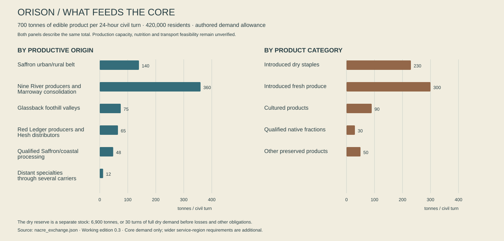

# Volume 06 — What arrives, what is owed

Working institutional and economic canon, edition 0.3, 13 October 2026. This volume describes Nacre in 742 AL. It develops the [social foundation](Drafts/SOCIETIES_FOUNDATION.md), [history](04_HISTORY_OF_NACRE.md), [regional atlas](07_REGIONAL_ATLAS.md) and [Orison proposal](Cities/ORISON.md). All quantities, organizations, prices and transactions below are authored design assumptions. They are not measurements of a simulated economy, financial advice, final gameplay balance or promises of implemented systems.

The companion [exchange register](Exchange/nacre_exchange.json) identifies productive regions, city functions, dependencies and an illustrative Orison food ledger. The [checked register](Exchange/EXCHANGE_CHECKS.md) distinguishes arithmetic and reference checks from capacities that still need qualification. These companions deliberately describe selected relationships rather than pretending twelve cities contain every settlement, factory or person on the planet.

## 1. The thing that arrived alive

The smallest crate on the quay has been given the quietest room. It contains no jewels, no weapon and nothing that would look impressive on a captain's mantel. Inside are three maintained cultures and their records. The records have already crossed the sea by relay. The cultures have taken eleven civil turns, including a stop that lasted longer than the scheduled voyage. Their temperature history has acquired a gap.

The receiving grower wants to open them. The inspector wants a sample. The carrier wants somebody to sign before the next cooling charge falls due. A student from the cultivation school sits on the crate's empty transport cradle because she has been assigned to witness the handover, and nobody has explained whether witnessing means looking busy or refusing to look away.

An older technician brings tea. She puts her cup on the floor instead of the test bench and asks which questions can be answered without opening all three vessels. The problem becomes smaller and more difficult: not whether the shipment is good or bad, but which vessel can be risked, what the records actually demonstrate and how long the local reserve can support a trial. The student finally has something worth writing down.

This is the material world of Borrowed Sun. Goods have histories, knowledge can arrive before matter, and trust never quite replaces either. Most transactions end quietly. The occasional failure matters because people have invested in the ordinary success of the others.

## 2. Research boundaries and the fictional decision

Ports can concentrate several kinds of power: land ownership, cargo handling, berth allocation, finance and regulatory authority. A recent World Bank discussion of port reform specifically identifies preferential berthing and service quality as potential forms of discrimination by integrated operators. That supports a design inference here: a port can obstruct an independent carrier without posting an obviously punitive price. It does not establish that any particular fictional port has done so. Nacre's institutions below are original choices, not copied jurisdictions. [World Bank: public and private roles in port reform](https://blogs.worldbank.org/en/transport/public-and-private-sector-in-port-reform-and-investments)

Energy resilience is tied to an identified load and a duration. A National Renewable Energy Laboratory case study evaluated how long a particular hybrid system could sustain critical telecommunications loads during an outage. Its numerical results cannot be transferred to Nacre. The useful principle is narrower: a storage nameplate is insufficient without dispatch, generation, fuel, losses and the services that must continue. Orison's night allowance therefore remains a planning case, not a certified guarantee. [Anderson and colleagues: Increasing Resiliency Through Renewable Energy Microgrids](https://research-hub.nlr.gov/en/publications/increasing-resiliency-through-renewable-energy-microgrids/)

Living collections require more than a locked store. FAO's genebank standards address viability monitoring, regeneration, documentation and safety duplication; different forms of plant material need different maintenance. The inference for Velis is that seed vaults, tissue stocks, growing rooms and skilled recovery work have distinct dependencies. A transmitted genome or a frozen vial does not automatically provide a productive crop. Native Nacre organisms add fictional compatibility limits beyond the Earth reference. [FAO: Genebank Standards for Plant Genetic Resources](https://www.fao.org/4/i3704e/i3704e.pdf)

These references constrain a few relationships. They do not supply Nacre's politics, technologies, wages, species or history. The deeper obligation is internal: when this volume gives somebody control of a resource, the resource must have a source, a use, an alternative and a cost of changing the arrangement.

## 3. A civilization without a single purse

Nacre has no established planetary government, central bank, uniform property code or continuous planetary electricity grid. This does not mean its residents live in permanent commercial confusion. They have mature regional systems, published interfaces, professional translation, courts and habits of asking which agreement applies. A traveler may cross several jurisdictions while seeing the same compatible payment terminal. Compatibility is a convenience, not evidence that all the terminals serve one sovereign.

Municipal balances, exchange-house accounts and cooperative accounts are commonly quoted in **marks** in the translated player presentation. The word is a denomination family, not a claim of universal backing. A full quote names the issuer or clearing area: an Orison mark is written **M-OR** in planning records; a Talweir quote uses **M-TL**. Local signs may abbreviate the familiar issuer. Cross-region invoices may not. There is no fixed canon conversion between these units and Earth currencies, a kilowatt-hour, a work hour or a quantity of daylight.

The shared name survives because readers and accountants found comparable forms useful. Institutions publish conversions for particular times, amounts and counterparties. An exchange house accepting a remote balance takes a risk or receives a guarantee; it is not discovering a natural constant. Small travelers usually see a clear converted total and a fee. Large cargo contracts also specify settlement date, dispute authority and what happens if a counterparty becomes unavailable.

Most people receive more than one kind of support. Wages remain important. So do returns from cooperatively owned equipment, household property, civic entitlements, pensions, care arrangements and irregular work. Advanced automation can make a cargo yard productive without giving every nearby household an ownership share. The central political question is often distribution of a real surplus, not a civilization inexplicably too primitive to produce enough of everything.

### Seven things that must not become one currency

| Instrument | What it represents | What it does not promise |
|---|---|---|
| Local clearing balance | A claim honored through a named issuer and participating payment network | Acceptance by every port or freedom from fees and restrictions |
| Bonded goods receipt | A recorded claim against identified stored goods, with custody and condition terms | That the goods remain sound, can cross a border, or can be collected immediately |
| Service allocation | A scheduled right to a defined service, such as a cultivation-light interval or booked lift capacity | An interchangeable amount of electricity, food or money |
| Cooperative share | Membership/property rights defined by a specific charter | A universal vote, guaranteed income or a right to sell the share freely |
| Passage contract | Specified carriage, baggage, route and contingency obligations | Unlimited onward travel or ownership of the carrier's reserve fuel |
| Civic entitlement | Access established by residency, contribution or another local legal basis | A token that can always be sold without losing the service |
| Personal promise | A social obligation whose force depends on people and institutions | Automatic machine enforcement or a transferable financial asset |

The Sunseed deals with authorization and routing. Its relevance to some service allocations does not turn it into a mint. A person can possess valid access to a collector while lacking the money to repair its mounting, or possess money while being excluded from a privately controlled interface. The fiction should let those distinctions generate choices without forcing every conversation into an explanation of accounting.

### Payment when a connection fails

Connected cities ordinarily settle small payments quickly. A temporary relay outage does not automatically erase people's money. Devices and institutions can authorize bounded offline spending, issue signed receipts or extend known customers short credit. Each method has a defined issuer, limit and later reconciliation. Some vendors prefer to suspend unfamiliar remote balances while accepting their neighbors'. That is inconvenient and sometimes discriminatory, but different from a universal shutdown.

Physical payment objects also exist. Most are durable local tokens, signed bearer vouchers or pre-funded transport instruments. Their visible marks identify denomination, issuer and expiry where applicable. They are not identical gold coins scattered through every ruin. An old token may be collectible, still redeemable, valuable as evidence or worthless. A failed issuer's beautiful coin can become jewelry without becoming a secret reserve currency.

Counterfeiting is not defeated simply because computers exist. A genuine receipt can describe substituted cargo; a valid identity can be used without consent; a dishonest warehouse can attest that two people own the same remaining stock. Conversely, the player should not break a mature clearing network by typing a plausible-looking number. Fraud stories need access, corroborating records, a specific weakness and victims whose losses are understandable.

### An ordinary household, with room to live

The following is one illustrative three-person Orison household over a **25-civil-turn span**. It is not a planetary median or a minimum subsistence standard. Two adults share care for a dependent relative. One earns 24 M-OR for each of sixteen eight-hour paid watches; the other earns 22 M-OR for fourteen. Schedules include rest and ordinary variation. The term watch identifies the paid block here; it does not require every resident to work eight-hour shifts.

Income is 384 + 308 + 28 M-OR of pooled civic/care support, totaling **720 M-OR**. Their illustrative spending is:

| Use over 25 civil turns | M-OR | What the figure contains |
|---|---:|---|
| Housing and shared-building maintenance | 210 | A modest maintained household dwelling; not ownership of the land |
| Food | 180 | Groceries, shared meals and occasional prepared food |
| Heat, electricity and working light | 45 | Ordinary household services; specialized growing light is separate |
| Potable water and waste service | 18 | Combined local charges and pooled maintenance contribution |
| Local transport | 38 | Regular transfers and occasional cargo assistance |
| Health coverage and routine consumables | 30 | Their pooled arrangement; not an upper limit on medical need |
| Education and care support | 22 | Materials and paid help alongside unpaid care |
| Existing debt payment | 36 | A defined obligation, not a universal tax on employment |
| Replacement and repair reserve | 50 | Appliances, clothing, tools and unexpected maintenance |
| Gifts, leisure and eating with others | 58 | Social life is part of a functioning household |
| Communication and account fees | 10 | A mix of public access and personal service |
| Uncommitted contingency | 23 | Easily exhausted by even a modest disruption |
| **Total** | **720** | Balanced example, not proof of universal affordability |

A missed 24-mark watch is therefore meaningful without making the family instantly homeless. Several missed watches combined with a failed appliance can remove their reserve. The relatives may offer help, the building cooperative may defer a charge, or a lender may sell them an expensive convenience. The same arithmetic can produce solidarity, embarrassment, quiet resentment or relief. None is inevitable.

This household also demonstrates why wages cannot be the sole measure of a life. Someone performs care that is only partly compensated. A publicly maintained library gives value without appearing as a purchase. A neighbor's skilled repair avoids an expense. These activities belong in the world as rooms, schedules, relationships and useful objects, not invisible abstractions appended to a combat reward table.

### Prices that communicate choices

Indicative Orison prices for the current authoring snapshot include a simple bakery portion at 0.3–0.7 M-OR, a modest prepared meal at 1.5–3, a local public-transport transfer at 0.15–0.4, a shared instrument-room booking at 2–5 and a small ordinary replacement fitting at 1–4 before labor. A technically demanding repair or a scarce medical fitting belongs in a different class and needs its own bill. These are design-scale examples, not finalized shop inventories.

Public drinking points can provide ordinary refills without a per-cup price. Their infrastructure is funded somewhere else. Emergency rescue does not wait while a person proves they can pay; later cost allocation differs by compact and can still cause disputes. A private operator may violate that norm. The violation should be recognizable as conduct, not silently presented as every society's definition of rescue.

Prices must retain a reason. A closed bridge can increase delivery costs in one district while shops on the other side remain supplied. A festival can raise lodging demand without doubling the price of every object on the planet. A player bringing a valuable cargo may improve a narrow shortage; they should not make every household wealthy by repeating an unbounded transaction against a store with infinite demand.

## 4. Who can tell whom to stop

Political maps on Nacre overlap. A city council can govern streets, a basin agreement constrain discharge, a port authority allocate approaches, a household trust own a building and a regional court hear a labor appeal. A corporation can hold an operating concession without acquiring every public power in the territory. A map of exclusive nation-colored polygons would conceal much of this structure.

The working institutions below are contemporary arrangements whose detailed founding dossiers remain to be dated. They do not retroactively replace the established historical settlements. Membership is practical and contested; geography, ancestry, language and legal standing do not coincide perfectly.

### Saffron charter districts

Orison and neighboring settlements retain municipal authority over residence, streets, schooling and ordinary public services. The **Saffron charter districts** is the translated collective description for their interlocking agreements, not the name of a single corporation or unified state. Orison's council contains elected district representation, professional service offices and chartered public hearings. Its ability to act depends on revenue, staff, physical access and contracts it cannot end without replacing the service.

The Concession's strongest position is the bundle of collector, dispatch, certification and financing rights inherited through the Terrace Settlement of 506 AL. Council members may oppose its terms while depending on its maintainers. Residents can distrust a director and still value the technician who returns during the night. Public ownership is one possible reform; independent certified operation, cooperative receiver ownership and revised dispatch access are others. Each needs a transition plan and accountable operators.

The city must also be allowed to govern things unrelated to the central mission. It chooses school sites, funds public toilets, argues over noise, adapts housing, protects market access and sometimes commissions a beautiful thing that is not efficient. A credible council has ordinary successes. Otherwise overthrowing it would be too simple, and living in its city would be implausibly miserable.

### The Lower Basin League

The **Lower Basin League** links participating Nine River authorities, growers, storage cooperatives and transport towns. It coordinates seasonal delivery commitments and disputes across water boundaries. It does not own every farm or claim that a river is a warehouse. Local councils retain land and household powers; downstream agreements constrain some uses regardless of who owns the bank.

Marroway is an important meeting and consolidation city, not the sole producer of everything passing its quays. Growers fear procurement rules written by distant kitchens. Urban buyers fear contracts that promise the same harvest several times. Small settlements fear that both sides will fund a main route and abandon their feeder bridge. League politics revolve around these differences as much as around a contest between virtuous farmers and predatory merchants.

The League can publish good reserve information and still allocate the burden of maintaining it unfairly. A storekeeper may be required to keep low-margin staples instead of profitable spices. A village may maintain a surplus because the agreement also guarantees specialist medical visits. An outsider who removes one obligation without seeing the reciprocal service may damage an arrangement residents had carefully improved.

### Lake jurisdictions and upland passage

Talweir's Lake Articles of 641 AL establish a shared arena for water, shore access and navigation claims. They are not a constitution for all Morrow. Namar, the interlake connection and Iren have linked but distinct uses and ecologies. A downstream landing is not interchangeable with an upstream reservoir. Talweir's city dossier determines local councils and districts within that framework.

Across the Aven uplands, **passage federacies** is a translated description for councils and route communities that recognize common access obligations while retaining different land codes. The established Passage cases are precedents, not a license to camp in anyone's bedroom. A protected refuge corridor can coexist with restrictions during recovery work or hazardous conditions. The burden is to provide a credible alternative when an essential route closes.

These institutions generate opportunities for the player to know a place. An apparently convenient shortcut may cross a protected intake. A longer public path may reach a good kitchen and a repair service. A resident can explain both without becoming an exposition dispenser if they have a reason to be making the journey themselves.

### Sere's return obligations

The **Return Compact** is the current collective name for participating Sere rescue, repair and refuge agreements. It borrows from the older Open Wake articles without making every member an Open Wake partisan. Tern's large repair operators, Velis cultivation carriers and small refuge settlements have different priorities. What joins them is the proposition that a route cannot advertise safe passage while leaving the cost of every rescue to its poorest stop.

Funding comes through specified port dues, carrier contributions and public appropriations. Good members keep equipment ready even through uneventful periods; readiness looks idle to someone judging only the most recent rescue count. Disputes concern coverage, inspection, volunteer fatigue and whether a wealthy carrier has arranged to use public rescue while contributing through a cheaper jurisdiction.

The Compact should also have pleasures. Crews meet again, apprentices swap techniques, visiting children recognize the same refuge symbols, and a retired rescue boat can become a local sailing school. Institutional continuity is something people enjoy, not only something that prevents disaster.

### The Pale station accords and Aster harbor assemblies

The **Pale station accords** coordinate specialist access, seasonal freight and shared observation facilities among participating northern settlements. Brin matters because it can repair and teach, not simply because it owns a large telescope. Permanent residents object when visiting institutions receive an outsized vote through equipment ownership. Station crews object when a distant town treats an expensive remote facility as if it were an ordinary municipal room. Both need each other to make access viable.

The **Aster harbor assemblies** govern a different geography: several inhabited islands whose workdays cross water. Sola's shared services coexist with island councils and locally held landing places. A ferry timetable can be a distribution of political opportunity. The first departure determines who can attend school, sell fresh food or speak at an assembly; the last determines who can return without buying a bed. A fast private launch does not solve that public problem.

These arrangements should not be painted as universal democracy. Exclusions, ownership privileges, inherited influence, coercive employment and closed proceedings persist unevenly. Their precise forms need local evidence. The player should discover who has standing, who lacks it and which institution could plausibly hear a challenge. A planet without one sovereign can have both robust freedoms and difficult places to appeal.

## 5. What this world can make

Nacre's 34.8 million estimated residents inherit a sophisticated industrial civilization. Automation, computation and trained machines are ordinary parts of it. A cargo yard does not require a crowd of people manually carrying every box so the environment can look busy. Work includes maintaining automation, inspecting uncertain cases, making custom things, caring for people, teaching, field observation and choosing what the productive system should do. Some people work with their hands because the task requires it; others because they prefer a particular craft or social setting.

Industrial capability is uneven. Common structural material, simple machinery and ordinary household goods have many local sources. Precision optics, specialist sensors, biological cultures, high-performance components and some computation hardware depend on fewer qualified facilities. A small shop can reproduce a bracket from an authorized pattern; it cannot turn an uncharacterized powder into a certified implant by owning a general fabrication tool.

The working capability ladder is:

| Capability | Typical distribution | Dependency that remains visible |
|---|---|---|
| Repair, joining, carpentry, masonry and ordinary fabrication | Most substantial settlements; mobile services reach smaller ones | Skilled inspection, compatible feedstock, tools and access to records |
| Bulk structural materials and commodity chemicals | Several regional industrial belts | Energy, process water, transport, emissions and worker/community oversight |
| Precision ceramics, optical assemblies and durable electronics modules | Distributed specialist centers, including Aven and major coastal industrial cities | Qualified batches, clean environments, calibration and replacement components |
| Cultivation stock and terrestrial partner cultures | Multiple collections and propagation networks, with Velis especially prestigious | Viability, diversity, documentation, controlled transfer and grow-out capacity |
| Advanced processors and highly specialized clinical/spaceflight components | A mixture of limited local production, rebuildable legacy equipment and irregular offworld imports | Long lead times, repair rights, testing, inventory and substitution work |
| Complete independent reproduction of every advanced imported technology | Not established by this bible | Further industrial and offworld history; no universal matter printer is assumed |

This ladder is not a research tree through which the player drags supposedly backward communities. A small island can possess excellent communication equipment and still import a particular bearing. A workshop full of repaired tools can be technically advanced. An expensive new machine can be less useful than an old one whose maintainers still have access to its drawings.

### Material memory

The Copper Shortage of 681–686 AL changed design because several failures and speculative purchases amplified each other. The new volume does not turn it into proof that all copper on the planet ran out. Orison's mixed conduits, recovered cable and alternative hardware record procurement decisions, not a geological impossibility. Some substitute assemblies work well and remain desirable; others are kept only because changing them would be disruptive.

Material histories belong in the asset brief. An old fitting can carry a manufacturer mark, a later test mark and a household inventory tag with different purposes. A patched wall may use locally available stone because a regional supplier closed, not because every poor person lives in randomly mismatched rubble. Contemporary wealth can appear as quiet maintenance and stable service access rather than an excess of gold surfaces.

Bulk aggregates usually come from relatively nearby sources. High-value parts can justify a longer journey. Imported stone for a civic frontage can be deliberately extravagant, and residents may argue about it. Its shipment then becomes part of the building's history. The environment should be able to show the same aggregate used in an ordinary drain and a carefully finished public stair without pretending the two places have identical budgets.

### Waste has several destinations

Repair and material recovery are extensive but not perfect. Sorted metal returns to industrial processors. Clean mineral material may be reused under a different qualification. Complex composites, contaminated residues and mixed biological waste require other handling. A recycling symbol never proves that an object can safely return to its previous use.

Introduced food systems and native biological processes are especially important to separate. Waste that terrestrial cultures can digest may be unusable or damaging in a native wetland. Native detritus does not automatically become safe garden compost. Processing, testing and containment are recurring work, and recovering a useful carbon fraction does not recover every nutrient, organism or structural property of the original material.

Residents can care deeply about recovery without romanticizing dangerous work. A respected dismantling yard has good lifting access, shade, clean changing rooms, records and places to eat. An exploitative yard may have the same colorful stacks and a worse maintenance budget. Art direction must show the difference through spatial conditions and objects rather than using visual clutter as a universal sign of authenticity.

## 6. Food that does not arrive by miracle

Human nutrition still rests on introduced crops and maintained cultures. Qualified native fractions can enrich flavors, materials and selected carbon inputs; they do not make every biome an interchangeable pantry. Each city draws on a wider producing region whose landscape must eventually include field systems, sheltered cultivation, processing, storage, roads, water and labor arrangements. A decorative roof garden cannot silently feed a metropolis.

Orison's planning dossier allows 600–800 tonnes of edible product per civil turn. This volume uses **700 tonnes** as an illustrative central case for the **420,000-person core**, or about 1.67 kg of edible product per resident per 24 hours. It is a freight mass allowance, not a completed calorie, nutrient, crop-yield or diet model. The wider 1.2-million-person service region has additional requirements and is not included again in the core total.

The central basket separates five categories: 230 tonnes of introduced dry grain/pulses, 300 tonnes of introduced fresh produce, 90 tonnes of cultured or fermented protein products, 30 tonnes of individually qualified native fractions and condiments, and 50 tonnes of other preserved foods, fruit products and oils. Native fractions are about 4.3 percent of the delivered mass in this example. No fraction is qualified solely by being listed in the basket; actual recipes and species-specific processing remain an authoring obligation.

### A core-city delivery ledger

The two panels show the same 700 tonnes, not two additive flows. Open the [full-size plate](Exchange/orison_food_allowance.svg) to inspect the quantities.

| Productive origin and consolidation | Dry staples t | Fresh produce t | Cultured products t | Native fractions t | Other preserved t | Total t/turn |
|---|---:|---:|---:|---:|---:|---:|
| Saffron urban/rural belt and local collection stores | 25 | 90 | 25 | 0 | 0 | 140 |
| Nine River producers, consolidated through Marroway and neighboring ports | 170 | 145 | 35 | 0 | 10 | 360 |
| Inhabited Glassback foothill valleys | 20 | 40 | 15 | 0 | 0 | 75 |
| Red Ledger producing settlements and Hesh distributors | 15 | 25 | 15 | 0 | 10 | 65 |
| Qualified Saffron/coastal processing and preservation businesses | 0 | 0 | 0 | 25 | 23 | 48 |
| Distant specialties through several carriers | 0 | 0 | 0 | 5 | 7 | 12 |
| **Core total** | **230** | **300** | **90** | **30** | **50** | **700** |

The ledger does not establish that these sources already possess the required acreage, yields or processing plants. It is the demand contract those regional dossiers must satisfy, revise or replace. Productive belts are not single points on the atlas. Marroway is a consolidation center for a large catchment; the city itself does not grow 360 tonnes on its visible balconies each day.

Within the Saffron row's 90 tonnes of fresh produce, the central case assigns **24 tonnes to urban growing and 66 tonnes to the rural belt**. The urban contribution is eight percent of the total 300-tonne fresh category, within Orison's existing 5–12 percent target. It is already included in the 700-tonne total. Roofs, courtyards and managed growing facilities still need enough actual area and yield to support it; this allocation is not proof that the illustrated gardens do so.

The 12-tonne specialty allowance can carry distinctive ingredients and preserved luxuries across long routes. It is intentionally small compared with staple flows. Velis can supply valuable viable stocks that later produce food in Orison without shipping the resulting harvest around the planet. Merrow can export a qualified preparation method and starter culture; local manufacture may replace most recurring bulk carriage once properly established.

### Reserves are specific, and need rotation

Orison's illustrative dry staple reserve is 6,900 tonnes, equal to thirty civil turns at 230 tonnes per turn before losses or changes in use. It is not thirty days of every kind of food. Fresh produce, clinical diets, cooking inputs, storage power and kitchen staffing have other limits. A warehouse full of one grain cannot replace all missing meals without adaptation, and a frightened procurement office can worsen scarcity by trying to reserve everything simultaneously.

If the Nine River chain is temporarily interrupted, the central basket loses 360 tonnes of incoming product per turn, including 170 tonnes of dry staples. With other dry flows continuing unchanged, consuming the entire stated dry reserve against that one 170-tonne deficit gives a simple upper-bound arithmetic interval of about **40.6 civil turns**. That is not a recommended operating policy or a guarantee of city food security. It assumes access to all stock, ignores losses and other obligations, and says nothing about the missing fresh or cultured products. The reserve is meaningful precisely because its limits can be understood.

An ordinary short interruption should lead first to altered deliveries, menus, prices, reserves and work. It does not justify instant starvation crowds. Persistent damage, unequal access, hoarding or failed recovery can make the situation worse. A wealthy restaurant may continue displaying imported produce while a public kitchen changes its menu; this does not prove the kitchen's managers are incompetent. The important records are where the food is, who can buy it and which alternative deliveries are possible.

Reserves are also a source of steady employment and pleasure. Stock rotation supplies inexpensive public meals, culinary schools practice with surplus batches, and festival planners negotiate early access to ingredients that would otherwise be held too long. A capable provisioning system can prevent a story from becoming a disaster. The game should make that success visible.

## 7. Twelve cities as parts of a larger economy

These roles are distinctive concentrations, not exclusive planetary monopolies. Every city has ordinary residents, services and production beyond its export image. Each also relies on smaller settlements whose existence must become visible in later regional dossiers.

**Orison** concentrates collector service, coastal repair, optical integration, freight handling and a mixed urban economy. It imports food and many industrial inputs from its region. It exports assemblies, services, trained people, performance and knowledge as well as physical cargo. Its light politics are important here without becoming the explanation for every distant city.

**Marroway** consolidates Nine River food and basin freight, maintains storage and inspection services, and hosts negotiations between growers and urban buyers. Its vulnerability is not one magical breadbasket switch: different rivers, harvests, stores and routes can fail independently. Local variety is essential to both credibility and resilience.

**Hesh** combines inland distribution, selected mineral processing, durable manufacture and the expertise required to maintain a closed-basin settlement. Its water constraints make indiscriminate export of water-intensive products a political question. High-value processes can be sensible while expanding low-value bulk production is not. The exact resource and water budgets remain to be authored.

**Serein** is a western maritime manufacturing and building-cooperative center. Moisture management, durable enclosures, repairable domestic goods and public interior design are prestigious fields. The city trades across Kesh and the sea without existing merely as the foggy supplier of Orison's windows.

**Talweir** concentrates inland-water transport, small-vessel design, regional food processing, civic measurement and the services of a large lake city. Its two connected lakes do not make it an ocean port. Long-distance freight changes mode or follows separately qualified river passages. The city can export refined boat design while importing ordinary material stock.

**Aven** is a highland transfer and education center with precision manufacture, instruments and tested ceramics. Its routes are long and its growing land unevenly distributed. Aven's technical prestige depends on apprentices, clean production rooms, suppliers and patient testing, not a citywide population of solitary geniuses.

**Dhal** supports river transport, field science, humidity-resistant construction and carefully qualified biological/material processing. Its surroundings are not free feedstock. Researchers, residents, processors and habitat stewards disagree about collection, access and whose knowledge supports a profitable claim.

**Merrow** combines estuarine services, food-conversion expertise, controlled processing and a strong public dining culture. Its exported knowledge includes mistakes remembered through the Blue Sill hearings. Buyers value some Merrow products partly because their records show how a failure would be found and corrected.

**Tern** provides repair, heavy marine service, rescue training, durable equipment and a large working harbor. It imports much of what its yards transform. A ship repaired here is an export of labor, parts, infrastructure and trust, even when no newly built vessel leaves the dock.

**Velis** concentrates cultivation teaching, viable stocks, preservation methods, domestic craft and specialist small-scale manufacture. Its prestige does not imply that it exports cereal harvests to every continent. The distinction between seed, living tissue, partner culture, stored data and immediately plantable stock is central to its material identity.

**Brin** provides northern logistics, observation, cold-environment maintenance and specialist training. It is not an infinite source of rare minerals placed where a game needs an endgame material. Resource projects need their own geology, access, waste and local consent. Brin's residents have reasons to care about the city after a particular project closes.

**Sola** handles interregional transfer, hospitality, translation, marine service and island manufacture. Its ferries and harbors serve local lives as well as long routes. Transit passengers can support excellent public rooms while placing pressure on water, rent and berth access. A resident should have places where they do not need to perform hospitality for visitors.

The exchange register connects these roles to selected dependencies. It does not claim a fully balanced planetary input-output table. Later city and rural authoring must account for production capacity, seasons, route alignment and alternatives before any simulated economy is implemented.

## 8. Electricity, heat, light and propulsion

Nacre's energy portfolio is intentionally mixed. Regional grids combine qualified dispatchable generation, storage and variable sources suited to local conditions. Licensed fission generation is established as one mature regional option; the bible does not specify reactor construction. Geothermal use depends on actual surveyed heat and fluid systems. Hydroelectric production depends on catchments, ecological obligations and storage. Wind and direct solar collection depend on weather and the long natural light cycle. No one category supplies a limitless background budget.

The technology is advanced enough that ordinary life need not resemble a perpetual emergency. Grids are planned for the world's natural cycle, reserve systems are maintained and many loads can shift. That competence has a cost and a history. Specialized failures matter because a working system usually conceals them from the user, not because every sunset is an unanticipated catastrophe.

Orison's authored case is a 600 MW average electrical load, a 1,050 MW peak target and a 9 GWh usable storage target, supported by regional imports and local dispatchable capacity. The city dossier distinguishes annual average variable contribution from firm supply. A continuous 120 MW deficit over a nominal 71.7-hour longest natural night requires about 8.604 GWh before additional losses, rounded upward to 8.61 GWh in the planning allowance. That illustrative comparison does not prove coverage: other loads, reserve margins, dispatch power and available generation matter.

Thermal storage can serve heat loads without becoming electrical storage. A warm cultivation wall and a charged vehicle battery are different resources. Some communities use industrial heat productively; they also need a plan for when the industrial process stops. An employer offering inexpensive district heat can provide a real benefit while gaining influence over people who never signed an employment contract.

Optical collectors redirect light within geometric limits. Their service is valuable to particular rooms, crops and schedules. Public lighting, domestic lamps, growing light and industrial electricity do not all fail when one optical lease ends. Mirror Ring remains a moving orbital annex. It is neither an ordinary stationary district nor a source of free deep-midnight sunlight.

Propulsion has a separate unresolved engineering budget. Mature local spacecraft and working boats exist in the fiction, but their final energy stores, propellants, performance envelopes and traffic rules must be specified together. This volume assumes servicing and replenishment infrastructure, not a chosen infinite-range drive. A port may offer electrical charging, mechanical work and stores while lacking a particular propulsion consumable. Route planning must know the difference.

Domestic grids need not be electrically unified across an ocean to exchange components, knowledge or emergency assistance. An intercontinental aid shipment may carry a switch assembly or trained repair crew rather than enough stored electricity to run a city. That gives a small cargo a believable importance without turning every important object into an implausibly dense battery.

## 9. Distance, handling and the cost of arriving

The atlas keeps Nacre's 5,900 km radius. Orison–Marroway is about 1,342 km by the shortest spherical line; Orison–Talweir about 8,978 km. At a hypothetical constant 650 km/h, those lower bounds take about 2.07 and 13.81 hours before routing, ascent, approach or waiting. These figures describe scale, not verified routes or approved vehicle performance. A line connecting two cities can cross mountains, land or unsuitable water.

Freight therefore uses corridors and changes mode. Bulk goods often benefit from large loads and regular schedules; small valuable goods can justify faster carriage. A vessel's advertised speed says little about a container awaiting inspection, a missed transfer or a part sitting in a warehouse because its receipt names the wrong custodian. Efficient logistics should exist alongside failures. The planet should not be populated entirely by incompetent carriers to manufacture quests.

Orison's 14,000–22,000-tonne gross port-freight allowance per civil turn includes regional transit, imports, exports, industrial materials and repeated handling where the eventual accounting definition includes it. It must not be divided by core population and called personal consumption. The 700-tonne edible delivery case is a separate core demand figure. Future port capacity work must specify whether a tonne is counted at entry, exit or each handled movement before comparing crane, berth and store throughput.

A fully specified corridor will need origin and destination facilities; intermediate modes and transfers; a navigable alignment; cargo restrictions; normal and adverse timing; replenishment and rescue coverage; capacity; seasonality; alternatives; and responsibility when a leg fails. The current exchange edges are dependency intentions. They deliberately omit invented exact travel times where those inputs are missing.

Travel should be enjoyable because the stops have purposes. A freight town can be a good place to buy a repaired instrument, see a local performance or learn why a familiar machine looks different here. The same carrier may transport a consignment, a visiting teacher and an amateur ensemble. Human-scale stories can share infrastructure without every route becoming a smuggling mission.

### Information often gets there first

Connected major cities can exchange ordinary messages quickly. Planetary distance alone is not a reason for radio to take days: even a 37,071 km path corresponds to roughly 0.124 seconds at light speed before network routing and processing. The real network path, relay availability, service quality, censorship, authentication and human response add other delays. This world has no established instantaneous interstellar communication, but that is a different scale of problem.

Some field sites and vehicles have intermittent service. They can buffer messages, use scheduled links or send a courier when physical material is required. A courier remains useful for specimens, hardware, protected physical records, authentication arrangements or places where the link is unavailable. The narrative must say why a particular recording cannot simply be sent through an ordinary working channel; distance by itself is insufficient.

News is not identical to belief or authority. A price report can reach an exchange house before a local shop decides it is reliable. A port closure can be published while a private carrier continues advertising outdated departures. A resident can know a political scandal and still lack the evidence required in court. These differences support a reactive world without making every NPC omniscient or implausibly uninformed.

## 10. The people inside an institution

The four familiar organizations need operational limits and internal disagreements. Their identities cannot be represented adequately by four shop discounts or a single shared reputation number. A player may have a good working relationship with a maintenance crew and a hostile relationship with its employer's claims office. These are different relationships, carried by named people and records.

### Concession: continuity, control and the cost of exit

The Concession's **Continuity Office** schedules maintenance and emergency dispatch across the assets it operates. Many staff measure success in outages prevented, not revenue. Its **Claims Directorate** interprets leases, arrears, certification rights and disputed access. A small **Works Development Board** selects future projects and investment priorities. These are functional divisions for the Orison region, not three separate factions with matching uniforms.

The divisions can cooperate productively or create harm together. Continuity may ask for reserve capacity, Claims restrict who can draw it, and Works postpone replacing an unreliable receiver because the lease remains profitable. A technician can document the problem without possessing authority to change the policy. A director can favor reform while fearing that an abrupt transition will strand pension commitments or trigger a loss of credit.

A credible challenge therefore needs several kinds of evidence: what the hardware can do, what the contracts permit, who paid for it, which service is being withheld and what a replacement arrangement would require. The Sunseed can expose or change a bounded access relationship. It cannot manufacture the crews, spare parts, public agreement and financing that make a new arrangement durable.

The Concession's recognizable visual signature is disciplined maintenance contrasted with selective access: clean test benches, standardized receiver bays, carefully marked restricted thresholds and older public fabric absorbed into newer service enclosures. Luxury is concentrated in offices and ceremonial projects, not sprayed over every employee's tools. An exploitative decision can be made in a practical room by someone who goes home to an ordinary apartment.

### Common Table: care, scale and the right not to perform gratitude

Common Table operations depend on kitchens, stores, clinics, household support, purchases and volunteer or paid labor. Local assemblies differ in how they fund them. Some own productive property; others rely on municipal contracts, donations, member contributions or service exchange. Their ability to care is real, but their budgets and personnel are finite.

One internal argument concerns entitlement. Should food be available without a contribution test? Most kitchens favor broad access in immediate need, but long-term funding arrangements differ. Another concerns privacy: identifying someone as a beneficiary can expose a debt, family conflict or medical condition. A third concerns labor: praising volunteers can become a way to avoid paying skilled workers reliably.

The player can support a particular service without accepting every assembly's politics. A kitchen may need a replacement pump, a fair procurement agreement or a place for staff to rest more than it needs a heroic donation of a rare ingredient. Success should leave people less dependent on the player's repeated arrival. A well-run public meal after a crisis is a meaningful aftermath, including the return of arguments about taste and music.

### Open Wake: passage requires somewhere to arrive

The Open Wake joins people with overlapping commitments to movement, rescue, repair access and freedom from coercive service claims. It contains independent owners, cooperatives, charter crews and people who do not own a vessel at all. A porter excluded from the only affordable landing has a reason to care about passage rights as strong as a captain's.

The **Open Berth circles** negotiate reciprocal access and shared maintenance. **Return stewards** track rescue contributions and unresolved crew obligations. Neither title establishes a universal command structure. A local circle can expel a negligent operator from its shared facilities while another port continues to welcome them. Disputes travel through testimony and records; they are not solved by a global faction switch.

A corrupt captain may invoke freedom to avoid paying a crew. An overbearing port official may invoke safety to exclude a competitor. The world must distinguish these possibilities with behavior, equipment condition, obligations and evidence. The romance of independent travel survives scrutiny better than it survives a rule that every outsider is automatically virtuous.

### Night Choir: a transmission is an intervention

The Night Choir preserves and circulates material that powerful institutions suppress. It uses ordinary communication where possible, trusted relays where needed and physical transfer when the material or protection requirement demands it. Secrecy is a situated practice, not a spell that makes every public network useless.

Its **Listeners** gather and contextualize material. **Custodians** preserve originals and consent conditions. **Voices** choose a form of publication. These are often roles held by the same person at different times, and the labels are translated descriptions rather than ranks. A person who can authenticate a recording is not automatically the right person to decide whose private life appears in it.

Seli's medicine and broadcasting make this conflict concrete. Clinical access can reveal a serious institutional harm while also revealing patients who did not volunteer for a campaign. A responsible publication may withhold details, secure consent, allow correction or use independently obtained evidence. A rushed disclosure can help one group and injure another. Consequences should reach the people involved, not be reduced to whether a faction approves of Rook.

## 11. Predatory economies and useful illegality

The world contains organized harm. It does not need an omnipotent criminal guild secretly responsible for every shortage. Several recurring patterns produce distinct places, evidence and opponents.

**The dry docket trade** deals in disputed custody and abandoned-property claims. Some participants help residents recover goods trapped by an insolvent operator. Others manufacture apparent abandonment so valuable equipment can be seized cheaply. Their power lies in access to yards, records and buyers. A dry docket story needs an identifiable claimant and an actual object, not a convenient declaration that everything inside a warehouse is ownerless loot.

**The white seal market** trades the appearance of qualification. A copied test mark can conceal unsafe stock, but an unauthorized component can also be competently made. The distinction requires testing and traceability. This continues the established excellent-counterfeit seed without converting safety into a synonym for corporate permission. The player may help open a legitimate independent route while still opposing deception about a batch's history.

**Quiet pledges** are coercive arrangements that disguise inherited labor claims as household guarantees, training obligations or equipment access. Their legality differs after the Unbinding decisions. The harm can persist even where a court would reject the contract, because people lack safe housing, independent treatment or transport while they challenge it. Rook's forged service record belongs within this material problem. Altering a record may open an exit while exposing somebody else to suspicion; that consequence needs a named person, not an abstract moral meter.

**The small passage trade** moves goods or people around restrictive institutions. Some cargo is dangerous or exploitative. Other cargo is harmless, culturally important or unjustly monopolized. A banned living stock could threaten a habitat, violate a rent-seeking license or both. Stories must establish which, rather than assuming illegality proves either heroism or villainy. A legitimate qualification process may provide a better long-term outcome than repeated clandestine deliveries, while an abusive process may need to be challenged.

Predatory operators still need workers, customers, facilities, cover and ways to dispose of gains. Their sites should look like functioning businesses with specific irregularities: a store whose inventory does not match its power draw, a yard that cannot name the last custodian, a training office with no graduates who can leave. This is environmental evidence, not a how-to manual for crime. The important experience is learning enough about a place to notice when its explanation fails.

## 12. Eight transactions worth a story

The following are social and event seeds, **not additional completed POIs**. Their local sites and schedules must be assigned through the relevant city dossiers before construction. IDs distinguish the seeds from species, places and existing mission characters.

### EX-S01 — The room with no display case

**Neris Vale**, a Serein enclosure designer, has built a beautiful domestic window assembly for a Brin cooperative. The shipment arrives with a minor surface flaw and fully sound performance. Neris offers a replacement because the work will appear in a professional exhibition. The cooperative wants to keep the installed assembly and have the replacement budget spent on another household's failing door.

No one needs to be dishonest. Neris fears the flaw will be read as carelessness; the residents want the designer to understand what made the first assembly valuable. A visit can include a warm shared room, a view of weather and a discussion about whether a public credit should name the repair crew. A return might find the flaw carefully retained in an exhibit about service life, or the exhibition moved from a showroom into the building itself.

### EX-S02 — The reserve that tastes different

**Pella Ruun**, a Marroway store manager, rotates a sound but unfashionable grain through several public kitchens. A popular broadcaster calls it evidence that poor residents are being fed inferior food. The grain is safe; its preparation requires a different soaking schedule, and hurried kitchens have produced bad meals. Pella's paperwork is accurate but her rollout was careless.

The useful intervention joins cooks, residents and delivery staff. Demonstrating a pleasant recipe can correct one claim while admitting the extra work imposed on kitchens. A replacement menu need not erase the residents' complaint. The aftermath can be a cooking exchange and revised labor allowance, not a victory speech proving that administrators always know best.

### EX-S03 — The ship that paid twice

**Toma Isel**, a Tern charter clerk, discovers that a vessel paid rescue contributions through two participating systems. Its owner wants a refund; the local refuge used the disputed share for overdue maintenance. The refund is justified under one agreement, while the refuge acted in good faith under another. Toma has enough records to show the overlap and too little authority to fix it alone.

The story can involve a shared hearing, a phased adjustment and a lasting change to invoices. A player who pays the difference may remove immediate pressure without solving the duplicate charge for the next crew. Returning should show whether the administrative improvement survived, whether the refuge remains ready and whether Toma finally takes the leave she postponed.

### EX-S04 — A garden that cannot be downloaded

**Iven Sott**, a Velis propagation teacher, is asked why a distant town should pay for living stock when it already received the genetic description. Iven could answer condescendingly and lose the relationship. Instead, she proposes a joint grow-out trial that makes the missing partners, conditions and labor visible.

The shipment is small; its consequences are slow. A courier can preserve the chain of care and still arrive at a town that has not prepared its growing room. The best outcome includes local competence, not permanent dependence on Velis. A later visit might find children eating produce from a successful introduced crop while a native planting nearby remains deliberately outside the food system.

### EX-S05 — The unbought instrument

**Sera Pell**, an Aven calibration apprentice, repairs an older instrument that a buyer had planned to replace. Her employer loses a sale and gains a loyal customer; the sales director calls the outcome disobedient, while her instructor calls it competent. The instrument carries an obsolete proprietary interface whose remaining service life is uncertain.

The player can help obtain a qualified adapter or return the instrument to its original owner. Neither option grants Sera a complete career. The lasting change may be a repair quotation category, a revised training agreement or her move to a cooperative bench. The object is valuable because somebody keeps using it, not because it hides a unique combat upgrade.

### EX-S06 — The last ferry is also a vote

**Rami Elt**, a Sola ferry scheduler, is asked to move a late departure to serve a visiting performance. Doing so would leave an outer-island assembly without a return connection for several speakers. An extra sailing is possible, but crew rest and funding must be arranged. The theater's publicity makes the performance seem like the only event happening that night.

This is an opportunity to experience two worthwhile gatherings. A route adjustment can let people attend both, or reveal that the proposed extra service depends on the same crew already covering a difficult shift. The aftermath belongs on timetable boards and in relationships, not in a universal transport discount bestowed by gratitude.

### EX-S07 — The account that kept a name

**Edrin Moss**, an Orison clearing-office worker, receives a request to close an old household account. The account's last regular payer died, but its small balance still pays for a public bench and drinking point. The relatives do not object to the service; they object to a name used on its plaque, which misrepresents a relationship the deceased had kept private.

The material problem is modest and the emotional one specific. Edrin can separate continued funding, account custody and public commemoration. A player can help locate the appropriate relative without making private documents public. A return may show a new inscription, the same well-used bench and an argument finally allowed to become ordinary grief.

### EX-S08 — The invoice for a song

**Lio Vennel**, a Talweir performance organizer, receives an invoice for a tune that several communities consider inherited repertoire. The claimant owns a recent arrangement, not the underlying tradition. A recording has blurred the two. Lio wants the musicians paid and fears that refusing the invoice will make the festival look indifferent to artists.

The sequence can involve listening, comparing arrangements and arranging a fair credit or commission. It should not assume that everything traditional belongs to nobody or that every claim of ownership is predatory. A later performance can make the difference audible. The listener who remembers the dispute hears people choosing how to share something, not a lecture about intellectual property.

## 13. Five changes that can travel

These are causal design cases for the later dynamic-world volume. They establish bounded propagation, alternatives and recovery. They are not implemented random events, universal market simulation or permission to destroy authored characters offscreen.

| Case | Local trigger | First affected relationships | What can spread | What must remain bounded | Recovery evidence |
|---|---|---|---|---|---|
| EX-E01: Nine River handling interruption | A specific intake, bridge or consolidation facility closes | Named delivery lots, store schedules and carrier assignments | Menu changes, reserve draw, selected prices and extra handling work | Other watersheds and stores do not fail merely by sharing a regional name | Facility reopens, backlog clears, reserves are replenished over time |
| EX-E02: disputed qualification batch | A named component batch loses accepted evidence | Buyers holding that batch and equipment actually using it | Inspection queues, substitute demand and claims against identifiable suppliers | Unrelated manufacturers and all devices of similar appearance remain unaffected | Corrected records, tested replacements or a justified continuing restriction |
| EX-E03: work stoppage at one service operator | Negotiations fail over defined work and pay conditions | Covered jobs, maintenance schedules and customers | Delays, mutual aid, alternate contracts and political pressure | A strike is not coded as automatic worker villainy or an instant city blackout | Agreement or changed operation, arrears addressed, accumulated work accounted for |
| EX-E04: uncertain living-stock shipment | A custody or condition gap prevents normal release | That consignment, local reserves and the receiving grow-out plan | Delayed planting, a replacement request and a qualification dispute | No invisible pathogen spreads without a defined biological mechanism | Trial results, destroyed/returned stock where justified, successful later propagation |
| EX-E05: false route notice | A stale or forged closure reaches a particular channel | People and carriers who receive and trust it | Misrouted passengers, missed work and investigation | Knowledge is recipient-specific; a rumor is not a planet-wide state flag | Corrected notice, practical assistance and restored confidence over more than one message |

Each event requires its own record of source, affected IDs, beginning, review time and current evidence. A rumor about a closure is separate from the physical closure. A service restored in one district does not automatically refill distant stores. Conversely, a published correction should reach connected subscribers promptly rather than being delayed for drama without a network reason.

Quiet periods matter. The world needs shops receiving normal deliveries, crews doing planned maintenance, stocks growing without incident and public services succeeding. A dynamic system that constantly interrupts every journey would communicate a civilization incapable of supporting its visible population. Escalation must have causes and room for recovery, and the player's route should include ordinary beauty rather than an uninterrupted chain of emergencies.

## 14. What this volume asks the asset library to show

The exchange model generates concrete production families: household storage and refill vessels; small local payment/receipt objects; compatible but institutionally distinct terminals; labeled cargo and condition records; reusable freight cradles; clean biological transport containers; temperature and custody interfaces; loading automation; human inspection benches; quarantine and grow-out rooms; public counters with private conversation space; safe dismantling bays; pressure-zoned water hardware; receiver service rooms; civic timetable and correction boards; and evidence of successive maintenance.

These are requirements to map against the existing 4,200 briefs, not a new claim of finished assets. A purchased warehouse kit can provide structure and ordinary shelving. Its signs, circulation, cargo mix, equipment, safety spaces and ownership history must be adapted to the particular business. Five containers with changed colors cannot substitute for five different supply relationships.

Objects need useful states: full, partly used, awaiting inspection, released, damaged, repairable, reserved, returned or retired, where those distinctions matter. Those states must later connect to stable object identity and custody. A box collected by the player cannot remain simultaneously delivered to a kitchen. Physical pickup and throwing remain existing gameplay capabilities awaiting further world integration; this volume adds no new runtime inventory system.

The art should preserve abundance as well as constraint. A well-stocked market, a carefully maintained public room, an elaborate hobby and an unnecessary but beloved ornament show what people do with security and surplus. A world built entirely from shortages cannot explain why residents fight to improve it instead of simply leaving.

## 15. Decisions established and work still open

This edition establishes a plural regional clearing system with issuer-qualified marks; separation of payment, service access and civic entitlement; overlapping contemporary jurisdictions; a distributed industrial capability ladder; mixed regional energy supply; rapid ordinary communication between connected cities; selected city exchange roles; and the explicit central-case Orison food ledger. These decisions extend existing canon and remain subject to cross-volume correction where evidence identifies a contradiction.

Still required are regional production acreage and yields; industrial material/energy balances; seasonal freight alignments and capacities; city-specific public finance and healthcare institutions; detailed legal procedures and standing; rural settlement dossiers; supply alternatives with actual spare capacity; offworld industrial history; propulsion and port engineering; deeper labor history; further named people and individually placed workplaces; and playable simulation boundaries. The exchange register checks arithmetic and references only. It does not close these obligations or certify the full planet bible complete.
