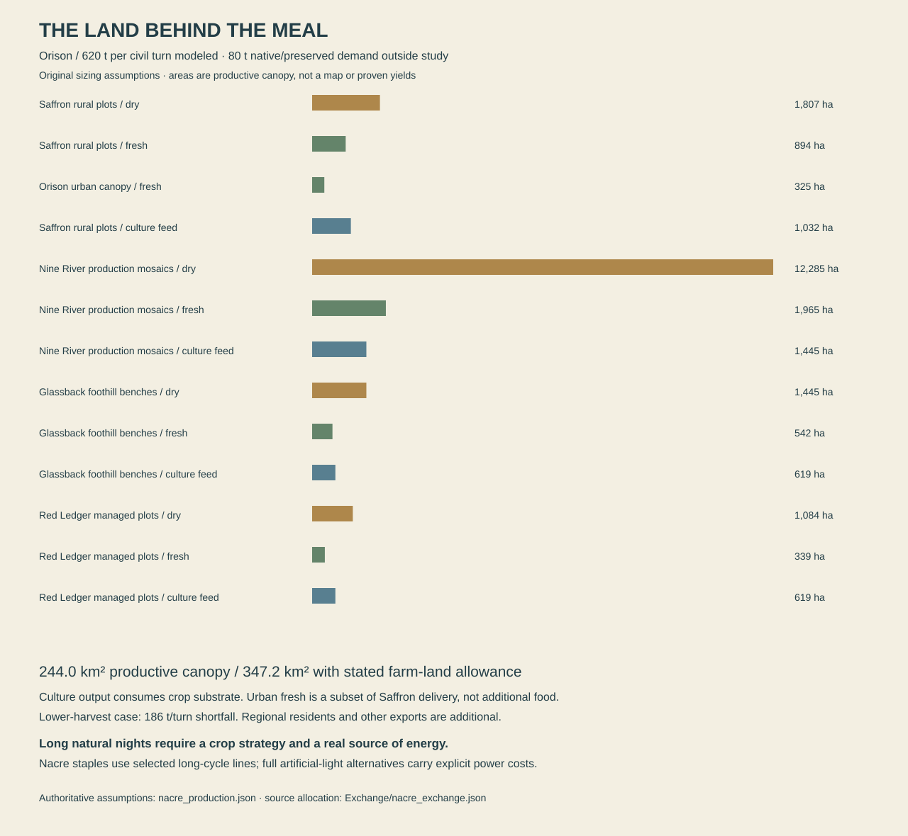

# Productive landscapes: the country behind the cities

**Working world canon and an explicit sizing study, edition 0.5.** Nacre's cities depend on inhabited country, cultivated organisms, industrial inputs and maintained routes. This chapter establishes how those dependencies should look and behave. It does not turn an allocation table into a proven farm, a complete diet or a mapped catchment. The numerical study covers an identified part of Orison's existing food basket; its limits are deliberate and visible.

The acceptance condition is that a journey away from a city reveals the places that support it, with their own interests and lives. A grower has somewhere to live, a reason to use a particular plot, a way to replace damaged equipment and a destination for residues. A city shipment has a source that cannot simultaneously sell the same stock elsewhere. A crop room has light and cooling costs. The landscape remains worth exploring when nothing has broken.

## 1. Most people are outside the twelve city cores

The twelve named major-city core estimates total **4.88 million people**. Against the present planetary estimate of **34.8 million**, approximately **29.92 million people** live outside those particular counting boundaries. This does not make them all farmers. The remainder includes secondary cities, outer metropolitan districts, industrial towns, research settlements, ports, villages, island communities, mobile households and people whose usual residence is difficult to count. The major-city atlas is the beginning of settlement geography.

That distinction changes what the player should see. A flight between capitals is not a sequence of huge empty biomes interrupted by twelve decorative domes. Settlement density varies along viable rivers, coasts, upland basins and older transport corridors. Some valleys contain many connected communities; other reaches remain sparsely inhabited. A small port may have more daily connections than a larger isolated town. Regional significance cannot be read from the height of a skyline alone.

Large distances remain large. The country between Marroway and Orison contains many potential origins and destinations, not one continuous suburb. Shipping a replacement valve across a region can be ordinary work without being a ten-minute errand. Local manufacture, inventories and trusted repairers matter because transport has cost and duration. Radio information can arrive much faster than a pump impeller. A mechanic may know exactly which part is needed and still have three distinct ways to obtain it.

Rural life must support occupations beyond production. There are teachers, care workers, boat builders, composers, programmers, medical staff, retail workers and people between jobs. A farming household can include someone who dislikes farming. Communities hold exhibitions, play games, quarrel about a rehearsal room, organize local sport and visit relatives. Their stories should not appear only when an outsider arrives to save a harvest.

The next settlement atlas must allocate people to mutually exclusive residence accounts, while allowing overlapping service areas. A regional food-processing town counted within a metropolitan perimeter cannot be added again as an independent population. Seasonal workers and guests need presence counts separate from usual residence. These rules are useful authoring discipline; they do not require the engine to instantiate thirty-four million individual characters.

## 2. What is now adopted about cultivation

**Selected introduced staple lineages can complete productive life cycles under Nacre's long natural light cycle in suitable local conditions.** This is a fictional biological premise of the world. It follows centuries of selection, retained breeding knowledge, maintained collections and controlled propagation; it is not a claim that present Earth grain would automatically tolerate Nacre. The retained lineages are neither magically universal nor immune to poor weather, disease or failed husbandry.

This premise is necessary to the existing settlement history. Nacre's people have supported a large population for generations. Treating all staple fields as ordinary Earth plants, then quietly illuminating every hectare through a roughly three-turn night, would conceal an enormous industrial requirement. The chosen world instead distinguishes natural-cycle staples, more sensitive controlled crops, propagation stocks and industrial cultures. Each has a different relationship to light, labor and energy.

The natural solar cycle lasts approximately **136.755 Earth hours**, or **5.698 civil turns**. Civil turns remain twenty-four hours; people and facilities need not abandon that social rhythm. Growing calendars record natural phase, seasonal position and civil time together. A cooperative may schedule harvest labor by ordinary watches while planning crop stages against the approaching natural night. A child can learn the distinction without being required to understand orbital equations.

The staple lines trade traits. Some tolerate long darkness by maintaining reserves and reducing growth, then use daylight differently from their ancestors. Some protect exposed tissue during sustained bright conditions. Some have reproductive timing that fits local practice. Those are authored trait directions, not invented molecular mechanisms. Yield, taste, storage, nutrient composition and resilience need not improve together. An older grain can be robust but require longer preparation, preserving the established Pella Ruun story rather than declaring technological progress a universal cure.

The first arrivals did not possess today's entire crop portfolio. Early controlled rooms and carefully supported plots created a narrower food base. Subsequent selection expanded the places and schedules in which people could grow food. Existing famine and contamination history still matters. The discovery of a workable lineage did not remove the need for water, drainage, clean propagation, storage or competent kitchens. No new miraculous intervention is inserted into the historical spine.

Some plants remain mostly inside. Fragile seed collections, high-value fresh produce, particular medicinal crops and research stocks use controlled schedules. A room can preserve a cultivar's twenty-four-hour photoperiod while the world outside remains dark for several turns. It needs luminaires, power conversion, air movement, water management and thermal control. It may borrow useful heat from nearby industry, but borrowed heat does not replace photons.

Food cultures consume feedstock and other inputs. A fermenter is not a generator of calories from an empty tank. Some systems improve usability or supply particular nutrients; others make desirable textures and flavors. Their output includes water, so wet product mass cannot be compared directly with dry grain mass. Alternative processes using other energy and carbon sources are possible future canon, but they must be specified before their output enters the food account.

NASA's plant research treats light, water, air, environment and plant selection as interacting requirements. It supports the need to design cultivation conditions; it does **not** validate these fictional Nacre lineages or their yields. The lineage decision above is original world authorship. [NASA: Growing Plants in Space](https://science.nasa.gov/biological-physical/the-challenges-of-growing-plants-in-space/).

## 3. A cultivated plot is an ecological boundary

Introduced food plants require maintained associated organisms and suitable root conditions. A rectangle of native soil does not become an Earth garden merely because a sack of seed reaches it. Growers use prepared mineral substrates, selected microbial communities, amendments, contained beds and monitoring appropriate to their crops. An established agricultural soil is a historical achievement, not a substance that appears beneath any green texture.

Native and introduced production may occupy adjacent land without sharing every material stream. Shuttlefan grown for qualified fiber or native fodder does not automatically belong in the human food account. Native animal husbandry does not establish that humans can digest the animal. Human kitchen residues cannot be assigned to every native grazer. Tools, storage and processing areas express these distinctions without turning the entire countryside into a sterile laboratory.

Boundaries vary with consequence. A high-value propagation room has tighter entry practices than an ordinary mature staple field. An outdoor plot can use drainage separation, inspected stock and managed margins instead of a gigantic sealed roof. Where native organisms exploit an introduced crop physically, the interaction must be developed from compatible chemistry and behavior rather than assumed from Earth pests. Damage, competition and habitat change do not require a pathogen to cross biochemistries.

The landscape therefore contains mixed mosaics: cultivated blocks, native wetlands, uncultivated slopes, service yards, access routes, treatment cells and settlement. Their boundaries are often legible from a distance. A straight drainage edge meeting an irregular native margin tells a different story from a forest cleared indiscriminately to the river. The shape of a field can preserve an old agreement, an abandoned machine width or a former channel.

There is no universal moral meaning to these shapes. A compact, intensively managed plot may protect more surrounding habitat than a picturesque but sprawling development. A cooperative may maintain excellent ecological practices or be divided over an expensive improvement. A concession operator may run a technically sound facility while imposing unfair access terms. Characters judge institutions through concrete conduct, not through a rule that one material palette signifies virtue.

Farm plans reserve space for fallow, soil recovery, roads, drainage, propagation and service work. These uses are not wasted blank terrain. A drained parcel being rested can host native seasonal life, but not every fallow is suitable habitat. A service road needs enough width and turning space for the equipment that actually uses it. An emergency access route cannot be permanently blocked by decorative storage chosen only to make a screenshot busy.

## 4. The first demand-to-land study

The [machine-readable assumptions](Resources/nacre_production.json) and [reproducible arithmetic](Resources/PRODUCTION_ARITHMETIC.md) begin with the existing [Orison food ledger](Exchange/nacre_exchange.json). That ledger assigns **700 tonnes of edible product per civil turn** to the 420,000-person city core. It already separates 230 tonnes of introduced dry staples, 300 of fresh produce, 90 of cultured products, 30 of conditional qualified native fractions and 50 of other preserved foods.

This study sizes the **620-tonne dry, fresh and cultured subset**. It does not quietly treat the remaining 80 tonnes as solved. Those categories need actual product definitions, processing yields, inputs, losses and qualified substitutions. Native fractions must have species, tissue and processing qualification; failure to qualify a product calls for an introduced replacement and its additional production requirements. A label saying “native” is not a source of nutrition.

The adopted numerical cases are openly hypothetical: five gross tonnes of dry crop per productive hectare per mean civil year, thirty tonnes of fresh product per hectare, 90% retained dry harvest and 80% retained fresh harvest. They are sizing values selected for the fictional study, not yields measured on Nacre or transferred from an Earth climate table. Annual yields already include the assumed annual cultivation pattern. Multiplying them by another number of harvests would double-count production.

The culture case uses wet output containing 20% dry biomass, a dry-biomass yield of 0.5 per unit dry fermentable substrate, and substrate extraction of 0.7 from retained harvest. Its upstream crop therefore occupies real land. Process water added to a product is not treated as harvested grain. This deliberately coarse process is a demand case rather than the established recipe of every food in Nacre's kitchens.

The resulting productive canopy is approximately **24,402 hectares**, or **244 km²**. Reserving only 70% of rural farm land for this counted productive canopy expands the combined allowance to approximately **347 km²**, including the unstacked urban canopy separately. These are distributed allocations to Orison's demand across several regions. They are not a single square field outside its city wall.

The study preserves source identity. Nine River's 170-tonne dry allocation remains Nine River's allocation. Red Ledger's fifteen dry, twenty-five fresh and fifteen cultured tonnes remain a regional obligation, not food invented inside Hesh's municipal boundary. Within Saffron's ninety fresh tonnes, the twenty-four-tonne urban subset is removed before sizing the sixty-six-tonne rural component. It is never added a second time.

The city cores and other exports are additional customers. Marroway has its own 1,139-tonne resident allowance, and Nine River also supplies Sola. Hesh and other Red Ledger settlements must eat before a designer can call the region a surplus producer. The study does not certify any region's total harvest or surplus. It establishes a reproducible burden that the future regional map must accommodate, then allows actual local demand and further commitments to be added.

The current dossiers already expose the following **selected additional destination accounts**, in edible-product tonnes per civil turn. They are useful lower bounds on named obligations, not a complete regional balance:

| Producing network | Orison allocation | Sola allocation | Serein allocation | Selected total | Separate nearby-city account |
|---|---:|---:|---:|---:|---|
| Nine River, REG-002 | 360 | 188.5 | 220 | 768.5 | Marroway residents: 1,139, with mixed regional and imported sources |
| Red Ledger, REG-004 | 65 | 25 | 84.5 | 174.5 | Hesh residents: 496, with mixed regional and imported sources |
| Talweir regional network, REG-009 | No bulk row assigned here | 125 | 25 | 150 | Talweir residents: 1,248, with a separately stated calorie-origin split |

The three destination columns belong to their respective city food accounts and must not be added again to those cities' totals. Nor may the nearby-city column be assumed entirely local production. These distinctions matter especially for Red Ledger: Hesh's original two named export destinations are no longer the only proposals after Serein is authored. The narrative and regional register must advance together.

This is more useful than choosing an impressive acreage first. The art team receives a reason for the kinds of country visible along a route. The writer receives a limit on what one delayed convoy can plausibly affect. The later simulation receives obligations with IDs, sources and units. None of them should infer that a crop-patch mesh represents precisely one hectare unless the placement recipe explicitly says so.

## 5. Water is larger than the drinking-water network

Crop water demand includes evaporation and transpiration, varies with crop and conditions, and changes during growth. A harvest's mass is not its water requirement. These are general relationships from agricultural science; Nacre's numerical evapotranspiration values remain authored assumptions. [FAO: Crop Water Needs](https://www.fao.org/4/s2022e/s2022e02.htm).

The study gives the dry and culture-feed cases an annual crop-water depth of 650 mm and fresh crops 900 mm. It assigns different effective-rain assumptions to Saffron, Nine River, Glassback and Red Ledger. Effective rain means the portion useful to the root zone in this account, not all rainfall measured at a weather station. A wet season can still produce damaging runoff or leave a later irrigation deficit. [FAO: Effective Rainfall](https://www.fao.org/4/s2022e/s2022e03.htm).

Across the modeled canopy, annual evapotranspiration is approximately **168.8 million m³**. After the stated effective rain, urban condensate recovery, additional Red Ledger leaching allowance and delivery fractions, the annual source-irrigation allowance is approximately **47.85 million m³**. Its mean is roughly **147,149 m³ per civil turn**. The actual seasonal and natural-cycle peaks would differ from this mean. A yearly total cannot size a pump or prove a reservoir will survive the driest period.

These agricultural flows are separate from Orison's 60,000 m³ delivered municipal drinking-water allowance. A farm in Nine River does not draw its entire irrigation requirement through an Orison street pipe. Conversely, assigning the flow to a region does not create an entitlement to take it. The catchment account must reserve downstream ecological water, other settlements, existing agricultural uses, navigation constraints where relevant and the effects of return flows.

The urban fresh case assumes protected rooms with no credited rain and 75% recovery of evaporated crop water as condensate. That is a process assumption with an energy and maintenance obligation. Condensation moves water; it does not make humidity management free. The calculation includes only recovered quantity, not the cooling plant that would achieve it. Crediting both full outdoor effective rain and this same closed-room recovery would describe incompatible systems, so the checker rejects that combination.

Gross abstraction, water reaching a plot, crop evapotranspiration, drainage, leakage and recovered condensate are separate quantities. An irrigation delivery fraction of 0.75 does not mean all the remaining water disappears from the planet. Some may return locally, some may be lost to evaporation and some may reach another groundwater or surface-water system. Reuse requires a real destination and suitable quality; it cannot be counted twice as new basin inflow.

Red Ledger needs a salt account as well as a water account. Irrigation can concentrate salts around roots; drainage can move those salts elsewhere. A closed basin still contains them unless they are removed as material or managed in an identified store. The study's additional leaching depth is a provisional allowance, not proof of adequate salt management. [FAO: Salinity Problems](https://www.fao.org/4/t0234e/T0234E02.htm).

Hesh therefore needs visible separation between productive fresh-water circuits, saline recovery operations and the lake. A pump marked “recycling” cannot erase dissolved material. Evaporation cells, recovery sheds, monitored ground, hauled residuals and maintenance access belong in its material world. Which operator owns a residue can become a conflict; the physical residue exists regardless of the dispute's legal result.

A completed basin dossier will use storage change explicitly: inflows plus transfers minus evaporation, consumption, outflow and exports, with return flows identified at the appropriate boundary. It will declare the time interval. A closed lake with stable average level still varies seasonally; a reservoir filling after rain may have a positive storage change without producing a permanent new surplus. Existing river controls provide locations and levels, not discharge records.

## 6. The cost of manufacturing a sunrise

The alternative lighting case uses **250 micromoles of photons per square meter per second**, an effective canopy-delivered efficacy of **3 micromoles per joule**, a sixteen-hour light schedule per civil turn and an assumed 50% overlap between scheduled lighting and insufficient natural light. The efficacy is measured at the useful canopy boundary for this assumption, including optical losses; it is not a lamp's advertised emission efficacy. These are declared calculation inputs, not a universal crop recipe, an equipment recommendation or a simulated seasonal daylight schedule.

At that efficacy the fixture demand is approximately **83.3 W/m²** of illuminated canopy. Applying it to all the study's productive canopy produces a coincident fixture load of about **20.34 GW**. Under the simplified duty and overlap assumptions, the mean supplementation is about **6.78 GW**. That excludes air movement, cooling, water treatment and processing. The case exposes the consequence of a design choice; it is not added to adopted regional power demand.

The selected natural-cycle staples are therefore more than a flavor detail. They let the world preserve recognizable outdoor agricultural landscapes without pretending every field receives cheap artificial noon. Controlled production remains valuable where its outputs justify its cost. A specialist seed room, a clinic's vulnerable stock or a high-value urban crop can rationally use energy that would be difficult to justify across all dry-staple acreage.

The existing twenty-four-tonne urban fresh allowance is also substantial. At the study yield it requires approximately **325 hectares of productive canopy**. If every canopy could use daylight, the illustrative mean supplementary light would still be about **90 MW**. Arranging four opaque layers cuts theoretical crop footprint to about **81 hectares**, but the lower three cannot borrow the top layer's sunlight. Under the same model, mean fixture power becomes approximately **158 MW**, before environmental services.

Neither figure is silently inserted into Orison's present 600 MW mean city budget. The city proposal has not yet reserved a corresponding farm-power subaccount. The conflict has a real resolution path: select actual crops and production methods, partition genuinely daylit gardens from enclosed stacks, revise annual yields and local fraction, and fund the resulting load within a revised generation and demand account. Until then the twenty-four-tonne urban contribution is a target with an exposed obligation.

A useful roof garden may produce less than an industrial farm and still be valuable. It supplies freshness, teaching, pleasure, seed continuity and local knowledge. The design should let it succeed at those things without claiming it feeds an entire district. A neighborhood's pride in its crop does not need exaggerated tonnage to be moving.

Orbital mirrors retain the constraints established in the physical review. Moving reflectors are not fixed suns above every farm, and a low-orbit mirror within the deep night shadow cannot reflect sunlight it does not receive. Ground collectors, storage and dispatchable generation remain distinct systems. The chapter's title is metaphorical; no new energy source or special exception to the sky model has been adopted.

## 7. Six productive landscape families

### Saffron: gardens fitted to inhabited slopes

Saffron production is a patchwork of suitable benches, maintained soil beds, urban gardens, propagation rooms and rural compounds. It should not cover every visible escarpment with identical green stripes. Wind, access, slope stability, soil depth and water delivery divide useful ground from dramatic but unsuitable terrain. Some roofs collect water; some shade domestic life; some grow food. Those functions can coexist only where structure and services permit them.

The rural visual grammar favors repairable shade frames, low wind breaks, clearly routed irrigation, tool rooms cut into stable ground and covered loading edges. Domestic thresholds look onto work without requiring families to sleep inside noisy processing halls. Newer plots use different hardware from old family gardens. Returning along the same road reveals repaired fabric, a harvested section, propagation trays moved into shelter and a public meal at a compound that was quiet earlier.

An adventure here can concern access across an old service cutting, a contested collector easement or a shipment transferred through an abandoned terrace depot. It must allow more than delivery work. A player might navigate a vertical route to inspect an obsolete optical installation, discover an old private living space or arrange a covert departure without damaging the farm that currently uses the lower approach. Civilian livelihoods make the terrain consequential, not untouchable.

### Nine River: a cultivated mosaic with native wetland between

Nine River's production belongs to many connected places. Raised storage, plots on appropriate ground, wet margins, processing yards and landing routes produce a broad landscape rhythm. A large staple block differs from a vulnerable fresh crop enclosure. Barges carry different loads and schedules; small local craft feed consolidation points without every household owning industrial equipment.

Dry stores stand above ordinary flood exposure, while expendable or moveable work can occupy lower margins. Flood marks show more than one event. An abandoned intake may remain beside a new one; its old approach can become a route, habitat or contested property. Grain Reach in Marroway is a node in this country, not the country's whole productive surface.

Pirate play can follow water and custody. A cargo may be physically moved before its transfer record is accepted, or claimed by two institutions with different accounts of an old obligation. Sneaking aboard, arranging an open inspection, tracing a seal or finding an alternate return berth changes the story differently. The player should be able to keep a promise that is inconvenient to both powerful parties. Ordinary crews continue competent work around the incident.

### Glassback foothills: cultivated benches and long connections

Usable foothill valleys vary in exposure and access. Production groups around workable benches, reliable sources and routes that can move bulk goods. A steep slope with a beautiful view is not automatically a farm. Some communities specialize in propagation, storage, repair or high-value products rather than trying to grow every staple locally.

The material language includes anchored frames, stone service channels, enclosed preparation rooms, equipment adapted to narrower approaches and transfer yards at changes of transport mode. A cable or rail dependency needs terminals and power, while a road needs a real grade and weather plan. Distant structures may appear close across a valley yet require a long journey to reach.

Exploration can reveal routes with different histories: a former freight cutting, an abandoned experiment in high-slope cultivation, a still-used family path and a newer public connection. The dramatic option should have a reason to exist. A concealed cache in an obsolete transfer station is more meaningful when its hardware explains why the station was once busy and why it stopped being useful.

### Red Ledger: production with an explicit residue

Managed cultivation around Hesh concentrates where source quality, substrate and transport permit it. Saline flats and crusted former shore are not universally sterile, nor are they automatically human farmland. Native communities occupy their own niches. Introduced crops require selected conditions and a managed salt destination. Gardens can be lavish in concentrated places while the wider landscape remains dry and spare.

The visual contrast is between bright, worked mineral surfaces and shaded, inhabited interiors. Productive compounds reveal separate water circuits, settling and recovery areas, stored membranes or components, repaired shade devices and hauled materials. Ornamental basins do not secretly supply irrigation. Fine domestic objects and public generosity can coexist with strict practical limits on wasteful use.

This country supports daring overland departures, mineral recovery, obsolete works and long sightlines that fail in dust or glare. A quiet route can become dangerous through weather without a hostile patrol being spawned to force drama. Salvage must distinguish abandoned ownership from abandoned maintenance: a long-unused chamber can still contain pressure, unstable material or valuable cultural evidence. These are setting consequences, not a request to implement destruction now.

### Morrow: lake-country staples and upland specialisms

Talweir's Lake Country, Aven's uplands and Dhal's lowlands are separate productive settings. Water systems and species ranges do not merge just because all three appear on one continent. The lake-country food share needs actual surrounding production and transport. Aven's higher benches support their own crop choices and source conditions. Dhal combines river access, wet lowland work and protected introduced cultivation within a wider native forest system.

Shared industrial standards can connect these places without making their architecture identical. A pump coupling or reusable crate may travel widely while its housing, shade, foundation and maintenance practice remain local. That is a strong modular-art opportunity: repeat a believable manufactured component inside distinct environmental construction. Reuse becomes evidence of trade rather than accidental sameness.

The journey between production regions should offer contrasting experiences. A vessel may move through low forest corridors, reach an exchange yard, then hand freight to a route over an upland divide. The inland city cannot receive an ocean ship merely because the camera wants a spectacular arrival. A small local boat, a transshipment operation or an air approach can each provide spectacle appropriate to the actual place.

### Islands, Sere and Pale: local production within wider exchange

Sola's urban and island production supplies particular needs within a large food-import account. Salt exposure, suitable ground, water storage and temporary population affect its choices. Four stacked green towers do not erase the freight arriving from Nine River and Talweir. A ship provision order is additional to resident food, and a festival's guests alter demand even when the permanent population is unchanged.

Velis maintains viable collections, selected crops and teaching networks. Its distant stock shipments are often small in mass and large in future consequence. Calling it a seed city does not turn it into the world's bulk grain exporter. Tern, Serein and Brin have different local climates and productive connections. Brin at 61° north does not receive polar night under the adopted tilt; its cultivation challenges must follow the actual sky rather than an Earth-Arctic shortcut.

Ocean routes carry food, machinery, people and live stock with different handling needs. A viable culture can lose usefulness without changing its gross cargo weight. A sealed container might hold a replacement component, a family collection or a biological stock with a narrow useful arrival window. These differences support travel stories without making every shipment an apocalyptic cure.

## 8. Nutrients, materials and the work after harvest

A farm exports more than carbon and water when it sends food away. Nutrients leave with products, residues are moved or returned, and soils change through use. The world must track the existence of nitrogen, phosphorus, potassium and trace requirements without assuming that each needs a detailed player-visible chemistry menu. Fertilizer and amendments have sources, processing, transport and safe storage.

No elemental loop is perfectly closed. Recovering useful material from municipal or agricultural residues requires collection, sorting, treatment and quality control. A recovered stream can be valuable while still needing an external supplement. Some contaminants concentrate as water is reused. A process that saves water may produce a harder residue problem. The resulting industrial buildings should have service faces and removal routes, not only attractive public entrances.

The adopted technological frame allows regional industrial manufacture, licensed fission, chemical processing and sophisticated repair. It does not grant every village a complete advanced supply chain. A local workshop may make ordinary housings but rely on imported membranes, precision bearings or electronics. Such dependencies generate trade and specialization; they need not make all communities permanently helpless.

Harvest processing has stages. Drying, cleaning, grading, milling, extraction, culture preparation, packaging, cooling and final cooking are different operations. A coarse food ledger combines them only to expose a first burden. Later product records should retain wet or dry basis, usable fraction, lot identity, temperature requirements where relevant and the point at which a product changes ownership or destination.

Waste should not be portrayed entirely as discarded wealth. Some material can be repaired or recovered; some is contaminated, exhausted or uneconomic to move. A crew choosing to salvage an old harvester needs somewhere to take it and a reason its components remain useful. The impressive intact machine in a ruin may be less valuable than a small verified control module in a protected room. That inversion can create discovery without arbitrary loot rarity.

Food preparation is itself infrastructure. A nutritionally adequate raw supply can fail people who lack time, equipment, fuel or the knowledge needed to prepare it. Public kitchens, household tools, instructions, shared recipes and culturally appropriate meals belong in the supply chain. A clever logistical fix that makes every resident perform hours of unpaid extra work is not an unqualified success.

## 9. Reserves, shocks and recovery

The first stress case applies a uniform **30% reduction in harvest** to the modeled 620-tonne subset while preserving its assumed processing fractions. The resulting delivery is 434 tonnes per turn, leaving a 186-tonne gap. Maintaining the old output at that reduced yield would require about 1.43 times the productive area if all else were equal. Land cannot be converted into a mature harvest instantly, so the extra-area figure is a planning comparison, not a response that resolves tomorrow's shortage.

The separate water stress removes 30% of the calculated irrigation-source allowance. It does not assign a 30% crop loss. Timing, crop stage, soil storage, priorities, source quality and local alternatives matter. A short interruption at one stage may differ greatly from the same interruption at another. The world should author specific event consequences when it knows those relationships, rather than translating every percent directly into another percent.

Reserves retain category and destination. Orison's dry reserve does not replace missing fresh vegetables, culture feed, medical food or every nutrient. A regional warehouse can hold multiple owners' stock. Available physical volume does not prove the player is authorized to redirect it, and a legal claim does not move a sealed pallet. Ownership, custody, suitability and transport should remain distinct narrative facts.

Recovery has quiet stages worth depicting. A repaired source may need cleaning and verification before it resumes use. A route reopened to light vehicles may still exclude bulk loads. Returning workers may find childcare or housing disrupted even when production restarts. The world should be able to show progress without pretending that an event flips from total crisis to untouched normality in one frame.

Most cycles should nevertheless work. Constant disaster flattens the emotional range and makes competent societies implausible. The player should sometimes arrive during a good harvest, an uneventful transfer or a successful repair celebration. A beautifully maintained facility can be as distinctive as a ruin. Exploration needs places that are desirable to reach, not only problems demanding intervention.

## 10. People and adventure at the production boundary

The following are **scenario families for later geolocation**, not additional completed POIs. They derive from the supply structure and require specific people, places and aftermath before inclusion in the final encounter catalogue.

**The second consignee.** A producer has already supplied the promised quantity, but a consolidator assigns the same stock to two destinations. The conflict is discovered while a vessel is physically being loaded. Evidence exists in the yard, in prior instructions and in the cargo itself. The player can arrange a witnessed division, protect one shipment, trace the attempted double sale or use a different source with its own cost. Resolving paperwork alone cannot duplicate food.

**The garden over the old approach.** A former industrial access route has become a productive community space. A salvage crew wants to reopen it to reach valuable abandoned machinery. The machinery's history and condition are discoverable; alternative access may be difficult but possible. The disagreement involves care, property and real transport constraints. The eventual site should let a bold physical approach coexist with negotiation, rather than assigning one obligatory moral answer.

**A dark room still running.** An old crop facility appears unused from the road, yet a protected inner room still operates. Its occupants may be maintaining a small collection, using it as a covert meeting place or preserving another household's work. The energy source and input stocks must explain its survival. An intact culture or seed line is valuable because of its documented properties and relationships, not because every hidden laboratory contains a universal cure.

**The honest bad batch.** A process has produced a safe but unpopular result. The supplier is candid, customers have legitimate objections and an intermediary would prefer a simpler scandal. The player can help establish a use, reveal a misleading account, choose not to intervene or build a relationship through practical work. This family preserves the game's capacity for thoughtful low-stakes discoveries alongside dangerous operations.

**The residue nobody signed for.** A profitable process leaves concentrated material in a store with disputed custody. A storm or maintenance failure increases urgency but does not automatically cause a cinematic catastrophe. A powerful actor proposes moving it somewhere convenient for them. The world needs actual destinations, carrier constraints and affected communities before this becomes a quest. The player may expose, redirect or refuse the job; a refusal does not remove the material from the world.

**The returning harvest crew.** Travelers encounter a skilled crew headed home after successful work. They have money, fatigue, jokes, disagreements and plans. An invitation can reveal a route, a sporting event, a maker or a personal mystery. No ambush is required. The later return of the same people gives the region continuity and a reason for the player to recognize ordinary vessels and vehicles.

**The protected shipment.** A modest live-stock consignment attracts attention because somebody wants control of its future use. Cargo volume is small; cultural and economic implications are not. Deception, custody, consent and the truth of the stock's capabilities matter. The player should be able to learn that a supposed monopoly is weaker than advertised, or that an apparently interchangeable replacement lacks a crucial trait, without the plot relying on invented scientific omnipotence.

## 11. What the asset pipeline must now express

These are **binding requirements for existing and future asset briefs**, not a new count of finished assets. They should be reconciled with the established 4,200 stable briefs before new catalogue IDs are created.

| Family | Required distinctions | Evidence in the environment |
|---|---|---|
| Cultivated ground | Introduced productive beds, native cultivation, fallow, service ground | Substrate edges, access, drainage and changes in cover |
| Shade and light | Outdoor shade, propagation room, fully lit stack, ordinary domestic canopy | Different frame spacing, power connections, repair and heat-management hardware |
| Water distribution | Raw source, treated network, irrigation, reuse, brine and drainage | Legible connections and separate destinations; no arbitrary shared pipe color without local convention |
| Crop stocks | Mature plants, propagation, harvested product and resting bed | Seasonal variants that share identity rather than unrelated mesh swaps |
| Storage | Dry staple, cooled fresh, vulnerable living stock, equipment and residue | Appropriate containment, handling faces, access and maintenance space |
| Culture facilities | Feed preparation, process vessels, product handling and cleaning | Inputs and outputs visible at a scale appropriate to the facility |
| Farm machinery | Regional tools, maintained working units, repaired parts and abandoned equipment | Wear caused by use and climate, with credible replacement components |
| Cargo | Lot, container, load state, reusable packaging and custody markers | Physical items that later collection and throwing systems can distinguish from fixtures |
| Settlement edges | Household space, work yard, common ground and public approach | Residents' own routes, leisure, storage and privacy |
| Salt and residues | Dry recovery, wet concentration, protected storage and transfer | Surface change, containment and removal routes tied to a process |
| Service structures | Pumps, controls, power conversion, cooling and maintenance | A service side behind the composed public view |
| Routes and transfer | Field access, landing, loading, staging and mode change | Vehicle fit, gradients, turning space and destinations |
| Public life | Teaching, cooking, games, local performance and visiting | A community that remains interesting without a production crisis |
| Historical layers | Obsolete but readable infrastructure, conversion and repair | Reasons for unusual spaces and opportunities for discovery |

Purchased packs can supply convincing base machinery, ordinary storage, industrial fittings and modular agricultural structures when their scale and permissions fit. Regional identity comes from assembly, material use, history and service relationships. A greenhouse pack does not decide which crop grows inside it, where the water comes from or how the settlement behaves. Those decisions belong to canon and placement recipes.

Small physical objects need a role before becoming freely movable. A loose sample tray, empty crate and household utensil differ from an anchored pressure component or protected living stock. Later inventory and physics systems can expose collection, carrying and throwing where appropriate. This chapter reserves those affordances and consequences without reopening mechanics implementation during world authorship.

Sound should reveal work at different distances: a low transfer motor, periodic crop-room fans, a latch rattling in wind, a boat approaching a landing, conversation from a shared cooking space. Avoid a permanent wall of machinery everywhere. Shutdown, maintenance, natural night and a festival can change the mix without making the entire place disappear when the player turns away.

## 12. What this chapter establishes and what follows

The world now has an explicit cultivation premise, a distinction between productive canopy and land allowance, a traceable first crop-input study, a water and lighting consequence for urban food targets, six productive-landscape families and concrete requirements for rural settlement and art. The study exposes an unresolved Orison farm-power allocation instead of hiding it behind attractive roof gardens.

The next resource pass must allocate regional populations and resident demand, complete the unmodeled food categories, locate actual production and material sources, define catchment boundaries and seasonal water storage, and connect freight to mapped transfer places. It must reconcile city generation budgets with any adopted controlled-crop loads. Source capacity should be supported by stated working assumptions and checked accounting; a full real-planet climate simulation is not a prerequisite for writing coherent fiction.

The final canon should let a reader follow a meal from lineage and growing ground through inputs, harvest, processing, transport and preparation; follow its residues onward; then meet people who have ambitions beyond that chain. That is how the resource model earns its place in an adventure world. The model makes places and choices possible. The inhabitants give them meaning.
