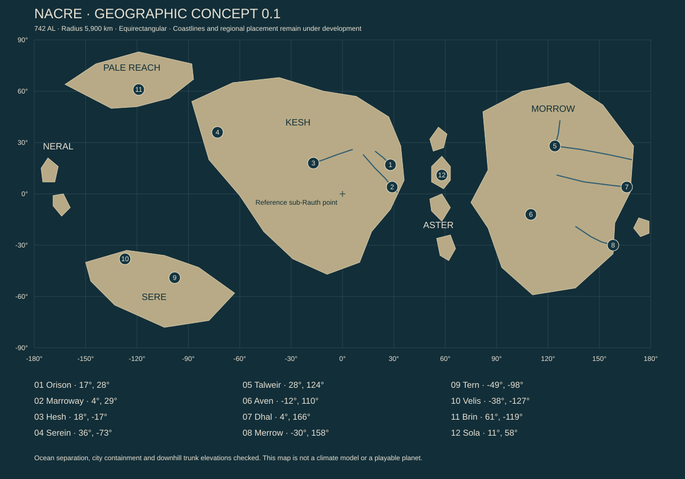

# Volume 07 — The distances between homes

Geographic foundation, edition 0.1. This establishes 24 regional identities and twelve anchor cities. It is not the final detailed atlas: coastlines are schematic, region anchors are not borders, and climate is an authored hypothesis pending further physical review. Every location below is original fiction. The [coordinate data](Atlas/nacre_atlas.json), [concept map](Atlas/nacre_geographic_concept.svg) and [distance arithmetic](Atlas/ATLAS_ARITHMETIC.md) are the current reproducible companions.

## How to read this world

Nacre has four principal continental masses in this edition. **Kesh** occupies much of the hemisphere facing Rauth. **Morrow** extends across much of the outward-facing hemisphere. The **Pale Reach** is a northern continent, while **Sere** occupies southern latitudes. The **Aster Chain** joins several central-ocean routes; the **Neral Arc** lies far across the map's longitude seam. The map seam is a drawing convention, not a wall in the ocean.

The continents are not nations. A river basin, trade association, linguistic network and legal jurisdiction may each cross a different set of boundaries. A region here describes a useful geographic and historical focus. Its eventual edge will include transition zones, shared habitats and disputed descriptions rather than an invisible line changing all vegetation at once.

Current low-resolution coastline polygons establish separation and orientation only. Their angular corners are not intended final headlands. City coordinates locate planning centers within those polygons; harbors, islands, lake shores and river mouths need finer coastline and elevation surveys. The map is a spherical geographic concept shown in an equirectangular projection, which distorts areas and distances away from the equator.

The physical model does not yet include a global circulation simulation. Labels such as fog coast, wet forest and dry basin describe intended conditions with proposed causes. They require checking against the slow rotation, long light cycle, seasonal forcing, sea temperatures and relief. A familiar Earth latitude is not sufficient evidence for an Earth biome. Native communities are assigned by habitat and dispersal history, not by palette.

## Kesh: the near sky and many beginnings

### REG-001 — Saffron Escarpment

Orison stands on the inner slopes of an ancient, eroded crater near Kesh's eastern coast, centered at 17° N, 28° E. A seaward breach connects sheltered water to the open coast. The regional escarpment supplies elevated collectors, reservoirs and approach landmarks. Fault circulation provides a candidate geothermal resource; the crater's ancient impact is not its present heat source. The exact geology and resource capacity remain to be modeled.

The region's beauty comes from vertical transitions: exposed ridge, garden terrace, shaded court, freight stair, quay and water. Rain reveals how these layers depend on one another. Clean upper runoff can become dirty below a workshop; a blocked stair drain can flood a room far from the visible obstruction. A service route can therefore be a social route and a hidden exploration route without being designed solely for parkour.

The escarpment includes farms, smaller ports and inland communities that resent being described as Orison's hinterland. The city buys their produce, skills and energy; it does not own their whole identity. Regional journeys must leave the city behind, encounter different building densities and cross land whose inhabitants have their own calendar of work and celebration.

### REG-002 — Nine-River Lowlands

Marroway sits near 4° N, 29° E within a large river network south of Orison. The name Nine-River is historical: different authorities count branches, tributaries and seasonal channels differently. The Neris trunk is the first mapped drainage concept, descending from the Glassback uplands toward the coastal lowland. Detailed tributary catchments remain to be drawn.

The [Marroway dossier](Cities/MARROWAY.md) maps nine districts and a local confluence while preserving the Neris city control at 18 m. The city remains inland: its authored river mouth is about 437 km away even by direct spherical comparison. Sea freight requires river passage or an explicit transfer.

Settlements occupy natural levees, raised foundations and engineered platforms. Some channels carry freight; others are protected native nurseries or domestic water sources. Imported food production uses managed substrates and treatment networks among extensive native wetlands. Human cultivation does not replace every marsh with familiar reeds and rice.

Marroway's civic character is conversational and spatially distributed. Markets meet boats; schools serve moving households; celebrations travel between banks. A visitor can learn why two houses facing each other across water belong to different jurisdictions while cousins living a day's travel apart share a provisioning account. The region's central tension concerns who may alter a flow whose consequences arrive elsewhere later. Its pleasures include floating performance courts, elaborate boat interiors and competitive cooking at transfer landings.

### REG-003 — Glassback Range

The Glassback uplands separate several eastern catchments from Kesh's interior basin. Their name comes from reflective mineral seams exposed on some ridges, not from a mountain chain made of fragile glass. Elevation, aspect and water storage create a sequence of native communities that cannot be represented by a single alpine preset.

Routes follow passes, stable benches and water. The obvious shortest line on the world map can cross impassable relief. Settlements exist where travelers can stop, equipment can be serviced, crops can be sheltered or a mine can justify freight. Some are wealthy from transport; others have survived the disappearance of the traffic they once served.

Exploration should reveal abandoned and current route systems crossing each other. An old refuge may remain carefully stocked after its commercial road closed. A cable anchor may lead to a vanished extraction gallery. Storms, loose slopes and unfamiliar biological crusts make the landscape demanding without requiring continuous combat. Long views connect watersheds the player previously knew as separate places.

### REG-004 — Red Ledger Basin

Hesh, near 18° N, 17° W, grew around a mountain-fed interior drainage basin. Its water comes from defined upland inputs and stored reserves; it does not appear because an oasis is visually convenient. The basin has no established open outlet in this edition. Salinity, terminal wetlands and recovery of used water therefore matter to its history.

The name Red Ledger originally referred to survey books printed on a durable mineral-treated sheet. Later popular accounts make it a metaphor for blood debt. Both meanings circulate, but the atlas should not silently endorse the melodramatic one. Hesh contains skilled water accounting, speculative land claims, shaded public rooms and people bored by outsiders asking about water all the time.

A city here can be lavish without being lush everywhere. Concentrated gardens, cool interiors and carefully tended shade contrast with wide exposed ground. Native soil crusts and reserve plants make apparently bare country ecologically active. Old shore marks disclose a larger past lake. Which changes were climatic and which followed human diversion must be established basin by basin.

### REG-005 — Foldwood Marches

The Foldwood is a broad southern Kesh mosaic of seasonal canopy, open grazing country and wet corridors. Its visual identity changes over a long day as native producers alter their posture. It should not behave like a single synchronized mechanical forest. Different slopes, species and water conditions shift at different times.

Human occupation follows tested agricultural pockets and travel routes. Some communities manage domesticated native grazers for useful materials and work; this does not make the animals' tissues ordinary human meat. Cultivation and native grazing can border one another under carefully maintained rules.

The region offers exploration through memory and motion. A path obvious beneath an open canopy becomes difficult to read after closure; a herd route indicates a water source absent from a visitor's map; a seasonal gathering leaves durable traces without becoming a permanent settlement. Residents are not all nomads. Workshops, libraries, schools and dense little towns anchor lives that include periodic movement.

### REG-006 — Serein Fog Coast

Serein, at 36° N, 73° W, faces a proposed cool coastal current. Persistent marine fog is an intended regional mechanism, subject to later circulation review. Upland catchments and storage remain necessary: fog collection supplements water rather than supplying every city need by aesthetic decree.

The architecture favors protected courtyards, accessible roof walks, corrosion management and shared bathing rooms. Pale walls and dark wet surfaces create an atmosphere distinct from Orison's brass and indigo. The city should feel inhabited by people who know how to enjoy cool damp weather, not like a perpetual misery filter.

Its cooperative building history supports a dense culture of domestic design, gardening and small theaters. It also produces arguments about who performs unpaid work and who gets a desirable room. Inland routes emerge from fog into clearer, more exposed country. Offshore shelves, sea caves and old landing structures offer different exploration rhythms from the city's compressed social spaces.

### REG-007 — Cairn Steppe

The Cairn Steppe occupies a cool interior north of the Red Ledger Basin. Its open vegetation includes native producers with low profiles and substantial reserves. Calling it steppe is a translated description of structure, not a promise of Earth grass species or identical climate.

Travelers rely on broad landmarks, maintained waymarks and seasonal water knowledge. Cairns have several histories: survey marks, memorials, route indicators and more recent imitations erected for prestige. Their forms cannot be treated as one universal code. A careful traveler learns which community maintains a particular sequence.

The region's towns support freight, animal husbandry, research and craft. Wide horizons give room for races, kite-like instruments and gatherings visible long before their sounds arrive. Empty space must remain meaningful: a herd migration, weather front or distant settlement can be a major sight precisely because the view is not packed with towers and encounter markers.

### REG-008 — North Gate Sounds

The northern Kesh coast is cut by deep inlets and channels whose detailed origin awaits the geological atlas. Sheltered water encourages a chain of smaller ports rather than one dominant metropolis. Islands and headlands repeatedly hide and reveal the larger sea.

Seasonal conditions affect shipping, maintenance and ecological activity. Public knowledge includes currents, safe moorings, repair capacity and which harbor can receive a damaged vessel. That knowledge changes; an old route chart can be historically valuable and operationally dangerous.

Communities share musicians, instructors and specialized machinery by scheduled boat. A festival may be designed to move instead of requiring everyone to travel to a capital. Exploration can follow a working itinerary and then depart from it into abandoned channels, nesting shelves or a settlement maintaining an unexpectedly sophisticated craft. This is a region of many connected homes, not a queue of pirate coves.

## Morrow: the wide sky

### REG-009 — Talweir Lake Country

Talweir's planning center lies at 28° N, 124° E, where a narrow connection between major freshwater basins concentrates movement. Namar's authored surface is 180 m and Iren's 176 m. The [city proposal](Cities/TALWEIR.md) preserves the atlas river's westward dogleg through the city and develops separate upper, lower and navigation reaches. Detailed bathymetry, catchments, flow and final engineering remain open. The city's defining feature is a lived relationship with inland water rather than an ornamental lake beside a standard capital.

Households combine shore addresses with boat access, rented growing plots and ties to smaller lake settlements. Different shore authorities regulate water use, navigation, cultivation and habitat. The Lake Articles of 641 AL never made these interests neatly separable.

Talweir is a place of public performance, long meals and exacting small-boat design. Fog, water level and changing light alter familiar crossings. Underwater structures may be submerged roads, deliberately installed habitat or remains of earlier shorelines; each needs its own history. Discoveries should reward learning a basin, not merely clearing its icon density.

### REG-010 — Aven Uplands

Aven, at 12° S, 110° E, connects several high basins and routes across Morrow. Elevation moderates conditions relative to nearby lowlands, but precise temperatures and precipitation remain design targets. Managed agriculture, transport services and specialized manufacture support the city.

The [Aven dossier](Cities/AVEN.md) develops nine districts on broad occupied benches around the southern spill's established 1,650 m city control. Its local river geometry and service assumptions remain an authored proposal; the city is not a coastal terminus or a navigable extension of Talweir's northern lake system.

Its urban form follows terraces and transfer spaces, with more horizontal plateaus than Orison's crater section. Long roof edges shelter public movement. Aven's identity includes education, walking clubs, competitive design exhibitions and families whose members work in several basins. The Passage cases made route access a civic subject without turning every resident into a lawyer.

The surrounding country offers difficult approaches and generous places to stop. A refuge may contain a serious lending library; a freight depot may host a celebrated amateur orchestra. Mountain travel should reveal society at intervals, with real stretches of exposure between. The pleasures of arrival depend on experiencing those intervals.

### REG-011 — Green Vault

The Green Vault is a wet lowland and river system east of Morrow's interior uplands. Dhal lies at 4° N, 166° E along the lower river, inland of its separately mapped coastal mouth. A large native canopy provides several vertically separated habitats. Light below it is filtered by biology as well as weather.

Human knowledge is uneven. Some river corridors are familiar workplaces; nearby canopy interiors can remain poorly studied. This is not evidence that residents are ignorant or the land untouched. Knowledge can be precise, local, deliberately restricted, or difficult to translate into a planetary database.

Dhal supports field research, processing, transport and ordinary families. Its architecture manages humidity, insects or native analogues, waste and material decay. Exploration can follow sound, water, canopy openings and signs of recent feeding. A dramatic organism needs a niche and a behavioral reason to be encountered. The forest is not a warehouse of mutually unrelated monsters.

### REG-012 — Merrow Estuaries

Merrow sits near 30° S, 158° E at a coastal confluence, with cultivated margins and native tidal nurseries surrounding the city. Water chemistry, salinity and sediment movement connect upstream decisions to coastal life. The Blue Sill hearings remain a central historical reference, but the region includes successful recovery as well as damage.

The city supports food conversion, ship services, education and an ambitious public dining culture. Native ingredients enter cuisine through specific safe processing; imported crops and cultures remain nutritionally essential. Processing yards should be beautiful in their own practical way rather than hidden behind a generic factory wall.

Estuary journeys reveal channels that open and close, working habitat structures, floating survey stations and homes facing different versions of the same water. A protected area is not automatically empty of people. Stewardship, seasonal work and research can coexist with limits on access. The player should learn why a limit exists before deciding what it means.

### REG-013 — White Reed Savannas

Southwestern Morrow's open country combines seasonal producer growth, flood-fed corridors and dry intervals. White reed is a translated common name for pale structural fans, not an introduced Earth reed covering a continent. Wind exposes the undersides of stands in moving bands.

The human settlement pattern is loose and connected by a few dependable routes. Seasonal movement includes traders, instructors, repair crews and wildlife observers as well as herders. Regional life should include people who stay because they love the openness, not only people unable to afford a city.

Exploration favors large patterns: a distant feeding aggregation, an isolated raised grove, an abandoned waterwork with changed downstream effects. At ground level there are fine distinctions in soil crust, shelter and the timing of growth. Vehicles can make crossing easy while making some knowledge harder to notice. That is an environmental design opportunity rather than a reason to arbitrarily forbid vehicles.

### REG-014 — Morrow Crown

The northern Morrow uplands feed several lower basins. Snow, seasonal ice and exposed high ground are intended conditions whose altitude and weather must be checked. The region contains mines, observatories, agricultural valleys and protected headwaters; none should be distributed uniformly.

Rauth is absent from most ordinary views here. Night architecture and navigation developed under a different sky from Orison's. People may value dark-sky gatherings, but a whole continent is not required to share one mystical attitude toward stars.

Long-lived structures can bridge geological and human histories: a measurement station repeatedly rebuilt on the same safe bench, an old quarry reused as a rehearsal space, a valley reservoir whose original purpose changed. The region should offer grandeur without placing a sacred ruin on every summit. Many mountains simply have weather, life and a difficult route home.

## Sere: southern water and warm ground

### REG-015 — Tern Storm Coast

Tern, at 49° S, 98° W, occupies a protected inlet within an exposed maritime coast. The exact storm regime requires the future circulation model; the city concept depends on shelter, repair and rescue rather than an assumption of permanent hurricane weather.

Heavy work and domestic life coexist. Dry docks, crane walks and parts stores share the city with schools, markets, bathing places and crowded viewing terraces for regattas. Residents distinguish competent risk from theatrical bravery. A person can be a celebrated competitor and an unpopular neighbor.

The coast supplies exploration through approaches: visible refuge lights, damaged vessels, unoccupied inlets, wildlife feeding passages and old facilities now too costly to maintain. Rescue coverage has boundaries. A remote harbor can have an excellent workshop and no medical specialist, or a strong community and an unreliable breakwater. These differences give journeys decisions without making every arrival a disaster.

### REG-016 — Velis Cold Gardens

Velis, at 38° S, 127° W, occupies a cooler estuary with sheltered cultivation and a long history of plant and microbial stock exchange. The gardens are working food systems and social spaces. They are not evidence that native cold vegetation provides a complete human diet.

The city is smaller than Tern and insists that this is often an advantage. Its prestige comes from cultivation, teaching, carefully made domestic goods and intimate performance venues. Rivalry with Tern survives through sport, apprenticeship choices and affectionate insult as well as commercial competition.

The surrounding region includes failed experiments, thriving mixed-use settlements and native habitat that remains largely outside cultivation. A visitor might follow a plant lineage through greenhouses, family records and an old transport route. Biological history can be an exploration subject as compelling as a military ruin.

### REG-017 — Ember Fault

The Ember Fault is a southern rift and geothermal province, not a uniformly glowing lava biome. Cold uplands surround local warm ground. Productive chemical ecosystems occur where suitable compounds and oxidants meet; heat alone does not feed a forest.

Human settlement concentrates at stable, maintainable sites. Industrial wells, bathing facilities, research posts and public refuges can use different parts of the same resource without identical legal rights. Mineral deposition and corrosion make maintenance visible. The most dramatic active areas may be unsuitable for permanent buildings.

Exploration should distinguish safe warmth, unstable crust, chemically dangerous water and apparently inactive ground. Instruments and local knowledge matter. A luminous pool need not be valuable; a plain mixing channel may support a unique community. Night scenes can be extraordinary without making every surface emissive or every encounter hostile.

## The Pale Reach: lives at the edge of access

### REG-018 — Brin Long Shore

Brin, at 61° N, 119° W, is a service and research port whose access varies with season and weather. Its history combines observation, mineral work, transport and civic life. It is not merely a laboratory with beds.

Residents plan for specialist shortages and interrupted deliveries while maintaining ordinary ambitions. Young people debate leaving, returning, or changing the city so they need not choose. Visiting experts can be respected for their skills and mocked for their assumptions. Architecture concentrates useful shared interiors and makes outside conditions legible before a door opens.

Coastal travel offers survey stations, working towns, abandoned claims and native seasonal gatherings. Some places are reachable only during particular windows; others can be reached at great cost throughout the year. The distinction should be explained by actual conditions and infrastructure, not a universal locked-season gate.

### REG-019 — Pale Interior

The interior contains cold uplands, ice margins and sheltered basins. Its exact ice cover remains a climate decision, not a filled white polygon. Low sun angles, long cycles and local topography create distinct exposures. Native life persists unevenly, often in places a fast traveler would overlook.

Human presence is sparse. Routes connect scientific work, monitoring, resource surveys and a few enduring communities. A shelter can preserve generations of practical annotation without becoming a quest board. Leaving it in good order is a comprehensible social act even where no authority watches.

Exploration should preserve the experience of distance and quiet. A horizon-scale atmospheric event or a small active water margin can be the main discovery of a journey. The interior does not need continuous ruins to justify its existence. Where a ruin does stand, the question of why anyone built there should have a strong answer.

### REG-020 — Split Cape

The western Pale Reach breaks into rocky coasts and islands. Its food webs connect nesting analogues, marine grazers, suspended producers and decomposers. Wildlife gatherings follow resources and reproduction, not a permanently available sightseeing schedule.

Small communities manage landing places, limited cultivation, processing and rescue support. Some maintain distinctive crafts because transport costs favor durable local work. Others depend heavily on imported parts. A hand-built object should not imply technological backwardness.

Routes through the cape reward knowledge of changing water, shelter and colony behavior. The same landing may be harmless at one time and damaging during a nursery interval. Interpretation can come through visible evidence and local practice rather than an omniscient prohibition banner. The region also needs accessible places where people simply enjoy being by the sea.

## Islands and oceans

### REG-021 — Aster Chain

Sola's linked harbors occupy the Aster island arc near 11° N, 58° E. Relief separates wet slopes and sheltered lee settlements. Freshwater storage, erosion and harbor capacity limit growth even where the surrounding sea appears endless.

The [Sola dossier](Cities/SOLA.md) proposes five distinct islands and nine districts, retaining three 147 AL landing grounds on Orrel before later expansion. Local island outlines refine the coarse concept; they are not surveyed shores. Resident, guest, ship and transfer demand are accounted for separately.

The city is polycentric. Ferries connect schools, markets, workshops and performance spaces across several islands. A resident's daily route can cross water repeatedly without being an expedition. The city should have recognizably different islands rather than repeated copies of one tropical port.

Long-distance traffic supports multilingual neighborhoods and a strong culture of temporary residence. Hospitality has institutions and prices, but also genuine pleasure in arrivals. Away from the main harbors, the chain offers native shelves, old survey sites, small farms and quiet communities that do not exist solely to supply pirates. Sola makes intercontinental travel tangible by being a place worth remaining in.

### REG-022 — Neral Arc

The Neral Arc occupies remote islands around the far side of the longitude seam. Its separation creates a strong reason for endemic lineages and distinct colonization histories. Similar-looking organisms on another continent must not automatically be assigned the same species name.

Human activity includes research, limited extraction, navigation support and a few small settlements. The arc is not wholly unknown, but its records are uneven and some areas remain poorly studied. Remoteness can protect a habitat while also making damage difficult to repair or document.

Exploration should foreground native processes and the practical problem of visiting responsibly with finite supplies. A field camp, tide-exposed colony or unusual dispersal event can carry an entire sequence of discoveries. No hidden ancient metropolis is required to validate the trip. If a major human ruin is later added, its original logistics and abandonment must be convincing.

### REG-023 — Pelagic Roads

The open ocean is a moving region rather than a single bounded province. Currents, productive fronts, weather routes and service coverage create temporary concentrations of life and traffic. The first anchor merely provides an atlas reference; it does not confine pelagic ecology to one longitude.

Ships, mobile research platforms and occasional permanent structures form a sparse human geography. Their communities have domestic life, ritual, boredom and recreation. An ocean journey can include long intervals without visible land while still containing decisions about weather, rendezvous, wildlife and fuel.

The surface is not the whole region. Depth, pressure, oxygen, light and seafloor chemistry create other worlds requiring their own later dossiers. Underwater exploration is a future world requirement, not a claim that diving mechanics currently exist. The ocean must not be filled with evenly spaced loot sites to conceal its scale.

### REG-024 — Southern Blue

The high southern waters combine seasonal ice, deep ocean, remote stations and changing access. Precise ice extent and ocean transport remain climate-model questions. This region should communicate the planet's geometry and seasonal scale without becoming a generic white endgame zone.

Human presence is selective and expensive. Some stations are occupied only during defined work windows; others maintain a small permanent population for observation or route support. A closed station may be carefully preserved, not catastrophically abandoned. Logs can reveal successful routine work as well as mysteries.

Exploration focuses on rare access, environmental observation, native seasonal life and the physical experience of moving around a curved world. Navigation near the pole requires clear coordinate handling later in implementation. In the fiction, the region can be a place of wonder, competence and companionship rather than compulsory isolation horror.

## The next atlas obligations

Each region now needs detailed relief and catchments; coast and lake geometry; ecological ranges with dispersal history; settlement and transport networks; seasonal weather assumptions; district-level city maps; and individually authored POIs. The existing 24 anchors and twelve cities are a framework for that depth, not substitutes for it.

The route arithmetic deliberately exposes large distances. Physical scale remains intact in the bible. [Roads, skies and exploration](09_ROADS_SKIES_AND_EXPLORATION.md) now develops the thirteen connections, close exploration, travel knowledge, adventure opportunities and optional advancement of represented passage time. Actual routes, vehicles and playable pacing still require evidence; the chapter does not silently shrink Nacre or implement transit.
