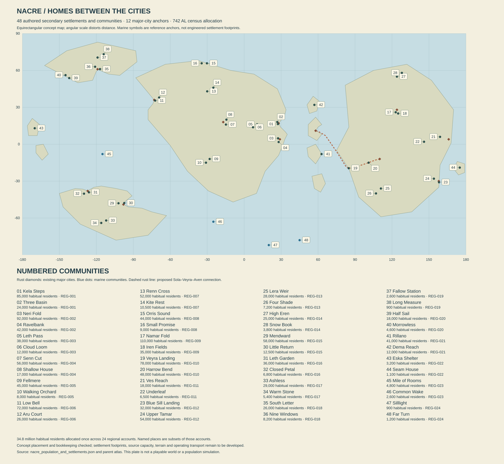

# Settlement belts and the inhabited planet

Working canon proposal, edition 0.7, 742 AL. Nacre's twelve major-city cores contain 4.88 million people. The reference census estimates 34.8 million. The difference is not empty countryside awaiting decoration: it includes surrounding settlement belts, other towns, villages, farms, workshops, stations and mobile communities. This chapter allocates that population once, establishes forty-eight secondary community anchors, and connects Sola to a proposed western Morrow gateway and the inland approach to Aven.

The [population and settlement record](Settlement/nacre_population_and_settlements.json) is the numerical authority for this proposal. Its rounded regional allocations preserve the existing world estimate and city populations. They are authored choices, not measured demographic forecasts. The [arithmetic and placement report](Settlement/POPULATION_AND_SETTLEMENT_CHECKS.md) distinguishes closed bookkeeping from unresolved productive capacity, regional boundaries and local terrain.

## 1. A civilization made of more than its famous cities

The twelve major cities are places of particular narrative, historical and industrial importance. They are not the only settlements large enough to be called cities. Namar Fold's 110,000 residents, for example, require varied work, institutions and neighborhoods of their own. Calling it a secondary settlement describes its place in this initial atlas, not the worth or sophistication of its inhabitants.

Settlement categories need definitions before numbers become meaningful. The UN's Degree of Urbanization distinguishes settlements using population, density and contiguity, while its glossary also distinguishes functional areas and a continuum between rural and urban forms. Those distinctions inform this chapter's separation of physical cores, associated belts and regional networks. Nacre's bins below are authored planning categories; they do not claim a UN classification without a population grid or transfer Earth's settlement shares to another world. [UN DESA demographic glossary](https://population.un.org/wup/glossary-demographic-terms).

The fictional census counts **habitual Nacre surface and marine residents**, including people temporarily away from their usual homes. Separately domiciled offworld or orbital communities are outside this estimate and need their own later accounts. A Brin resident temporarily working in orbit remains in Brin's population; an established resident of an independent orbital habitat is not quietly added to Brin when visiting. This boundary describes the estimate, not citizenship, belonging or a universal law.

The distinction matters most where movement is ordinary. A river household can maintain a usual berth network while traveling. A shipboard family can belong to a mobile community without being counted in every visited port. A student spending a substantial settled period elsewhere needs a stated residence rule in the local record. A person living outside formal registration is still a person the census attempts to estimate; absence of paperwork does not make them disappear from the world.

| Exclusive reference category | Habitual residents | What it means here |
|---|---:|---|
| Twelve major-city cores | 4,880,000 | The populations already used by the city dossiers |
| Associated settlement belts | 2,430,000 | Communities outside those cores with strong everyday service and work connections |
| Other towns | 12,237,000 | Independent settlements and local town networks beyond those core/belt accounts |
| Dispersed and station communities | 14,559,000 | Villages, farm households, small work settlements and fixed stations; not solitary homesteaders exclusively |
| Mobile usual residents | 694,000 | People whose ordinary homes belong to moving communities rather than a counted land settlement |
| **Total** | **34,800,000** | One allocation of the inherited estimate |

These categories are exclusive for bookkeeping, while people's relationships are not. A farmer can be a shareholder in a city workshop, a resident of a small village, a speaker of several languages and a regular passenger to another region. Administrative jurisdiction, cultural affiliation, watershed and service network have different boundaries. The map should eventually show those differences rather than paint each region as one sovereign cultural block.

The reference uncertainty remains approximately ten percent. It is not an instruction to add ten percent independently to every region and call the result a new census. Some errors correlate: a mobile group may be missed in one record and counted twice in another; a change in classification can increase a city's reported population without anyone moving. The exact total used for authoring keeps dependencies inspectable while acknowledging the fictional census's limits.

## 2. Belts, islands of occupation and long empty views

An associated settlement belt is not an unbroken carpet of suburbia. It can include fields, native habitat, reservoirs, industrial land, villages, rail stops and protected gaps. People may share a hospital, school network or labor market while living beyond walking distance of the city center. There should be places where the skyline remains visible across unbuilt ground, and places where it has disappeared long before social connection ends.

Orison's existing **1.2-million-person urban and agricultural service region** remains a functional subset of the proposed **2.4-million Saffron Escarpment regional account**. Its 420,000 core residents are included in that 1.2 million. Neither number is added again to the regional total. The functional region's remaining constituent settlements still need specific membership and boundaries. Kela Steps and Three Basin belong to Saffron's account, but this first record does not automatically declare all their residents inside the Orison functional subset.

Other towns receive 12.237 million residents because a planetary civilization needs more than a handful of service centers. The forty-eight named communities below cover only a subset. Future names must be assigned against the remaining allocation, or the allocation must be explicitly revised. A generated village does not create extra census population merely because its houses look occupied. Conversely, a ledger of unnamed residents is not finished worldbuilding: those remaining networks need history, geography and selected places the player can actually visit.

Dispersed settlement does not mean technological isolation. A farming household can use advanced instruments and depend on a nearby repair town. A station can host families and visiting teachers. A woodland village can communicate quickly while receiving bulky materials slowly. The distinction between information and freight is one of the world's most useful sources of scale: a person can know exactly which part is needed and still face a substantial journey to obtain it.

Empty views should have specific contents. A broad native canopy, a watershed without roads, an exposed mineral basin or a moving ocean front can occupy hours of travel without repeated buildings. The absence of visible settlement is not evidence that land has no owners, history, ecological value or uses. Nor must every empty horizon hide a ruin. Some discoveries are changes in light, animal movement, geology or the first sign of another traveler.

The local density around a town and the mean density of its huge region are different quantities. This chapter does not calculate regional density because the atlas currently uses regional focus anchors, not complete boundary polygons. City districts and town footprints also need separate area records. Population should inform those future designs without being used to manufacture precision from a map that does not yet contain it.

## 3. Kesh's connected regions

Kesh receives **16.6 million habitual residents** in this allocation. Its long settlement history produces several overlapping belts rather than one coast-to-interior gradient of civilization. Early infrastructure, later migration, regional industry and native landscapes create different concentrations. The following towns are new local proposals; their detailed founding dates will be reconciled before being added to the historical register.

### SET-001 — Kela Steps

**REG-001 · 85,000 residents · 27.4° E, 16.4° N.** Kela Steps occupies an escarpment service position inland from Orison. Freight is sorted by destination and handling requirement before it enters smaller routes; independent workshops make the town more than a warehouse with beds. Broad working terraces alternate with tightly inhabited streets. Their retaining structures, access and drainage will require local terrain design rather than copying Orison's crater wall.

People know the arrival of a particular component can change several businesses' plans. A broken freight lift might inconvenience a school exhibition, a fabricator and a household move in different ways. The town's pleasure is the view from working roofs after a shift: domestic lights appear on separate benches, while the city's distant glow sometimes disappears in weather. A traveling crew can find an excellent technician here whose ambitions have nothing to do with leaving.

Its material signature combines large replaceable loading edges, pale domestic courts and brightly marked private entrances. Public routes remain distinct from heavy-work corridors. A future adventure can turn on choosing which route a disputed cargo takes, with local workers as informed participants rather than anonymous obstacles.

### SET-002 — Three Basin

**REG-001 · 24,000 residents · 26.9° E, 18.1° N.** Three Basin is a cultivation and rural-service town whose name preserves an earlier division of storage and growing ground. The proposal does not establish three immense reservoirs merely by naming them. Actual source water, catchments and productive area must be allocated against the regional accounts.

Its inhabited center joins a market, school, care rooms, equipment yards and processing buildings. Beyond it, introduced crops occupy selected managed ground among native patches and unbuilt slopes. Household gardens are not counted as sufficient city food. The community's visual interest comes from different ages of enclosure, shade and irrigation work, with additions fitted around inherited paths.

A traveling cook might stay to learn a preservation method; a repair crew might need to return for a missing seal; a household can disagree about accepting a larger buyer's contract. The place must offer ordinary success as well as pressure. Its annual gathering celebrates prepared food and useful domestic objects, giving artists reasons to author utensils, packaging, tables and family collections that later travel into Orison.

### SET-003 — Neri Fold

**REG-002 · 92,000 residents · 27.5° E, 4.8° N.** Neri Fold gathers food and manufactured household goods from a wider lowland network. Its anchor is on concept land; the exact waterways, local flood levels and transfer facilities remain to be mapped. A regional food allocation passing through the town is not all grown within its boundaries or eaten by its residents.

Large clean processing rooms sit beside older mixed workshops. Their waste, water and transport paths must differ. Public eating places serve workers, merchants and households without making every meal a ceremonial showcase. Good preservation work is a local source of pride, while cheap containers and attractive labels can cause arguments about value and honesty.

The town can support a substantial independent adventure: identify who diverted a contracted shipment, find the actual goods, and choose whether to honor a claim that may itself be exploitative. The evidence belongs in containers, production records, handling marks and people's specific knowledge. A correct answer should change real deliveries and relationships. It should not reveal a conspiracy governing all lowland agriculture.

### SET-004 — Ravelbank

**REG-002 · 42,000 residents · 28° E, 1.8° N.** Ravelbank combines teaching, repair and a regional market. Its name is inherited locally and is not proof that every resident belongs to the Ravel tradition. People from several settlement networks study and work here, some for a short interval and others for decades.

Workshops display repaired objects alongside the tools used to understand them. A training household may host learners without turning its rooms into a permanent dormitory. Public demonstrations can be entertaining and competitive; a celebrated instructor can be wrong about a particular old assembly. Expertise remains distributed among people with different histories.

The surrounding lowlands connect homes, fields and native wetland through routes whose seasonal behavior varies. A future local plan should make a market arrival possible without forcing every visitor through a dangerous habitat. Ravelbank is a place to obtain help, develop a relationship and learn why an apparently easy route deserves a second look. Its architectural grammar favors open teaching fronts, protected stores and generous shared thresholds.

### SET-005 — Leth Pass

**REG-003 · 38,000 residents · 10.5° E, 16.2° N.** Leth Pass serves a route across the Glassback uplands. The anchor establishes a settlement location, not the final elevation or geometry of the pass. The route will need terrain, grade, drainage, refuge and freight studies before it can carry the traffic implied by the town.

Its economy includes transfer, vehicle work, lodging and manufacture suited to smaller valuable cargo. Families live around the route without spending every day waiting for travelers. A protected performance court can be full while a distant road remains closed. Local guides disagree about route choices for reasons that can include experience, commercial interest and private obligations.

The visual approach should reveal the settlement in stages: a service marker, cultivated pockets, occupied terraces and then the actual crossing. Different elevations need separate silhouettes rather than one stack of identical buildings. An optional journey might follow an older alignment toward a retired relay or a hidden departure point, provided that its original purpose and present hazards are authored as carefully as the main road.

### SET-006 — Cloud Loom

**REG-003 · 12,000 residents · 7.2° E, 13.8° N.** Cloud Loom is known for fine textile work and its position among source-water communities. Its name describes an impression of cloth and shifting cloud, not a machine that condenses unlimited drinking water. Regional water rights and catchment operations remain distinct from the workshop economy.

Small productive rooms and larger shared finishing spaces produce a town with unusual color inside otherwise restrained weather-facing buildings. A cloth made here can appear as a valued lining in Brin or an ordinary repaired curtain nearby. Export prestige should coexist with practical local versions, imperfect work and fashions that residents no longer admire.

The town's strongest stories concern attribution and collaboration: a design travels under another maker's name, a household technique becomes an institutional product, or two people disagree about what may be shared. Those conflicts can lead to journeys and difficult choices without making every artisan poor or every merchant predatory. Assets need actual weaving or fabrication logic, storage, drying conditions and the distinction between work in progress and display.

### SET-007 — Senn Cut

**REG-004 · 56,000 residents · 14.8° W, 16° N.** Senn Cut occupies a dry concept-land position east of the mapped terminal waters. It supports mineral processing, repair and reuse within the Red Ledger network. Materials arrive with different compositions and contamination histories; an efficient-looking plant cannot turn arbitrary scrap into any needed alloy.

The settlement has a broad industrial edge and a more compact inhabited center. Shade, acoustic separation and clean entrances make the difference between working near industry and living inside a factory. Residue storage and long-term closure occupy land beyond the pleasant streets, with transport and accountability rather than a hidden disposal void.

Independent crews come for parts, contracts and occasional discreet work. A valuable recovered assembly can generate a dispute between its finder, former owner, processor and the household that needs its service. The player may move through those relationships without becoming the only competent person present. The skyline uses low heavy masses, narrow service towers and a few precise points of color. It should remain distinct from Hesh's intimate room culture.

### SET-008 — Shallow House

**REG-004 · 17,000 residents · 14.4° W, 20° N.** Shallow House combines regional care, repair and selected basin-margin cultivation. Its name comes from an older building tradition whose later interpretations need local history; it is not a declaration that groundwater lies just below every floor.

People arrive for appointments, training, family visits and supplies. Some remain longer than planned. The town therefore needs ordinary lodging with kitchens and privacy, not only an inn designed for the protagonist. A care worker can have strong views about an expedition because a crew member is a friend, while still respecting their choice to leave.

Its public spaces favor shade, short accessible routes and small gardens using qualified introduced plants. The surrounding native landscape remains visible between occupied clusters. A future exploration sequence can begin with an old household record that points to a place outside the town, without turning confidential medical information into collectible clues. Here the world demonstrates care as skilled work and friendship as something that survives distance.

### SET-009 — Fellmere

**REG-005 · 45,000 residents · 28° W, 12° S.** Fellmere is a service town in the Foldwood Marches. Native seasonal folding vegetation shapes views and access, while introduced cultivation and domestic planting occupy managed sites. Familiar human food does not grow safely from every striking native fruiting body.

The town is organized around routes that have changed as work, habitat and settlement expanded. An older street can end at a protected patch instead of continuing as a convenient straight road. Homes use deep sheltered edges and generous places to clean equipment before bringing it inside. Public workshops support field gear, ordinary furniture and local processing rather than one exotic resource exclusively.

Exploration can begin with a change in a known route or a returning traveler whose account contradicts a popular guide. The answer should depend on the specific place and season. Fellmere also needs good weather walks, games, romances and a craft market where visitors buy objects for pleasure. Its identity is seasonal responsiveness expressed in a lived town, not a permanent warning about the forest.

### SET-010 — Walking Orchard

**REG-005 · 8,000 residents · 31° W, 15° S.** Walking Orchard is a permanent service community for introduced crop nurseries and dispersed households. The name refers to the movement of stock, people and designs across generations. Buildings and mature trees do not physically migrate through the forest.

Families maintain working plots at different distances from the central rooms. A nursery order can take years of attention before it becomes a useful shipment elsewhere, so a delivery scene should reveal preparation and knowledge rather than a glowing crate of instant prosperity. Local stock choices must reconcile with Velis's specialized services instead of making every town equally capable of preserving everything.

The central market changes with actual arrivals, while schooling, care and repairs continue between them. A small stage hosts sharp local comedy about urban visitors who misunderstand the name. A player can earn trust by carrying information accurately or arranging a fair exchange, but a household may still refuse to release a cherished line. Its asset brief emphasizes propagation work, domestic continuity and containers that show their intended journey.

### SET-011 — Low Bell

**REG-006 · 72,000 residents · 72.2° W, 35.5° N.** Low Bell is inland of Serein's coast, supporting enclosure fabrication and freight consolidation. It is not another harbor placed wherever a map icon looks attractive. Components can move between the town and coastal services through routes that remain to be designed at local scale.

Factories, cooperatives and small makers share some standards while competing over finish, warranty and adaptability. A modest home may contain an excellent window whose maker is known personally. Larger public buildings can reveal several generations of replacement assemblies. This is an opportunity for a shared regional kit with genuine variation in construction, not a copy of every Serein facade.

Workers have leisure institutions of their own: amateur stage sets, domestic music, competitions over absurdly precise miniature fittings. An industrial dispute can concern a real failed batch without implicating all manufacture. A traveling crew might carry evidence or negotiate a repair guarantee. Returning later should reveal what was corrected, who paid and whether the people involved still choose to work together.

### SET-012 — Aru Court

**REG-006 · 26,000 residents · 69° W, 38° N.** Aru Court joins upland teaching, housing and source-water services. Its relationship to Serein is functional rather than subordinate in every matter. A coastal request for additional water or specialist labor has to meet local obligations, not simply override them because the larger city is more important to the story.

The town's courts are broad inhabited spaces between buildings with different institutional histories. Some began as shared work access and became valued domestic places. Residents can favor a technically sound upgrade while objecting to how it would change their daily route or tenancy. A visiting expert should encounter informed disagreement, not a population waiting to be educated.

Its surroundings offer routes toward catchment landscapes, old monitoring sites and quiet viewpoints. Actual intake works require mapped sources and ecological limits before becoming canon. The assets should join clean instrument work, comfortable homes and weather-facing structures. A memorable visit might include a difficult public meeting followed by a wonderful meal with someone who argued against the player.

### SET-013 — Renn Cross

**REG-007 · 52,000 residents · 30° W, 43° N.** Renn Cross is a steppe freight intersection with vehicle repair, lodging and local manufacture. It is large enough to have several neighborhoods and competing centers of activity. The open country should remain visible from its edges, with long routes disappearing beyond isolated signs of occupation.

Movement is its public theater. Crews arrive with damaged equipment, excellent news, tired passengers and stories that improve during retelling. Dispatch work is usually competent; a missing or contradictory report matters because there is a functioning network. A household can choose the town for opportunity rather than because a vehicle broke there once.

The architectural family uses broad service yards, low wind-conscious housing and sheltered communal rooms with unexpectedly elaborate interiors. A pirate story might involve a change of cargo carrier or a concealed passenger, while an ordinary return can be marked by someone remembering how the player takes a meal. Beyond the town, native migrations and seasonal ground conditions create real reasons to vary a journey.

### SET-014 — Kite Rest

**REG-007 · 10,500 residents · 25° W, 46° N.** Kite Rest supports fieldwork, regional care and observation of native movement. Its name does not introduce an Earth bird into the ecosystem. The settlement's history should distinguish an inherited metaphor from the actual organisms people come to watch.

Long observation intervals coexist with practical work. Researchers, guides, drivers, teachers and families have different reasons to be here. A good observation site may be poor ground for a large visiting event; another site can offer accessible public viewing without damaging a breeding area. Those choices need specific habitat and route design.

Homes and public rooms use large framed views selectively, balanced by privacy and weather control. The town should be lovely when nothing unusual occurs. A returning visitor can see an old drawing displayed, discover that an expected migration took another route, or encounter a guide who has changed their opinion through evidence. Observation becomes a relationship with a place, not a checklist of collectible animals.

### SET-015 — Orris Sound

**REG-008 · 44,000 residents · 30.2° W, 65.8° N.** Orris Sound is a proposed northern coastal interchange, about 8.9 km from the coarse concept shore. That distance locates a town near water; a harbor, access channel and actual loading sites still require local geometry. Its role includes seasonal provisioning, repair and transfers between regional and longer routes.

The inhabited town rises away from the working approach in several clusters. Some residents know Brin or Serein through repeated journeys; others know them through relatives, media and goods. Northern Kesh supply promised to Brin must include Orris's own residents and the other customers using the network. The town is not a warehouse whose contents belong to whichever major city asks first.

Departures can be festive, routine or troubling. An independent crew offers freedom but also employment terms worth reading. Assets should make vessel classes, passenger needs and stored goods distinct. Sheltered public rooms overlook movement without blocking it, and a community can continue enjoying the coast when no long-distance ship is due.

### SET-016 — Small Promise

**REG-008 · 9,000 residents · 34.5° W, 65.8° N.** Small Promise is a land-based community in the wider sounds region. Its small scale is relative to the major cities, not evidence that it consists of six houses. Repair, schooling, care, provisioning and domestic manufacture give it several overlapping centers.

Its residents maintain particular agreements with nearby places: a specialist visit, a shared vehicle, a place in a training program, a supply arrangement with a credible fallback. A broken promise can matter deeply without becoming a regional war. The settlement's humor often concerns the distance between grand declarations and useful small commitments, but that is a social tendency to develop through people, not a trait assigned to every resident.

A traveler might come for shelter and stay to help finish an object, attend a local event or wait for someone they hope to meet. The landscape beyond remains expansive. Materials favor repairable assemblies, protected color and domestic collections accumulated through exchange. The most important asset may be a room whose use changes across a civil turn, making the community feel occupied by lives rather than services for the player.

## 4. Morrow beyond the four major cities

Morrow receives **13.1 million habitual residents**. Talweir, Aven, Dhal and Merrow are different centers within that population, separated by landscapes and journeys large enough to support distinct histories. The proposed western gateway serves Aven without moving Aven to the coast. Native forests, lake systems, uplands and estuary habitats remain geographically different, even where a common manufactured component appears in several towns.

### SET-017 — Namar Fold

**REG-009 · 110,000 residents · 123° E, 26° N.** Namar Fold is a substantial processing and market town in the lake-country network. Its dry anchor lies outside the mapped lake polygons. The name expresses regional connection, not a claim that its central square is on the lake edge. Local transfer routes must bridge that distinction honestly.

The town draws together introduced agriculture, preservation, manufacture, services and domestic life. Tall processing volumes stand apart from smaller streets rather than filling every view. Some households work in regional production; others teach, care, repair, trade or make things that have little to do with food. The town is large enough for artistic disagreement and for people to live quite different versions of it.

A cargo promised to Sola, Serein or Brin cannot be counted as available here merely because it is physically stored nearby. A future adventure can explore that gap between location and entitlement through real goods and people. Its visual character favors generous working courts, controlled clean interiors and public spaces where visitors can spend a pleasant day without entering an industrial facility.

### SET-018 — Iren Fields

**REG-009 · 35,000 residents · 125° E, 25° N.** Iren Fields serves introduced cultivation and smaller processing communities. It is a town, not an endless field texture. Schools, homes, shops, tools, recreation and disagreements occupy the spaces between production. The surrounding crop mosaic needs explicit rotations, water, substrates, nutrient return and seasonal work.

The town values well-made objects that travel between indoor and outdoor life: folding tables, protected carriers, field instruments, repairable footwear and containers whose closure can be trusted. Good design is visible in ordinary use rather than collected only in a museum. A household may preserve an old object because it fits a task better than a fashionable replacement.

Exploration can follow a route through working landscapes into native margins and then farther toward an older service site. Those transitions need legitimate access and observable boundaries. An abandoned building should have a reason it was built and a reason useful contents remain. A return to town can be marked by changed produce, a repaired road or a person who has finally decided to join a distant course.

### SET-019 — Veyra Landing

**REG-010 · 78,000 residents · 84.9° E, 19.5° S.** Veyra is the proposed western Morrow gateway for a major Sola–Aven connection. Its dry town anchor is about 19.2 km from the coarse coast. The name refers to the wider landing district; the actual marine terminal, shore approach and inland transfer must be located in a detailed local plan. A cargo ship does not berth at the inland town-center coordinate.

The gateway belongs to Aven's functional regional network without requiring a narrow continuous administrative corridor. It handles ocean-to-land transfer, vehicle work, warehousing, passengers and its own substantial domestic economy. Residents can resent distant assumptions that they exist only to serve the uplands. Aven and Veyra need agreements between institutions with different priorities, not one invisible authority controlling the entire journey.

Its architecture should celebrate arrival through depth and sequence: marine work, transfer courts, temporary lodging, ordinary neighborhoods and a visible inland departure. The port's historic layers remain to be dated. A future playable visit can offer several onward choices, including remaining in a community with music, ambition and waterfront life of its own.

### SET-020 — Harrow Bend

**REG-010 · 48,000 residents · 101° E, 15° S.** Harrow Bend is an inland transfer and service town on the proposed continuation toward Aven. Its location on the route is a planning control, not proof of a navigable valley or a river bend. The final terrain must supply a credible reason for the alignment and the inherited name.

Long-distance freight changes handling here, while passengers encounter a different rhythm from the coast. Some vehicles continue; some loads are reorganized; some people stay. Housing includes permanent households, longer-term learners and visitors waiting for specialist work. A connection missed here should create practical alternatives and social possibilities rather than simply force a loading-screen delay.

The town's visual signature joins broad maneuvering spaces to close protected residential streets. A view from a cafe can show heavy machinery, an amateur performance and the beginning of an upland route. Independent crews may seek a quiet transfer away from a larger terminal. Their choices should have witnesses, ownership and consequences appropriate to this particular town, not a generic outlaw status applied across Morrow.

### SET-021 — Ves Reach

**REG-011 · 18,000 residents · 159° E, 6° N.** Ves Reach links forest-region publishing, field logistics and households spread across several routes. Its dry anchor does not by itself establish a river quay. The town can exchange information rapidly with Dhal while physical travel remains substantial, a useful distinction for both ordinary correspondence and adventure.

Public rooms combine reading, recording, teaching and practical preparation. Publishers disagree about how to represent places their readers may never visit. Field crews can object to a beautiful illustration that implies a safe route where none exists. A local artist may deliberately make an impossible landscape and label it honestly, producing pleasure without turning every work into a technical map.

The surrounding native system retains the Green Vault's established ecological limits. Homes and productive enclosures need specific drainage and interfaces with that landscape. The player can follow a discrepancy between an account and a place, meet its author and discover a story more interesting than a simple fraud. Material assets should include several media, field-worn cases, domestic libraries and the tools that turn observation into a shareable work.

### SET-022 — Underleaf

**REG-011 · 6,500 residents · 146° E, 2° N.** Underleaf is a small forest household network with a service center and qualified materials work. Native life shapes its setting, but the community does not live by casually eating or building from everything it finds. Introduced food, local suitability tests and regional supply remain necessary.

The inhabited ground should feel chosen carefully: compact work areas, clean domestic thresholds, paths that reveal older changes in use, and places where the native canopy remains close without being forced into every room. Residents have connections to several towns and reasons to disagree about further growth. A successful local material can bring attention that not everyone welcomes.

An expedition might begin with a request to verify a distant supply site or recover records from a disused trial house. The useful result can be a decision not to scale a harmful process, an improved method or a trade that supports more than one household. The settlement also needs ordinary enjoyment: shared food, small performances and quiet walks whose value does not depend on finding a rare specimen.

### SET-023 — Blue Sill Landing

**REG-012 · 32,000 residents · 158.18° E, 30.94° S.** Blue Sill Landing places an inhabited lower-estuary transfer community near the mapped mouth, approximately four kilometers from the coarse concept shore. It does not locate every historical Blue Sill nursery or hearing site at this one point. Those places require their own ecology and history records.

The town makes the distance from Merrow tangible. People who work here can give evidence in the city without being city residents. Cargo, samples, visitors and ordinary household goods travel through different handling arrangements. Nursery interpretation belongs beside competent port work and residential life, not in a sterile visitor center that replaces the community.

The local plan must establish water chemistry, tides, landings and habitat before assigning intertidal species. A future journey can compare an upstream claim with a downstream consequence, then discover residents who disagree about the best response. Assets should distinguish controlled observation, working shore, protected habitat and public enjoyment. A repaired nursery can be a living place with new obligations rather than a permanently frozen monument to damage.

### SET-024 — Upper Tamar

**REG-012 · 54,000 residents · 154° E, 28° S.** Upper Tamar serves processing, household craft and boat-related work in Merrow's broader river region. Its concept-land anchor does not assert that the parent river's drawn centerline runs through the town. A local route and water connection must be established where the final functions need them.

The town's makers adapt large-city standards to smaller firms and households. An excellent compact kitchen assembly can travel aboard a family vessel; a poorly designed replacement can become the subject of a memorable public argument. Different tenures and traditions overlap, with people moving among boats, land homes and temporary work without becoming one uniform nomadic culture.

Adventures can emerge from a missing vessel, a disputed repair or a household choosing a different future. The relevant people should have histories and options beyond waiting for the player. Visually, Upper Tamar favors mixed work-and-home courts, small fabrication volumes and objects whose scale reveals the lives they serve. It needs places for departure and places where someone has clearly decided to stay.

### SET-025 — Lera Weir

**REG-013 · 28,000 residents · 111° E, 36° S.** Lera Weir supports seasonal cultivation and exchange in White Reed country. The name is a historical lead, not a completed hydraulic structure: any surviving or proposed weir needs a real channel, purpose, levels and ecological consequences in the local plan.

The town's seasonal cycle includes intense work, repair, visits and quiet intervals. Introduced crops occupy suitable managed ground; native open vegetation and flood-fed corridors remain different systems. A successful harvest must include storage and delivery, while a spectacular rain scene does not prove that every source has replenished.

Public spaces can shift between trade, performance and ordinary recreation without requiring every building to transform mechanically. Residents have strong views about who may use a shared court and who must clean it afterward. A journey outward can reveal cultivation margins, routes used by native life and a former infrastructure project whose benefits and costs were uneven. The return should show the consequences in a particular settlement rather than award an abstract environmental score.

### SET-026 — Four Shade

**REG-013 · 7,200 residents · 107° E, 40° S.** Four Shade joins refuge, maintenance and field study in open country. Its name can survive changes in the number of actual shelters without becoming an error to fix. People have continued using an inherited place through several generations of practical alteration.

The community's public rooms are designed for arrivals without assuming everyone is a tourist. A driver may need sleep, a household may need a specialist, a researcher may need a quiet place to finish work, and a traveler may simply want company. Service limits can be explained by actual staffing and supplies rather than an arbitrary locked shop.

Its outward routes should offer long views, changing ground and modest signs of human care: a repaired marker, a useful wind screen, a small store maintained by people who are not present when it is used. A future event can test that reciprocal practice through a specific broken agreement. Assets need durable outdoor details and interiors with enough personal variation to show that refuge is also home.

### SET-027 — High Eren

**REG-014 · 25,000 residents · 124° E, 55° N.** High Eren is a cool-upland town supporting instrument work and source-water services. Its latitude does not place it in polar night under Nacre's adopted tilt. Seasonal light, weather and terrain exposure require the same care as in the larger cities.

Workshop output can be valuable enough to travel far, while bulky household needs favor regional connections. An instrument maker may have clients in Tern and a sibling in a nearby village. That network gives the town access to ideas without making freight distance irrelevant. A proposed source-water installation must serve local and downstream obligations through actual geography and agreements.

The architecture uses separated technical spaces, close domestic streets and strong framed views. A public festival might celebrate an ordinary craft that outsiders rarely associate with scientific work. Exploration can lead from a familiar maintenance route toward a higher site whose history has been simplified in popular accounts. The place should reward both careful investigation and the pleasure of seeing an immense landscape from a well-made room.

### SET-028 — Snow Book

**REG-014 · 3,800 residents · 128° E, 58° N.** Snow Book is a ridge community with a school, archives and support for dispersed settlements. Its archive includes ordinary practical knowledge, family records and disputed local accounts. It is not the single repository that somehow knows the truth about the whole planet.

Teachers and visiting specialists use different schedules, while households keep life going between arrivals. A child can grow up here with sophisticated interests and incomplete familiarity with a distant city. A returning resident may find that the place changed while they were away, and that their remembered expertise is no longer current.

The settlement's assets should convey adaptation through specific changes: an archive room extended, a service entrance moved, a shared table repaired, a window replaced after years of complaint. An adventure can begin in a small record and lead far beyond the town, but the record should have an author, a reason to survive and limits. Snow outside is conditional; the place remains itself in other seasons.

## 5. Sere's working coast and interior

Sere receives **2.72 million habitual residents**. Its smaller total does not make the continent a single remote outpost. Tern's industry, Velis's living-stock work, the wider food and household networks, and the Ember Fault's different settings create multiple centers. Marine transport, local cultivation and inland routes have separate operating conditions.

### SET-029 — Mendward

**REG-015 · 58,000 residents · 102° W, 48° S.** Mendward supplies repair and fabrication beyond Tern. It is inland in the concept geography, so the movement of hull sections or large assemblies needs actual land corridors and handling equipment. A vessel does not sail through the town merely because many residents work on ships.

The community's main distinction is the combination of heavy industrial competence with domestic precision. A large enclosure can stand beside a street of finely adapted small homes. Workers may make beautiful personal objects using skills related to their employment, without every home becoming an unpaid extension of the workshop.

Disputes can concern a qualification result, a missed delivery or who owns a design developed collaboratively. A player seeking a scarce part should encounter legitimate alternatives and people able to say no. Returning after a successful refit can reveal new work rather than an eternally identical half-built hull. The art brief requires varied work stages, clean assembly, stored material and spaces deliberately left empty for operations.

### SET-030 — Little Return

**REG-015 · 12,500 residents · 97.3° W, 47.8° S.** Little Return is a coastal refuge and independent vessel-service town, about 14.1 km from the coarse shoreline. Its eventual landing site must prove shelter for particular vessels and conditions. A place can be useful for one crew while unsuitable for another.

Residents have relationships with Tern's rescue and repair institutions without all being rescue workers. The town offers lodging, ordinary food, maintenance, care and reasons to remain after a difficult arrival. A returning vessel can bring celebration, paperwork, damage and private unease in different proportions.

The shoreline should distinguish working access from public enjoyment and native habitat. A future encounter might involve a crew seeking emergency help while its possession of a component is disputed. Shelter and ownership are separate questions; assisting people need not erase another person's claim. Assets should make this distinction visible through temporary work, secure storage, occupied rooms and a port whose use changes without becoming a permanent disaster scene.

### SET-031 — Leth Garden

**REG-016 · 36,000 residents · 126° W, 39.1° S.** Leth Garden supports propagation training and ordinary food processing beyond Velis. It does not duplicate every specialized preservation capability in the city. Different facilities handle different living materials, and the skills to use them remain part of the trade.

The town combines cultivated courts, homes, teaching rooms and processing spaces. Opening roofs and ventilation have particular purposes rather than forming one spectacular machine across the whole settlement. Domestic gardens can be cherished without being credited with a significant fraction of regional nutrition.

A visiting recipient might discover that a purchased stock line requires changes at home, turning a delivery into a longer relationship of training and adaptation. A local teacher may support that independence while their institution prefers recurring service income. The disagreement deserves people with mixed motives. Visually, Leth Garden should feel more distributed and domestic than Velis's central stock institutions, with evidence of both successful routines and patient incomplete work.

### SET-032 — Closed Petal

**REG-016 · 6,800 residents · 130° W, 40.2° S.** Closed Petal is a cold-garden household community with living-stock care. Its name describes a remembered image, not a claim that all its plants share one behavior. Introduced crops, native life and maintained cultures have distinct needs and ownership.

The settlement's rooms are compact but varied. A small shared facility can serve several households, while private spaces preserve different tastes and rituals. Cold weather makes enclosure important; it does not abolish ventilation, maintenance, recreation or the desire for an open view. Warmth should be visibly supplied and selectively used.

A shipment can arrive viable yet become useless if the receiving conditions are wrong. That possibility gives a meaningful task to a carrier without making them responsible for every later outcome. The town also supports gentler returns: a household successfully establishes a new crop, a learner comes home, an old culture is respectfully retired. Assets emphasize care over spectacle, with containers and tools that reveal what living continuity requires.

### SET-033 — Ashless

**REG-017 · 29,000 residents · 112° W, 62° S.** Ashless serves fault-region heat investigation and manufacture. The name explicitly resists the habit of depicting every geothermal place as a flaming volcanic field. The inherited region contains rift and thermal systems; any useful resource requires a specified reservoir, temperature, chemistry, flow and operating plan.

The town's industries can use qualified local heat for selected purposes while relying on other supplies for electricity and materials. A warm pipe in one room does not prove the settlement is energy independent. People who maintain the system have ordinary ambitions and disagreements beyond keeping everyone alive.

Its architecture can contrast dark mineral ground, restrained service structures and unexpectedly bright occupied interiors. Old trial works offer exploration only where their history and present condition justify access. An adventure may concern a valuable observation, a disputed site or a failed commercial promise. The strongest outcome can change who is allowed to decide the next project, rather than reveal an inexhaustible resource that solves the planet's economy.

### SET-034 — Warm Stone

**REG-017 · 5,400 residents · 116° W, 64° S.** Warm Stone is a mineral-service settlement with thermal workshops. Its small population supports a limited range of work and depends on neighboring communities for other services. A specialist arriving here should find capable colleagues whose expertise is local and specific.

The town's public life gathers around a few well-used rooms without implying that residents have no privacy. An ordinary bathing or warming facility, if adopted, needs an actual supplied thermal circuit and hygiene arrangements. Its appeal should come from social practice and material comfort rather than a generic fantasy hot spring placed anywhere in a cold biome.

Routes outward pass through sparse occupied ground, field installations and native habitats adapted to local conditions. A player might retrieve an abandoned instrument whose data belongs to several parties, or accompany someone returning to a place they helped build. The environment needs visible service history, safe ordinary routes and optional difficult approaches. Warm Stone should feel worth coming back to even when the mineral work is uneventful.

## 6. The Pale Reach as home

The Pale Reach receives **940,000 habitual residents**: 650,000 in the Brin Long Shore account, 60,000 in the Pale Interior and 230,000 in Split Cape. Most of this vast land remains sparsely occupied. Coastal and inland communities have distinct access and ecological conditions; latitude alone cannot determine their personalities, political views or degree of modernity.

### SET-035 — South Letter

**REG-018 · 26,000 residents · 117° W, 61.1° N.** South Letter combines regional freight, teaching and domestic manufacture. It is an inland settlement in the Long Shore network, not a second harbor inferred from its regional name. Connections to Brin need actual route and service records.

The town's correspondence culture includes ordinary messages, recordings and objects sent to people elsewhere. Brin's Pocket Weather enthusiasm can appear here through individual makers without making every household a miniature workshop. A person can love a distant place, dislike the fashion associated with it and still want to visit.

Schools and workshops share some facilities through bounded agreements. When a visiting specialist leaves, knowledge and responsibility must remain with actual people. A future journey can be motivated by an unfinished collaboration rather than a missing magical component. Assets should include old and new domestic work, changing displays, practical freight space and public rooms whose proportions make long conversations possible.

### SET-036 — Nine Windows

**REG-018 · 8,200 residents · 121° W, 63° N.** Nine Windows supports an inland approach and instrument repair. The name belongs to a local history that future work should establish; it is not an instruction to put exactly nine windows on every building. A recognizable older facade could preserve the association while the community grows around it.

Travelers encounter preparations, ordinary deliveries and people deciding whether to leave. Equipment readiness, route conditions and personal obligations may point toward different choices. A competent operator can postpone a departure without the story treating them as cowardly, while an ambitious traveler can accept a known risk without being written as foolish.

The settlement should offer close domestic warmth and wide exterior views in the same visit. A repaired instrument may return from Brin with an annotation from someone the player knows, linking the cities through actual objects. Beyond the occupied ground, the route toward interior communities needs refuges, service intervals and meaningful discoveries. Nine Windows is the beginning of that experience, not a substitute for it.

### SET-037 — Fallow Station

**REG-019 · 2,600 residents · 119° W, 70.5° N.** Fallow Station is a permanent service community rather than a rotating camp with no domestic life. Its population includes varied work, care, teaching and households, while some technical staff rotate through shorter assignments. The census distinguishes those residents from temporary visitors.

The station's name does not mean it produces no useful work between expeditions. Maintenance, observation, preservation, correspondence and learning continue through quiet intervals. A public room can host a game, an argument about an old recording and a route briefing on the same civil turn. People deserve time that is not organized around danger.

This latitude remains outside the nominal polar circle under the adopted tilt, though local exposure and weather can be severe. Supplies, energy and access need explicit later accounts. A journey here should feel substantial because of geography and preparation, not because the population is portrayed as incapable. Assets require real storage, occupied private rooms, technical separation and evidence that people have made the place their own over time.

### SET-038 — Long Measure

**REG-019 · 900 residents · 114° W, 73.2° N.** Long Measure combines observation and refuge functions within a small enduring community. At 73.2° north it is still below the nominal 75.93° polar-circle latitude, so the art must not assume geometric season-long darkness. Terrain can block sunlight locally and cloud can alter experience; those are different claims.

The small population makes some relationships close without making everyone friendly or all knowledge public. A technician can be new, a teacher can be tired, and a household can have reasons to remain that visitors fail to understand. Private space and clear service responsibilities are especially important where shared rooms do much work.

An arriving crew may be welcome and still strain a specific resource. The response can involve neighboring routes, changed plans or a bounded contribution rather than an instant morality test. Beyond the station, observation sites and native margins should offer quiet discoveries and genuinely demanding travel. The architecture should show careful additions, durable closures and personal ornament in places that weather cannot erase quickly.

### SET-039 — Half Sail

**REG-020 · 18,000 residents · 142° W, 53.8° N.** Half Sail is a proposed cape landing and household-repair town, about 13.2 km from the coarse coast. The marine approach must later distinguish exposed water, shelter, habitat and actual transfer sites. The town's name does not determine its dominant propulsion technology.

Households work across repair, processing, transport, teaching and ordinary services. Some families have marine histories; others arrived for quite different reasons. A visitor may recognize a craft style from another coast and learn how it changed here through materials, trade and individual choices.

Wildlife observation belongs alongside daily coastal life. A landing can be appropriate at one time and harmful during a nursery interval, while an alternative public route remains available. A future adventure might require reaching a particular island or negotiating passage with a crew whose aims differ from the player's. Assets need dry stores, weather-facing edges, protected domestic color and useful intermediate spaces between vessel work and home.

### SET-040 — Morrowless

**REG-020 · 4,600 residents · 145° W, 56.2° N.** Morrowless is inland within the cape region, serving crafts and dispersed households. Its name is a historical puzzle to investigate later, not evidence that residents reject the continent of Morrow or all outsiders. Local etymology should emerge from records and usage rather than convenient wordplay imposed as fact.

The community produces durable objects that travel well: selected fittings, domestic mechanisms, cases and repaired tools. Its makers depend on imported inputs as well as regional materials. Hand work can coexist with advanced manufacturing and excellent communications. A lovingly fitted part is not proof of technological regression.

The settlement's social life has room for disagreement about taste, work and departure. A young maker may want a larger audience; an established one may prefer the freedom of a modest local practice. The player can carry a work, bring back criticism or help arrange a collaboration. Returning should reveal changes in actual rooms and people, while the surrounding landscape retains space and quiet.

## 7. Islands with different horizons

The Aster Chain receives **1.05 million habitual residents**, including Sola's 290,000-person core. The Neral Arc receives **110,000** across much more sparsely occupied island networks. The coarse atlas polygons summarize island groups; local shorelines and individual islands need finer mapping. Neither chain is one continuous landmass just because a concept polygon encloses it.

### SET-041 — Rillano

**REG-021 · 41,000 residents · 62.8° E, 8° S.** Rillano is a southern Aster coastal market and vessel-service town, approximately 17.4 km from the coarse concept shore. It lies well beyond Sola's five local islands. A journey between them must retain its actual regional scale instead of treating the whole arc as one ferry district.

The town has its own food, freshwater and repair obligations. Passing cargo can connect it to larger routes without supplying every household automatically. Wet and dry exposures, local relief and storage will shape its architecture; Sola's specific island plan cannot simply be copied with different colors. Domestic buildings should reveal several generations of adaptation and imported components used in local ways.

A crew might arrive for a useful repair and become involved in a disagreement over a shipment's destination. Residents may also invite the player to a performance, a meal or a quiet excursion with no hidden crisis. The coastal approach should offer public enjoyment, working access and native habitat as distinct places. Rillano is a possible destination in its own right, not only a refueling stop.

### SET-042 — Dema Reach

**REG-021 · 12,000 residents · 57° E, 32° N.** Dema Reach is an inland town in the northern Aster group, supporting farming, schooling and repairs. It does not acquire a harbor simply because the surrounding regional category is an island arc. Goods and people need actual connections to the shore.

The town's households use introduced crops and regional supplies within the same bounded biological premise as the rest of Nacre. Their fields need suitable ground, water, nutrients and storage. Native slopes and shelves remain ecologically distinct. A visiting observer should find local knowledge precise in some domains and uncertain in others, rather than a uniformly wise rural population.

The public center can feel expansive through its views and intimate through repeated encounters. A repaired object may carry a maker's mark from Sola, while a local alteration tells another part of its history. A future story can follow that object's journey across several communities. Assets should support agricultural work, domestic pleasure and the visible transition from a service street into a much larger landscape.

### SET-043 — Eska Shelter

**REG-022 · 3,200 residents · 170° W, 13° N.** Eska Shelter is an enduring remote-island community with service and observation functions. The word shelter does not mean every resident is a transient researcher. Families, care, teaching, craft and leisure give the place continuity between expeditions.

The Neral Arc's native lineages need their own ecological identities. A similar silhouette from another continent is not enough to assign the same species. Visitors may arrive with outdated identification guides, and local disagreement can concern genuine uncertainty rather than deliberate secrecy. Collecting a specimen or introducing a living stock has particular consequences and needs a specific purpose.

The community's imports, waste and energy remain finite obligations. Its material culture can combine repaired imported systems with locally developed domestic forms. An excellent visit might culminate in an unusual ecological observation, a difficult exchange of evidence or a decision to return with better preparation. The island should also offer ordinary beauty: a familiar path, a place to sit, and people pleased to see someone come home.

### SET-044 — Seam House

**REG-022 · 1,100 residents · 175° E, 19° S.** Seam House lies in the southern Neral group, across the atlas's longitude seam from Eska Shelter. The seam is a map convention, not a physical boundary, storm wall or discontinuity in travel. The two communities are nevertheless separated by substantial latitude and ocean distance; they are not neighboring streets joined by wrapping the map.

The settlement supports refuge, fieldwork and ordinary households with strong links beyond its size. Its public rooms receive travelers whose plans depend on equipment, weather, rights and actual supplies. Some will be welcome, some unwelcome and some unknown. A reputation arriving before a ship has a sender and a route, not omniscient planetary reach.

Exploration outward can reveal islands with uneven histories of observation and use. A former human installation needs a credible original purpose and abandonment story; there is no default hidden ancient metropolis. Assets should emphasize durable service, private comfort and traces of contact across long distances. A return can be emotionally significant because a few people remember a specific promise, not because the settlement awards a global loyalty level.

## 8. Communities that move and stations at sea

The Pelagic Roads account contains **250,000 mobile usual residents**. Southern Blue contains **30,000 residents**, allocated as 8,000 in fixed station communities and 22,000 in mobile communities. These are ordinary homes and social networks as well as operating vessels. Their reference coordinates locate an authoring view, not the permanent positions of every person or ship.

Marine community populations must eventually resolve into real vessels, platforms, space, water, energy, supplies, crew and household arrangements. A convoy population does not imply one impossibly convenient ship. A fixed floating station needs moorings or another stated station-keeping system, depth and environmental conditions. Those are essential later construction and engineering decisions, not assumptions hidden by placing a dot on blue map space.

### SET-045 — Mile of Rooms

**REG-023 · 4,800 residents · reference 115° W, 8° S.** Mile of Rooms is a mobile convoy community distributed across several vessels and their changing associations. Its name describes a social image, not a measured length or one continuous floating corridor. Household, workshop, care, schooling and operational functions occupy particular vessels whose fleet plan remains to be authored.

People can belong to the community while temporarily traveling aboard another ship. A visitor can remain for several legs without becoming a permanent resident by accident. Transfers, private belongings, shared services and emergency arrangements make belonging practical. The community can disagree about a destination, a contract or whether to accept another vessel, with consequences for actual households.

A visit should reveal domestic life at sea: games, lessons, repairs, intimate spaces and long views with no land. Adventure can involve a rendezvous, an unexpected passenger, a disputed cargo or a changing ocean front. The player needs to find the convoy through current information. Returning to its old reference coordinate should not summon it back into existence.

### SET-046 — Common Wake

**REG-023 · 2,600 residents · reference 25° W, 63° S.** Common Wake is a mobile marine service and research community. It combines contracted work, observation and the lives of people who ordinarily reside aboard its vessels. The research role does not make every resident a scientist or every voyage a public expedition.

Its fleet needs a mixture of capabilities and reasons for vessels to remain associated. A repair ship, a family vessel and an instrument carrier can share some services while retaining separate owners and crews. The name is a social commitment whose precise terms can be argued about, not proof of perfect collective harmony.

The player might join a leg, supply a needed service, trace a report or choose between competing rendezvous plans. Ocean weather and information delay should create intelligible uncertainty. A missed meeting can lead to another contact method rather than automatically stranding the story. Assets require coherent transfer points, occupied interiors, differing ship histories and visible work at a scale the eventual fleet can support. Long stretches of sea remain part of the experience.

### SET-047 — Silllight

**REG-024 · 900 residents · proposed fixed marine reference 20° E, 82° S.** Silllight is a floating high-southern service station. The position is not an island, and no new seabed elevation is inferred from the name. Bathymetry, ice, mooring or station keeping, resupply and refuge capability must determine whether this exact site survives detailed design.

At this latitude, geometric polar light regimes can occur under Nacre's adopted tilt, unlike Brin and the two named Pale Interior communities. The exact durations belong to a site-specific sky calculation and local exposure. Long isolation should affect schedules and supplies without erasing modern communication or the inhabitants' ordinary interests.

The station's population supports varied domestic life but cannot be portrayed as self-sufficient by default. A visiting crew brings obligations as well as opportunity. Exploration may concern deep water, seasonal ice or a distant instrument, each with different equipment needs. The strongest interior brief contrasts purposeful shared facilities with small private acts of taste: an impractical picture, a treasured garment, an excellent meal made for a friend's return.

### SET-048 — Far Turn

**REG-024 · 1,200 residents · mobile reference 45° E, 78° S.** Far Turn is a southern observation and supply community whose route changes with its work and conditions. It is not permanently moored to this atlas coordinate. The fleet and its usual-residence rules need to remain distinct from the people it carries temporarily between stations.

Its visits can connect otherwise isolated communities without becoming a universal emergency service. The crew must choose routes and commitments within actual capacity. A request from Silllight can conflict with another accepted obligation, creating a decision involving more than whichever location the protagonist currently sees.

A journey with Far Turn should combine scale, expertise, boredom, companionship and sudden changes in attention. A distant visual phenomenon can be worth observing without becoming a threat or collectible. An unexpected signal can lead to known human activity whose story is incomplete. Assets require a believable fleet composition, observation work, private rooms and a record of where the community has been. Its saved position and itinerary must eventually matter as much as its name.

## 9. From Sola to Aven through Veyra

The earlier atlas's ROUTE-005 expressed an intended Sola–Aven connection. Aven is inland and upland. The new proposal gives that intent a coastal gateway and an inland continuation without moving either established city. It adds **Veyra Landing, SET-019**, and **Harrow Bend, SET-020**, as communities with their own populations rather than faceless transfer markers.

The marine concept begins at an offshore Sola approach control, passes through open-water controls west of Morrow and ends offshore near Veyra. The sum of short great-circle distances between those controls is **4,201.408 km**. The transfer from Sola's actual berth to the first control and from the final control into a qualified Veyra terminal is additional. The drawn control segments avoid coarse concept land in the checker, but currents, weather, depth, traffic and local navigation remain to be designed.

The land concept runs from Veyra's town anchor through Harrow Bend toward Aven, with a **2,608.462 km control-chain length**. It stays within Morrow's coarse land polygon. That establishes continental continuity, not a road, railway or pass. Real terrain alignment will lengthen or otherwise change the journey. River crossings, gradients, service intervals and the transition to Aven's 1,650 m river-center setting need explicit designs.

The distances make the transport choice consequential. At an illustrative uninterrupted 35 km/h, the marine control chain alone takes about **120 hours**, approximately five civil turns. At an illustrative 80 km/h, the inland chain alone takes about **32.6 hours**, before stops, transfers, slow sections or rest. These are arithmetic examples, not adopted vehicle specifications or promised timetables. Faster aircraft or other established future transport can change the experience, but must bring their own payload, energy, operating and representation rules.

A freight passenger might experience the journey through several occupied places: departure from Sola, life aboard a vessel, arrival at Veyra, time in a transfer town, then the changing inland landscape and Harrow Bend before Aven. A player with an appropriate independent craft can choose another route, accept a different risk or bypass some scheduled transfers. Freedom should expand the choices without silently erasing the world scale.

The route also creates return stories. A friend in Veyra can become more than a person met once between quests. A shipment promised in Sola may arrive after the player has already flown ahead. Someone can refuse to accompany the player because they have an obligation at Harrow Bend. Information can reach Aven before a physical object, and an object can still be indispensable when it arrives.

The gateway's location is an adopted working proposal subject to terrain and resource reconciliation. It is not yet canon that this is the optimal route for every cargo. Other Morrow ports and approaches will exist. Their competition should emerge from actual distance, access, capacity, institutions and history rather than identical icons with different prices.

## 10. How the wider world changes

Population creates commitments that city-only design misses. A service closure affects people arriving from outside the city core; a successful harvest has several customers; a new school can change travel patterns without changing the number of people in the region. The regional ledger and individual biographies should identify those connections before an event claims to affect everyone.

**A processing delay** begins at a specific facility with a specific product. The first consequences concern stock, delivery and customers who actually depend on it. Another supplier may cover some demand at a cost. A household's menu can change while another remains unaffected. The player can help, profit, worsen the situation or miss it entirely. Recovery includes invoices, repairs, new contracts and people's memories.

**A route opening** changes access for particular travelers and vehicles. It can bring a market gathering, an expedition or a long-awaited visit. It does not automatically move every mobile community to the same place. Different crews can hear the news at different times and make different choices. The opening should sometimes lead to uneventful success, preserving the value of competent preparation.

**A community grows or contracts** through births, deaths, migration and classification changes with different timescales. Buildings can be reused before new ones are constructed. A school may share rooms, a workshop may expand, or a household may remain in a district whose former industry has declined. The environment should preserve those layers rather than regenerate a town instantly from a population number.

**A mobile community changes course** through an actual decision and itinerary. People seeking it need current information or a rendezvous agreement. A delayed ship does not imply the community has ceased to exist. Lost contact, known delay, confirmed damage and deliberate refusal are different states. The eventual game must retain that distinction instead of turning every missed update into a rescue quest.

**A place becomes fashionable** through media, reputation or a particular work. Visitors can bring income and pressure without being uniformly destructive. Residents may welcome, resist or adapt to the change. A craft copied elsewhere can lose exclusivity while gaining new uses. These consequences connect art, trade and ordinary life across the planet.

Each change needs a spatial scale and a social route. A letter moves through people and systems. A physical cargo follows a transport path. A habitat responds through its own processes. A public authority acts within a jurisdiction. The world feels alive when those paths sometimes meet and sometimes fail to meet, not when one global variable makes every person repeat the same reaction.

## 11. Material families for the settlement network

The forty-eight anchors do not require forty-eight unrelated building kits. They require shared manufacture with local adaptation and identifiable histories. A window system can connect Low Bell, Serein and Brin while their street sections, climate exposure and domestic tastes remain different. A cargo container can travel from Neri Fold to Orris Sound without turning either town into the same place.

The initial regional production families should cover **service streets and transfer courts; rural homes and shared rooms; introduced cultivation and processing; clean and dirty workshops; coastal landings; upland refuges; observation and teaching spaces; and marine domestic interiors**. Each family needs structural logic, environmental enclosure, services, objects, damage/repair states and sound. The specific material palette follows the region and history, not a universal “rustic” modifier for anything outside a major city.

Reusable assemblies must preserve meaningful differences. A lowland processing court needs different drainage and separation from a cold-garden propagation room. A cape repair shed differs from a clean instrument workshop. A mobile household interior has movement, attachment and storage needs unlike a land home. Those distinctions can be carried by geometry, layout, material response, object selection and use rather than a unique mesh for every wall.

Hero work belongs where it makes a place memorable: Veyra's arrival sequence, a distinctive Leth Pass approach, Cloud Loom's public textile room, a particular convoy vessel, Silllight's occupied interior against the southern environment. Ordinary support can draw on qualified premade assets and shared original kits. Existing stable asset IDs remain; later production work maps the new regional requirements to them and creates new IDs only for genuine gaps.

Handling and collection requirements can be authored now without implementing inventory. Loose personal objects need owners, scale, mass and storage context. Attached service parts need a reason they can be removed and consequences when they are. A collectible recording has an author and an actual represented place. Throwing a cup, taking a tool and dismantling a refuge heater are different actions with different social and physical stakes.

The map and ledger are a foundation for this production work, not a claim that the settlements already exist in Unreal. Before construction, the remaining unnamed populations, local terrain and sources, institutions, histories and routes must be developed and reconciled with the other bible volumes. Their purpose is to support a planet whose scale survives close attention: places to leave, places to miss, places that continue living while the player is elsewhere.
