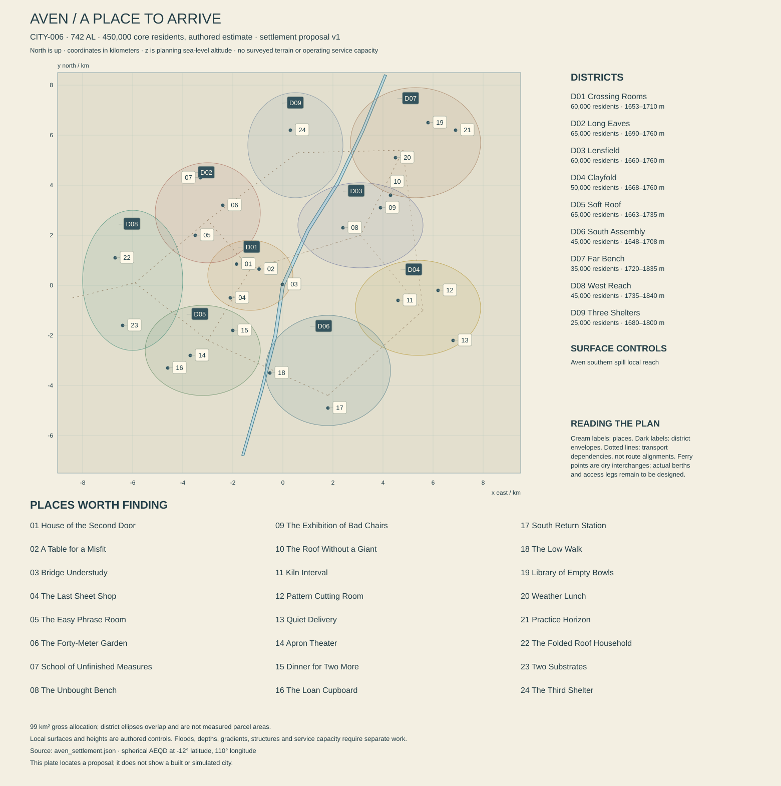

# Aven — a city with somewhere else to walk

**CITY-006 · REG-010, Aven Uplands, Morrow · working city bible 0.1 · 13 October 2026.** Present: 742 AL. Fixed atlas center: 12° S, 110° E. Core population: approximately 450,000. The southern spill passes the planning origin at 1,650 m above planning sea level. This dossier and [its settlement plan](aven_settlement.json) are original authoring proposals, not surveyed terrain, operating services, completed characters or Unreal construction.

The [settlement checks](AVEN_SETTLEMENT_CHECKS.md) record authored geometry, service assumptions and their limits. Numbered markers refer to the 24 place dossiers below; this is not a constructed city.

## 1. Arriving above the distance

The first remarkable thing about Aven is how little it asks you to climb. The last part of the regional journey has already done the climbing. From the arrival platform, a covered street goes almost level between workshops, a public dining room and a school whose upper windows have been opened for cleaning. Beyond them, other occupied benches lie at different heights, separated by shallow slopes and a narrow river valley. Mountains exist farther away. They do not have to occupy every gap between buildings.

An exhibition is being unloaded. The prize object is apparently a chair, although somebody is arguing that it is a walking aid with ambitions. Students carry it through the crowd while its designer worries about a scratch that nobody else can see. A woman with a picnic carrier waits for them to pass. She has come from the other side of the city to buy a particular folded pastry, and will soon take the long route home for no professional reason.

The architecture gives the sky a broad edge. Roofs overlap without imitating feathers; long straight eaves shade private doors, small balconies and the public way. Walls use pale aggregate, warm grey mineral blocks, ceramic panels, replaceable timber composites and painted metal with a clear structural job. Interiors can be intimate and bright without requiring enormous windows facing every cold night. Color gathers at thresholds, workrooms and exhibitions. The whole city is not a showroom for one manufacturer.

Rauth is absent from the ordinary sky. People born here can know its astronomical significance without feeling that something is missing above their street. During a clear long night, the dark interval is spacious enough for several meals, sleep periods and shifts. Some roofs support observers; most shelter people who would rather watch a small broadcast, finish a garment or go to bed. The place earns grandeur through the relation between a useful inhabited foreground and country that continues beyond it.

Aven's defining public promise is that competence should make life easier. Its imperfect institutions sometimes confuse competence with credentials. Its most attractive people show the difference: a skilled maker who leaves a repair understandable, a teacher who does not humiliate a hesitant adult, a walker who chooses the enjoyable route that everyone present can use. These are social possibilities, not a moral property of the city or its residents.

## 2. The basin, the river and the unmeasured weather

The fixed geographic contract is RIV-007, the **Aven southern spill**. The continental controls place its upstream course northeast of the city at 112° E, 7° S and 3,200 m; the city control is 110° E, 12° S and 1,650 m; the next major control is southward at 109° E, 21° S and 1,200 m. Those are separated by continental distances. They do not describe a steep stream descending from a nearby mountain directly into a sea-level harbor. Aven is inland, and its river is not assumed navigable by regional cargo vessels.

The local plan refines a short reach from the northeast through the unchanged origin toward the south-southwest. Proposed reference water surfaces descend from 1,669 m near the upper drawing edge, through 1,663 m at the northeast approach and 1,650 m at the origin, to 1,640 m near the southern edge. Intermediate bends are authored choices. They neither move the global river nor prove a surveyed channel. The current flowing-water polygon has a reference surface of 1,650 m; local banks, decks and intakes must use the nearby channel control rather than that one reference everywhere.

Broad buildable terraces flank this course. The central inhabited benches lie mainly around 1,670–1,745 m; western and northeastern neighborhoods reach roughly 1,770–1,835 m. Local lower paths approach the river more closely. The city has embankments, bridges and occasional useful lifts, but its ordinary connections follow long gentle changes. Aven's distinction from Orison is therefore structural: horizontal districts occupy a high basin instead of climbing the inner wall of a crater. Views cross roofs before reaching distant relief.

The river corridor is interrupted by floodable margins, maintained banks, service crossings and patches of native vegetation. It is not one continuous recreation promenade. Some stretches need working access or habitat refuge. A continuous *public route* can step inland around them without requiring continuous public ownership of every wet edge. Proposed bridges remain alignment obligations; straight transport lines in the JSON indicate relationships and never grant a tram permission to cross an unsupported gap.

The plan uses spherical azimuthal equidistant meters about the atlas center, with east as positive x and north as positive y. Heights remain sea-level altitudes, not local offsets. Its 18.5-by-16-kilometer frame contains district envelopes and open gaps. The 99 km² allocation is an independent land-use allowance, not the area of those overlapping envelopes or proof that the whole drawn rectangle is occupied. The sparse country beyond the frame belongs to larger regional dossiers.

At 12° S the adopted reference model gives about 66.1 hours of geometric daylight at northern solstice, 68.4 near an equinox and 70.7 at southern solstice. The longest reference night is correspondingly about 70.7 hours. Terrain, atmospheric refraction and weather modify what a particular window experiences. A civil turn is always 24 Earth-standard hours; three scheduled eight-hour watches do not stretch to match a sunrise. School dates, deliveries and leases use the civil calendar while outdoor plans also display sky phase.

The working climate character is an upland basin with cool exposed intervals, local cold-air collection, strong differences between sunny walls and shaded hollows, and seasonally varying wetting. This is not a measured temperature or rainfall series. Nearby lowlands can be warmer without every high terrace being cold. Frost requires suitable conditions; clouds can limit radiative cooling; the river does not freeze solid whenever the star sets. Passes, sheltered streets and agricultural enclosures need separate forecasts.

Weather changes how the city is enjoyed. A clear interval brings tablecloths onto sheltered terraces and makes a familiar circuit worth doing slowly. Light rain makes the long roofs sociable. During more serious weather, ordinary trips remain possible on maintained local routes while particular exposed paths close. Recovery has places and durations: a cleaned drain, a drying seat, a slope still awaiting inspection, a bridge open before the shortcut beside it. A perfect clear sky is not evidence that yesterday's loose material has become stable.

## 3. A history made from repeated arrivals

Existing canon places Aven's origins beside an upland transfer route during Morrow's settlement after the crossings intensified around 163 AL. It places the Passage cases within the **549–624 AL era**, without assigning them one exact year. It also establishes regional pouchspindle management experiments in the 247–304 AL interval. Those anchors remain intact. The following local dates are explicit new proposals, not recovered historical facts.

**The Shelter Ledger, proposed 194 AL**, is the earliest surviving shared inventory of three transfer shelters near the future city. It lists bedding, instruments, damaged containers and food obligations. Later civic historians called it a founding charter, although it did not define a city boundary or create all the households already using the route. Its most human entry records a missing cooking pan that reappears under another shelter's account. A transcription can be displayed; the actual original need not sit unprotected beside a public kettle.

**The Bench Schools, proposed 267–282 AL**, joined short technical courses to longer household schooling. Arriving workers could learn a new instrument without pretending to become children again. The system excluded some people whose employers would not release them or whose prior knowledge did not fit its forms. Modern adult teaching inherits both the useful practice and the argument about who has time to attend. No surviving school building has remained physically unchanged for more than four hundred standard years.

**The Covered Circuit, proposed 351–368 AL**, connected several central workshops and residences through public roofed routes. Merchants funded portions because dry visitors stayed longer. Households demanded doors that could close and places where a public passage did not look directly into a bedroom. Later adaptations narrowed some sections, widened others and inserted lifts. The inherited route is a chain of alterations rather than one immaculate ancient masterplan.

**The First Useful Exhibition, proposed 432 AL**, awarded a prize to a repairable household fixture after years of spectacles favoring expensive prototypes. It did not end prestige design. It created an enduring public counterweight: visitors could ask whether an admired object was usable, maintainable and worth the room it occupied. Today several rival exhibitions claim its descent. A comic show of bad chairs is a recent branch, not proof that generations of makers lacked skill.

During the **Passage cases in 549–624 AL**, several upland disputes established that enclosure could not quietly eliminate a long-used refuge route and its reliable water access. Later Aven storytelling often compresses the cases into one brave walker and one cruel owner. The actual worldbuilding obligation is plural proceedings, different claimants and uneven enforcement. This dossier preserves a local route associated with those arguments without fabricating a single definitive case date or claiming every modern path carries the same rights.

**The Independent Bench Fund, proposed 631 AL**, began helping qualified workers share equipment outside large employers. It increased some people's freedom while giving its assessors considerable gatekeeping power. Its descendants include successful cooperatives, failed studios and individual tenants with no interest in communal rhetoric. Sera Pell can contemplate moving to such a bench without that move automatically solving her access to adapters, insurance or customers.

**The Roof and Rest program, proposed 698–716 AL**, added resting places, clearer junctions and alternatives to short steep links. The initiative grew from everyday users, including caregivers, older walkers and people who relied on mobility equipment. Its visible legacy is practical: a comfortable circuit can include ambitious views while offering early returns and level alternatives. Some old lifts still fail. Miri Sen's remembered shortcut can be closed while an accessible longer route remains useful.

Current Aven has inherited enough security to argue about quality. That should not conceal people missing secure housing, struggling with a qualification barrier or doing unpleasant service work. Neither should those failures consume every story. Local memory includes unusually good exhibitions, teachers remembered with affection, a family finally obtaining a larger room, and a public garden whose mature introduced trees grew through several residents' lifetimes.

## 4. Homes, work and the scale of the place

The nine districts allocate 450,000 residents and 99 km². This is a rounded core population, including established students and temporary workers who are counted as residents under the eventual census definition. Daily visitors and freight crews are additional flows. No plan assumes all 450,000 people are continuously rendered agents, nor that every resident works in advanced manufacture.

A housing screen uses **173,000 dwellings**, 95 percent occupied and 2.74 people per occupied dwelling, giving 450,319 people. A 27 km² residential parcel allowance with 25 percent building coverage and 2.9 effective residential floors gives 19.575 million m² of gross residential floor. At 80 percent usable efficiency, 15.66 million m² provides about **90.5 m² per dwelling**. These averages accommodate small flats, shared homes and larger units. They are design assumptions, not minimum dwelling sizes or evidence of universal affordability.

The broader allocation is 27 km² residential parcels, 18 employment and manufacture, 9 education and civic services, 17 streets and transport, 16 parks, native refuges and managed growing, 5 river and associated margins, and 7 other reserves and open land. Mixed parcels receive one dominant category. Indoor workshops, gardens and public passages can share a block without their land being counted repeatedly. Two- to five-story structures dominate many streets; effective floor averages include lower courts and setbacks.

Occupation varies within every district. Lensfield has cleaners, cooks, caregivers and residents whose work is elsewhere. West Reach has affluent growers, precarious nursery employees and people who only want an inexpensive room near a friend. Some households own, some rent from cooperatives or private landlords, and some depend on employer housing. A design prize does not automatically pay the winner's rent. A reliable industrial job can support a lively amateur life without making the worker a failed artist.

The city values making but also knows the fatigue of being asked to demonstrate it. A visitor center may celebrate local craft while residents buy standardized imported utensils. A beautiful handmade chair can be uncomfortable; a mass-produced chair can be the one somebody loves. Interiors should record preference, budgets and accumulated use instead of displaying compulsory regional taste in every home.

## 5. Supplies that have to reach the plateau

### Water and returns

The domestic planning allowance is **140 liters per resident per civil turn**, or 63,000 m³. Another 27,000 m³ serves civic, commercial and specified industrial potable uses, making **90,000 m³ delivered per turn**. With a 15 percent distribution loss assumption, treated supply entering the network must be **105,882.353 m³ per turn**. A separate illustrative treatment recovery of 96 percent requires **110,294.118 m³ of raw abstraction**. Neither the river's attractive appearance nor its presence on a map establishes that yield.

An upper intake and off-channel raw storage are proposed upstream of the dense core. Storage totaling 3.6 million m³ would represent about 32.64 turns of this raw demand before evaporation, dead storage and other obligations. It lies outside the local drawing and needs its own catchment, site and ecological assessment. Two treatment trains are provisionally rated at a combined 120,000 m³ per turn of treated output. Combined capacity is not one-plant-out reliability.

Pumping lifts treated water from the upper service area to separate western stores with working water surfaces around 1,805 and 1,870 m. Pressure zones and boosters then serve different benches. These are explicit powered transfers; the river cannot lift itself to the higher neighborhoods. Proposed usable treated storage of 360,000 m³ covers about **3.4 civil turns** at network-input demand before additional operating constraints. Dividing that stock only by delivered customer demand would overstate its duration.

Sewer collection is provisionally 70,000 m³ per turn. Two 45,000 m³-per-turn works provide a combined 90,000 nominal rating, with flood, outage and maintenance cases still unresolved. Reuse supplies 12,000 m³ per turn to separately plumbed industrial or landscape uses. In one transparent screening balance, 90,000 potable plus 12,000 reclaimed deliveries make 102,000 gross end-use throughput; 70,000 returns to treatment and 32,000 is consumed or uncollected. Treatment sends 12,000 around the reuse loop and 58,000 to qualified final discharge, before separately assigning treatment-specific losses.

The external balance therefore distinguishes approximately 4,412 m³ of raw-treatment rejects, 15,882 of network losses, 32,000 of net consumption or uncollected return, and 58,000 of final wastewater residual. Those terms sum to the raw input with rounding. They are not all water permanently removed from the watershed. Some losses re-enter local ground or drainage, and chemistry determines whether that return is useful or harmful. The receiving reach is downstream of principal abstractions; neither dilution nor a native organism replaces treatment.

### Food, growing and freight

At 1.65 kg of edible product per resident, Aven's core needs approximately **742.5 tonnes per civil turn**. A separate 2,400 kcal-per-person screen gives **1.08 billion kcal per turn**. At 3,200 kcal per kilogram of mixed dry equivalent, that energy is 337.5 tonnes; it must not be added to the 742.5 tonnes as another delivery. A 75-gram protein allowance requires **33.75 tonnes of protein** within a qualified diet. Mass, calories and protein each need a later basket.

The working annual calorie origin is 62 percent from broader Aven basin agriculture, 36 percent from other connected Morrow producing districts and 2 percent from primary production within the core land allocation. These are demand assignments, not proven yields. The small urban share still requires real growing space. Cultures consuming imported sugar or grain do not create additional primary calories. Introduced crops and maintained food cultures remain the nutritional foundation; native cradleroot and pouchspindles are not default human food.

Rotating dry reserves target sixty turns of the full dry calorie-equivalent demand, **20,250 tonnes**. This is a stock planning target, not sixty turns of every fresh food, specialized diet or cooking input. Protected cultivation produces some delicate ingredients; managed outdoor benches require locally successful crops and seasonal practice. Propagation, storage, lighting and labor remain separate requirements. A picnic shop's good bread is evidence of a working supply chain, not of wheat growing everywhere outside its door.

Talweir is about 4,349 km away by the globe's lower-bound distance. It can provide specialist cultivation stocks, instruments and relationships without being Aven's nearby vegetable district. Velis's even longer shipments concern viable stocks and expertise, not routine cereal tonnage. Regional rail and road bring most bulk goods through transfer yards; air service handles selected people and qualified cargo. The city is not an ocean port, and no river-freight throughput is credited in this proposal.

An initial gross freight study range of 4,500–7,000 tonnes per turn includes food, industrial inputs, construction materials, equipment and outgoing products. It is not a forecast or proof of terminal capacity. Counts must eventually distinguish one shipment from several handling movements. The eastern manufacturing areas need metals, tested powders, electronics modules, packaging and replacement tooling. Their exports include finished work, design rights and calibration services, with different physical transport needs.

### Electricity, heat and material waste

The core electrical study case is **420 MW average and 740 MW peak**, including the specified urban manufacture, care, teaching, transport and water services. Two regional connections total a proposed 300 MW rating. Local dispatchable plant has a 150 MW nameplate; regional wind and distributed solar candidates add 160 MW and 400 MWp respectively. These are portfolio candidates, not simultaneous output. Regional imports need actual contracts and generation; local plant needs fuel, maintenance and cooling.

Storage is proposed at **18 GWh usable energy and 220 MW discharge**. A continuous 150 MW residual deficit through a 70.7-hour reference night consumes about **10.605 GWh** before further losses. A 260 MW deficit instead needs about 18.382 GWh and exceeds both that energy target and the discharge rating. This exposes what a night case must resolve. The annual average cannot be defended by pointing at a sum of nameplates.

Kiln schedules, sterilization, thermal stores and recovered industrial heat can change electric demand. Useful heat and electricity are recorded separately; waste heat is not counted again as new generation. Local river hydro contributes no assumed output. A future scheme must demonstrate discharge, available head, ecological constraints and storage rather than claiming the entire 1,650-meter altitude above the sea as conveniently available power.

Municipal material waste at 0.75 kg per resident is **337.5 tonnes per turn**, excluding construction and major industrial streams. Reusable packaging, ceramic rejects, electronic components, introduced organic waste and native material have different destinations. A kiln cannot harmlessly consume every unknown residue. Pouchspindle cast material is a qualified material stream with handling requirements, not an infinitely renewable replacement for every fabric. Clean manufacture still has dirty maintenance jobs and places where the resulting waste must go.

## 6. Belonging, language and public power

Aven's municipality maintains streets, housing rules, local services, schools and care arrangements. Basin agreements constrain water uses. Passage federacies connect route communities without becoming a single upland state. Measure Houses certify particular processes; they do not acquire authority over every opinion because the city makes instruments. A school can reject an unsafe workshop exercise without deciding who belongs in the neighborhood.

Public speech commonly draws on the Lake continuum, with many household languages and sign communities. Miri Sen's Lake, Shore and Leri relationships remain particular to her life. Transit Clear belongs on route notices, manifests and operating instructions; it should not flatten intimate dialogue into cargo acknowledgments. English presentation carries essential meaning, with optional original forms used within the bounded language specification. Visitors need no vocabulary exam to understand a closure or enjoy a dance.

Public and private thresholds matter. A walking club can invite strangers to a garden circuit while leaving residential stairwells private. A teacher's professional profile does not expose their family's medical record. Translators can render words accurately while missing a temporary lift closure or the reason a resident prefers another entrance. A current sign, a useful conversation and a route that physically exists resolve the situation more credibly than a magical translation failure.

Payments use issuer-qualified balances where needed; this dossier introduces no fixed exchange rate or universal Aven price scale. Wages, cooperative shares, public entitlements and equipment loans remain different rights. A subsidized bench can reduce the cost of starting work while retaining a waiting list. Household security depends on housing, care and schedule as well as purchasing power. The city should let people discuss these matters briefly while continuing to do something more interesting than explain its entire constitution.

The eight wider traditions intersect within blocks and families. Road Houses help maintain refuges; Closegardens preserve stocks; Measure Houses support qualified production; Berth practices sustain households across travel. None owns a district or a biological type. A famous institution can be useful, vain, exclusionary and capable of reform in different situations. The player should find friendships crossing its boundaries before encountering a mission that asks which side to join.

## 7. Nine districts, with rooms behind the view

### AVE-D01 — Crossing Rooms

**60,000 residents; 9 km²; center (-1,300, 400, 1,682).** The oldest central bench stands west of the origin, close enough to hear some river conditions but high enough that ordinary streets do not become quays. Short blocks connect covered routes, older homes, small businesses and exhibition rooms. Buildings have gained rear stairs, subdivided interiors and new utility cores. Their histories are visible in changed window rhythms rather than a universal layer of picturesque damage.

Visitors often meet Aven here after a tram ride from a regional terminal. They can eat, leave baggage and choose an onward route without entering a school or obtaining a special local identity. The district's prestige partly comes from being useful to everyone else. It also supports expensive addresses, insecure leases and shops surviving because their owners have already paid off the building.

The lower riverside viewing deck is reached from the bench by a separate graded route. The busy streets above do not need to descend to it. Some residents cross the river daily; others visit the near bank mainly when a relative comes to stay. This gives the same landscape practical and ceremonial uses without assigning either one to a class.

### AVE-D02 — Long Eaves

**65,000 residents; 12 km²; center (-3,000, 2,900, 1,720).** Long Eaves contains family housing, ordinary schools, small offices, care services and several music rooms. Its broad courts are linked by shallow roofed passages. A few old shortcuts use stairs or lifts between neighboring levels, but the main route continues around them. This is where a visitor should discover that the city's walking culture includes people going slowly with a shopping bag.

Del Ressi's music room belongs here, as does the school Miri Sen remembers. The district has changed enough to make a returning resident occasionally wrong about it. A former shop is now a home; a childhood garden has a new accessible entrance; an expensive cafe occupies rooms once used for equipment storage. None of these changes automatically proves decline or improvement.

Private life occupies much of the soundscape: a lesson repeated badly, cutlery being sorted, a person practicing a speech and a neighbor asking them to close the window. Late quiet periods vary by building agreement, not by whether the star is above the roof. Public signs explain actual hours.

### AVE-D03 — Lensfield

**60,000 residents; 11 km²; center (3,100, 2,400, 1,725).** Lensfield joins technical teaching, calibration businesses, exhibitions and mixed housing east of the river. Its clean workrooms are concentrated facilities, not an excuse for every street to look sterile. Deliveries use service entrances; public galleries and ordinary cafes face the walking route. An apprentice can finish a precise task and then spill soup on their coat.

The district's competitive culture has several audiences. Manufacturers want reliable orders; students want recognition; visitors enjoy ingenious objects; residents want crowds to leave a route home. The useful exhibitions are comprehensible without an engineering degree. A person can admire how a folding table opens, or dislike its appearance, before learning anything about the mechanism.

Roof observatories and small dark rooms share upper floors with domestic uses. They need shielding and appointments, not a citywide ban on lamps. Sera Pell works in a commercial calibration house here. Her professional decisions connect to contracts and instructors rather than a solitary inventor mythology. Most Lensfield residents are neither prodigies nor competitors.

### AVE-D04 — Clayfold

**50,000 residents; 12 km²; center (5,400, -900, 1,708).** Clayfold's name preserves an early workshop nickname; it does not promise a limitless local deposit. Tested mineral powders and other feedstock arrive under traceable specifications. Ceramics, housings, garment workshops and small assembly plants share a district whose public face includes worker homes, food counters and surprisingly good evening rehearsals.

Hot processes, dusty maintenance and quiet assembly occupy distinct buildings and service arrangements. A dramatic kiln hall can be beautiful from a protected gallery while its dirty work remains real. Roof stacks, collection equipment, loading courts and heat-management spaces have purposes. Decorative steam should not replace their actual operating states.

The district's fashion makers often use the same exacting habits as its industrial shops: a pattern must fit somebody and a fastening must survive use. Their products also include extravagant, impractical clothes made because people want them. Prosperity, jokes and taste belong in a manufacturing district. So do injury leave, childcare, shift changes and the occasional successful argument for a less punishing schedule.

### AVE-D05 — Soft Roof

**65,000 residents; 13 km²; center (-3,200, -2,600, 1,695).** The name comes from sound: sheltered courts, planted interiors and layered domestic roofs make conversation less exposed than on the freight approach. Buildings are materially solid. This is a dense inhabited district of households, small employers, repair, communal dining and neighborhood performance, not a single cooperative commune.

Its best-known public kitchen is only one way to eat. Families keep private preferences, buy prepared portions, grow a few introduced herbs or avoid cooking when tired. Shared rooms require cleaning, booking and somebody able to say that a loud rehearsal has gone on long enough. The district's affection is strongest when these arrangements work without ceremony.

Housing pressure appears in converted storage rooms, friends reluctantly moving apart and an older owner choosing a smaller flat nearby. A generous neighbor can help with one problem while being impossible about another. The city's slower household stories belong here alongside ordinary prosperity: a repaired heating panel, a new grandchild, an amateur performance that finally finds the right ending.

### AVE-D06 — South Assembly

**45,000 residents; 10 km²; center (1,800, -3,400, 1,668).** South Assembly receives road and rail connections, sorts selected freight and houses people whose work begins before the visitor's appointment. Broad service yards occupy the flatter bench east of the lower river. Noise barriers, public entrances and loading routes must be different structures, not one monumental terminal wall pretending to serve every use.

There are homes because workers and their families live here, not because the city needs decorative windows around a station. Shops serve residents as well as travelers. Some have long opening hours; others close predictably because their owners also sleep. A regional arrival can lead directly to a tram, a walk, a meal or a booked room.

The lower river route sits near the district's western edge, connected by a public approach that avoids live yards. Floodable low ground is distinct from the inhabited bench. Walking here can be pleasant without turning a treatment outfall into a bathing place or pretending a freight bridge is an unrestricted pedestrian shortcut.

### AVE-D07 — Far Bench

**35,000 residents; 12 km²; center (5,300, 5,700, 1,778).** Far Bench meets open upland country through a sequence of homes, small gardens, native hollows and maintained departures. Its lower density includes schools, studios and route services. It is inhabited throughout the year; it does not vanish into an adventure zone as soon as a visitor leaves the tram.

Walking clubs organize circuits with early returns, comfortable picnic stops and optional longer branches. Their membership includes competitive walkers, sociable slow travelers, photographers and people primarily interested in lunch. Good maps describe distances and changes of level. They do not rank a person's worth by the difficult route they choose.

Rain pools and cradleroot patches occupy suitable ground among dry gaps. Managed paths must avoid compacting their margins. An apparently empty hollow can be the most interesting part of a return visit. The Library of Empty Bowls makes that temporal depth visible while leaving room for other pleasures: clothing, conversation, an ordinary bakery and the joy of recognizing somebody arriving from far away.

### AVE-D08 — West Reach

**45,000 residents; 12 km²; center (-6,000, 200, 1,788).** West Reach combines higher housing, propagation facilities, route maintenance and carefully bounded native husbandry. It looks toward other basin journeys without claiming those destinations are a short walk away. The western freight approach meets smaller distribution vehicles here, keeping routine deliveries possible without threading heavy trains through every court.

Introduced growing rooms and native material grounds have separate substrates, tools and waste practices. A shared public path can make their difference legible through beds and boundaries instead of one enormous warning wall. Some families work in neither. A teacher may rent above a nursery because the rooms suit her, while a grower commutes from South Assembly.

Pouchspindle management is a small, particular activity. Animals need compatible fodder, digestive partners and sheltered resting ground. Their cast material can support a workshop without supporting the entire city's clothing budget. The household maintaining them has private rooms, debts, holidays and alternatives to continuing the business. Its children do not inherit a biological destiny to become handlers.

### AVE-D09 — Three Shelters

**25,000 residents; 8 km²; center (500, 5,600, 1,738).** Three Shelters preserves the idea of several useful arrivals within one neighborhood. The old sites have been rebuilt many times. Modern refuge accommodation stands beside homes, a small clinic, food stores, classrooms and the northern road approach. The name is historical; visitors should not find only three isolated cabins.

Routes here intersect legal histories without becoming a compulsory court lesson. A reliable drinking-water service and a place to wait are practical obligations. Commercial rooms can offer comfort above that baseline. A proprietor may charge for a warm private bedroom while still helping a stranded traveler contact their next stop.

The district's quieter importance is continuity. Children recognize travelers who return irregularly; an instructor teaches both residents and route workers; a retired driver prefers the local seat with the least interesting view because his friends use it. The third shelter's garden contains evidence of successive accommodations rather than a heroic statue explaining every right at once.

## 8. Twenty-four places worth returning to

The coordinates below identify authored focal positions. Ordinary places stand on land. The explicitly supported river deck has a separate dry shore-access point in the plan. Indoor floors, building footprints, detailed slopes and visitor routes still require construction-scale design. These are places with purposes and people before they become mission locations.

### AVE-POI-001 — House of the Second Door

**Crossing Rooms; (-1,850, 850, 1,688); a household that receives without surrendering privacy.** The house has a public arrival room and a second door into the rooms where its members actually live. Wet coats, parcels and conversation can remain outside the intimate interior. A narrow side passage reaches a guest room without requiring a returning resident to walk through a sleeping relative's space. The arrangement is generous because its boundaries are understandable.

Eren Tav, a transport scheduler, belongs to the household and is Sera Pell's aunt. Her current ambition is modest: finish repairing the guest room before a former member arrives for an exhibition. She has bought the wrong hinges twice and is tired of being reminded that transport planning is supposedly her expertise. Other residents have different opinions about how long the guest should stay.

A player may be invited into the arrival room, help carry a parcel or meet somebody over tea. Entry into private rooms requires an actual invitation. A return can reveal the completed door, a guest's belongings or a household meal already underway. The place continues to function if the player never solves a problem there.

Assets need two convincing thresholds, storage of several ages, private circulation, a usable kettle area and ordinary evidence of work. The visible guest room should have somewhere to put a bag and dry clothing. Its hospitality comes from those provisions, not a decorative “welcome” emblem placed on an otherwise empty facade.

### AVE-POI-002 — A Table for a Misfit

**Crossing Rooms; (-950, 650, 1,681); public design, ambition and a little vanity.** A long exhibition room opens onto a sheltered court. Its current show asks designers to make one household object fit two people whose needs differ. The most discussed entry is a table with independently adjustable sections; another is a storage cabinet so thoughtfully arranged that visitors miss its ingenuity until they try to reach something.

Curator Iven Sorr enjoys the work and knows that sponsors prefer photogenic transformations. He has given a quiet repairable design a better position than its sponsor expected. His assistant thinks this is principled; his partner thinks he also enjoys irritating influential people. Neither explanation cancels the other. The room's competitions include beginners, trained makers and established studios under distinct entry categories.

Visitors can handle designated demonstrations, watch an ordinary usability session or listen to a maker change their mind. A later visit finds wear, a revised mechanism or an empty plinth whose object has gone to its intended household. Prizes are not the only measure of success. Some entrants prefer a useful conversation to winning.

Production needs actual moving clearances, mixed seated and standing reach, repair access, protective storage and labels whose English meaning is immediately available. The exhibition must also contain enough unsuccessful or merely competent work to make its strongest pieces credible. Not every object is a spectacular transforming machine waiting to become player equipment.

### AVE-POI-003 — Bridge Understudy

**Crossing Rooms; (-20, 40, 1,655); supported river deck with dry approach (-140, 40, 1,656).** The deck occupies a small position beside an inherited crossing. Its name comes from an old temporary viewing platform retained after bridge works ended. It does not impersonate a second bridge. People arrive from the western bank, sit above the local flowing-water surface and look beneath the larger structure's shadow at an ordinary stretch of river.

Nera Doss sketches the joints because she builds small architectural models. Her drawings increasingly include the people sitting in front of them, which annoys her because people will not remain in the same place. She has arranged a small model exchange with a friend at the Last Sheet Shop. Her purpose is leisure, not permanent surveillance of river traffic.

The player can rest, compare a model with its subject or notice how sound changes when the deck is partly occupied. Water conditions alter the experience without guaranteeing danger. A return after maintenance might show one replaced board whose finish has not yet aged to match the rest. High-water closure leaves the approach gate and an alternate viewpoint usable.

The plan records an engineered supported placement rather than dry ground. Production needs real supports, a land connection, guard geometry, drainage, inspectable joints and level-consistent water. The deck floor lies above the nearby reference surface, but flood clearance and structural adequacy remain unverified. It is neither a swimming platform nor a navigable berth.

### AVE-POI-004 — The Last Sheet Shop

**Crossing Rooms; (-2,100, -500, 1,678); books, small editions and courtship at an inconvenient hour.** The shop sells printed sheets, bound books, drawing materials and licensed copies of locally made work. Digital editions coexist with things people like to hold, annotate or give away. The printing room is small; most stock comes from elsewhere. A back table displays cheap short editions that can be read while waiting for a friend.

Owner Toma Vell is preparing a collection of walking essays by people who usually turn back early. He has invited an illustrator he likes to choose the cover and cannot tell whether the repeated consultations concern the book or their growing affection. Nera Doss's models occasionally occupy the window. They share customers, not a permanent exhibition contract.

A visitor can browse, listen to a reading or buy a modest object. The encounter has no mandatory hidden text or secret code. Returning changes the window, the marked-up proof on the table and sometimes the person minding the till. A quiet reading can be more rewarding than a dramatic revelation, particularly when the same familiar voice tries an unfamiliar kind of story.

Assets include readable selected pages, shelving with accessible lower browsing, a workable checkout, packing supplies and a print area whose equipment fits the room. Books need varied dimensions and histories. The people who use them should be allowed to leave a small untidy pile without the whole shop becoming an archaeological ruin.

### AVE-POI-005 — The Easy Phrase Room

**Long Eaves; (-3,500, 2,000, 1,716); Del Ressi's neighborhood music and dance room.** The room has a resilient floor, chairs at its edges and enough circulation that sitting down does not mean leaving the event. Del, born 685 AL and approximately fifty-one standard years old, hosts the established six-step exchange session. A clear hand phrase introduces the movement before optional turns and closer coordination are added.

Del earns part of their living arranging music for other groups and has no wish to turn every informal session into a branded school. Their current pleasure is a seated pair's variation that standing dancers keep trying to copy. They worry more about an awkward room booking than about whether newcomers are impressive. Miri Sen sometimes arrives late from teaching, with an apology that nobody requires.

The player can join, watch, keep time or decline. Partners ask before changing contact or pace; participation does not purchase romance or create an obligation to return. When the session ends, some people go home and a few continue to a cafe. On another visit, a formerly improvised phrase has become a shared joke rather than a universally standardized dance.

This place needs original music, readable invitations, varied confident and tentative movement, clear sight lines and sound that still permits conversation. Its chairs, coat storage and accessible toilet route matter as much as the dance floor. The room remains useful when empty, with stacked equipment and preparations for its next ordinary booking.

### AVE-POI-006 — The Forty-Meter Garden

**Long Eaves; (-2,400, 3,200, 1,722); a short shared garden with several meanings of “near.”** The garden's length supplied its nickname; no resident expects the inherited boundary to be exact to a centimeter. Introduced planting occupies maintained beds, with sitting space, a clothes-drying corner and a path that connects two streets. It is generous domestic infrastructure, not a productive farm secretly supporting a neighborhood.

Vessa Dren recently moved into a nearby flat and met Miri Sen while comparing routes to Del's music room. Miri remembered a scenic stair and a useful lift; Vessa needed a route that would accommodate her present mobility needs. The lift's temporary closure made the longer covered approach preferable. Their friendship began after an awkward assumption about Miri's origins was corrected and allowed to end.

The player can encounter them planning a visit, or find Vessa tending a plant whose label she does not trust. A return after lift repairs offers another route without erasing the value of the longer one. Their conversation may concern clothes, a meal or an annoying neighbor. They are not required to repeat the language-volume incident to every visitor.

Assets need a genuine through path, usable bed edges, seated views and a junction whose alternate routes agree with the local map. The temporary notice has a date and destination. Domestic windows should show that the garden is shared by people with private lives, not owned by an accessibility demonstration.

### AVE-POI-007 — School of Unfinished Measures

**Long Eaves; (-3,300, 4,300, 1,740); ordinary learning across different ages.** Several workshop classrooms surround a sheltered court. Children use some rooms during their scheduled sessions; adults attend other classes, with teaching and safeguarding arrangements appropriate to each group. The institution's name values revision. It does not mean pupils spend their lives unable to complete a task or that every lesson becomes a philosophical performance.

Daro Vell coordinates adult courses and shares mathematics teaching with Miri Sen. He is Toma's brother and privately less enthusiastic about public readings than Toma assumes. His immediate problem is finding a timetable that includes caregivers and late-shift workers. A mathematically elegant sequence of lessons is useless if the people needing it cannot attend. He sometimes teaches himself a slower explanation before using it with a class.

Visitors may observe a scheduled open demonstration, attend a beginner session or see a small exhibition of work that improved through several attempts. A returning learner's achievement can be modest and recognizable: a clean fit, an understood estimate, a question asked without embarrassment. The player does not become a qualified machinist by completing one interaction.

Production needs different classroom uses, stored works in progress, clear staff and private boundaries, ordinary lunches and equipment that can actually be reached. The schoolyard should be occupied for reasons beyond sending the player somewhere else. Audio combines lessons, breaks and quiet concentrated intervals without making every room simultaneously noisy.

### AVE-POI-008 — The Unbought Bench

**Lensfield; (2,400, 2,300, 1,718); Sera Pell's calibration workplace.** A commercial instrument house retains a repair bench beside its demonstration room. Customers see clean displays first; a window into the work area reveals fixtures, reference pieces and older instruments that do not match the current catalog. The bench's nickname began after Sera repaired something its owner had expected to replace. The sales department dislikes how well the story travels.

Sera remains an apprentice with colleagues, supervision and work she cannot yet certify independently. Her instructor, Halet Vorn, values her judgment while warning that an obsolete interface still needs a viable service plan. Eren Tav is her aunt, not a guaranteed source of professional influence. Their family conversations contain pride, practical help and disagreement about how much uncertainty a young worker should accept.

The existing exchange story can develop here through a qualified adapter, a revised quotation or a decision to return an instrument to its owner. A later visit may show the same object in productive use elsewhere, or the bench cleared for another job. No outcome instantly grants Sera a workshop, customers and a complete career.

Assets need credible small-scale instrument work, clean and ordinary circulation, protective cases, calibration references and readable difference between a customer display and a restricted workspace. The valuable object should look worth maintaining through function and history. It does not need a hidden weapon setting or a mysteriously radiant core to justify the care.

### AVE-POI-009 — The Exhibition of Bad Chairs

**Lensfield; (3,900, 3,100, 1,731); comedy with serious craftsmanship behind it.** The exhibition invites makers to show a chair that taught them something expensive. Some entries are attractive and uncomfortable; others are perfectly useful but impossible to repair cheaply. Clearly marked demonstrators can be tried. Unstable prototypes remain restrained, with safe replicas or recorded tests explaining the problem. The joke never requires a visitor to be injured.

Organizer Sena Arl builds excellent ordinary furniture and is tired of clients assuming that her participation advertises incompetence. She has entered her own early adjustable chair because explaining its failure made a recent design better. Her partner has submitted an anonymous drawing of a chair that she once insisted would fit through their door. Sena recognizes it and has chosen not to say so yet.

Visitors vote for different categories, talk to makers or enjoy watching another visitor reconsider a confidently expressed opinion. Return changes can include repairs, new entries and a chair withdrawn because its designer wants to try again. The exhibition's emotional range includes embarrassment, affection and competitive delight, not a tribunal of failures.

The strongest assets are mechanically coherent objects with distinct causes of success or difficulty: reach, balance, assembly, cleaning, fit and material behavior. Labels use plain English rendering. Seating available for ordinary rest must be clearly different from the exhibits, and good comfortable chairs should exist elsewhere in the same building without apologizing for being unremarkable.

### AVE-POI-010 — The Roof Without a Giant

**Lensfield; (4,300, 3,600, 1,740); patient observation and an ordinary open sky.** A teaching roof offers a protected view above nearby eaves, with small instruments and shielded low lighting. It was named by a near-side visitor; some local observers dislike the name because absence is not how they experience their home sky. The disagreement persists amiably on an old hand-lettered notice kept inside the stair enclosure.

Nemi Orven maintains the school instruments and brings a small group here during suitable dark conditions. She wants to identify which of her own old observations remain useful after an instrument change. One regular attendee mostly comes because his apartment has a poor view. Their participation does not require everyone to understand orbital mechanics or to treat astronomy as a vocation.

The player can watch a session, inspect selected images or simply sit during an open interval. Rauth stays below Aven's ordinary horizon; no scenic exception makes it rise for an important conversation. Cloud, glare or maintenance can lead to an indoor session without turning the visit into failure. A return after several civil turns may encounter a different sky phase and another group.

Assets require believable instrument mounts, storage, safe roof edges, wind shelter and carefully limited light. A dynamic sky must follow the planetary contract. Screens can explain what an instrument sees without inventing constellations that are secretly visible from every place and orientation. Quiet conversation and the distant city should remain part of the experience.

### AVE-POI-011 — Kiln Interval

**Clayfold; (4,600, -600, 1,700); controlled heat and work between dramatic moments.** The public gallery looks into selected parts of a ceramics works through a designed separation. Visitors may see loading, an enclosed firing cycle, cooling or inspection. Most of the spectacle is preparation: fixtures arranged, components checked and a worker reconsidering an apparently trivial spacing decision. Nothing is improved by leaving a hot process open to a passing crowd.

Process lead Rova Mett is preparing a batch of durable housings and a smaller artistic commission sharing compatible production stages. She dislikes clients who assume the art matters more because it will be photographed. Her sibling makes costumes in the Pattern Cutting Room, and they enjoy exchanging requests that sound simple until the other explains the material. Their teasing reflects competence rather than contempt.

The player can attend a scheduled explanation or observe an ordinary inspection. Return shows the batch's next stage, a legitimate reject or an empty fixture being prepared again. A single flawed piece does not prove sabotage. A successful batch can be satisfying because its outcome was earned through several decisions visible across visits.

Production needs contained hot zones, ventilation, material staging, lifting aids, cooling space and separate public circulation. Powders and broken material require controlled handling. Exterior forms should reveal those functions with restraint. Heat haze, lighting and sound follow actual operating states instead of covering every workshop in permanent furnace glow.

### AVE-POI-012 — Pattern Cutting Room

**Clayfold; (6,200, -200, 1,720); clothing that begins with a particular body and occasion.** A shared garment workshop occupies two long rooms above an accessible shopfront. The cutting tables are lit for work, while the fitting area has adjustable privacy and enough room for a person to sit. Customers arrive with occupational requirements, assistive devices, a desired silhouette or simply a coat they do not want to abandon.

Designer Telli Mett is Rova's sibling and has accepted a commission for an exhibition host who wants an absurdly broad collar. Telli intends to make it removable so the wearer can eat comfortably afterward. Their apprentice is more interested in repairing a child's favorite sleeve. Both jobs matter, and the expensive commission helps pay for time spent on less profitable work.

A player can see patterns become garments, watch a scheduled display or return a fitting for adjustment. A later visit might reveal the extravagant collar hanging casually on a chair while its owner eats next door. The humor comes from a usable object encountering ordinary life. Fashion should not be reduced to a faction uniform with a different color stripe.

Assets require varied work surfaces, fastenings, fabric behavior, fitting references and clothing constructed for actual movement. Native-derived material appears only where qualified and specified. Cut remnants, reusable pattern pieces and ordinary packaging should have destinations. The room needs enough unfinished work to feel busy without becoming an implausible mountain of abandoned textiles.

### AVE-POI-013 — Quiet Delivery

**Clayfold; (6,800, -2,200, 1,698); a freight hall whose success is mostly uneventful.** The hall receives precision components, finished work and other selected cargo from the district. Protected loading positions connect to storage, inspection and outgoing transport without taking every parcel through the public entrance. A visitor balcony overlooks one handling area; sensitive consignments and personal records remain outside public view. The architecture makes ordinary coordination visible without exposing everything.

Supervisor Omin Darel is training a replacement for part of his shift because he wants more time for an amateur theater group in Soft Roof. He is good at his job and does not intend to abandon it. His trainee, Fir Senn, has reorganized a shelf in a way that initially annoyed him and now saves both of them time. Their disagreement has become a running joke.

The player can arrange an authorized collection, accompany a consignment or wait for a person coming off duty. A return after a delay shows a changed queue and a cleared bay, not permanent panic. Some work can happen automatically; staff intervene where handling, judgment or an exception actually requires them. Efficient technology is part of the place's appeal.

Assets need pallet and container families tied to real cargo sizes, marked circulation, powered handling equipment, cushioning and accessible customer space. Packaging should recur between this hall and the workshops that use it. The public view must not imply that high-value goods are casually available to take just because an interaction system eventually allows movable objects.

### AVE-POI-014 — Apron Theater

**Soft Roof; (-3,700, -2,800, 1,699); a small stage between households and a shared court.** The theater opens from a former workroom onto a covered audience area. Its name remembers both the projecting stage edge and an early performer who refused to remove her cooking apron. Current shows include puppets, short comedy, spoken pieces and modest music. Professional visitors sometimes participate, but the neighborhood does not exist to supply unpaid performers for them.

Director Bera Noll is assembling a comedy about two relatives who independently decide to make the same surprise visit. Omin Darel has accepted a small role with one difficult entrance and is practicing it far more seriously than the play requires. Bera is pleased with the cast and less pleased that the costume storage keeps absorbing household chairs needed elsewhere in the building.

A visitor can attend a performance, watch a public rehearsal or encounter somebody repairing a prop. Returning changes what is ready, not simply whether the stage is “on.” A missed line can produce affection instead of humiliation. After the show, the court returns to a place where people talk, stack seats and carry ordinary dishes upstairs.

Production needs a transformable but credible room, acoustically legible speech, backstage circulation, prop storage and audience positions for different bodies. Private doors must remain private even while the public court fills. The comedy needs an authored beginning and ending; an endless loop of actors bowing cannot substitute for the life of a performance.

### AVE-POI-015 — Dinner for Two More

**Soft Roof; (-2,000, -1,800, 1,685); a dining room with limits that make its welcome dependable.** A neighborhood kitchen serves residents, nearby workers and booked visitors in overlapping sittings. The name began as a promise to keep a small flexible margin, not an obligation to feed an unlimited crowd. Menus use introduced grains, pulses, vegetables and maintained food cultures. Ingredients and substitutions remain legible without turning every plate into a lesson.

Cook Vara Tem enjoys building picnic portions that remain good when cold, and exchanges recipes with Nali Res at Weather Lunch. Their friendly rivalry concerns texture as often as flavor. Vara's partner prefers simple food and finds their elaborate testing evenings exhausting. The kitchen's staff include people doing an ordinary paid job, not only volunteers whose generosity replaces wages.

The player can share a table, collect a meal or encounter preparations between sittings. A return may reveal a seasonal variation, an absent favorite or a familiar dish improved after feedback. A supply interruption changes specific ingredients before it becomes a universal empty-kitchen scene. Most meals occur because the operation works.

Assets require receiving, cold and dry storage, preparation, washing, waste separation and routes that keep hot service from colliding with returning dishes. Tables need plausible spacing and a choice of social or quieter seats. The emotional detail may be a portion held back for a late arrival, with consent and payment arrangements that belong to actual people.

### AVE-POI-016 — The Loan Cupboard

**Soft Roof; (-4,600, -3,300, 1,707); useful objects moving between familiar homes.** The cupboard is actually a small ground-floor room holding domestic tools, mobility accessories, cooking equipment and a few instruments. It does not stock every imaginable device. Storage, maintenance and a modest replacement fund support the collection. Some items require an explanation or fitting; others can be checked out quickly by a known member.

Keeper Asha Verr previously repaired household appliances and still prefers doing that to explaining why a late return matters. Her current project is an adjustable support for somebody recovering from an injury, with the user's own preferences guiding the work. She does not publish who borrowed medical or personal equipment. Omin has reserved a small lighting stand for the Apron Theater, provided its current borrower returns it in time.

A player can borrow under an actual arrangement, return something, or listen while two users discover they can share a tool instead of competing for it. On return, objects occupy different spaces and maintenance tags have changed. A missing item has a named borrower or a recorded uncertainty; it is not an infinite inventory refill.

Assets should express many makers and ages, with replaceable parts, fitted storage and clear condition differences. Future object interactions can support the room, but throwing a borrowed object must not silently leave its record unchanged. This dossier establishes a social use and its consequences without pretending an inventory or persistence system is already implemented.

### AVE-POI-017 — South Return Station

**South Assembly; (1,800, -4,900, 1,658); arrival without an obligatory spectacle.** The passenger hall sits above the local lower river level on a broad working bench. Tracks and roads approach through reserved corridors; arriving people reach a public concourse with seating, toilets, information and onward transport. Freight has connected but separate handling areas. The visitor can understand where to go while tired, carrying luggage or meeting someone unfamiliar.

Lerin Vos works at the onward-travel desk and sings in a small ensemble when off duty. She knows Eren Tav through scheduling work, though they disagree about how much information belongs on the first screen a traveler sees. Lerin's immediate pleasure is welcoming a sibling who has not visited for several local years. The private reunion will occur after she finishes the handover, not while every traveler waits for her story.

The player can arrive, meet a contact, book a supported continuation or choose to walk. Returning changes departures, baggage and people without turning the hall into an arbitrary crowd generator. During a route interruption, the station has a specific waiting arrangement and alternatives with actual limits. A clear service day should feel easy.

Production needs coherent platform access, luggage handling, signage, maintenance, staff rest and sound separated into understandable zones. The panorama beyond the hall remains upland country. No sea appears outside because a reused port kit happens to include one, and no spacecraft landing sequence replaces the ordinary regional services that sustain this population.

### AVE-POI-018 — The Low Walk

**South Assembly; (-520, -3,500, 1,650); a river-edge route beneath the main inhabited bench.** A modest public path reaches a sheltered landward seat near the lower channel. It is lower than the district center and connected by a graded approach outside live freight yards. The immediate scene is water, low native growth where suitable, bank maintenance and the underside of a distant crossing. It does not offer unrestricted bathing or access to a treatment outlet.

Senra Kett comes here after a noise-intensive job maintaining terminal equipment. She likes the view precisely because it gives her little to interpret. Her partner, an enthusiastic photographer, has learned not to make every visit a lesson about composition. Sometimes they walk together and discuss dinner. Sometimes Senra sits alone and leaves before anybody she knows arrives.

A player can share the space without starting a conversation, watch changing water conditions or follow the route back toward the city. After high water, the seat may be clean while the nearest low section remains closed for inspection. A later return can show deposits, repaired surfacing and vegetation recovering at different rates. Those changes need a recorded cause.

Assets require credible bank transitions, a dry public footprint, drainage, floodable ground clearly distinguished from the main path and an unobtrusive alternate route. The seat is not a quest pedestal. Sound design should let the river and ordinary distant work coexist, with neither roaring constantly merely to prove that the location is alive.

### AVE-POI-019 — Library of Empty Bowls

**Far Bench; (5,800, 6,500, 1,792); a refuge library and a landscape whose active life is intermittent.** Inside the small reading room are drawings of nearby hollows made across generations. Some show rainwater and transparent rainsleepers; many show apparently empty ground. Their value lies in repeated attention, including the unremarkable intervals. The hollow outside is usually neither a permanently full pond nor a guaranteed wildlife performance.

Caretaker Orel Min maintains the collection and remembers an experimental basin kept wet with good intentions. Its community changed; permanence did not preserve everything its makers loved. Orel is preparing a new display with a young neighbor who has noticed that one familiar pool now fills differently. They are comparing path repairs and overflow routes before deciding what actually happened.

The player can browse, walk the marked observation route or return after suitable wetting to discover a brief active generation. Not every resting case activates, and a passing shadow does not trigger emergence. A meaningful outcome could be a small corrected drainage detail followed by later observation. No one can restore an entire ecological history through a single dramatic lever.

Assets need dry, partly wet and active-pool states, protected sediment, stable repeat-view markers and species at their actual small scale. The library remains enjoyable when the bowls look empty: comfortable seats, drawings, a kettle and other visitors who came for reasons of their own. Its field displays keep monitoring equipment distinct from things available to borrow.

### AVE-POI-020 — Weather Lunch

**Far Bench; (4,500, 5,100, 1,769); a picnic shop where the destination can be the meal.** The shop offers small savory portions, refillable carriers, water and route advice drawn from current notices. Some customers set out on long circuits. Others eat on the sheltered terrace and call the expedition complete. The business respects both choices. Its view includes neighboring homes and paths before the more distant uplands.

Nali Res runs the kitchen with two employees and trades recipe experiments with Vara Tem. Nali once tried organizing every walk around the most impressive viewpoint and discovered that friends remembered where they could sit comfortably. She now advocates a route with a particularly unheroic bench. Her partner Eren Tav considers a picnic successful if nobody has to coordinate a complicated timetable.

The player can choose a meal, join an open club departure or remain while a group debates how far to go. On return, an available ingredient or route may differ for a specific reason. The shop does not issue dangerous challenges disguised as friendly advice. A canceled exposed branch can lead to a pleasant local circuit rather than a failed outing.

Assets need compact food preparation, reusable carriers, seating, drying space and concise notices that show distance, accessibility and actual closure information. Clothing and equipment should suggest different intentions and budgets. Not every customer needs an expedition harness, and a good picnic need not introduce a combat encounter in the next valley.

### AVE-POI-021 — Practice Horizon

**Far Bench; (6,900, 6,200, 1,814); looking, drawing and the useful permission to be mediocre.** A sheltered open terrace provides several views into the upland mosaic. Local clubs use it for photography and drawing sessions, including a popular exercise in making the least dramatic part of a scene interesting. The site is reached by an ordinary maintained path; more demanding country continues beyond a separate signed departure.

Tutor Etan Rell has spent years teaching composition and remains irritated by how often his own best pictures happen accidentally. He brings spare drawing boards but does not correct strangers without invitation. One regular paints the same roof repeatedly because a relative lives beneath it. Etan initially thought this lacked ambition and has come to recognize what the repetition reveals.

The player can compare works, watch a changing patch of light or return under another sky phase. Conditional ridgewake visitors may appear only where suitable seasonal routes and feeding conditions support them. They are not permanent soaring decorations, and nothing here establishes their detailed flight performance. A day without animals can still offer a worthwhile view.

Assets need foreground structure, convincing distant relief and atmospheric variation consistent with the weather state. The city should remain visible as inhabited territory rather than a miniature collectible below the player. Drawing props, sheltered seats and quiet conversation provide scale. Any launch or flight behavior belongs to later creature validation, not a promise hidden in a beautiful image.

### AVE-POI-022 — The Folded Roof Household

**West Reach; (-6,700, 1,100, 1,810); a private home beside managed native husbandry.** The household maintains a small pouchspindle group on qualified native fodder grounds. Low shelters, rotation boundaries and handling space adjoin a material workshop and actual domestic rooms. A public observation edge is available at stated times. Visitors do not walk into resting groups or assume that an animal moving toward a person wants to be touched.

Handler Ora Drem works with her adult son Pellin, who wants to develop other workshop products rather than expand the group. They disagree about the business's future while both caring for the animals competently. A new insulating prototype uses cast material alongside conventional components; its qualification is limited to that construction. It is not proof that pouchspindles supply every need cheaper than industrial alternatives.

The player can observe a quiet settling interval, see appropriate feeding or attend a workshop demonstration. Return shows changed grazing rotation, a material batch drying or a shelter altered after use. Young feeding fringes may be briefly visible beneath an adult's protective fold when conditions and the group's behavior permit. That intimate sight does not require a crisis or a reward marker.

Assets need species-specific movement, compatible native planting, sheltered rest, clean handling and distinct human food storage. Wild pouchspindles are not pack animals waiting to be claimed. The family's home should contain objects unrelated to husbandry, allowing its inhabitants to remain people with interests and relationships beyond their most visually unusual work.

### AVE-POI-023 — Two Substrates

**West Reach; (-6,400, -1,600, 1,776); cultivation teaching that makes differences visible.** A public teaching room looks onto introduced crop propagation on one side and selected native material plots on the other. The contrast is practical: different substrates, associated organisms, tools, waste destinations and purposes. It is not a display of one garden being civilized and the other wild. Neither side represents all the biology of its category.

Instructor Varo Linn is preparing a short course for people who want a few successful household plants rather than a professional qualification. He maintains meticulous work labels and repeatedly forgets where he left his own lunch. A recent student has returned with healthy introduced beans and an unnecessarily elaborate support frame. Varo intends to praise the success before suggesting that the frame is larger than the kitchen where it must fit.

The player can inspect a scheduled demonstration, ask about a failed planting or meet someone collecting a qualified starter. On return, growth and replacement reflect real intervals and care. A transmitted set of instructions does not become a living crop without viable material, a prepared space and somebody able to use the method.

Assets require containment appropriate to the stated activities, separated washing and storage, legible labels and ordinary accessible teaching space. Native cradleroot can appear as a material or fodder subject without becoming a human salad. Fresh food from the introduced side is still accounted within the city's limited urban production allocation, with energy and labor remaining actual costs.

### AVE-POI-024 — The Third Shelter

**Three Shelters; (300, 6,200, 1,750); a useful refuge beside an inherited route.** The current building includes a public waiting room, drinking-water service, basic assistance and separately booked accommodation. Its foundations contain several construction periods. A garden path follows an old approach associated with local Passage disputes, while the modern road uses another alignment. The protected route is not assumed to grant entry into every adjacent property.

Keeper Iri Senn has returned after working in several other basins and is learning what the place has become in her absence. Her child considers the shelter entirely ordinary and would prefer to visit the Exhibition of Bad Chairs. Iri is proud of keeping the refuge dependable, yet occasionally tired of visitors treating her home as the embodiment of a grand civic principle.

The player can obtain current information, wait comfortably or arrange a room. In a specific access dispute, records and present conditions could matter; most visits need none. A returning traveler may recognize another visitor, find a repaired drying rack or discover that the keeper finally took the leave she planned. Someone else then operates the shelter competently.

Assets need privacy, staffed and unattended arrangements, storage, accessible wash facilities and a clear distinction between public aid and commercial lodging. The water point connects to maintained infrastructure rather than an inexhaustible sacred spring. Historical evidence should be distributed among altered walls, photographs and an old route line, without inventing one exact date for the whole Passage-case era.

## 9. People whose lives cross the plan

**Miri Sen** learned in Aven, taught elsewhere and returned with professional confidence that did not restore perfect knowledge of her old streets. Her Lake, Shore and Leri relationships remain those established in the language volume. Teaching with Daro offers continuity; friendship with Vessa makes room for a present different from her remembered home. She likes dancing badly without being asked to explain a mathematical pattern in it. Her private aim is a comfortable settled room while retaining friendships elsewhere.

**Sera Pell** chose calibration partly because she liked patient hands-on work and partly because a qualified trade seemed dependable. Her repair decision tests how an employer values useful judgment when it reduces immediate sales. Halet supports her without promising protection from every consequence. Eren provides ordinary family care, not a secret route to promotion. Sera can eventually change workplaces while remaining attached to colleagues she leaves. A credible future includes routine jobs, further learning and occasional mistakes.

**Eren Tav and Nali Res** maintain separate work lives and an affectionate difference in habits. Eren schedules complex transfers but wants simple private plans; Nali enjoys improvised invitations after running a kitchen to a timetable. The receiving household accommodates Eren's obligations without automatically housing everyone Nali invites. Their disagreements concern space, fatigue and how much visiting is enjoyable. A quiet picnic can reconcile a small argument without resolving every question about how they want to live together.

**Del Ressi** has enough experience to know when a hesitant participant needs an invitation and when they need to be left alone. Born 685 AL, approximately fifty-one standard years old in current presentation, Del has professional arranging work beyond the neighborhood session. Their private enjoyment of a new phrase should survive even when nobody records it. They can refuse an extra booking because they want rest, without that refusal becoming a crisis for the city's cultural life.

**Orel Min** spent earlier working years maintaining route accommodation before taking responsibility for the library. Practical memories explain the interest in records that show what changed between visits. Orel's past attempt to maintain permanent water in a separate experimental bowl informs present caution without turning them into somebody ashamed of every experiment. They like the young neighbor's persistence, sometimes need quiet from it, and want a successor who will keep the collection useful rather than perfectly unchanged.

**Ora Drem and Pellin** have a working relationship inside a family relationship, which makes disagreement harder to leave at the workshop door. Ora worries that abandoning husbandry will waste accumulated knowledge. Pellin wants skills that remain useful if the material business contracts. They can reduce their managed group responsibly and still preserve a line, or maintain it with another qualified household. Neither outcome requires one generation to defeat the other. Their domestic interests must remain visible during any business transition.

These people do not all know one another. Links arise through a particular school, household, supply relationship or hobby. The city needs strangers and weak acquaintances as well as tightly connected casts. Schedules allow absence, rest and private activity; an authored contact is not a person permanently stationed at a player-service counter.

## 10. Building obligations and the source boundary

The first construction studies should test one occupied bench, its covered street, private room depth and actual connection across the river. Aven needs broad roof and court families, clean-workroom inserts, domestic interiors, ceramic service buildings, planted household spaces, rail interfaces and upland refuge elements. Shared bolts and imported furniture can recur from other cities; district composition, use and terrain create the distinction.

The source spine is the [atlas](../Atlas/nacre_atlas.json), [geography](../Atlas/nacre_geography.json), [sky](../02_SKY_WATER_AND_SEASONS.md), [history](../04_HISTORY_OF_NACRE.md), [languages](../05_LANGUAGES_NAMES_AND_BELONGING.md), [exchange](../06_POWER_AND_EXCHANGE.md), [Morrow ecology](../Drafts/MORROW_ECOSYSTEMS.md) and [everyday pleasures](../Drafts/PLEASURES_AND_EVERYDAY_LIFE.md). New dates, capacities, local geometry and people are proposals within those contracts. The named biological behavior follows that ecological foundation; this dossier adds no claim of tested flight, crop yield or human food qualification.

Terrain, drainage, flood levels, reservoir sites, treatment, firm power, transport alignments, housing costs, original music and runtime representation remain specific next obligations. The plan makes the city reviewable before those systems exist. Its intended beauty depends on inhabited relationships and useful spaces as much as on mesh detail.
