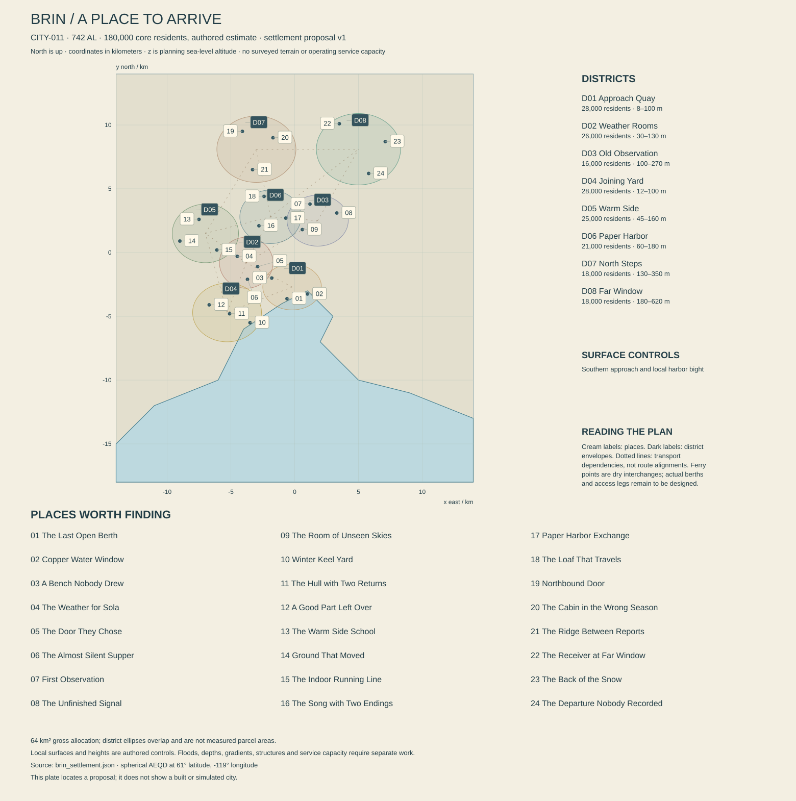

# Brin — a window on somewhere else

**CITY-011 · REG-018, Brin Long Shore, Pale Reach · proposal 0.1 · 13 October 2026.** Present: 742 AL. Atlas center: 61° N, 119° W. Core population: 180,000. This dossier and `brin_settlement.json` are an authored settlement proposal. Local historical additions remain subject to the master chronology and social-register pass. Neither prose nor a checked schematic establishes built terrain, navigable water, working services or playable encounters.

The acceptance condition is a northern city someone might choose as a home, leave with excitement and miss afterward. Its distance must produce adventure without making its inhabitants decorative survivors. Brin should have extraordinary journeys outside the windows and ordinary things inside worth staying for.

## 1. Arrival, and the size of a room

From the southern approach, Brin first appears as a broken sequence of lit openings above dark shore. Its low buildings hold close to the land until the observation ridge lifts behind them. The upper instruments are far apart. Between them lies actual ground: a road cut, a dark shoulder of rock, a shelter with one lit room. The city is not a laboratory tower surrounded by snow. On a clear arrival, one sees housing climbing away from the water and the long shallow roofs of workshops at its western edge.

The first surprise is color at human scale. A sheltered entrance has a deep red inner face. A stair landing carries a curtain printed with an invented southern garden. A winter coat opens to an extravagantly patterned lining. Outside surfaces are restrained because weather and repair leave strong marks; the sheltered surfaces belong to individual choices. Brin's public warmth comes from those differences, not from painting every building orange.

Inside, the architecture changes pace. A double entrance opens to a place where people can remove wet outer layers without blocking the next arrival. Light falls across a shared table. There may be a window seat, a shoe repair, a domestic argument and an absurd mechanical cloud in the same room. Rooms have acoustical lives: a workshop asks for hearing protection; a listening room is quiet by agreement; a bakery tolerates three conversations and a machine. An uninterrupted cozy soundtrack would erase much of the city.

Beyond the last occupied terraces, the prospect becomes immense. The route toward the Pale Interior rises through broken ground and distant shoulders rather than a single ceremonial gate. Weather can hide the next refuge while leaving the nearby valley brilliantly clear. Independent vessels bring news and passengers through a seasonal approach whose availability has to be learned. A departing ship is a specific opportunity, with a crew, a destination, a price and a risk. It should never be merely a fast-travel icon attached to a dock.

Brin makes precision instruments, repairs cold-service equipment, hosts research and supports freight and mineral work. It also teaches children, falls in love, makes bad comedy, lends books, mourns people and sometimes imports an expensive fashion that looks ridiculous on a wet morning. The city's greatest argument is not whether to survive. It is who gets to decide what a good future here would be.

## 2. Geography, sky and the honest edge of the map

The atlas center remains **61° N, 119° W** on the Pale Reach. The local frame uses the canonical 5,900 km spherical radius, x east, y north and planning altitude above mean sea level. Its bounds are x ±14 km and y −18 to +14 km. A southern harbor indentation is an explicit local refinement of the coarse continental coast. It is not claimed to be a surveyed projection of a detailed source shoreline. No parent atlas river crosses Brin's center, and this edition does not invent one.

The [settlement checks](BRIN_SETTLEMENT_CHECKS.md) verify selected geometry, placement, connectivity and arithmetic. District ellipses are spatial envelopes, not parcel boundaries or the shapes used to compute gross land allocations. Straight transport lines express dependencies between interchanges. They do not prove gradients, turning radii, bridge works, winter exposure or a usable street.

The southern bight gives a plausible sheltered approach, but shelter has degrees. Outer swell, crosswind, visibility, floating ice, berth condition and vessel capability are separate observations. An inner basin may be quiet while departure remains unsafe. On Earth, swell can travel away from its generating weather; that mechanism informs this distinction without providing a Nacre wave forecast. [NOAA's explanation of waves](https://www.noaa.gov/jetstream/ocean/waves).

The proposal places workshops on lower western ground, homes and public rooms across the central benches, and observation and departure facilities on higher northern and eastern ground. Bedrock and weathered deposits vary. Some low or sheltered patches may hold ground ice; others may drain and behave differently. Later ground surveys must distinguish them. Buildings do not all sit on either uniform permanent ice or convenient solid granite. The mechanism behind thaw settlement depends on ground conditions and ice content; it is not an effect to apply to every northern foundation. [USGS on permafrost-related processes](https://www.usgs.gov/publications/permafrost-related-processes-and-recent-response-climatic-changes).

Brin is **outside the nominal polar circle** implied by the adopted 14.07° tilt. At its latitude the idealized northern-solstice day is about **88.8 hours**, equinox about **68.4 hours**, and southern-solstice day about **48.0 hours** within the 136.755-hour natural solar cycle. Its longest nominal night is therefore approximately 88.8 hours. Terrain, cloud and atmospheric effects alter received light. There is no geometric season-long polar night here. Higher parts of the Pale Reach have different conditions; the name of a broad region does not assign one light regime to every address.

**Rauth is below Brin's ordinary horizon.** A local child can grow up recognizing it from recordings without seeing it from the city. A Pocket Weather model of a southern Rauth-lit street is a picture of another place. Brin's own night views rely on stars, atmosphere, weather and human lights, with conditions stated. Do not add the gas giant behind the observation ridge for a prettier composition.

Sea ice, where conditions permit it, is not a white road that appears on a convenient civil date. Salt rejection during freezing, brine pockets, currents, tides and later deformation complicate its properties. Earth sea-ice processes provide a mechanism reference, not transferred Earth months, safe thickness tables or a Nacre climate solution. [NOAA on sea ice](https://oceanservice.noaa.gov/facts/sea-ice-climate.html). The default public inland route remains on land. A licensed local operator's decision about a particular marine crossing does not establish permission for all future crossings.

Drainage is equally specific. Melt or rain can collect beside a warm service trench, cross an old path and refreeze later. A clear roof does not prove a clear stair. The city uses inspectable drainage and removable sections rather than pretending every hazard can be permanently heated away. Snow storage, cleared sightlines and accessible detours consume real room in the plan.

## 3. Foundings and the stories that outlived them

**279 AL is inherited canon:** a survey observatory became a nucleus of Brin. Sky observation, cold-environment research, mineral work and a seasonally navigable approach all mattered. Institutional histories disagree about which was the founding purpose partly because they preserved different evidence. This dossier does not settle the dispute by making every other record fraudulent.

**Proposed 296–314 AL: the rooms below the instruments.** Maintenance workers, freight households, teachers and independent trades occupy the lower benches more durably. Some remain attached to institutional quarters; others build homes that can survive a change of employer. The important surviving distinction is tenure, not one architectural style. A privately owned old apartment can stand beside a cooperative rebuilt from a former institution's dormitory.

**Proposed 358 AL: the two-entrance agreement.** Several employers and municipal representatives agree on a limited housing-access settlement. Losing a job should not automatically mean losing every heated doorway that same turn. Its protections have defined jurisdictions, notice and dispute processes. Later retellings make it a universal charter; the actual document is narrower and was amended. Its physical inheritance includes public entrances separated from controlled workshop access.

**Proposed 423–447 AL: the repair winters.** During the later broken-links era following the initial Relay Winter, unreliable distant support forces the retirement of some equipment and the adaptation of other equipment. People salvage, substitute, teach and argue about acceptable risk. There is no uninterrupted catastrophe lasting every day of those years. A surviving receiver shell can contain three later working installations and one much older sealed compartment. Its newest failure is not necessarily evidence of the historic crisis.

**Proposed 512 AL: the departing households.** A change in institutional contracts sends a group of specialists south. Some move gladly, some reluctantly, and some return. The city responds by expanding independent teaching and repair space. Families preserve different memories of the same departures. Present resentment should attach to actual promises and outcomes, not the claim that leaving Brin is betrayal.

**Proposed 603 AL: the joining-yard settlement.** Participating yards publish limited repair and storage terms for visiting crews. The arrangement makes independent journeys easier without giving every vessel immunity from investigation. It distinguishes emergency shelter, paid repair and disputed possession. A crew may receive shelter while the ownership of a component remains unresolved. This practical distinction is a source of pirate stories with real choices.

**716 AL is inherited canon:** Pocket Weather boxes spread from Brin hobbyists into exhibitions, schools, homes and markets. Their moving cloth, cool lights and miniature mechanisms evoke weather. A famous early figure repeatedly steps around a puddle. The boxes are neither portable climates nor life-support systems. The question of whether silent digital versions have lost something remains a pleasingly disproportionate argument.

**Proposed 731 AL: the shared apprenticeship rooms.** A group of workshops and educators opens selected training equipment beyond the largest institutions. The program improves access but creates competition over maintenance, teaching time and who receives credit. It does not make advanced fabrication free. Several graduates choose to leave anyway. Their later correspondence becomes part of Brin's connection to the rest of the planet.

The present tension is therefore concrete: retain opportunity without turning the city into a company enclave. Larger institutions can offer reliable equipment, attractive work and scholarships. Independent rooms offer flexibility, ownership and different forms of belonging. Neither is automatically honest, efficient or generous. A household may depend on both and have no interest in joining a grand ideological confrontation about it.

## 4. Eight neighborhoods and enough room to live

The allocations total **180,000 residents and 64 km² of gross planning area**. A housing screen uses 76,000 dwellings, 95% occupancy and 2.5 residents per occupied dwelling: capacity for 180,500 people against the rounded census target. This is a scale check, not a claim that all homes are equally occupied. Fourteen square kilometers of residential parcels at 26% footprint coverage, 2.5 effective residential floors and 80% usable efficiency gives 7.28 million m² usable floor area, approximately 95.8 m² per dwelling. Shared rooms, uneven household sizes and real building layouts remain to be distributed.

### BRI-D01 — Approach Quay

**28,000 residents; 8 km²; center (−200, −2,700, 25 m); planning altitude 8–100 m.** This is the first city many visitors know: arrivals, waiting rooms, shops, lodging and apartments that overlook work without being part of it. The harbor's protected side has narrow walks and public windows; exposed work faces have controlled access, stronger edges and less ornament. The Last Open Berth is a public approach and booking place on dry ground, not a surveyed ship footprint. Actual berths need bathymetry and vessel design.

Its central social institution is the waiting room. Residents use it for ordinary meetings as well as departures. Noticeboards show issue times, destinations and who is responsible for a statement. A closed route is not an empty room: passengers rearrange care, food, work and company. A visitor with a ship encounters people who have destinations of their own, not twenty copies of a cargo quest.

### BRI-D02 — Weather Rooms

**26,000 residents; 7 km²; center (−3,800, −800, 58 m); altitude 30–130 m.** Long Shore's makers' room sits among homes, teaching spaces and small workshops. Window recesses and shared stair landings provide small public stages. The district is not entirely charming miniatures: it also contains a repair counter that is too busy, a cooperative whose entrance needs replacement and a room that nobody can agree how to book.

Pocket Weather occupies everything from a school cabinet to an exacting collector's table. Mechanisms can be heard in a quiet exhibition interval, then disappear under conversation. Working makers need ordinary stock, task light, storage and income. An exhibition can be excellent while a maker's rent remains difficult. The visual brief requires expensive and cheap versions, unfinished attempts and pieces kept only because someone loved their maker.

### BRI-D03 — Old Observation

**16,000 residents; 6 km²; center (1,800, 2,500, 160 m); altitude 100–270 m.** Older institutional buildings cross the rising ground rather than forming one enormous complex. Some instruments have moved; their service spaces have become homes, archives, studios or stores. The surviving first observation structure is carefully interpreted. Later additions can be more useful than the oldest part, and a resident can reasonably prefer a new kitchen to an original wall.

The district's pleasure is outlook and its inconvenience is separation. A short map distance can include an exposed crossing or a steep connection. Routes therefore use occupied intermediate rooms and accessible alternatives. A rooftop view is a specific opportunity with a legitimate route and weather conditions. Climbable maintenance structures should preserve anchors, loads and restricted areas rather than becoming decoration placed solely for acrobatics.

### BRI-D04 — Joining Yard

**28,000 residents; 9 km²; center (−5,300, −4,700, 35 m); altitude 12–100 m.** The western workshops repair hull sections, vehicles, pumps, insulation and cold-service tools. Lower shore access and inland dry layup are distinct. A hull stored kilometers from the water was hauled on an actual cradle through a working corridor. It did not sail through a residential street. The mapped Winter Keel Yard anchor is a shore-side approach, while The Hull with Two Returns is inland.

Homes overlook some yards; other operations need distance, ventilation and exclusion. Late shifts create a different street rhythm from the makers' exhibitions. Cafes serve workers arriving and leaving rather than one universal dinner hour. A well-used workshop can be orderly. Distinguish oil, clean assembly, abrasive work, occupied benches and stored components instead of applying the same grunge everywhere.

### BRI-D05 — Warm Side

**25,000 residents; 8 km²; center (−7,000, 1,500, 78 m); altitude 45–160 m.** The name is partly affectionate and partly practical: sheltered courtyards and shared facilities make this a desirable family district. It does not have a different planetary climate. Housing combines short terraces, modest apartment blocks and reused institutional buildings. School, care, recreation and small shops sit close enough to share ordinary walking trips.

Warm Side should contain signs of changing generations. A former nursery becomes a study room; an older resident keeps a larger flat after a partner dies; a young household needs another bedroom. The city negotiates these changes through actual tenures and choices. It cannot solve housing simply by declaring every room communal. Ground That Moved supplies a local foundation problem whose response includes relocation and repair without turning the whole district into a disaster zone.

### BRI-D06 — Paper Harbor

**21,000 residents; 7 km²; center (−1,900, 2,800, 98 m); altitude 60–180 m.** Its harbor is metaphorical: messages, small parcels, songs, recordings and people awaiting connections meet here. The district contains libraries, language rooms, recording studios, food shops and ordinary freight offices. Paper remains useful for some purposes and pleasurable for others; it is not proof that the society forgot digital communication.

Its public rooms support learning without requiring performance. A person can attend a Doven session, struggle and return. An amateur recording can matter to a distant relative more than the celebrated broadcast made next door. Bright printed linings and folding screens make interiors distinctive. Exterior signs remain functional, with legitimate languages and legible ownership rather than decorative invented script on every surface.

### BRI-D07 — North Steps

**18,000 residents; 9 km²; center (−3,000, 8,100, 240 m); altitude 130–350 m.** This is the occupied threshold toward inland routes, not the end of civilization. Workshops, vehicle stores, lodging, homes and training grounds support travel. Its gateway node marks an interchange; the complete route to a Pale Interior station extends beyond this plate and must receive its own terrain, refuge and service records.

The district lives with departures. People compare forecasts, prepare equipment, share meals and sometimes decide not to go. Restraint can be competence, cowardice, prudence or disappointment depending on the actual situation. The dramatic brief should allow successful journeys, poor decisions, changed minds and spectacular returns. Every conversation must not be an admonition about weather.

### BRI-D08 — Far Window

**18,000 residents; 10 km²; center (5,000, 8,100, 340 m); altitude 180–620 m.** Observation, communications, aviation support and ridge housing occupy dispersed sites. The air gateway is a land interchange for a later detailed facility, not a validated runway or universal landing pad. Its work includes patient listening and meticulous maintenance, but also freight arguments, visiting crews and people hoping for a berth elsewhere.

Clear views can be extraordinary; obscured ones can be intimate. Lit windows against a blank exterior make the occupied buildings feel far apart without moving them. Local ground, wind and visibility matter to any approach. A reckless pilot should not be rewarded with a collision-free cinematic lane merely because the scene would look impressive. A skilled pilot deserves routes whose conditions can actually be read.

## 5. What supports the windows

These are transparent planning cases, not engineering certification. Core residents, visitors, regional stations and departing vessels remain different customers. A city label on a freight crate does not mean the city consumed its contents. Long natural darkness changes operation and storage; it does not multiply a 24-hour civil-turn population by the solar-day length.

### Water: four different quantities

Domestic delivered use is **125 L per resident per turn**, or 22,500 m³. The case assigns another 10,500 m³ to public and commercial potable use, giving **33,000 m³ delivered**. At 12% network loss, **37,500 m³ enters distribution**, with 4,500 m³ lost. A planning split supplies 30,000 m³ of that product from treated regional freshwater and 7,500 m³ from desalination. Those source facilities and their catchments still require geographic allocations outside the city plate.

At an illustrative 95% freshwater treatment recovery, 30,000 m³ product requires **31,578.95 m³ raw water**, leaving 1,578.95 m³ residual stream before further treatment. At an illustrative 45% desalination recovery, 7,500 m³ product requires **16,666.67 m³ intake** and produces 9,166.67 m³ concentrate. Salinity, intake ecology, discharge mixing, pumping heads and winter operability remain unresolved. Desalination product is not all seawater abstracted, and neither concentrate nor treatment residual disappears into an accounting label.

An additional **9,000 m³ reclaimed stream** serves specified nonpotable uses. Thus 42,000 m³ enters end uses: 33,000 potable delivery plus 9,000 reuse. The working balance sends 29,000 m³ to collection and assigns 13,000 m³ to consumption or uncollected destinations. Reclaiming 9,000 from collection leaves 20,000 for final managed effluent. The distribution-level external balance closes as **37,500 = 4,500 loss + 13,000 consumption/uncollected + 20,000 final effluent**. Source treatment residuals are additional upstream flows. Collection quality and final discharge require design; this is not blanket permission to discharge anywhere.

Treated storage of 450,000 m³ is **12 ordinary input turns** at 37,500, before unavailable volume and reserve policy. If an emergency service supplies 18,000 m³ delivered through the same loss fraction, its input is 20,454.55 and that nominal storage gives **22 turns**. A separate hypothetical 3 million m³ usable raw reservoir would supply about 95 turns of the 31,578.95 freshwater intake with zero replenishment; it does not also supply the desalination stream. These cases must not be added as interchangeable days of whole-city survival.

Water for farms, regional stations, ship provisioning and a seasonal visitor surge is additional unless specifically allocated. A 12,000-person visitor case at the domestic rate alone adds 1,500 m³ delivered per turn. Public facilities may also change demand. Cold weather does not make a reservoir, pipe or wastewater plant exempt from energy and maintenance requirements.

### Food: a northern city with a regional plate

The resident edible-product allowance is **1.65 kg per person per turn**, or **297 t/turn**. It is a freight and production case, not proof of nutritional adequacy. It contains 105 t dry staples, 115 t fresh product, 55 t qualified cultured foods and 22 t other preserved foods. Native marine organisms are not required to make human nutrition close. Selected introduced long-cycle crops remain the fictional cultivation premise established in the productive-landscapes chapter; sensitive stocks need their own controlled conditions.

| Proposed source grouping | Dry | Fresh | Cultured | Other preserved | Total t/turn |
|---|---:|---:|---:|---:|---:|
| Brin-serving local and regional production | 10 | 55 | 5 | 5 | 75 |
| Serein-serving coastal supply network | 35 | 35 | 15 | 5 | 90 |
| Northern Kesh trading network | 30 | 15 | 10 | 5 | 60 |
| Talweir-serving production and processors | 25 | 0 | 15 | 5 | 45 |
| Other participating Pale settlements | 5 | 10 | 10 | 2 | 27 |
| **Core resident allowance** | **105** | **115** | **55** | **22** | **297** |

These are proposed destination allocations, not established surplus from those producers. The regional ledger must add them to earlier commitments and resident needs. In particular, Talweir's 45 t is mainly stable cargo and does not require a daily direct fresh-food flight. Cultured foods need feedstock, water, vessels, energy and qualified processing; counting their wet output does not create free primary production. Velis may supply small high-value propagation stocks through a separate trade, not all of Brin's food by air.

The 55 t regional fresh target is **not proved supplied by city greenhouses**. Daylit seasonal growing, stored suitable crops, qualified controlled cultivation and imports need separate allocations. Controlled growing must compete within the electrical budget below or justify a revision. The caution is material: Orison's earlier lighting study showed that apparently modest urban fresh targets can consume substantial power. Brin's 20 MW cultivation line is an allowance awaiting a selected system, not demonstrated enough light for this row.

A 12,000-visitor peak adds **19.8 t/turn** at the same edible-product rate. A separate 12 t vessel-provisioning case belongs to departing passengers and crews, not the resident plate. Station freight remains a third obligation. A dry-staple store of **9,450 t** covers 90 turns of the 105 t dry row before losses and inaccessible stock. It does not represent 90 turns of the complete diet. Fresh and cultured foods have product-specific storage limits; outside air is not a universal cold room.

### Electricity, heat and things that still need fuel

The initial annual-mean end-use allowance is **240 MW**, with **440 MW coincident peak** as a design screen. Its mean categories are domestic 70, public services 40, workshops 50, port and freight 30, cultivation 20, water systems 10, and communications/research 20 MW. These categories include their associated electrical heating and cooling; thermal output is not added to them as though it were electrical demand.

A provisional annual supply allocation is 190 MW mean from dispatchable generation, 35 MW mean from wind and 15 MW mean from solar, stated as **net contributions to the 240 MW end-use budget**. Gross generation must additionally cover generation auxiliaries, distribution losses and any storage-cycling losses; that source-energy account remains unclosed. Proposed nameplate capacities are 320 MW dispatchable, 160 MW wind and 100 MW solar. Annual means do not imply those outputs are available in every turn. The dispatchable process, fuel origin, maintenance downtime and environmental consequences remain to be selected and supplied. Calling it dispatchable does not give Brin an unlimited reactor, magical fuel or a completed plant design.

A storage study uses **150 MW discharge power and 12 GWh usable electrical energy**. Consider a bounded cold, calm outage case with 240 MW demand, 180 MW available generation and no credited variable output. The 60 MW deficit over 88.8 hours consumes **5.328 GWh**, within those nominal power and energy limits before reserve policy and any additional losses excluded from the definition of usable storage. A 440 MW peak against the same 180 MW supply needs 260 MW; storage alone cannot meet that peak. Load control, restored generation or additional capacity is required. The study must not be advertised as N−1 security for the whole system.

Heating gets its own cold-weather case. An illustrative 150 MW thermal service might receive 60 MW recovered heat and 90 MW heat-pump output. At an assumed COP 2.5 the latter consumes **36 MW electrical power**. That electrical load must be placed in the relevant end-use profile when evaluating the cold case; it is not a free addition outside the 240 MW assumption. Heat recovery depends on an operating source and distribution temperatures. A failed plant can remove both electrical and thermal service. Backup heat, fuel, thermal storage and building losses require a detailed seasonal profile before capacity is considered adequate.

The city therefore has more than one kind of resilience. A warm occupied room can shelter people while an unoccupied wing cools; safe water can be stored separately from raw water; workshop loads can be scheduled. These are choices with costs and limits. They do not excuse every institution from providing reliable ordinary service.

### Waste, freight and the labor behind reliability

A household residual-material screen of **0.85 kg per resident per turn** yields **153 t/turn**, separate from industrial scrap, wastewater solids and construction material. A 12,000-visitor case at 0.8 kg adds 9.6 t. Sorting recovers specific streams only where there is a receiver, a quality specification and transport. Neither cold nor remoteness makes plastics, metals, contaminated material or organic residues disappear.

Repairs need tools, consumables and trained people. An old pump can be worth preserving, yet its seal compound still has a supply chain. The joining yards trade components, not miracles. Critical stocks require dates, specifications and genuine alternatives. A matching shape alone cannot qualify a pressure part. A pirate captain may be good at obtaining something scarce and still need a competent technician to decide whether it belongs in the ship.

This material reality should create meaningful journeys without turning routine play into a municipal spreadsheet. The player sees consequences through occupied rooms, changed departures, repairs, cargo and conversations. The full accounting exists to keep those consequences consistent.

## 6. Life at the shore

The Long Shore ecology inherits **ECO-061 through ECO-064** from the Sere and Pale dossier. Their exact populations and seasonal ranges remain proposals. The city does not import a complete Earth polar ecosystem and relabel it. It also does not turn every native organism into a harvestable food or glowing decoration.

**Lanternglass, ECO-061**, is a microscopic marine producer whose packets can scatter low-angle light like copper dust. It is **not bioluminescent**. Its effect changes with light, water, abundance and observation angle. Carbon fixation requires useful illumination; nutrients, mixing and resting stages matter. A dark observation window must not show an electric copper glow simply because that would be convenient art direction.

**Snowthimble, ECO-062**, is a small ribbon grazer, approximately 0.8–3 cm, using suitable particles including lanternglass. Young ice or submerged structure can provide refuge without providing enough food. A ventral brood fold is a reproductive feature, not a device making each individual a colony. Feeding movement and dark-period behavior need observation. Research on Antarctic krill provides a useful real example of shelter and food availability diverging; Nacre's animal does not inherit that species' measured rates or physiology. [British Antarctic Survey study](https://www.bas.ac.uk/data/our-data/publication/the-winter-pack-ice-zone-provides-a-sheltered-but-food-poor-habitat-for-larval-antarctic-krill/).

**Keelhand, ECO-063**, is a 1.1–2 m marine hunter with muscular ridges and paddling surfaces. It can scoop concentrated prey and make short active bursts; ventilation and energy still constrain it. It is not rideable. Sheltered egg sites and tending adults deserve spatial continuity. A familiar scarred animal returning to one observation area does not prove a planet-spanning migration or a friendship bond with the player.

**Saltmend, ECO-064**, decomposes suitable wrack in damp, aerated shore conditions outside prolonged immersion. Drying can draw its visible threads into salt-marked seams. It is not a universal wall mold, a deep anoxic-mud organism or an automatically safe packaging material. Liquid water, substrate and air matter. A proposed wrack-binding demonstration remains a materials experiment until its performance and biological handling are qualified.

These relationships give shore visits changing meanings. A good viewing day can be poor for approaching an exposed route. A refuge can hold few visible grazers because food has shifted. Artificial light can alter observations. Port works can affect a small habitat while leaving another reach intact. The authored event should identify the affected place and mechanism instead of awarding an abstract planetwide ecology score.

## 7. Institutions, languages and the right to leave

Municipal rooms, research institutions, yard agreements and the **Pale station accords** overlap. The accords coordinate participating settlements' specialist access, observation and seasonal freight. They are not a northern sovereign government. Equipment owners seek influence because their equipment matters; permanent residents resist visiting institutions receiving disproportionate authority over domestic life. Station workers, in turn, object when city administrators treat a remote specialist facility as an ordinary municipal room. Each objection has a concrete domain.

The Common Table tradition appears in shared services and teaching arrangements. Measure affiliations appear in calibration and evidence practices. Open Wake sympathies occur among independent travelers, but membership is neither required for departure nor universal among pirates. Concession interests can fund useful capacity and seek restrictive contracts. Night Choir participants disagree about privacy, testimony and institutional reach. No faction owns an entire district or an inherited language.

Reach speech is the public anchor, alongside migrants' languages, Transit Clear in operational settings, heritage Doven and FrameSign. Reach evidential particles describe a bounded reporting practice; they do not compel truth. A liar can use a careful register. A truthful person can speak casually. Signs require issue times and responsible contacts where those facts matter, while a bakery can still have a playful name.

Elle Ruan's Doven learning belongs to a living social network, not a recovery puzzle in which the player becomes the first person to understand a forgotten people. Some families use the language comfortably, others partially, others not at all. Teaching can preserve several legitimate forms. A new greeting receives review from an actual speaker before it becomes a production asset; this dossier does not invent decorative strings to fill the texture.

Religion and private belief need room without assigning everyone a northern creed. Some households maintain a place for remembered dead; some attend established traditions described elsewhere; some prefer no ritual language. A long-room listening evening can be aesthetic, social or spiritual to different participants. Institutions should not infer citizenship, trustworthiness or technical competence from those choices.

Leaving remains a legitimate aspiration. A young specialist can love Brin and want to work in Sola. A person who has never traveled can make excellent art about home. A returning traveler may find both affection and changes they dislike. These lives should support the larger game's freedom: the ship offers possibilities, while the places left behind continue to belong to other people.

## 8. People with lives crossing the map

The following additions are local proposals pending the shared identity register. Established people retain their existing histories. Relationships describe who can know something; they do not grant universal knowledge or teleporting schedules.

**Nola Iven** is the established miniature maker born in 696 AL, approximately 41 Earth-standard years old in 742. She has never visited Sola. Her model relies on a friend's recordings and deliberately enlarges the pastry stall that dominated them. She wants the exaggeration understood as affection, not mistaken for an accurate survey. She exchanges workshop time with Mara Vennel, borrows recordings through Paper Harbor and asks Elle about a greeting. Her ordinary work and friendships matter even if the player never delivers anything.

**Elle Ruan**, the established young hobbyist, is learning Doven through classes, relatives and recorded songs. This dossier does not assign a new birth year. Her practical talent is patient paper mechanism work; her insecurity concerns speaking in front of fluent relatives. She helps a school project, attends Iren Ova's language group and sometimes tires of being praised as a symbol of heritage revival. She wants to make one funny greeting that actually sounds like her.

**Mara Vennel**, a proposed housing-cooperative repair coordinator, organizes the decision to retain a sound but cosmetically imperfect window and spend the replacement budget on a household's failed door. She respects Neris Vale's work and refuses the suggestion that accepting an imperfect finish means accepting unsafe housing. Her disagreement with Nola concerns booking a common room during repair work, not whether art matters. She has a private enthusiasm for fast, melodramatic adventure serials.

**Sella Corven**, a proposed berth coordinator, knows arrivals, local operators and the difference between an expected opening and a confirmed one. She helps a relative relocate to Warm Side and wants a less irregular work pattern. She will assist an unfamiliar captain who provides good information, but she does not know the true ownership of every cargo. A false departure rumor is both an operational nuisance and an insult to work she takes seriously.

**Jaro Pell**, a proposed independent captain, operates the small freight vessel *Patient Argument*. He sells transport, sometimes accepts discreet cargo and has refused work he considered exploitative. He has also concealed a contract problem from his crew. Brin is one home among several. His former partner at Joining Yard, Dema Korr, can contradict his polished departure stories. The player should be able to like him without the bible certifying him as harmless.

**Dema Korr**, a proposed yard foreperson, can identify the difference between the hull now in dry layup and the object described in two competing ownership records. She wants the storage bill paid and the apprentices taught properly. She once traveled with Jaro and declined to go again. Her expertise is local and material; it does not make her an omniscient investigator. She likes restoring small musical mechanisms that have no commercial value.

**Iren Ova**, a proposed Doven teacher and recording editor, teaches living variation rather than declaring one classroom pronunciation uniquely authentic. Their work includes paid editing and family care, so the conversation room cannot be staffed at every hour. They have their own disagreements with older speakers and acknowledge them. Elle's confidence matters to them, but they will not make a public lesson from Elle's private embarrassment without consent.

**Tavi Rennet**, a proposed marine observer, works with local crews and public viewing rooms. They can recognize several keelhand individuals and explain the limits of that recognition. They want a quieter observation interval and worry that a fashionable viewing event will change the behavior being advertised. Their sibling works in port maintenance, making infrastructure disputes personal without making either side corrupt. Tavi enjoys loud dancing far from the observation window.

**Lessa Dorn**, a proposed inland route driver, trains travelers and carries ordinary freight. She knows a particular corridor well and treats distant routes as someone else's expertise. She is saving for a shared vehicle rather than a solitary heroic expedition. She sometimes chooses the less spectacular route because she has promised to be home for a school performance. That promise should not automatically cause a rescue mission.

**Oren Pellis**, a proposed instrument technician at Far Window, has a scholarship offer elsewhere and an unfinished local repair he does not want to abandon. His supervisor supports the move; an institutional recruitment office prefers a longer service commitment. He is friends with Elle through paper engineering and owes Dema a borrowed fixture. He can be ambitious, conscientious and impatient in the same conversation.

**Vera Sann**, a proposed archive interpreter, maintains distinctions between measured evidence, retrospective memory and institutional promotion. She dislikes being cast as the person who will finally name Brin's one true founder. She stages excellent small exhibitions and sometimes edits a story too cautiously. Her neighbor Jaro supplies lively oral accounts that she checks rather than dismisses. Her private work is a comic history of failed commemorative statues.

**Ruun Avel**, a proposed runner and school maintenance worker, organizes the Indoor Running Line. They use FrameSign and spoken Reach in different settings, and want the route's meeting rules to work for people moving at different speeds. Their partner works irregular port shifts. The running group offers friendship, rivalry and modest vanity. It is not secretly a resistance cell unless a later authored story earns that change.

**Meri Tal**, a proposed baker and parcel enthusiast, produces actual food as well as occasional decorative clay loaves made with a neighboring craft worker. She keeps the two plainly separate. Her shop is popular enough to create work she cannot always enjoy. She dreams of visiting a bakery whose owner she knows only through correspondence. She is a customer of Sella's departure board, not a free provisioning service for the player.

These people form several overlapping circles: makers and language learners; repair and housing workers; port and yard crews; inland and observation staff. A message crosses circles through a person, a broadcast or a document. An altered departure affects Sella first, Jaro's crew through their own channel, Meri if her shipment is on it, and Nola only if someone tells her or a relevant parcel fails to arrive. The whole city does not acquire one synchronized emotional state.

## 9. Twenty-four places with reasons to return

Coordinates below are **(east, north, altitude) in meters**, in the local frame. They locate an authored place, not a complete footprint. Each place needs further spatial design before construction. Public access, private access and a dangerous optional route must be visibly distinguishable. Collectible or movable objects remain environmental requirements for later mechanics, not claims that inventory, physics handling or climbing have been implemented.

### BRI-POI-001 — The Last Open Berth

**Approach Quay · (−600, −3,620, 18).** The marker locates a dry public approach roughly 180 m from the authored shoreline, not the center of a moored vessel. A long room opens toward the actual berths, whose geometry remains to be designed. People can see preparation without being allowed to wander beneath a suspended load. The old name refers to a remembered late departure, although at least three families disagree about which one.

Sella posts a limited opening for Jaro's *Patient Argument*. The available passenger places and the cargo already accepted are separate quantities. A traveler offers the player valuable information in return for passage, but bringing them aboard would displace an existing booking unless another solution is arranged. The problem is not solved by clicking a captain's friendliness high enough. The player can negotiate another departure, use their own vessel if its capabilities and costs permit, decline, or discover that the offer concealed a different intended destination.

Evidence appears in dated bookings, loaded cargo and conversations with the actual crew. A later weather update can close the opening without erasing those commitments. If the player leaves, the ship and its passengers should continue through an authored outcome rather than wait eternally at the dock. A return can bring the traveler back changed, reveal a broken promise or simply provide news from another city.

Assets: an occupied waiting room, sheltered exterior approach, cargo segregation, boarding equipment, current notices, luggage with ownership, warm layered interiors and a vessel arrival/departure staging plan. Preserve views of work, not just a picturesque ship backdrop.

### BRI-POI-002 — Copper Water Window

**Approach Quay · (1,000, −3,250, 9).** A supported observation room projects over the local sea surface at 0 m; its recorded dry approach is (800, −2,700, 14). The connecting structure needs later engineering. The difference in coordinates does not authorize a casually unsupported span. Public interpretation distinguishes the room, its structure and the changing water beyond.

Tavi sometimes holds quiet intervals here. Lanternglass may scatter daylight through the water while snowthimbles gather elsewhere and a recognizable keelhand passes on an independent feeding route. On another visit the room is beautiful and almost empty of visible animals. A publicity organizer wants brighter lights for a booked viewing. The player can help obtain better low-light recording equipment, support a different time or accept a less spectacular event. The observer cannot promise that a hunter will appear on cue.

A scratched maintenance note records an earlier artificial-light trial and its limitations. It leads to a shore observation point outside the room, where wind and access differ. Finding that record should deepen understanding rather than unlock a universal wildlife detector. Feeding, capture and riding are not default interactions.

Return states include a revised exhibition, a closed maintenance panel, seasonal changes in visibility and Tavi's account of what was actually observed. Assets require correct water-light behavior, transparent and reflective glass variants, condensation confined to plausible conditions, supported structure, ecological scale references and sound separation between the sheltered interior and exposed approach.

### BRI-POI-003 — A Bench Nobody Drew

**Approach Quay · (−1,800, −2,000, 45).** A plain bench sits where two walking routes meet beside a small wind shelter. Its apparent insignificance is the point: a Brin miniature maker reproduced it so faithfully that residents recognized it instantly. It has changed slats and fixings over time, while the model preserves one old arrangement. Neither object is therefore a perfect copy of the other in the present.

A visitor looking for a discreet meeting uses the model's old orientation and waits in the wrong place. This can be an amusing misunderstanding, a missed family reunion or the start of a more dangerous clandestine exchange, depending on a specifically authored scenario. The bench itself is not secretly a permanent pirate dead drop. If smugglers use it, residents still use it afterward, and their ordinary presence can complicate a clandestine plan.

The player can compare model and street, notice the replaced timber, ask a regular user or simply sit and watch who passes. Useful observations are bounded by actual line of sight and time. The city's whole traffic history is not recoverable from one clue.

A return should preserve whether the meeting happened and whether the participants learned about the mistake. The miniature can later be altered or deliberately retain the old bench. Assets are modest but exact: several replacement materials, fastening history, a place to rest a bag, wind protection, accessible approach and nearby domestic activity. This is a test of attention, not polygon extravagance.

### BRI-POI-004 — The Weather for Sola

**Weather Rooms · (−4,500, −300, 60).** In the Long Shore makers' room, Nola constructs the established Pocket Weather model from her friend's recordings. She has never been to Sola. The pastry stall is outrageously large because the friend discussed it at length; the exaggeration is intentional and can be labeled. Another maker's exact Brin bench provides a useful contrast without establishing a moral hierarchy between accuracy and affection.

Elle is preparing a short Doven greeting, checked with a speaker. Visitors can inspect a mechanism, listen to a recording, compare what the model emphasizes and contribute an observation from an actual journey. Nola should be allowed to decline a correction that misunderstands the work. A player who knows Sola can distinguish a useful detail from a demand that every artwork become a survey.

An exhibition interval removes music so the mechanisms can be heard. The event needs a social schedule, not a magical whole-building silence switch. Someone in an adjacent workshop may still be working. Later correspondence from the friend corrects a bench and approves the enormous pastry stall, preserving the existing warm vignette.

The place changes through progress, use and correspondence. There is no obligatory theft, sabotage or rescue attached to it. Assets include layered miniature assemblies, safe moving parts, rejected paper pieces, carefully sized tools, recordings with provenance and several makers' distinct work surfaces. An interactive miniature is a future hero prop; a written brief is not proof of a working simulation.

### BRI-POI-005 — The Door They Chose

**Weather Rooms · (−2,900, −1,100, 52).** A housing cooperative retains a sound window designed by Serein's Neris Vale despite a minor cosmetic imperfection. When offered a replacement for exhibition purposes, residents prefer to direct the budget toward another household's failing door. The installed original remains in Brin. An exhibition elsewhere may show documentation or another object, not silently claim to contain this same physical window.

Mara coordinates the work. The door's problem has a diagnosis and a repair plan; the window's imperfection is cosmetic, not a hidden safety defect. The player can inspect the difference, help with a legitimate delivery or listen to the cooperative's disagreement about public representation. A resident may dislike having an ordinary maintenance choice celebrated as a moral lesson by visiting curators.

The environmental story resides in parallel surfaces: one nearly perfect frame, one worn entrance, a temporary protected route and household belongings moved for access. People need to enter, leave and receive care during work. Construction cannot block every route while NPCs pretend nothing changed.

Afterward the repaired door changes sound and closure behavior, while the retained window still shows its small flaw. A letter to Neris records the decision in the residents' own words. Assets: two distinct assemblies, removable trim, temporary protection, plausible tools and fittings, access notices and inhabited rooms beyond. The reward can be a relationship and an invitation, without requiring a rare item in every cupboard.

### BRI-POI-006 — The Almost Silent Supper

**Weather Rooms · (−3,700, −2,100, 44).** A shared room hosts a long meal with a long-room composition playing quietly enough to enter and leave attention. The hosts disagree about whether mechanical Pocket Weather sound belongs in the performance. Several guests fall asleep afterward; the composer is entitled to be mildly offended and the guests are entitled to have been tired.

The space is useful because relationships cross here. Oren can discuss a scholarship with a friend before telling his employer. Jaro can tell a departure story that Dema later disputes. These conversations are not guaranteed simultaneously, nor should the room become an exposition buffet. Each gathering has invited people, private subjects and a reason the player is present.

An invitation can ask the player to bring a recording from somewhere they actually visited. The system should preserve its place and circumstances rather than generating a generic souvenir. A beautiful recording made during a dangerous journey can acquire a second, domestic life. Refusing to perform a story publicly should remain a valid response.

Return visits vary the group, meal, sound and social knowledge. Conflict can be intimate: a guest repeats a private decision too soon, or a host misjudges who can afford a contribution. The stakes need not escalate to violence. Assets require usable serving surfaces, different seating preferences, dishes in stages of use, belongings with owners, adjustable lamps and acoustics that make the almost-silence perceptible.

### BRI-POI-007 — First Observation

**Old Observation · (1,200, 3,800, 210).** The preserved survey nucleus is smaller than promotional images imply. Later structures surround it without completely swallowing it. A visitor can distinguish original mounting points, a replaced enclosure and modern interpretation. The site establishes the inherited 279 AL observatory history while leaving different founding purposes open to evidence.

Vera prepares an exhibition that refuses to crown one institution as Brin's sole creator. A sponsor wants a simpler story. The player can bring a dated maintenance record from another local site, interview a descendant or challenge an overconfident caption. The record may alter a narrow claim about staffing or funding; it should not automatically prove that everyone has lied about the city's origin.

An optional after-hours route through retired service spaces can expose how the building changed. Legitimate access, trespass and physical danger are separate issues. A locked archive is not a broken ventilation shaft, and damaging a preserved assembly has consequences even if the player finds useful evidence beyond it.

On return, the exhibition can show a revised caption with attributed uncertainty. A sponsor may withdraw support, another donor may step forward, and some residents may remain uninterested. Assets include generations of instrument mounts, readable layers of renovation, interpretation at different heights, an accessible public route and a restricted technical route. The oldest room should feel materially specific rather than filled with generic glowing ancient machinery.

### BRI-POI-008 — The Unfinished Signal

**Old Observation · (3,300, 3,100, 225).** A retired signal assembly occupies a shoulder above the district. It was modified repeatedly and finally left incomplete when another site took over its function. The surviving structure is not a still-powered relic from the Relay Winter. A present diagnostic transmitter has been attached for a limited modern purpose, making the place look more alive than its institutional status suggests.

Oren has borrowed a fixture from Dema to test it. A narrow maintenance route offers a dramatic view and potential climbing space, but access needs actual supports, fall exposure and weather limits. During a current equipment fault the player can assist from a safe service station, travel to fetch a qualified part or choose a riskier physical intervention if later mechanics support it. The authored problem must identify why remote reset or another worker cannot simply resolve it immediately.

A false local transmission can also originate here in a separate scenario. Its cause might be an improvised message, a deliberate diversion or an incompatible test schedule. Evidence distinguishes these possibilities. Nothing in this location implies alien intelligence or a global communications conspiracy by default.

Return conditions preserve removal of the borrowed fixture, the repaired or retired installation and any dispute about use. Assets require dated cable paths, accessible isolation, structurally legible maintenance platforms, weathered but not uniformly ruined metal and a view framed by the real absent-Rauth sky.

### BRI-POI-009 — The Room of Unseen Skies

**Old Observation · (600, 1,800, 154).** This public room collects recordings of skies that cannot be seen from Brin, including ordinary views of Rauth from other regions. Its displays separate direct recordings, reconstructed diagrams and artistic inventions. The institution's value is not that residents have never heard of the rest of Nacre. It lets people compare distant experiences carefully and pleasurably.

Nola uses the collection for mood and light references, while a student studies observation conditions. A donated recording claims to show a famous departure but has ambiguous provenance. The player can trace its maker, compare a known skyline or discover that an honest family edit has been misrepresented by a later collector. Correcting the label need not destroy the work's emotional value.

One alcove presents the same place in clear weather, cloud and changing civil activity. This supports a worldbuilding promise: distant cities have lived conditions, not fixed promotional vistas. A recording brought back from exploration should show its actual time and viewpoint where known. The room cannot fabricate a verified scene from a place the player has never reached.

Returns can add attributed recordings, exchanges with other cities and small public programs. Assets include listening stations, accessible controls, dark and light adaptation between rooms, real media rights/provenance fields in production, and a display mode that does not require a full simulated planet inside every screen.

### BRI-POI-010 — Winter Keel Yard

**Joining Yard · (−3,500, −5,500, 18).** The dry anchor is approximately 166 m from the authored shore. It marks the yard's approach and working offices; actual marine access, haulage grades, cradles and berth geometry need detailed design. The name does not promise that every vessel can be launched in every season.

Dema oversees a repair whose visible scale matches its requirements: a hull section, seals, access and testing, not merely a glowing wrench icon. Jaro wants a faster departure. A qualified substitute part may be available through another crew, but its price includes a favor with an uncertain moral cost. The player can negotiate, pay, wait or seek the part through a hazardous but legitimate journey. A stolen incompatible component must not become suitable simply because it is rare.

The yard offers multiple social routes through the same physical space: public office, invited inspection, paid work, illicit access. Its workers continue around the player and react to real obstructions or damage. Heavy lifts define temporary exclusions. A dramatic shortcut beneath one is a risk the world recognizes, not a permanent decorative passage.

Later visits show the repaired vessel gone, another on the cradle, apprentices advancing and invoices still disputed. Assets include machinery at appropriate scale, changing work stages, stocked and empty racks, separate clean and dirty operations, occupational sound and dry storage. The yard should express competence alongside urgency.

### BRI-POI-011 — The Hull with Two Returns

**Joining Yard · (−5,100, −4,800, 42).** A small vessel rests in an **inland dry layup yard**, delivered by a heavy transport cradle along a designated corridor. Its present location is not water. Two parties claim a right to take it: one points to a repair-and-return agreement, another to an emergency transfer made during a failed journey. The hull's physical history can contradict both simplified stories.

Dema knows which repairs were actually performed. Jaro knows one claimant but withholds an embarrassing part of his involvement. An independent crew offers to move the vessel before the dispute is heard. The player can investigate, mediate, assist a lawful release, participate in a theft or refuse. Each path needs a specific state of ownership and knowledge. A generic faction score cannot decide who owns this individual ship.

The exciting route could involve protecting or pursuing the haulage movement through an occupied industrial corridor, then dealing with the actual shore transfer. The vessel cannot simply lift off if its current configuration lacks that capability. Blocking a public road or damaging a cradle affects people beyond the claimants. Violence is possible in a particular escalation, not inevitable because independent crews are present.

Returns retain the hull's location, damage, papers and crew decisions. Assets require a coherent vessel interior, repair layers, transport cradle, movable personal belongings, accessible evidence and a route large enough for the intended movement. This is a hero adventure site with a material beginning and an aftermath.

### BRI-POI-012 — A Good Part Left Over

**Joining Yard · (−6,700, −4,100, 40).** A parts cooperative maintains a mixed inventory of serviceable, uncertain and retired components. The title comes from a worker's habit of finding a useful item after everyone has agreed a project is finished. Labels record known specifications, provenance and test status. The room is neither a magical universal crafting station nor an excuse to scatter identical junk across every shelf.

An expedition needs a component that the cooperative once held. Records show it left in a larger assembly bound for a now intermittently used ridge facility. Retrieval can become a substantial journey: find the actual receiver, negotiate ownership, establish whether removal is safe and return with something the workshop can qualify. The correct answer may be to bring the whole assembly, use a different design or abandon the expedition's chosen configuration.

A dishonest dealer offers a visually similar part. Careful inspection and conversations should expose meaningful differences without demanding that the player possess real engineering credentials. Production must design readable marks and physical clues with an expert-informed basis. Merely recoloring one mesh red and another green would make the world feel arbitrary.

On return, the cooperative's stock and obligations change. A donated spare can help someone later; an unauthorized removal can leave another user waiting. Assets include storage systems, workbenches, inspection tools, packaging, discarded protective caps and several variants with genuine functional distinctions. Small objects need scale, mass and collision briefs for later handling mechanics.

### BRI-POI-013 — The Warm Side School

**Warm Side · (−7,500, 2,600, 105).** The school occupies a newer extension joined to a reused teaching building. Children, adult learners, cleaners and maintenance workers use different parts at different times. A public exhibition route does not grant access to every classroom. The site should convey ordinary care through layout, sound and possessions, without placing vulnerable occupants in routine combat space.

Elle helps a paper-engineering project while Ruun deals with a door that opens into a busy circulation route. A visiting specialist proposes an ambitious instrument demonstration. Teachers want enough time for students to make and misunderstand things themselves. The player can contribute a safe object, an account of a journey or practical help, but cannot instantly become the institution's indispensable savior.

A display includes several failed miniature mechanisms with comments about what their makers tried. One successful design later influences an adult workshop solution, credited to its actual maker and teacher. The point is a network of learning, not a prodigy who replaces all professional expertise. Private student records are not collectible lore objects.

Return conditions include changing exhibitions, holidays, adult classes and maintenance progress. A public event may be rescheduled when a route closes, with notices reaching actual families. Assets require scale variation without caricature, durable interiors, accessible circulation, visible storage, repair history and original student work. A safe public frontage can connect to adventure elsewhere without turning every room into a lootable interior.

### BRI-POI-014 — Ground That Moved

**Warm Side · (−9,000, 900, 72).** A short housing row crosses ground whose recent movement differs from the adjacent bedrock-founded buildings. The proposal is a localized ground-ice and drainage problem subject to later terrain design, not proof that all of Brin is thawing uniformly. Monitoring marks, repaired finishes and a carefully rerouted path make the change legible before anyone explains it.

Residents disagree about the preferred response: temporary relocation, staged repair or replacement. Their situations differ. One runs a home business; another cannot easily use stairs; another has already arranged to leave. Mara coordinates with specialists rather than deciding geology by committee. The player can help preserve belongings, document an accessible route, transport a requested item or investigate an actual contractor dispute if one is authored.

An optional maintenance-space visit reveals the difference between cosmetic cracking and a serious service problem. Dangerous access must have a reason and a viable alternative. The site is not a reward chest behind a collapsing floor. A sensational rumor that the district is uninhabitable can cause harm even when the underlying fault is real and bounded.

Returning shows the chosen intervention, residents' different outcomes and continued monitoring where needed. A repaired house need not look entirely new. Assets include independent structural and decorative layers, temporary occupation arrangements, readable survey marks, service isolation and grounded material differences. The story earns its scale by staying local while affecting lives deeply.

### BRI-POI-015 — The Indoor Running Line

**Warm Side · (−6,100, 200, 74).** Connected public rooms and a covered exercise hall support a running route that remains useful when the outdoor route is unpleasant. It is not an endless climate-controlled tunnel through the whole city. Walkers, runners and people using mobility equipment negotiate passing, direction and quiet intervals. Ruun helps organize the group and sometimes enjoys winning more than they admit.

The player can join an informal event, learn a local route or simply observe relationships through competition. A future traversal challenge should reward readable corners, pacing and movement, not exploit NPC collisions. Accessibility belongs to the social and spatial design; a different route or activity can remain equally legitimate rather than becoming an inferior prize category.

The wall carries a changing collection of route sketches from elsewhere. Lessa contributes an outdoor loop that looks modest on paper but has a remarkable view. A participant from Tern adds a much flatter one with a complicated story attached. These are invitations to travel whose actual places need later geolocation, not instant generation of completed routes from a decorative map.

Return visits show training, events, maintenance and ordinary empty intervals. A rivalry can become friendship or remain a harmless irritation. Assets include appropriate floor wear, storage for belongings, visible circulation rules, FrameSign-friendly sightlines, ventilation details and sound that changes between the exercise hall and adjacent rooms. There is room here for exuberance without danger.

### BRI-POI-016 — The Song with Two Endings

**Paper Harbor · (−2,800, 2,100, 105).** Iren's language and recording room hosts the established Doven-learning situation. Elle discovers jokes in familiar songs and uses a mixture of classroom forms and phrases learned from an older relative. Another learner insists that one form must be correct. The recordings themselves preserve variation, and the teacher explains it without pretending all interpretations are equally supported.

The room contains ordinary teaching materials, editing equipment and comfortable imperfect furniture. It is an active language community, not a tomb of lost knowledge. A song's two endings may reflect performers, audiences or a family edit; the dossier does not assign a linguistic explanation before the actual text is authored and checked.

The player can help trace a recording's provenance, attend with permission or carry an approved copy to a distant relative. A private recording is not automatically public because it would make good lore. Someone may want the joke explained but their voice kept out of an exhibition. Respecting that distinction can produce a different artifact without closing the relationship.

On return Elle has learned more, not instantly become fluent. Iren may be absent because of paid work or care obligations, with another qualified host or a rescheduled session. Assets require multilingual layout prepared for real approved text, recording controls, personal annotations and differing media generations. Audio should carry humor and uncertainty, not just a solemn invented chant.

### BRI-POI-017 — Paper Harbor Exchange

**Paper Harbor · (−700, 2,700, 115).** Parcels, recordings and travel messages move through a public counter and controlled sorting rooms. The building's name does not imply a second physical harbor. Its shelves contain a mixture of ordinary commerce, affectionate gifts and specialist material. Secure items have a reason for their handling; the whole building is not filled with contraband.

A parcel linked to *Patient Argument* is addressed to a person who has already departed inland. Its sender gave limited instructions, and the contents may belong to someone else. The player can carry it under a clear agreement, locate the recipient, return it or open it without authority and accept the consequences. The staff's decision about release depends on evidence and jurisdiction, not a universal persuasion check.

A separate pirate scenario can involve a forged transfer record and an attempt to divert a small high-value component. Physical packaging, timestamps and who handled the object give clues. A false record should not erase every trace, and a correct record should not reveal private contents to any passerby. Investigation may lead to the parts cooperative, an actual berth or a distant station rather than a convenient villain behind the counter.

Returns preserve deliveries, loss, ownership disputes and the recipient's response. Assets need a believable sorting workflow, mixed package sizes, secure storage, return notices, counters accessible to different bodies and personal details that do not expose private records as decorative wallpaper.

### BRI-POI-018 — The Loaf That Travels

**Paper Harbor · (−2,400, 4,400, 142).** Meri's bakery makes a travel-suitable long loaf and participates in the Brin joke of sending miniature clay loaves to distant friends. The replica survives a journey better than the real loaf would. Food preparation and craft production are physically distinct. The decorative object is clearly marked and never treated as edible because it shares a shape.

Meri wants to visit a correspondent's bakery but has staffing and cost problems. A player might arrange a reasonable exchange, bring back a recipe with permission or merely deliver a parcel. The business continues to charge for food. Friendship does not mean the owner subsidizes every expedition. The ingredients come from qualified cultivated foods and the city's actual supply network, not a newly invented native grain declared safe by appearance.

A shipment delay changes what can be baked without closing the whole city. Regular customers notice a substitution and disagree about whether it is better. A fashionable visitor may misunderstand a practical loaf as an exclusive luxury, briefly making ordinary production inconveniently popular. This gives the world humor and social motion without manufacturing a crisis.

Return states include correspondence, a changed display, Meri's eventual absence on a trip or her decision to postpone. Assets require working and finished food stages, credible storage, packaging, a few unmistakably ceramic miniatures, worn customer habits and warm light whose source is visible. Smell is described through reactions and context rather than promised as a simulated sense.

### BRI-POI-019 — Northbound Door

**North Steps · (−4,100, 9,500, 242).** This inland departure house combines route information, equipment checks, freight handling and lodging. It is a place to assemble a journey, not an automatic portal to every northern location. Lessa's usual corridor and the intended refuge chain must be mapped beyond the city before a playable expedition is claimed.

A proposed expedition seeks an abandoned specialist assembly that could support an independent operation. Its members have different motives: repair, profit, research, escape or simple curiosity. The player can join, charter transport, propose another route or form a competing crew. Supplies, expertise and ownership need actual agreements. Accepting the adventure should feel exciting because it opens the world, not because the bible insists every expedition will fail.

The departure board separates recent observations, forecast assumptions and stale reports. Reach reporting conventions help express provenance but cannot guarantee honesty. A rival captain may conceal a useful observation; another traveler may pass on an innocent misunderstanding. Clues must let the player make a reasoned decision rather than punish them for missing a randomly assigned secret.

Return can bring recovered equipment, new route knowledge, changed relationships and a reason to go farther. A decision to retreat can preserve both crew and future opportunity. Assets include loading space, equipment in preparation, occupied lodgings, a local terrain model clearly labeled as a model, and windows onto the actual inland approach. The world beyond the door must eventually justify the anticipation built here.

### BRI-POI-020 — The Cabin in the Wrong Season

**North Steps · (−1,700, 9,000, 294).** The mapped cabin is a retired local training refuge within the city-edge landscape, not a remote station somehow compressed into this coordinate. It reproduces some equipment arrangements used farther inland. People remember it from training, while a small group now uses it informally for a purpose its owner did not authorize.

The initial clue is a current sign of occupation that conflicts with a closure notice: recent supplies, a repaired latch or a fresh communication label. The occupants might be travelers avoiding an exploitative contract, a crew hiding stolen equipment or people seeking privacy. The author must choose the actual situation for each event rather than leaving all possibilities as an endless mystery. Their need for shelter does not settle the separate question of ownership.

The player can approach openly, observe from a legitimate path, involve the owner or assist a departure. Breaking into a room with people inside is a consequential action. A route around the cabin offers a view and an alternative approach, but dangerous terrain is not automatically justified as the only way to hear the truth.

Return states show the occupants' departure or continued stay, a negotiated use, a new lock or a reopened training program. Assets require domestic traces at plausible ages, actual provisions, worn training diagrams, insulation and service details. The cabin's strongest story is the difference between what it was built for and what people need now.

### BRI-POI-021 — The Ridge Between Reports

**North Steps · (−3,300, 6,500, 218).** A low ridge connection separates two observation points whose reports can seem contradictory. One side may be sheltered while the other is exposed. The place turns weather interpretation into readable geography: wind noise, drifting material, visibility and the behavior of people already using the route provide evidence before a formal forecast is consulted.

An outdoor route from the running group passes nearby, while workers use a safer service connection. A proposed exploration event asks the player to compare a missing route report with conditions on the ground. The missing observer need not be injured; they may have changed route, lost a device or been diverted by another obligation. Search should follow actual clues, not a glowing trail generated from nowhere.

The ridge can also provide a clandestine approach toward an institutional site. Its appeal is limited visibility from one direction, balanced against exposure from another. An illicit shortcut should be spatially intelligible. The player may use it well, discover it is occupied, or decide a public approach offers better prospects.

Return conditions preserve new reports, repaired markers and any consequences of trespass. Different weather can transform the experience without changing the physical route arbitrarily. Assets require distinct windward and sheltered treatments, grounded drainage, readable path wear, convincing distant views and places to pause. The final terrain must make both reports locally plausible; prose alone does not establish that result.

### BRI-POI-022 — The Receiver at Far Window

**Far Window · (3,500, 10,100, 530).** The receiver combines current equipment with older mounts and a public interpretation room at a safe remove. Its functions have changed over time. It receives specific traffic through defined systems, not every message transmitted anywhere on the planet. A view toward the horizon cannot reveal Rauth from this location.

Oren's unfinished work involves a local maintenance obligation and a decision about his future. A partial reception during a test may lead to a distant vessel, a station, or an orbital service whose identity can be traced. The signal is not presumed alien. Its excitement comes from reaching beyond the city: an unexpected living voice, a legitimate but difficult request, or evidence that a declared departure took a different route.

The player can help reconcile logs, carry information through an available channel or prepare a physical journey. A damaged receiver cannot be repaired by stealing an arbitrary glowing module. The fault, needed expertise and available alternatives must be specified in the eventual event. Private communications remain private unless an actual situation authorizes or motivates intrusion.

On return Oren may have left, another technician may have taken over and the received message may have consequences elsewhere. The city should survive a talented person's departure. Assets include serviceable instrument architecture, cable and cooling paths, different maintenance generations, accessible public interpretation and a distinctive soundscape of equipment, wind and occasional human contact.

### BRI-POI-023 — The Back of the Snow

**Far Window · (7,100, 8,700, 430).** Behind a sheltered shoulder, wind-shaped snow or exposed ground reveals a very different view from the district's public approach. Snow is conditional; the location must remain meaningful when it is absent. Its name refers to how local children describe the hidden side of a drift, not an established meteorological term.

A small abandoned service recess can conceal a cache, but the cache's contents and age need a particular owner and story. In one proposed pirate event, a crew has left equipment for an unauthorized departure. Another person discovers it first and wants a share. The player can negotiate, follow the route, take the equipment or reveal it. The resulting conflict should track that specific property and the people who know, not make every guard on Nacre instantly hostile.

Approach is part of the pleasure: a close sheltered passage opens onto a broad view, and a apparently easy return can face different exposure. A final route must be designed with physical continuity, alternate retreat and readable risk. No snow cover should hide an arbitrary death plane. A cache beneath snow needs a persistent position and evidence that changes with weather.

Returns can reveal removal, a new owner, a repaired recess or a quiet landscape with no event at all. Assets require a strong terrain silhouette, wind-shaped surface variations, material beneath snow, modest service remnants and equipment with explicit ownership and handling properties. Empty space is part of its scale.

### BRI-POI-024 — The Departure Nobody Recorded

**Far Window · (5,800, 6,200, 316).** A former departure-office annex contains incomplete records of a journey whose participants did not all agree what should be made public. The marker is an administrative and service site, not a validated airfield. Nearby aviation facilities and the actual departure path require later design. The mystery must not rely on a ship launching through solid terrain.

One account describes an unauthorized escape from a coercive contract; another describes stolen equipment; a third simply remembers a friend leaving without goodbye. These claims can all contain different true elements. The player can reconstruct a bounded chain through the exchange, receiver, yard and a living participant. The final answer should identify what happened, what remains unknown and who is entitled to decide whether private details are published.

A present crew may propose repeating part of the route. That turns archival discovery into an adventurous choice: use the information, sell it, help someone leave or expose a harmful plan. The route's historical success does not prove it is currently safe or technically possible. Equipment, weather and surveillance may have changed.

Return states preserve both the historical record and the present action. A person can be grateful for help and angry at unwanted publicity. Assets include altered office partitions, selectively preserved records, current occupants, visible connections to service space and a departure-view composition grounded in later facility geometry. The chapter should end with the feeling that a door has opened onto a much larger world.

## 10. Changes that belong to this city

Events need named participants, a bounded cause and saved aftermath. They are authored requirements for future implementation. None is a claim that the current game runs a city simulation. Quiet intervals and successful ordinary operation belong in the state space alongside disruptions.

**The seasonal opening.** A qualified local operator reports conditions permitting a defined departure class. Sella updates relevant bookings; crews inspect their own readiness; passengers receive notices through available channels. An opening can be declined by a captain whose vessel is not ready. It does not automatically empty every shop or spawn an identical convoy. Record actual departures and displaced bookings, then allow the city to return to its normal rhythm.

**The visitor surge.** A planned program brings a known additional population for a stated duration. Beds, food, domestic water and public space have incremental demands; the 12,000-person case above is a sizing example, not a constant festival crowd. Local workers can enjoy the event, earn from it or find it exhausting. When visitors leave, temporary facilities and reservations change. Their departure should not delete permanent residents who shared the same public space.

**The observation interval.** Copper Water Window reduces selected artificial light for a defined program. This changes the experience and perhaps the observed behavior, without guaranteeing animals. A maintenance need can override the program and be explained. Saved outcomes distinguish observations made, recordings shared and claims later corrected. The whole shore does not switch ecology states instantaneously.

**The damaged common entrance.** A specific door or access connection fails. A temporary route appears; residents with different access needs are considered; a repair takes materials and time. Rumors may exaggerate the problem. Completion restores the route and leaves visible repair history. This event cannot repeat indefinitely on the same door without explanation simply because the player needs another small task.

**The disputed hull release.** One claimant gains a documented release while another contests it. Dema, the crew and the actual enforcement body learn through identified channels. Physical movement uses the haulage corridor and shore transfer. Theft or violence changes damage, property, witnesses and future access. It does not silently reset at the next visit or make an unrelated housing cooperative confiscate the player's belongings.

**The chosen departure.** Oren accepts or declines an opportunity elsewhere after circumstances have developed. The institution plans replacement coverage; friends react differently; unfinished work is transferred or remains visibly delayed. The player may influence a specific circumstance but does not own the decision. A later letter, visit or distant encounter keeps the person part of the world without trapping them permanently at the original quest marker.

**The changed inland report.** New evidence alters one route's availability. A crew already beyond communications range follows its own knowledge until reached. The departure house records issue time and scope. Travelers can choose another route, wait or knowingly take risk. Recovery includes updated markers, repair or a revised seasonal practice. A single bad report never means the entire Pale Reach is closed.

**The miniature exhibition.** Makers finish some work and abandon other work. Friends gather; sales and loans have owners; an award can please one person and irritate another. The exhibition changes later household displays and correspondence. Nothing must be stolen for the event to matter. This is a deliberate counterweight to danger, allowing the world to be desirable as well as dramatic.

## 11. Architecture, objects and the asset grammar

Brin's visual family uses low insulated masses, strong entrances, inspectable service edges, sheltered color and separated ridge facilities. It needs variation within that family: old observation buildings, cooperative housing, private additions, working yards, public rooms, modest shops and recent institutional investment. Do not distribute one northern facade across all eight districts.

The primary building kit should distinguish **load-bearing or supported structure, environmental enclosure and replaceable domestic finish**. A worn decorative panel is not a failing structural panel. Thick openings need believable reveals, latches, seals and drainage. Roof forms should make maintenance and snow management intelligible without claiming that a single slope solves every weather condition. Service routes must have destinations and access. Chimneys, vents and cables are not interchangeable silhouette ornaments.

Four construction generations provide variety. The early observation layer uses compact serviceable enclosures and durable mounting work. The repair-winter layer contains specific substitutions, closed bays and repurposed rooms. Later cooperative housing emphasizes adaptable domestic layouts and shared access. Current specialist construction introduces cleaner assemblies and equipment with new requirements. These generations can coexist within one building. They should not be assigned a uniform dirt gradient from old to new.

Material response carries much of the identity: mineral surfaces with appropriate edge wear; coated metal that changes at fixings and repair boundaries; glass with different interior and exterior conditions; fabric that moves indoors for reasons unlike exterior wind; wood or composite domestic finishes protected from direct exposure. Snow, damp and frost are conditional layers tied to orientation, weather and heat. A universal snow material on every underside would destroy the city's credibility.

Object families connect daily life to later interaction. Travel bags, insulated containers, utensils, miniature tools, clay loaves, approved food packages, repaired musical mechanisms, parts trays and personal recordings require scale, plausible mass, ownership and breakage class. A decorative attached component and a loose pickup need distinct asset briefs. High-value technical parts need provenance and readable distinctions. Not every intricate object needs a unique high-resolution mesh; silhouette, material, assembly and narrative importance guide allocation.

Hero objects include Nola's Sola miniature, the retained Neris window, the first observation mount, the disputed hull and its cradle, a qualified receiver assembly, and selected versions of the long-loaf joke. Their specific histories justify custom work. Generic storage, structural fasteners and ordinary workshop support can use suitable premade components after style and technical adaptation. Paid pack selection remains separate from purchase and license review. This edition buys nothing and does not count authored briefs as finished models.

The coastal kit requires dry shore, supported platforms, actual connections, marine growth zones, work faces and viewing surfaces. Keep waterline effects distinct from splash, condensation and roof runoff. The inland kit requires exposed and sheltered ground, drainable paths, removable markers, refuges, vehicle-service areas and topography whose silhouettes can be recognized from more than one approach. Regional terrain beyond the plate remains to be authored; a backdrop mesh would not satisfy that obligation.

Sound should reveal scale and activity. Indoors: soft conversation, specific machines, clothing, paper, dishes, mechanisms and sometimes silence. At the yard: distant and close work separated by buildings and operating state. At the shore: water appropriate to exposure, structural contact and wind, without inserting constant dramatic ice cracking. At Far Window: equipment and wind that can leave room for a single received voice. Language recording needs actual approved text, performers and context, not arbitrary syllables used as cultural decoration.

Lighting follows the real local sky, occupied rooms and task needs. Brin offers long transitions and extended darkness, but it also has a 48-hour nominal winter day. Windows should not all shine at the same brightness or remain occupied forever. A departing household can darken one window; a workshop shift can light another. Art direction must allow clear ordinary daylight and comfortable public life, not only blue dusk and emergency red.

## 12. Exploration promises and construction gates

Three authored approaches should eventually demonstrate the city's identity: arrive by a qualified marine route into the occupied southern shore; enter through the inland departure network and see homes before distant instruments; approach an actual designed aviation facility with a legible landscape and weather. These are construction requirements, not presently verified flight, navigation or streaming capabilities.

A first on-foot route can connect The Last Open Berth, Copper Water Window, the makers' room, the retained window and Paper Harbor. Its interest comes from transitions between work, observation, domestic choice and distant correspondence. A second route moves through Joining Yard toward the disputed hull and the parts cooperative, creating opportunities for risky independent work. A third climbs toward North Steps and Far Window, opening actual routes beyond the city. Their lengths, gradients, accessibility and traversal durations still need design against the fixed spatial anchors.

The eventual environment should support curiosity through visible evidence. A line of cargo leads somewhere; a repeated name connects people; a recording depicts an actual distant place; an exposed path can be judged from sheltered ground. Hidden routes need a reason to exist. Locked doors need an owner and function. Empty space needs enough geography to be navigable and enough restraint to feel large.

Destruction, pickup, throwing, climbing and inventory remain later mechanisms. Their environmental contracts can be prepared now: attachments versus loose objects, support relationships, repair states, dangerous equipment, private property, routes large enough for bodies and vessels, and consequences that persist. Do not make every wall destructible or every household possession collectible merely because a future system might allow it. Select interactions that preserve the location's meaning and the inhabitants' ability to continue living there.

Before this dossier becomes construction authority, reconcile its new local dates and identities, allocate regional water and food sources, resolve the cultivation/energy case, design coastal and aviation access, and map the inland refuge network. Prove representative geometry and service relationships in the eventual engine phase. The present plate checks authored placement and selected arithmetic only.

The emotional target remains simple to assess in a finished journey: after a dangerous trip into a vast northern landscape, returning to Brin should feel like returning to a place with people who have continued their own lives. A miniature has advanced, a ship has left, a door closes properly, a friend has received a recording, and another departure is possible.
