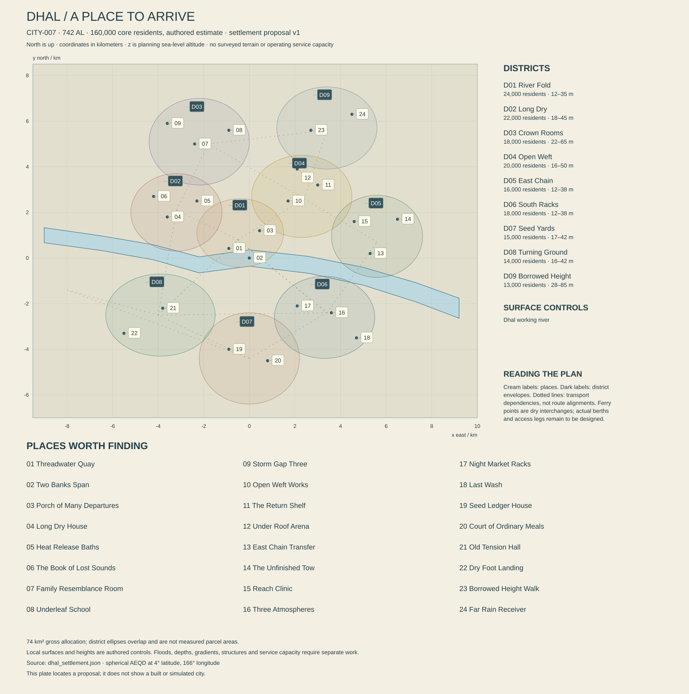

# Dhal — The spaces between living things

City dossier, authored proposal, 742 AL. CITY-007, REG-011, Green Vault, Morrow; 4° north, 166° east. Core population estimate: 160,000. This volume proposes nine districts, twenty-four mapped places and a service study for review. It is not surveyed terrain, a constructed Unreal environment, operating infrastructure or a simulated population. The accompanying `dhal_settlement.json` preserves the atlas anchor and identifies the geometric and numerical assumptions. New local dates, institutions and biographies below are authorial additions, not newly discovered historical evidence.

The [machine-readable settlement plan](dhal_settlement.json) and [generated relationship checks](DHAL_SETTLEMENT_CHECKS.md) accompany this dossier. The plate and checks describe authored geometry and arithmetic, not surveyed or built capacity.

## Arriving inside an already inhabited forest

The first impressive object is a machine. An articulated river crane lifts a long replacement roof beam above a barge, holding it absolutely still while two small inspection crawlers move along its seam. Beyond the boom, successive tiers of vault-vane fans admit narrow patches of sky. They are much taller than the houses and much less orderly than a planted avenue. A fallen support has been left beside a paved freight apron; someone has enclosed its dangerous end, while the sheltered underside remains alive with reclaimers. Keeping the apron open and keeping the fallen support were separate decisions made by people who still argue about the boundary.

Dhal is an inland river city, approximately 235 km from its separately mapped downstream mouth. It is neither a sea harbor nor an expedition camp that happened to grow a market. Families have rebuilt rooms here for generations. The city publishes children's serials, repairs pressure equipment, manufactures panels that tolerate humid service, prepares qualified biological fractions and operates an important transfer between river and land routes. It also contains impatient teenagers, a formidable amateur percussion scene, disappointing restaurants, excellent tailors and people whose ambitions have nothing to do with the forest.

The river comes from the west. Long upstream cargo strings shorten and redistribute their loads at Dhal; coastal consignments require their own downstream voyage and transfer arrangements. Nobody gets to Merrow by following one continuous Dhal river south. Aven's equipment can reach this city through connected land, air and freight networks, with actual routes and transfers still to be specified. Names on a delivery label communicate an extensive world without pretending all of Morrow lies one boat ride away.

The city is visually layered, but its ground plan is mostly gentle. Low waterfront aprons give way to slightly higher old banks and shallow ridges. Raised walkways avoid saturated ground; upper structures reach canopy observation levels. This is not Orison's crater climb reproduced in green. The characteristic movement is sideways through alternating volumes: enclosed dry room, ventilated porch, open yard, low fan canopy, exposed river, then a tall shaft of light. Height changes become exceptional and memorable because much ordinary travel is easy.

At night the giant Rauth is absent below the ordinary horizon. Electric lights reveal occupied routes and windows without filling every recess. Farther from the working river, a short dry note can announce a chime drifter landing, followed by several seconds of nothing. A machine releases heat across the water. A family closes an insect screen and leaves its porch light on for a returning relative. The city is beautiful because those activities coexist, not because all human industry has been hidden behind leaves.

## Ground, water and the limits of the sketch

All local coordinates use a spherical azimuthal equidistant frame centered on the unchanged atlas point; x increases east, y north, and z is absolute planning sea-level elevation in meters. The reference sphere has radius 5,900 km. The river's exact parent control is **[166°, 4°, 8 m]**. Upstream, RIV-005 passes [157°, 5°, 35 m]; downstream it reaches [168.148148°, 3°, 0 m] at the coast. Those distant controls determine broad direction and height, not the shape of every bend.

The authored local reach runs from [-9,000, 1,000, 9.2] through [0, 0, 8] to [9,200, -2,200, 6.8]. It occupies one continuous, variable-width water polygon. Intermediate bends are refinements within the coarse atlas, not a claim that the long upstream segment is straight. The nominal profile declines downstream. Its approximately 2.4 m fall across roughly 19 km says little about flood discharge, bed depth or seasonal water level. No major city power station obtains free head from this almost level reach.

Most occupied ground controls fall between 14 and 42 m. A few public decks rise to 69 m on independent structures. Those deck elevations do not imply that the underlying soil is equally high. District altitude envelopes include buildings and raised routes, while ground surfaces need a later terrain model. The city's 74 km² gross allocation includes transportation, habitat, work and housing parcels; it is not the area of the overlapping district ellipses. The wider forest, agricultural belt and watershed are additional territories, with no arbitrary population assigned to them here.

A deliberately simple inundation exercise raises the central water reference from 8 to 12 m. It tests which low approaches, drainage outlets and moorings require attention; it does **not** establish a flood frequency, safe elevation or universal horizontal flood plane. Water levels vary along the river, and backwater, debris, channel obstruction, drainage and groundwater require separate analysis. Critical equipment proposed above 20 m still needs access, foundations and utility routes that function during the event. A high pump on an island of dry concrete is not a working water system if its intake or switchboard fails.

The upper banks are occupied because they were convenient, not because residents possess an infallible memory of every flood. Older ground levels can disappear beneath new fill. A dry season can make a bad site look sensible for years. Marks are preserved beside survey benchmarks and dated photographs, with instruments permitted to disagree with anecdotes. Buildings use replaceable lower components where appropriate, but no household should be described as delightfully floodable. Recovery includes cleaning, drying, testing, compensation and somewhere comfortable to stay.

Only one mapped place sits directly over the river: the central Two Banks Span. Its public deck control is 17 m, above the local nominal water surface of 8 m, with dry shore access explicitly identified. The deck-to-water difference is not understructure navigation clearance. Pier positions, collision protection, debris passage, vessel air draft and accessible approaches remain engineering obligations. A berth drawn near a dry transport node is also not proof of a navigable quay. Draft, turning room and seasonal current are not yet measured.

## Light, weather and the forest's separate rooms

Dhal's near-equatorial latitude produces only a modest seasonal difference in geometric daylight. The adopted sky model gives about 69.1 hours at northern solstice, 68.4 at equinox and 67.6 at southern solstice, inside a 136.755-hour natural solar cycle. The longest nominal night is therefore approximately 69.1 hours. Those are open-horizon intervals, not guarantees of direct light at a window. Canopy, buildings and cloud create additional patterns. The civil turn remains 24 hours; a shop opening at first watch does not promise a sunrise outside its door.

The forest contains different air and moisture conditions rather than one uniform atmosphere. Exposed fan surfaces dry in moving air while cavities remain damp. A roof beneath several tiers can continue dripping long after a shower ends over the river. A warm metal service enclosure can generate a small rising current without noticeably changing the whole neighborhood. Humidity control is selective: homes provide reliable dry storage and comfortable sleeping spaces; medical and manufacturing rooms enforce tighter limits; open porches accept outdoor variation.

The broad climate proposal is a wet lowland regime with variable storm episodes and seasonal shifts in runoff, cloud and reproductive activity. No circulation model has established rainfall totals or a precise afternoon thunderstorm clock. A useful forecast separates incoming rain, upstream river change, gust exposure at upper decks, and residual branch or support hazards after the wind falls. Rain over a distant part of the catchment can matter more to a quay than a spectacular local shower. A clearing sky does not automatically reopen a route below weakened fans.

Comfortable weather is common enough to shape life. Visitors can spend several civil turns taking boats, watching wildlife and eating on screened terraces. During a dry anomaly, different tissues and soils respond at different rates. Fire concern requires actual fuel condition and ignition opportunity; the whole region does not spontaneously become a tinderbox because a seasonal counter changed. Recovery from a wet event includes brighter routes, repaired shelters, returning traffic and the pleasure of hearing outdoor performance again. Weather should give Dhal rhythms, not trap it in endless survival labor.

Vault vanes, ECO-033, form successive angled supports and tiers of narrow fans, often 25–50 m high. Mature stands contain dead material and changing gaps. They are not giant hollow cistern crowns imported from Kesh. Rootspindle, ECO-035, decomposes compatible dead tissue and participates in conditional root relationships; it does not form an intelligent citywide communications network. Chime drifters, ECO-034, need juvenile substrate as well as adult feeding opportunities. Parchment wardens, ECO-036, fold temporary platforms from suitable shed material and sometimes eat other native animals. Their ordinary lives include failure, predation and relocation.

Human food is a different system. Maintained introduced crop lineages and cultivated microbial or fungal cultures underpin diets. Selected native fractions require species, tissue, processing and batch qualification. A cream spindle under a fallen vane is not a mushroom snack; a warden eating something is not a human safety test. This boundary need not become a repeated alarm message. Shops offer abundant recognizable meals with dependable labels, and adventurous cooking operates inside knowledge accumulated over centuries. Local expertise can make food interesting without making every mouthful a reckless experiment.

## How Dhal became several overlapping cities

The global chronology places expanding Morrow crossings after 163 AL and rejects the idea of a single founding expedition. Within that framework, this dossier proposes an early river-service settlement cluster in **214–238 AL**. The range acknowledges several occupied landings and repair yards before anyone used one municipal identity. An early crane base reused beneath Threadwater Quay and pottery fragments from a buried household floor offer different kinds of evidence. Neither proves that one captain founded every neighborhood.

An explicitly proposed **309 AL Common Dry Store agreement** pooled reliable rooms for tools, records and crop stocks. Its successors became commercial insurers, household cooperatives and a public reserve, rather than one institution remaining unchanged for four centuries. This history explains why dry space carries status and affection. It does not mean poorer residents universally live in mold or that those controlling humidity can arbitrarily turn off breathable air.

During the proposed **397–421 AL transfer expansion**, larger river cargoes encouraged independent structural frames along the banks. Some were later shortened, rerouted or converted. The Old Tension Hall survives from this period, although much of its visible cladding is younger. Its former lifting system was designed for heavy material, not people swinging through the forest. Present exploration routes use inspected portions with known support, while abandoned spans remain hazards or distant scenery. Age is readable through repair interfaces and incompatible fastener families, not a blanket layer of grime.

The planet's Passage Cases occupy the established **549–624 AL** era. Dhal's local record concerns competing rights to cross industrial parcels and use long-established river approaches. This dossier does not invent an exact famous case date. Oral accounts disagree about who first opened a disputed gate. The practical legacy is a distinction between public passage, private working floor and revocable service access, with separate arrangements for repair and emergency use. Walking across town should generally be straightforward; the history becomes visible at particular contested seams rather than at every doorway.

A proposed **667 AL Wet Rooms inquiry** examined repeated building failures after a roof-product manufacturer presented accelerated tests as proof of long-term service. Some failures came from installation, others from genuine product defects, and a few households were wrongly blamed for insufficient ventilation. Current material qualification, tenant advice and shared repair funds grew through different responses. The company is neither secretly responsible for every damp wall nor conveniently vanished: successor firms still employ skilled local workers and face specific obligations.

The proposed **701–718 AL Canopy Connection program** expanded independent observation structures and household routes around selected stands. Its first designs were too eager to preserve an attractive silhouette at the expense of habitat below. Later revisions created fewer, better approaches and remote viewing options. The program also improved access for residents who had previously seen their surroundings only from low roads. It contains successful public investment as well as mistakes. Current debate concerns which maintenance commitments can be honored before adding another celebrated route.

These dates are working local canon, open to later chronological refinement without moving the city or overwriting global events. Dhal's oldest surviving records are not necessarily its most representative voices. Migrants, temporary workers, children and people who left can appear through letters, repaired objects and household collections. The city did not become culturally complete after its first settlement phase. New music, labor arrangements, names and imported techniques still alter it in 742 AL.

## Power, ownership and ordinary freedom

Dhal's municipal assembly manages local public services through elected representatives and contracted operators. The **River Work Association** coordinates berth schedules, training and common heavy equipment; its membership includes small operators and large employers whose interests often conflict. The **Habitat Rooms Trust** manages specified observation properties and ecological maintenance agreements, not all living things within sight. The **Dry Housing Federation** links independent landlord, tenant and cooperative bodies through particular warranty and repair arrangements. None of these organizations is an ethnic group, a religious tradition or a planetary government.

Local power is distributed unevenly. A successful processor can fund a research room and still underpay cleaners. A tenant representative can demand better drying equipment while opposing an expansion that would make it cheaper. Habitat stewards may disagree about whether a new route reduces scattered disturbance or draws too many visitors. Some captains want common tariff rules; others value negotiable terms. Political diversity belongs inside each profession and household. The player should meet coalitions assembled around a problem rather than discover that everybody wearing one kind of coat agrees.

Public movement is generous. The principal river walk, neighborhood roads, ordinary markets and several canopy approaches remain open without a special ecological license. Temporary closures identify their cause, extent and likely review. Industrial hot zones, sensitive studies and genuinely unsafe structures have narrower controls. Exploration can include invitation, observation, negotiation, skilled access, lawbreaking and refusal, with consequences appropriate to the act. The city is not a forest-themed sequence of permission desks, and a player need not solve local politics to enjoy a boat trip.

Lake speech is common in publishing and public conversation alongside Shore, Wake, other contact varieties, household languages and local sign communities. Translation systems usually work well. They can still miss a family joke, distinguish a product grade poorly or translate a provisional offer as a promise unless the participants clarify it. Transit Clear supports moorings, medical handovers and mixed crews. Essential directions and choices remain legible in English presentation; authentic texture never depends on decoding an entire invented language.

The eight established traditions cross these institutions without defining their membership. People may maintain a household observance, participate in a civic memorial and reject a relative's political interpretation of both. There is no authorized forest priesthood explaining all ecological relationships. A researcher can hold a religious conviction, a secular mechanic can care intensely for a stand, and a devout visitor can prefer the arena to an observation walk. No native organism exists to validate a human belief system.

## A demand study that the forest does not pay for

All service figures below refer to the **160,000 core residents** and a **24-hour civil turn** unless stated otherwise. They are screening assumptions, not measured capacity. Seasonal visitors, export industry and the wider agricultural catchment need additional explicit accounts. A nominal service number does not certify affordability, reliability or equitable access. Separate scenarios should later test a river closure, reduced regional power import, a production recall and simultaneous heavy rain with equipment maintenance.

### Homes and usable space

Propose 65,000 dwelling units. At 96% occupied and an average 2.57 people per occupied unit, the screening accommodation is 160,368 people, close to the atlas estimate without pretending a fractional person occupies a room. The 2,600 unoccupied units include repairs, succession delays and genuine spare capacity; they are not all immediately habitable or affordable. Household sizes vary, with single residents, large families, shared flats and supported homes rather than a mandatory local family structure.

A 12.5 km² residential parcel allocation, 24% average building coverage and 2.5 effective floors gives 7.5 million m² gross residential floor area. At 80% usable allocation that is 6 million m², approximately 92.3 m² per planned unit. These averages allow compact central apartments and larger peripheral homes; they do not specify every dwelling's layout. The remaining gross allocation is 8 km² industrial and freight parcels, 11 km² transportation and utility land, 28 km² public habitat and open land, and 14.5 km² other civic, commercial and mixed-use allocation. The categories total 74 km² and must not be counted again as separate additional land.

### Water, treatment and return flows

Domestic potable use is set at 120 liters per person per turn, or 19,200 m³. Other core potable demand adds 10,800 m³ for commerce, institutions and the accounted urban production. Total delivered potable water is **30,000 m³/turn**. At 12% distribution loss, treated network input is **34,090.909 m³/turn**. Assuming 95% treatment recovery, raw abstraction is **35,885.167 m³/turn**, approximately 0.4153 m³/s averaged over the turn. Treatment residuals are 1,794.258 m³ and network loss 4,090.909 m³. Those streams are distinct; river water taken into the works is not identical to clean water reaching a tap.

The preferred raw intake is upstream of the urban discharge reach, with a separate vulnerable bank access and monitoring obligation. Exact intake and discharge engineering is not encoded as a working hydraulic network in this settlement map. A 0.75 m³/s instantaneous intake candidate would exceed average required abstraction, but neither sustainable river flow nor acceptable abstraction share is established. Intake performance during debris pulses, drought and upstream contamination remains unresolved. Rain collection can serve local uses; it earns no citywide potable credit in this balance.

Propose 700,000 m³ of protected raw storage, equivalent to approximately 19.51 turns of average raw demand if full and usable, plus 90,000 m³ of treated storage, about 2.64 turns of network input. Raw reservoirs require land or structural volume, lining, water-quality management and a refill source. A high level on a dashboard cannot prove all stored volume is accessible. Treated tanks remain divided for inspection and neighborhood pressure; their usable fractions and fire reserve will reduce the simple endurance figure.

A separate 6,000 m³/turn reclaimed delivery supports qualified industrial, cleaning and landscape uses. Gross end-use supply becomes 36,000 m³: 30,000 potable plus 6,000 reuse. An assumed 26,000 m³ sewer collection leaves 10,000 m³ net consumption or uncollected return. Treatment divides that 26,000 into 6,000 reclaimed and 20,000 final residual water. This is a conservation screening case, not a prediction of actual use fractions. Raw input therefore balances 1,794.258 treatment residual + 4,090.909 network loss + 10,000 net end-use loss + 20,000 final water. Storm runoff is outside this foul-water balance.

Two wastewater process trains proposed at 16,000 m³/turn each provide 32,000 nominal combined throughput. One train cannot process the assumed full 26,000 collection. Maintenance requires a genuine reduced-load, storage or diversion plan; the proposal does not claim full redundancy. Wet-weather infiltration can consume headroom, and a biological treatment process suited to human waste does not automatically process every native industrial compound. Segregated material streams, testing and residue disposal remain necessary even where the receiving river looks large.

### Food and freight

At 1.65 kg edible product per person per turn, core food movement is **264 tonnes/turn**. A separate dietary screening target of 2,400 kcal per person gives 384 million kcal, while 75 g protein gives 12 tonnes protein. Neither target is proved by product mass. A mixed dry staple equivalent at 3,200 kcal/kg would require 120 tonnes for the calorie target if it supplied everything; real diets also include water-rich fresh produce, oils, cultures and differently dense foods. Native qualified fractions are ingredient streams, not replacement whole proteins.

A source scenario assigns 68% of calories to the surrounding maintained agricultural and culture belt, 29% to other Morrow producing regions, and 3% to urban growing and culture rooms. These shares partition calories only. They do not multiply the 264 tonnes into justified freight categories because product composition differs. The regional belt uses introduced lines selected over centuries for Nacre's long cycle, drainage and local conditions, a fictional agricultural commitment rather than proof that unmodified Earth crops thrive here. Selected controlled stock rooms use electrical lighting and climate control; their power must be counted, not attributed to alien fertility.

Thirty turns of complete dry calorie equivalent would be 3,600 tonnes. A proposed reserve of that size is a planning target, with rotation, pests, processing, cooking fuel and dietary limits still to resolve. Reserve stocks should include useful protein and micronutrient sources rather than one heroic mound of grain. Regional farmers need their own consumption and seed accounts. The city cannot reserve their entire harvest simply because the map leaves it outside the municipal frame.

Normal freight screening spans 1,600–2,800 tonnes per turn through urban transfer facilities, including food, construction inputs, material products, fuel or consumables and recirculating equipment. This is a workload envelope, not a measured throughput or export promise. Heavy cargo moves through dedicated aprons and consolidation windows; small merchants use shared services. Passenger ferries should not silently carry the whole industrial tonnage. Downstream navigation closures shift storage and schedules, while fast aircraft can prioritize medicine or expensive components without replacing bulk transport at equal cost.

### Electricity, heat and discard

The demand case is **150 MW average**, **270 MW peak**, or 3.6 GWh per turn on average. It includes 43 MW homes and ordinary commerce, 18 MW public services and water, 22 MW transport and freight, 47 MW core manufacturing and controlled food processes, and 20 MW cooling, drying and distribution auxiliaries. These allocations total 150 MW; export production beyond the defined core study is additional. Useful recovered heat can assist compatible drying stages, but tropical heat rejection remains a real design need. Not every warm pipe is a free resource somebody forgot to use.

A candidate supply study combines 110 MW of contracted regional firm import and 60 MW of local firm generation, with technology, siting and operating evidence still open. Separate renewable candidates of 100 MWp solar on suitable developed surfaces and 30 MW wind are installed ratings, not firm additions. Forest clearing is not justified merely by coloring a solar patch on the map. The local firm plant cannot be declared biomass-fed from unlimited native litter; fission or another qualified supply chain would need explicit fuel, cooling, safety and waste provisions before selection.

Storage proposed at 8 GWh usable with a 120 MW discharge limit could bridge 69.1 hours at an 80 MW deficit, requiring 5.528 GWh. It could not cover the complete 150 MW city load for that interval: 10.365 GWh exceeds capacity and 150 MW exceeds the discharge limit. Charging losses, reserve margins and simultaneous outages worsen those simple cases. Hospitals, cold storage, communications, refuge cooling and water have prioritized circuits, but priority does not create supply. Deep night uses generation and stored energy; no mirror over Orison is counted as Dhal electricity.

At 0.65 kg ordinary municipal solid discard per person per turn, the core produces 104 tonnes before separately classified industrial waste. Collection distinguishes repairable goods, clean feedstock, introduced-food organics, contaminated filters and native material residues. Proposed recovery percentages must await composition studies. Native reclaimers do not become an automatic human waste plant. A broken humidity panel can move from warranty inspection to recovered material; a failed batch from a qualified process may need a more expensive route. Both outcomes are visible parts of the city's economy.

## Nine districts, with overlapping lives

The allocations below sum to 160,000 residents and 74 km². Ellipse envelopes are orientation aids; they overlap and are not cadastral boundaries. Their heights include mapped structures. Homes, work and pleasure occur in every district even where one function leads its description.

| ID | District | Residents | Allocation | Planning height envelope |
|---|---|---:|---:|---:|
| DHA-D01 | River Fold | 24,000 | 8 km² | 12–35 m |
| DHA-D02 | Long Dry | 22,000 | 7 km² | 18–45 m |
| DHA-D03 | Crown Rooms | 18,000 | 9 km² | 22–65 m |
| DHA-D04 | Open Weft | 20,000 | 8 km² | 16–50 m |
| DHA-D05 | East Chain | 16,000 | 7 km² | 12–38 m |
| DHA-D06 | South Racks | 18,000 | 9 km² | 12–38 m |
| DHA-D07 | Seed Yards | 15,000 | 8 km² | 17–42 m |
| DHA-D08 | Turning Ground | 14,000 | 9 km² | 16–42 m |
| DHA-D09 | Borrowed Height | 13,000 | 9 km² | 28–85 m |

**River Fold** is the main arrival sequence: freight movement, covered public approaches, a bridge and homes behind the first service strip. The river bends beside streets rather than dividing the population neatly by income. Pilots rent central flats; a wealthy family keeps an inconvenient old workshop; temporary crews use rooms with secure lockers and excellent laundry. Its characteristic sounds are restrained warning tones, water against moorings and conversations interrupted when a crane's load enters view. Quiet courts sit one passage behind the working frontage. This district must feel useful before it feels picturesque.

**Long Dry** grew around dependable enclosed storage and now combines older apartment blocks, household repair services, bathing rooms and publishing. Its streets have broad eaves with visible drainage and replaceable screens. Interior finishes vary from expensive sealed panels to meticulously maintained older surfaces; poverty is not represented by giving every low-cost home the same rot texture. The neighborhood's humor comes from its reputation for keeping everything, including grievances, in excellent condition. People also move away, empty rooms and donate collections. A loved object can survive without becoming a mandatory quest item.

**Crown Rooms** meets a substantial native stand along several carefully placed approaches. Its name is a household metaphor, not evidence that Kesh's cistern crowns grow here. Schools, drawing rooms, research accommodation and ordinary homes share the edge. Some residents work elsewhere and barely notice visitors photographing their daily route. Public views coexist with experimental exclusions and unscripted wildlife movement. Architecture frames different heights without assuming every native support will bear a person. The most beautiful feature can be a recently opened gap whose familiar silhouette has disappeared.

**Open Weft** manufactures repairable enclosure systems, acoustic components and selected machinery assemblies. Workplaces include noisy floors, clean rooms, testing yards and staff kitchens rather than one interchangeable factory shed. The district also has Dhal's largest indoor amateur arena and a lively cluster of food stalls serving late shifts. Its political arguments often concern warranties, subcontracting and time: who must wait when a supplier disputes a fault, and who gets paid while an investigation continues. People value excellent work while retaining the right to leave a job they dislike.

**East Chain** connects the city to the downstream river corridor and the land approach beside it. Warehouses contain different businesses, not one omnipotent port authority. Some parcels were once more exposed to channel movement and contain unusual foundations. The Reach Clinic serves residents and traveling crews without turning every arrival into a medical crisis. A decommissioned tow system offers a long visual line toward the east, its missing sections making the distance legible. Beyond the last dense roofs the city gives way to other settlements, not immediately to uninhabited mystery.

**South Racks** holds food and material processes requiring several carefully separated environments. The name comes from older drying and maintenance frames; most current production uses contemporary equipment. Shift patterns make the night market busy while a school street nearby sleeps. Household routes cross service corridors at controlled places, and the riverfront contains both work and generous recreation. The district's beauty includes vapor condensing on a cool shield, an immaculate workbench and the color of ordinary meals under warm lamps. It should not resemble an endless toxic industrial dungeon.

**Seed Yards** is a residential and cultivation-service district with stock libraries, propagation spaces, freight consolidation and kitchens. Productive land continues beyond its envelope; the entire regional calorie supply does not fit among its houses. Some residents descend from cultivation workers, others arrived recently to teach, repair or retire. Family recipes use reliable ingredients while cooks argue creatively about texture and flavor. Native habitat patches remain separate from human crop stocks where compatibility and containment require it. The district makes food systems tangible without making every garden a survival lesson.

**Turning Ground** occupies older upstream transfer parcels and low ridges south of the river. It combines workshops, spacious homes divided into smaller households, sporting grounds and reused lifting structures. Its residents have strong ideas about what makes a building worth saving, which do not always agree. Some enjoy dramatic industrial remnants; others would rather have a quieter street and a reliable bus. Routes into the wider region start here with practical supplies, clear transport connections and no implication that a pedestrian can cross the continent in an afternoon.

**Borrowed Height** uses independent frames to reach selected views above nearby roofs and lower canopy. Ground remains gently raised, not mountainous. Observation structures, homes, technical facilities and ordinary open ground form a dispersed neighborhood. Tall structures have separate maintenance and evacuation needs; trees are not convenient unexamined foundations. On clear intervals, upper routes expose a large sky from which Rauth is still absent. The district attracts visitors seeking height, residents seeking quiet and teenagers interested in neither because they are meeting friends in a kitchen.

## Twenty-four places worth finding

Each location below has a stable identifier and mapped position. The stated experiences, choices and return states are narrative and environment requirements for future development, not implemented interactions. Coordinates identify a meaningful arrival or focal point, not the whole building footprint. Local dates not already established elsewhere remain explicitly proposed city history.

### DHA-POI-001 — Threadwater Quay

River Fold; [-900, 420, 15]; land. The quay's oldest visible lifting base predates its current paving, but the machinery above it is routinely renewed. A public gallery follows the rear of the working apron, giving visitors a close view without making every spectator an obstacle. Loads carry individual destinations, inspection tags and handling requirements. One covered bundle is a school roof, another a refinery component, another someone's carefully packed household.

Lena Varo, born 678 AL and approximately 57 standard years old, plans mooring sequences. She is Kes's mother and knows less about illustration than she pretends. Her current problem is an overdue tug occupying the best repair position while its owner argues with an insurer. Moving it frees a berth but may separate the crew from the only affordable nearby rooms. Lena wants a workable schedule, not a heroic stranger announcing which people matter.

A visitor can follow a load from unloading to its street carrier, learn why two apparently empty berths are unavailable, or take a public boat. If invited into the dispute, the useful discovery is an overlooked short-duration repair slot, with real limits on access and tooling. Later the repaired tug may be gone while its crew's farewell drawing remains in the galley window. The environment requires convincing fenders, cable leads, lifting envelopes, dry electrical housings and worn routes at actual handling points. Open river views should interrupt the dense canopy often enough to make arrival exhilarating.

### DHA-POI-002 — Two Banks Span

River Fold; [0, 0, 17]; supported overwater, nominal water 8 m. The span follows an established public crossing through a later structural replacement. Its broad resting bays serve people who enjoy watching river work without buying a drink. A dry northern access control at [0, 650, 18] connects to ordinary streets; the opposite approach and detailed gradients require subsequent design. Its deck is not the navigation clearance beneath its structure.

Pev Ari, born 713 AL, approximately 26 standard years old, maintains illuminated and tactile wayfinding. Pev shares a flat with Kes and can recognize when their roommate's cheerful account conceals exhaustion. Here Pev is replacing signs whose color choices work poorly in reflected wet light. The fix improves a real public route while provoking surprisingly heated opinions about a beloved old typeface.

The bridge offers a choice between the direct walk and a slower sheltered bay where boat crews sometimes exchange shouted jokes with people above. A navigation interruption can hold a convoy in view, making the river's scale and impatience palpable. During a serious high-water warning the closure reflects actual inspection and clearance concerns, not a timer attached to the player's arrival. On return, one sign may be new and a familiar route perfectly unchanged. Model maintenance hatches, accessible rest positions, anti-slip repairs, drainage and structural depth. Avoid disguising a huge crossing as a weightless decorative vine bridge; its elegance should come from intelligible engineering.

### DHA-POI-003 — Porch of Many Departures

River Fold; [450, 1200, 22]; land. This boarding house occupies three joined buildings whose porches were aligned long after their interior floors. The public common room opens toward a busy lane, while sleeping rooms retreat behind screened courts. Residents include visiting specialists, separated partners, crews between contracts and people waiting for a permanent home. A long stay is not automatically a failure to leave.

Jalen Oth, born 704 AL and approximately 34 standard years old, rents one of the smallest rooms despite earning enough for more. Jalen is saving for an extended journey through colder regions and keeps photographs of ice beside excellent river charts. A former partner still uses the house's parcel address. Their continuing friendship is comfortable until an invitation assumes they will travel together.

The player can obtain a room, join a meal or hear accounts of routes from people with conflicting tastes. Nobody must be interrogated to unlock the neighborhood. A missing bag can create a bounded investigation through labels, deliveries and honest mistakes, while an unopened private letter remains private even if it would make the answer easier. Later Jalen's room may stand empty, occupied by another traveler, or decorated with a newly returned photograph. The house needs luggage wear, individually altered screens, a shared charging shelf, sound separation and domestic possessions that distinguish residents. Its central promise is that travel changes homes as well as travelers.

### DHA-POI-004 — Long Dry House

Long Dry; [-3600, 1800, 28]; land. A cooperative housing block grew around one of the district's reliable storage rooms. Its central hall once served goods whose owners lived elsewhere; now it also contains bicycles, mobility equipment, theater costumes and an impressive number of jars nobody agrees to discard. The dry room is carefully managed, while balconies remain open to ordinary weather. The entire building does not consume laboratory levels of conditioning.

Neri Doss, born 696 AL, approximately 41 standard years old, lives here with their mother Oran. Neri inspects enclosure materials in Open Weft and hates being asked to diagnose every stain at family dinners. Oran, a retired freight clerk, organizes shared meals and is quietly considering a smaller apartment. They love each other without agreeing on whether living together still suits them.

A proposed roof replacement creates a practical choice among cost, repairability, disruption and an attractive design that reduces daylight in several homes. Residents already possess expertise; the player can help compare conditions in the affected rooms, carry an invitation or simply attend the open discussion. No single technical answer erases disagreement over expense. A return may reveal a completed roof, a changed bedroom arrangement and a celebration unrelated to either project. Asset work should show patch chronology, tenant alterations, drying rails, good contemporary appliances and spaces generous enough for shared use. This is a desirable home with a complicated decision, not an inhabited ruin awaiting rescue.

### DHA-POI-005 — Heat Release Baths

Long Dry; [-2300, 2500, 29]; land. The baths offer washing, quiet pools, cool resting rooms and a lively communal dining area. Their name refers to bodily relief and a carefully bounded use of recovered heat; plumbing still needs treatment, pumping and a source when neighboring equipment is idle. Water quality is maintained rather than entrusted to a decorative native organism. Different rooms provide different levels of privacy and conversation.

Sivren Lann, born 695 AL, approximately 42 standard years old, manages the kitchen and is Neri Doss's partner. They keep separate homes because both enjoy hosting relatives in their own way. Sivren experiments with introduced herbs grown in screened enclosures and reliable cultured sourness. Their ambitious new dish is controversial because regulars preferred the old one, not because alien mold has secretly entered the soup.

Visitors choose an energetic social session, a quieter reservation or simply dinner. A small scene can involve an old friend arriving after a long absence and discovering that the familiar bathing group now includes strangers. Sivren can arrange introductions without demanding reconciliation. During maintenance one pool closes while the rest of the business remains welcoming. Returning later should sometimes deliver exactly the comfort expected. Materials need credible wet and dry boundaries, changing facilities, nonvisual wayfinding, cleaning storage and heat-exchange equipment at a comprehensible scale. The baths demonstrate how advanced infrastructure can disappear into ordinary pleasure without becoming physically free.

### DHA-POI-006 — The Book of Lost Sounds

Long Dry; [-4200, 2700, 30]; land. The title belongs to a small publisher and listening room rather than one mystical object. Recordings document old engines, domestic music, changing river approaches and native soundscapes with dates and locations. Some tracks are poor recordings of important moments; others are exquisite recordings of events nobody remembers. The collection distinguishes evidence from reconstruction and permits an enjoyable fictional soundtrack to be labeled as one.

Gev Anik, born 667 AL and approximately 67 standard years old, founded the listening sessions after retiring from equipment diagnostics. Gev's adult daughter lives elsewhere and sends messages that are mostly ordinary family news. A new friendship with performer Tessa Ruun has made Gev more interested in attending live events than perfecting the archive. Colleagues affectionately regard this as a major institutional development.

A visitor may compare one location across several decades or contribute a properly described recording. An apparent missing animal call could reflect microphone direction, machinery or changed habitat; the archive supplies questions rather than instant ecological certainty. An old recording also contains a joke whose second speaker wishes to remain unnamed. Respecting that request need not destroy the useful acoustic record. On return, a new compilation can include audience notes and acknowledged uncertainty. Build headphone furniture, accessible playback controls, patched acoustic treatment and ordinary publishing work. The listening room should make silence, imperfect memory and affection as compelling as a dramatic hidden message.

### DHA-POI-007 — Family Resemblance Room

Crown Rooms; [-2400, 5000, 39]; land. A sheltered viewing room overlooks a vault-vane stand without requiring visitors to enter its root zone. Adjustable easels, low viewing positions and movable frames support different bodies and artistic preferences. The room was adapted from a field accommodation wing, retaining a good kitchen and one inconvenient column people now use as an exhibition surface. Its subjects keep growing when the room is empty.

Kes Varo, born 716 AL and approximately 23 standard years old, draws the canopy as an extravagantly dressed relative from an old family photograph. Another regular records fan angles with precision. Both drawings receive serious attention and good jokes. Kes works occasional packaging shifts while building an illustration portfolio, sometimes accepting too many commitments because declining feels like announcing failure. Lena's proud recommendations can make this worse despite her affection.

The player can borrow a frame, compare drawings, sit quietly or ask to see the photograph that prompted the joke. There is no correct species-identification answer required for belonging. Later an exhibition places the accurate study and ridiculous portrait together, with the creators' permission. Kes may choose paid work, a rest period or a different project rather than become the player's permanent artist. The location preserves the established leisure vignette while identifying the organism as ECO-033. Its assets require uneven real fan geometry, domestic art supplies, a beautiful ordinary view and evidence of unhurried shared time.

### DHA-POI-008 — Underleaf School

Crown Rooms; [-900, 5600, 36]; land. The school teaches ordinary subjects in buildings designed around daylight, ventilation and dependable enclosed rooms. Its name does not mean every lesson happens outdoors or every pupil wants to study ecology. One class constructs radio receivers, another rehearses a farce about a badly managed spaceship. A courtyard contains introduced food plants in controlled beds and a separate native observation patch whose care follows different rules.

Teacher Iral Sen, born 705 AL and approximately 33 standard years old, grew up in Dhal but returned only recently after working elsewhere. Iral rents a room from Oran Doss's friend and is trying to make friendships that do not revolve around school. Kes visits occasionally for illustration sessions, while Pev helps pupils compare useful signs with signs that merely look official. Their contributions supplement paid teaching rather than replace it.

A visitor can attend a public performance or follow a pupil-designed route exhibition. Children have bounded curiosity, differing abilities and real adult care; they are not a source of compulsory dangerous errands. One project incorrectly attributes a change in drifter sounds to rainfall alone. Comparing observations can reveal another factor without humiliating its authors. On return the display includes the correction and an unrelated, excellent model vehicle. Build lockers, quiet study corners, realistic teaching equipment, accessible play space and many uses of the same materials. Education here should suggest an open future larger than maintaining the city exactly as inherited.

### DHA-POI-009 — Storm Gap Three

Crown Rooms; [-3600, 5900, 34]; land. A recent vault-vane fall has opened a shaft of light beside an established research approach. Broken supports, suspended tissue and damp debris make the area visually spectacular and locally hazardous. The numbered name belongs to a study sequence, not an assertion that only three gaps exist. Some residents miss an old perch; others notice small producers using light that has not reached them for years.

Field lead Rema Ol, born 699 AL and approximately 38 standard years old, wants a short observation approach and a reliable remote station. A first alignment would remove juvenile drifter habitat; another passes beneath weakened support. Rema accepts that the best arrangement may be less photogenic than the fundraising image. Their brother works at the arena and teases them for making a temporary walkway into an architectural saga.

This is the mapped city expression of MOR-E03. The player can compare proposed approaches, observe organisms from an existing safe edge, or return later without intervening. A workable revision preserves selected debris and uses a shorter route with remote observation. It does not instantly repair the forest. Later seedlings fail or establish, a parchment warden changes platforms, and the early drifter concentration becomes quieter. Asset staging must preserve fallen geometry between visits and show growth at plausible rates. The reward is learning a place whose continuing life exceeds the intervention, with real danger and curiosity beyond the comfort of a viewing room.

### DHA-POI-010 — Open Weft Works

Open Weft; [1700, 2500, 25]; land. The works makes enclosure panels, service doors and repair assemblies for humid environments. Production combines precise automated operations with inspection, fitting and decisions about unusual orders. Test pieces occupy an open yard where aging can be observed without confusing it with proof of decades of service. A repaired old panel beside a new prototype makes the district's material history immediately legible.

Neri Doss examines returns here. Their colleague Vesh Dan, born 710 AL and approximately 28 standard years old, has developed an elegant replacement joint that is slower to fit but easier to repair. Management wants a product launch while a supplier dispute remains unresolved. The disagreement involves money and pride as well as technical evidence. Neri's experience of the family's housing repairs makes the consequences concrete without rendering them perfectly impartial.

A visitor can tour an authorized gallery, follow a component's route or help trace a disputed batch through marked samples and photographs. Choosing the easiest public accusation may damage workers whose evidence actually supports the complaint. A useful outcome identifies which failures share a cause and which need different remedies. Future visits can show an adopted joint, a postponed line or staff moving to another project. Build fixtures, reject bins, tooling changes, clean storage and distinct acoustic zones. Robots and computation should visibly reduce repetitive work while leaving meaningful supervision, maintenance and human judgment.

### DHA-POI-011 — The Return Shelf

Open Weft; [3000, 3200, 27]; land. This repair and resale hall gives costly objects a second route through the city. A long display mixes restored fans, household equipment, mobility accessories and peculiar commissioned furniture. Ownership and condition are stated clearly enough that shopping can be pleasurable. Not every object is a mystery; most are simply useful, with repairs that a skilled visitor can recognize.

Owner Mava Il, born 689 AL and approximately 47 standard years old, once worked in industrial purchasing and left after a lucrative promotion made the job intolerable. Mava employs two apprentices, pays for specialist work rather than expecting universal expertise, and keeps one disastrously uncomfortable chair because a friend made it. Kes designed the current labels and was paid promptly, an ordinary fact that matters to their friendship.

A found object can be brought here for identification, return, repair or sale depending on its actual ownership. That gives later collection mechanics a social setting without declaring all street props free loot. One dramatic-looking case contains harmless stage equipment; an unassuming sealed cartridge requires specialized handling. Mava explains the difference without turning the shop into a tutorial lecture. On return a familiar object may have a new owner, while the terrible chair remains. Assets should include finished repairs, halfway work, parts storage and honest wear at grips and hinges. The hall rewards curiosity about making things last without treating endless unpaid repair as a virtue everyone must accept.

### DHA-POI-012 — Under Roof Arena

Open Weft; [2100, 3900, 29]; land. A large covered floor accommodates ball games, choreographed movement, exhibitions and loud ensemble performance. Its roof has acoustic sections that can be adjusted for different uses, with machinery and access visible above the seating. The arena's best-known event is an informal relay combining accurate throws with rapid route choices around movable barriers. It is a sport, not a disguised military selection test.

Tessa Ruun, born 670 AL and approximately 64 standard years old, performs percussion here and enjoys Gev Anik's increasingly frequent attendance. Tessa's ensemble contains factory workers, a physician, students and one person who mostly wants to move heavy drums. Rema Ol's brother Jan manages equipment and sometimes discovers that performers have rearranged everything after he labeled it. Their arguments are affectionate until someone ignores a genuine safety boundary.

The player can watch, participate at a suitable level or use an accessible practice variation. Winning is one pleasure among companionship, spectacle and ridiculous mistakes. A damaged roof section can move an event to a smaller arrangement without canceling all enjoyment. Returning may reveal a new team, a familiar rhythm or Gev looking embarrassingly pleased in the front row. Build storage large enough for the equipment actually used, worn floor markings, rest spaces and entrances that handle crowds. The city needs a place where impressive coordinated action exists for fun rather than extraction, governance or danger.

### DHA-POI-013 — East Chain Transfer

East Chain; [5300, 200, 15]; land. The downstream interchange collects passengers, smaller freight and consignments requiring different vessels beyond Dhal. Its public concourse is on land, with berths and water access still requiring detailed design. Departure boards distinguish a city ferry, an intermediate settlement service and a voyage toward the coast. A distant destination is not represented by a universally available instant departure.

Jalen Oth often begins a working turn here. Dispatcher Bera Thenn, born 688 AL and approximately 48 standard years old, is helping train Jalen's eventual replacement while privately hoping the planned cold-country journey gets postponed. Bera's partner runs a grocery farther inland and dislikes the assumption that every river worker's family also works afloat. Their household plans depend on schedules that visitors usually notice only when delayed.

The traveler can board a normal service, watch load consolidation or investigate why a promised consignment changed vessel. A plausible adventure begins when a mechanical problem strands a useful package at an intermediate landing, requiring a different route and real coordination rather than a magical radio blackout. An independent trip can be exciting without every crew member becoming an enemy. On return, a changed departure pattern reveals whether the upstream disruption actually ended. Build cargo separation, sheltered waiting, repair access, luggage facilities and sightlines to approaching boats. The port should communicate competence and reach, with the low forest horizon making downstream distance feel larger than the buildings.

### DHA-POI-014 — The Unfinished Tow

East Chain; [6500, 1700, 22]; land. Remnants of an older bank-side towing installation form a line of towers and truncated beams toward the eastern outskirts. Its abandonment was uneven: some supports were removed, others became utility structures, and one inspection house remained occupied long after the machinery stopped. This is human industrial archaeology with a documented purpose, not evidence of an ancient unknown civilization.

Sal Oren, born 701 AL and approximately 37 standard years old, leads occasional exploration walks through inspected sections while also maintaining industrial access equipment for a living. Sal likes difficult routes and dislikes being sold as a fearless local guide. A younger relative wants to film a jump across a missing section; Sal can oppose the act without opposing exploration itself. The safer detour still offers height, strange framing and a remarkable view along the lost alignment.

The player can follow a marked ground route, accept a guided upper approach or investigate the former inspection house with its current custodian's consent. Locked machinery spaces contain real ownership and hazards, not automatic loot permission. A storm may expose a buried pulley or force one span's closure; useful discoveries remain after the first visit. If later movement mechanics permit technical traversal, anchor quality and falls must matter. Build broken continuity, independent modern repairs, legible loads and a distinct ground alternative. The drama comes from reconstructing movement through a large machine whose surviving pieces no longer form a complete system.

### DHA-POI-015 — Reach Clinic

East Chain; [4600, 1600, 22]; land. The clinic serves neighborhood households and traveling crews with ordinary appointments, rehabilitation and urgent care. A covered arrival court provides room for assisted transfers without converting the building into a fortified compound. Waiting areas include quieter rooms, screens against outdoor nuisance organisms and good communications. Advanced diagnostic equipment is present where its operating support can be sustained.

Physician Dana Esh, born 697 AL and approximately 40 standard years old, plays at the arena and is impatient when acquaintances assume medical work is their entire personality. Dana's parent lives at Long Dry House and frequently recommends the clinic to people who already know it exists. Dana has a strong professional boundary around patient stories, including the amusing ones friends keep requesting after performances.

A visitor might accompany a crew member, replace damaged personal equipment through a legitimate supplier, or help reconnect someone with their travel companions. A native scratch is treated according to observed injury and chemistry; the narrative does not assume every alien animal carries a human-transmissible plague. A difficult case can involve uncertain exposure without inventing magical universal medicine failure. Subsequent visits may show recovery, adjusted work and an ordinary appointment rather than another catastrophe. Model clean and public circulation, supplies, maintenance access, privacy and comfortable rehabilitation space. The clinic makes the city reassuringly habitable while leaving medicine skilled, finite and deserving of resources.

### DHA-POI-016 — Three Atmospheres

South Racks; [3600, -2400, 20]; land. The nickname describes a processing complex's separately managed environments: a humid receiving area for specified material, a controlled conversion and preparation zone, and dry final storage. Actual production uses more subdivisions than the name suggests. A public gallery shows portions of the work through proper separation, while operators explain what viewers cannot infer from an attractive sample.

Process lead Kade Leth, born 694 AL and approximately 43 standard years old, supervises qualified material fractions and maintains a separate account for introduced food cultures. Kade's sibling supplies theatrical props to the arena and resents that visitors always find the laboratory more impressive. Both professions transform materials, but their safety claims and markets differ. A visitor's interest can reveal the shared craft without pretending the two certifications are interchangeable.

One storyline follows an unusually variable native batch whose yield disappointed an exporter. The source records, tissue identity and processing conditions matter; collecting more unidentified forest material is not a solution. The existing Orison trade study's conditional Dhal-origin native fraction remains a demand hypothesis, not a promised output of this building. The player can trace an error, support a recall or decline involvement while production continues elsewhere. Return states include a revised process, a changed supplier and work that resumes successfully. Build segregated drains, cleaning stages, sample retention, sealed storage, heat rejection and unglamorous residue handling. The visual spectacle should be precise transformations whose costs remain visible.

### DHA-POI-017 — Night Market Racks

South Racks; [2100, -2100, 19]; land. Stalls occupy the sheltered edges of former drying frames, with current food preparation in hygienic modular units. The market's busiest hours follow work shifts rather than sunset. During the long natural night its lights create a warm inhabited volume with dark canopy beyond; during daylight it remains a useful shaded place. Open hours are posted in civil turns and watches with the sky phase alongside.

Cook Henna Val, born 708 AL and approximately 30 standard years old, serves crisp introduced-root cakes, cultured sauces and rotating fillings. Henna shares deliveries with Sivren's bath kitchen but refuses to copy its fashionable menu. Their friendly rivalry sustains a small audience of regulars who insist on judging each experiment. Kes sometimes eats here after packaging work, drawing customers only when they agree.

The player can try unfamiliar but qualified food, hear a performance or sit with travelers waiting out rain. A stall dispute might concern borrowed space and a genuinely successful new business rather than poisoning, extortion or disaster. Helping rearrange storage can preserve both an access aisle and room for another table. Later the arrangement becomes ordinary, with no monument to the stranger who suggested it. Assets need heat, steam, utensils, washing, cold storage, refuse collection and different stall histories. The sound design mixes conversation, food preparation and distant river machinery without making every native creature sing in rhythm with the music.

### DHA-POI-018 — Last Wash

South Racks; [4700, -3500, 17]; land. This material recovery and treatment interface stands well away from the popular river walk. Its name comes from an old laundry operation, but the present complex handles distinct streams that cannot all share one process. Public access ends at an observation room and a service exhibition; working floors remain working floors. The site should be visually specific rather than uniformly filthy.

Supervisor Miren Faal, born 682 AL and approximately 53 standard years old, began in household appliance repair and moved into process maintenance after retraining. Miren still volunteers at the Return Shelf, partly for pleasure and partly to keep a perspective on what arrives as waste. Their teenage child wants to become a pilot and finds the family's enthusiasm for repaired objects faintly exhausting.

An industrial residue with incomplete labeling can delay a collection route without threatening the entire planet. The player may help establish its origin through shipment records and physical fittings, or choose a transport solution that keeps uncertain material contained. A dangerous shortcut creates specific worker and receiving-process risks; there is no native root network waiting to harmlessly consume it. Return visits can show repaired equipment, a better handling interface or a completed training display. Model separated drainage, lifting, secure sample storage, clean staff rooms and the scale of collection vehicles. This location anchors the city's beauty in work that deserves decent conditions, while providing tangible investigation through material evidence.

### DHA-POI-019 — Seed Ledger House

Seed Yards; [-900, -4000, 26]; land. The house keeps introduced crop and microbial stock records alongside living material in separately maintained rooms. It is a supplier, training center and community institution, with ordinary offices beside expensive controlled spaces. A printed ledger remains useful for browsing histories, but operational records also have modern backups and identification systems. Nostalgia does not require technological incompetence.

Emra Tess, born 680 AL and approximately 55 standard years old, coordinates stock exchange with growers beyond the city. Emra's foster brother Vadu Ress works around boats and theater equipment; they argue about how much time each owes their aging former guardian. Neither duty nor affection divides itself neatly by profession. Emra sometimes leaves early to attend an arena performance and trusts colleagues to finish perfectly competently.

A supply story can begin with a promising new introduced line whose long-cycle performance varies between two growing sites. The investigation compares drainage, handling and environmental control instead of assuming fraud or inventing a miracle seed. Visitors can join a public demonstration, learn how a familiar meal starts here, or follow a delivery into the agricultural belt. Native ecological specimens remain a different program. On return, a cautiously successful trial may expand while another is abandoned and preserved in the archive. Asset work needs believable storage gradients, stock labels, cleaning boundaries, backup power and the modest tools of daily propagation. The institution's value is continuity that still permits experimentation.

### DHA-POI-020 — Court of Ordinary Meals

Seed Yards; [800, -4500, 25]; land. Several housing entrances share a courtyard with a kitchen large enough for events and small enough to feel domestic. Most meals still happen in private homes. The shared table is a choice, used for celebrations, inexpensive suppers and occasions when cooking alone sounds unappealing. Introduced herbs grow in enclosed planters, while a native habitat patch beyond the fence follows different care.

Vadu Ress, born 684 AL and approximately 52 standard years old, cooks here between irregular technical jobs. Their former guardian, Eni, enjoys being invited but dislikes having younger relatives organize life around presumed frailty. Emra proposes a dependable rota; Vadu prefers visits that feel spontaneous. Eni wants both of them to ask what help is actually welcome. The disagreement remains loving and can exist without a tragic resolution.

A visitor can contribute a useful ingredient, join a meal or listen to competing plans for an ordinary celebration. A cook may decline a spectacular unknown native item politely and offer something dependable instead. The player can help make the event accessible without becoming its center. On return, a familiar place at the table may belong to someone new, while Eni has started attending a hobby group elsewhere. Build mismatched seating, a serious kitchen, private thresholds, weather protection and personal objects brought out only for gatherings. The court establishes that collective provision can coexist with privacy, abundance and the freedom to eat somewhere else.

### DHA-POI-021 — Old Tension Hall

Turning Ground; [-3800, -2200, 24]; land. A former heavy-transfer structure from the proposed 397–421 AL expansion now contains workshops, climbing practice equipment and an occasional performance floor. Its original lifting history remains readable in foundations, cable paths and an outsized maintenance opening. Present recreation uses separately inspected apparatus. Nobody assumes that a surviving industrial beam is safe merely because it looks heroic.

Vadu Ress sometimes adapts stage mechanisms here, collaborating with Sal Oren on access systems. They disagree about how much original machinery to retain. Sal sees an extraordinary teaching object; Vadu sees expensive floor space occupied by equipment nobody will operate again. A younger workshop collective proposes making part of the mechanism move under tightly bounded demonstration conditions, while keeping the most vulnerable section static.

Exploration can follow an old cable route from ground inspection to an upper gallery, discovering how the whole apparatus once worked. A practice route offers optional physical challenge alongside a reliable viewing approach. A later quest might use the hall's expertise to reach a damaged structure elsewhere; it should not make unsafe improvisation universally equivalent to engineering. Return states include a successful demonstration, a revised performance or a quiet day of ordinary fabrication. Assets require authentic large-scale connections, worn service platforms, modern independent supports and an appealing interior volume. This is a place where adventurous movement and heavy machinery can be exciting without erasing competence or ownership.

### DHA-POI-022 — Dry Foot Landing

Turning Ground; [-5500, -3300, 25]; land. Despite its inherited name, the mapped focal point is a land staging house south of the river, connected to upstream roads and selected field approaches. Former boat access survives in photographs and subsurface traces; the contemporary watercourse is not moved to satisfy the name. Supplies, route advice, equipment hire and a small café make it a practical departure rather than a mysterious threshold.

Guide Iven Pell, born 706 AL and approximately 32 standard years old, leads trips that range from comfortable observation walks to demanding multi-turn travel. Iven is good at saying when a route exceeds a group's equipment or wishes. Their partner designs software from home and sometimes joins the shortest outings, preferring conversation to professional enthusiasm about every sound. Both are thoroughly local people with different interests.

A visitor can choose distance, difficulty and purpose, with a clear return plan and meaningful alternatives when conditions change. A missing trail marker may reveal ordinary damage; an unfamiliar sound may justify patient observation rather than combat. Longer expeditions need supplies, communications and transport appropriate to real distance. On return, the staging house can carry photographs, repairs and accounts from other travelers, including trips made successfully without the player. Build useful maps, drying and charging space, equipment in varied sizes and a clear connection to the inhabited city. The freedom to leave should feel inviting precisely because returning is also possible.

### DHA-POI-023 — Borrowed Height Walk

Borrowed Height; [2700, 5600, 69]; land-supported elevated structure. Independent frames carry a public observation route into selected canopy openings. The coordinate marks its upper resting platform, not a 69 m hill. Foundations and access stay on authored land; surrounding vault vanes neither consent to nor secretly support the structure. An accessible approach and emergency arrangements remain detailed design work, not an assumption supplied by a line on the map.

Maintainer Ula Renn, born 691 AL and approximately 45 standard years old, likes the walk most when few people are using it. Ula also supports public access and resents expensive private viewpoints sold as the only authentic forest experience. Their household hosts visiting relatives who reliably choose the arena instead. The disagreement is an affectionate reminder that spectacle does not compel everybody to feel the same thing.

At the transition toward night, outer vault-vane fans fold in uneven waves, changing the visible pieces of sky. A parchment warden may work on a temporary platform while drifters choose shorter crossings. The player can wait, continue to a different viewing level or leave without missing a mandatory timed revelation. Rauth never appears here above the ordinary horizon. Later a growing fan obscures a cherished view while another opens elsewhere. Build credible structural depth, wind response, comfortable resting bays, maintenance routes and real separation from vulnerable tissue. The experience should offer height and wonder while making the city below feel inhabited rather than miniaturized scenery.

### DHA-POI-024 — Far Rain Receiver

Borrowed Height; [4500, 6300, 44]; land. A small weather and communications facility combines remote observations with local instruments and a public forecast room. Its position on a modest rise improves some exposures without turning it into a mountain observatory. Screens distinguish river forecast, upper-route wind, local rainfall and data quality. A sophisticated model can still have an uncertain upstream input; uncertainty is displayed where it changes a decision.

Analyst Noa Desh, born 700 AL and approximately 37 standard years old, works with both river operators and habitat observers. Noa enjoys building elaborate small model boats that perform badly, a hobby colleagues find baffling given the quality of their professional calculations. Bera Thenn requests early transport advice; Rema Ol wants a different forecast for exposed supports; neither customer receives one universal green or red symbol.

The visitor can watch distant weather arrive through measurements before it appears in the sky, compare a forecast with a later outcome, or help carry a replacement part to a nearby instrument station. Communications remain ordinarily capable; a maintenance trip matters because hardware needs physical work, not because messages are inexplicably forbidden. A return after a storm can show both accurate warnings and a corrected bias, alongside the cheerful reopening of routes. Asset needs include actual instrument purposes, cable protection, maintenance access, quiet computing rooms and Noa's impractical boats. This final overlook connects intimate city decisions with a watershed far larger than the visible forest.

## Movement, ownership and a day's freedom

The plan supplies one land interchange in each district and an additional upstream regional road gateway. River Fold and East Chain also carry declared regional gateway roles. Walking, bus, tram, road and ferry links express required connections, not surveyed alignments or operating capacity. In particular, a straight dependency across the water does not certify a bridge, and ferry endpoints remain dry waiting or interchange points until berths and access are designed. Every district must remain connected if an optional spectacle route closes.

A visitor can arrive at Threadwater, walk to the boarding house, cross the span, eat at the night market, visit the arena and return by a different route without touching a main plot. Another can spend a whole stay following a manufacturing defect, riding upriver or watching a storm gap. These itineraries should intersect ordinary life at different hours. The same civil time can occur in daylight on one visit and darkness on another; household schedules persist through both. The city should support a good session with no combat, and also contain spaces for later pursuit, theft, physical challenge and difficult negotiations when their causes are authored.

Future collectible objects need provenance and affordances. A loose rental tool is returnable equipment, a stall item is stock, shed native material may remain ecologically valuable, and a household keepsake belongs to somebody even when its owner is absent. Objects that can be lifted or thrown require mass, breakage, ownership and response rules, separately implemented later. Public refuse and salvage sites can offer legitimate collecting opportunities without making every home a treasure cupboard. Destruction likewise needs structural and service consequences; a snapped decorative screen is not the same as severing a bridge support.

Exploration clues should be physical and various. A replacement joint identifies a repaired product family. A damp line appears above an old photograph's paving level. Drifter notes concentrate around a new gap, then diminish as the stand changes. A missing transit sound may indicate a closed route rather than a conspiracy. A boat changes its trim when loaded. Some of these observations support practical action; others deepen familiarity. Not every clue must end in a reward container, and not every unidentified object needs a sinister explanation.

## Return states, relationships and production obligations

The named cast forms overlapping networks rather than twenty-four isolated service terminals. Lena, Kes and Pev connect river work, shared housing, art and signage. Neri, Oran and Sivren connect inspection, domestic repair and hospitality. Gev and Tessa give an archive a living audience. Emra, Vadu and Eni negotiate care without fitting a simple virtuous-versus-selfish pattern. Rema and Jan connect habitat work with performance; Jalen and Bera make travel affect people who remain behind. Their private decisions should continue when the player is elsewhere, but not all on a fabricated universal drama timer.

Return changes require carriers and timescales. A repaired sign can appear after parts and work arrive. A recalled batch affects a specific product chain. A storm gap's life changes through growth, mortality and movement, not through instant mature regrowth after a quest. A household move takes planning; a changed chair at supper may be immediate. Some sites remain dependable for years, giving the player the pleasure of recognition. A world in which every loved place deteriorates between visits would contradict Dhal's established capacity to maintain a good life.

The visual asset families are explicit: river cargo and mooring equipment; broad eaves and drainage; repairable humid-service panels; screened domestic thresholds; clean controlled interiors; independent canopy frames; distinct vault-vane growth stages and dead structures; process segregation; normal household clutter; and performance infrastructure. Materials need placement logic. Condensation belongs where temperature and moisture allow it, corrosion depends on material and exposure, and a maintained room should look maintained. Bright native bioluminescence is not established for these four species and should not be added as a universal forest shader.

Audio needs equally specific layers: intermittent drifter contact notes, different fan movements, rain arriving at several heights, delayed dripping, river handling, selective ventilation, footsteps on ground and structural decks, and rooms with different acoustic treatment. Quiet periods matter. Speech comes from varied people with comprehensible intentions, while optional Lake and other language textures follow the language volume's bounded design. Sign communities need visible sightlines and communication habits rather than a generic hand animation pasted onto every conversation.

No new external factual claims are required to establish this authored city. Its physical and ecological boundaries inherit the checked candidate and cited research distinctions in Volumes 00–02, the history and language volumes, the power-and-exchange study, the regional atlas, the ecology foundation and the Morrow ecosystem dossier. The earlier leisure vignette LEI-04 is retained and now assigned explicitly to a vault-vane view. This proposal does not turn current stock estimates into proven agriculture or processing yields.

The next evidence required is local terrain and channel survey design, flood and drainage scenarios, navigation dimensions, foundations and structural access, actual service sites and routes, productive agricultural areas and yields, process qualification, and measurable implementation budgets. The two authored files can check identifiers, placements, connectivity and declared arithmetic now. They cannot demonstrate hydraulic performance, ecological recovery, housing affordability or rendered quality. Dhal's current achievement is a coherent place to build: industrial and intimate, exciting to leave from, and good enough to want to return to.
