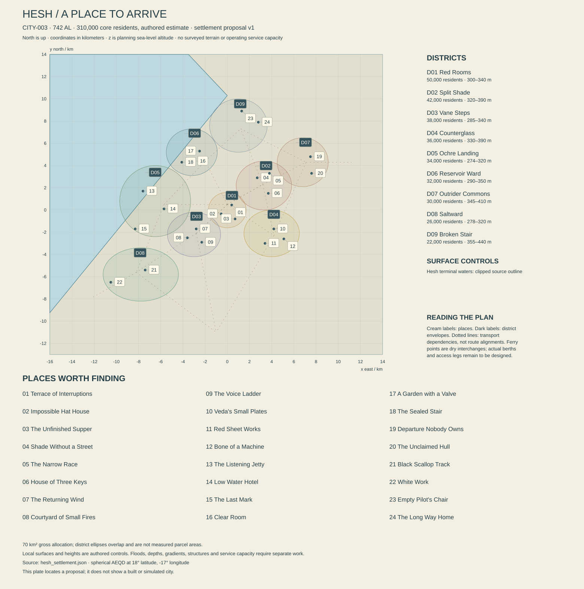

# Hesh — the freedom to leave something unfinished

**CITY-003 · REG-004, Red Ledger Basin, Kesh · proposal 0.1 · 13 October 2026.** Present: 742 AL. Atlas center: 18° N, 17° W. Resident estimate: 310,000. This dossier and `hesh_settlement.json` author a city for review. Terrain, service capacities, dangerous routes and character systems are not implemented or validated by writing them down. New local dates, relationships and ecological proposals are marked as additions to established canon.

The acceptance condition is a city with a compelling life and an intelligible edge: one can leave a beautiful private room, cross a crowded argument, negotiate with an independent crew and reach a genuinely hazardous landscape without the world changing its rules to accommodate the journey. Its closed basin must have a material future, including somewhere for salt and waste to go.

## 1. The city that looks back

Hesh appears as a dark line of shade cut into pale and red ground. At a distance, its roofs seem almost level. Close by, the land breaks into shallow scarps, old excavations and raised streets. Narrow gaps suddenly frame a far larger landscape: terminal water, exposed mineral margins, a moving line of dust where a vehicle has actually disturbed loose ground. The air can also be brilliantly clear. Dryness is not an orange filter permanently applied to the camera.

Its architecture has weight and sharpness. Thick mineral walls carry thin metal shades. Deep windows hold colored inner shutters, while external faces remain quiet enough to show changes in light. Some streets are cut beside natural rock; others cross voids on contemporary structural spans. Bright domestic ornament occupies intimate surfaces: a polished latch, a painted cabinet back, a small patterned plate placed where afternoon light reaches it. Luxury is often silence, a well-sealed room and excellent proportions.

Hesh is also a place of departures. Independent overland convoys, repair crews, prospectors, couriers and people with less easily described work pass through its yards. Some obey every registration rule. Others have escaped an unfair service claim, concealed a cargo or acquired a ship through acts they describe differently from its former owner. Their presence creates opportunity and danger without making every resident a smuggler or every official an enemy.

The city permits strong opinions and enjoys their performance. People argue about art, mechanisms, contracts, food, architecture and whether a particular pilot can possibly be as good as she claims. A public debate may be serious or gloriously trivial. The name Red Ledger originally referred to durable mineral-treated survey sheets. Outsiders who insist it must mean blood debt quickly exhaust their welcome.

At night Rauth stands high toward the east-southeast in the reference sky, roughly 65° above an unobstructed horizon. Its phase and cloud conditions affect the view. The giant does not illuminate every alley or abolish darkness. Some of Hesh's best moments occur in that uncertainty: a familiar roof becomes an unfamiliar silhouette; a distant machine starts; someone asks whether you still intend to take the long route.

## 2. Water west of the city, not a river through its heart

Hesh's atlas center remains at 18° N, 17° W. The **Hesh terminal waters, LAK-003**, have a planning surface of **270 m** and no established open outlet. Their outline represents one variable water state. The river **RIV-003** ends at 17.6° W, 17.8° N, 270 m, approximately 62 km southwest in the city's local projection. It does **not** pass through Hesh's origin. This plan does not move it or invent a convenient city-center river altitude.

The local frame is spherical azimuthal equidistant, radius 5,900,000 m, centered at Hesh. x is east, y north and z is planning mean-sea-level altitude. Projecting the source lake places its eastern vertex at approximately (0, 10,297) m and the next southeastern vertex at (-58,958, -61,690) m. Their coarse connecting edge passes about 8.46 km west of the city origin. The center is therefore inland; the lake lies west and northwest in this local view.

The JSON records the full projected source polygon and clips that same polygon to the local frame for rendering. No invented shoreline bay makes a district fit. This is a provenance-preserving schematic boundary, not a surveyed bank. Later local shore detail may refine it through explicit revision. Until then, lakeward buildings and shore access are placed consistently on its dry side, with supported structures explicitly marked where they project above water.

The [settlement check report](HESH_SETTLEMENT_CHECKS.md) records authored geometry, placement, connectivity and arithmetic checks. The plate is a location proposal, not surveyed terrain or an operating-city simulation.

Hesh occupies rising ground east and southeast of this edge. Residential and working districts range provisionally from about 280 to 410 m, with local cuttings and elevated structures. These heights describe an authored basin margin, not an ancient impact crater or a complete geological section. Open ridges and old excavations create strong sectional architecture without repeating Orison's bowl. The whole city is not built in a canyon, and its skyline is not one uninterrupted stack of terraces.

The waterward quarter has lake craft and maintenance landings, not an ocean harbor. Lake salinity is variable and unquantified outside the specific hypothetical process case below. The city is not surrounded by uniformly fresh oasis pools. Native freshwater animals cannot be imported from Marroway merely because there is water in the frame. Ordinary movement follows roads, raised shore routes, rail connections and flight facilities; the lake is one part of the geography rather than the explanation for every trip.

Local intense rain can produce rapid runoff through cut streets and damaged ground. It may wet the square while contributing little to long-term reserve recovery. Upland inflow, recharge, reservoir operations and city rainfall require separate reports. The plan does not draw a permanent canal across the center to stand for these processes. Proposed drains belong to later civil design and must have real destinations.

The margins offer adventure precisely because they are not uniform. A firm mineral bench can adjoin a thin crust over soft saline material. A quiet excavation can contain unstable edges, isolated pressure equipment or a shaft not visible from above. Wind can make an exposed crossing unsafe while a nearby courtyard remains pleasant. Route choice, preparation and retreat should matter. These are authored hazard categories, not tested traversal mechanics or excuses for arbitrary invisible death zones.

## 3. Histories people have made useful

The master chronology establishes inland expansion, evolving technical standards, the Relay Winter and later repair settlements without giving Hesh one definitive founding birthday. This dossier proposes local anchors within that spine. They remain proposals until integrated into the chronology.

**Proposed 104–121 AL: the East Bank stations.** Several survey, cultivation and repair compounds establish durable occupation on higher ground near the terminal basin. Their surviving service walls are distributed among later neighborhoods. No one surviving doorway is declared the sole birthplace of the city. Water rights predate some municipal boundaries, while several older claims were later abandoned or renegotiated.

**Proposed 154 AL: the red-sheet survey editions.** Local workshops adopt a durable mineral-treated sheet for field records. Red Ledger becomes a convenient regional name, then an identity people reinterpret. Present printed reproductions are not all made from the original process. A popular dramatic history later turns the name into blood debt; its influence belongs to media history, not geological evidence.

**Proposed 263 AL: the shade-span standards.** Fabricators reconcile a useful set of fasteners, supports and removable shade panels. The agreement spreads because repairs become easier, not because every household adopts one architectural taste. Surviving streets contain several compatible generations of hardware. An ornate old panel may fit a very plain new bracket, visibly joining different periods.

**Proposed 414–426 AL: the departures from the old condensate works.** During the later broken-links era, a remote-linked processing complex loses reliable parts and contracts. Operators shut down sections in stages and remove useful equipment. Some areas are stripped, others sealed and a few later reused. The ruins should contain records of orderly departure alongside localized failure, rather than a perfectly stocked facility waiting centuries for the player.

**Proposed 487 AL: the open-yard settlement.** Participating yards recognize limited safe-conduct, repair access and published terms for visiting crews. These are local protections, not an abolition of criminal law or a universal right to hide stolen cargo. The arrangement becomes valuable to independent captains and ordinary travelers alike. Disputes turn on what a yard actually promised, not whether freedom is inherently good or bad.

**Proposed 604 AL: the Small Rooms season.** A series of exhibitions popularizes finely made compact interiors and sharp variations of off-center dress. Serein's earlier Oblique Rooms movement is acknowledged rather than secretly copied and renamed. Hesh's contribution concerns scale, density, folded shadows and the pleasure of one excellent object in an otherwise restrained room.

**Proposed 688 AL: the Saltward closure review.** A municipal review makes accumulated residue and future storage obligations visible as physical commitments. The change is not the first time anyone knew salt existed. Earlier works had local disposal arrangements; the review connects several long-term obligations that previously appeared affordable in isolation. This history produces engineered sites and difficult budgets, but it does not turn every conversation into water accounting.

The present inherits competently maintained places and unresolved ones. Some descendants resent a preserved wall because it complicates their apartment; others love the same wall. A crew may remember an open yard as the place that allowed them to leave a coercive arrangement, while a former owner remembers an unresolved theft. The bible should know which facts are established and which remain disputed. Ambiguity is stronger when it has a defined object.

## 4. Nine neighborhoods, not nine castes

The nine district allocations total **310,000 residents and 70 km² of gross planning area**. Drawn envelopes overlap and do not represent legal parcels. A housing screen uses **125,000 dwellings**, 95% occupied and an average 2.61 residents per occupied dwelling, implying 309,938 people. That supports the rounded census target without making every room a communal dormitory.

An illustrative 15 km² of residential parcels at 32% coverage and 3.0 effective residential floors yields 14.4 million m² gross residential floor area. At 80% usable efficiency, 11.52 million m² remains, about 92.2 m² per dwelling across very unequal homes. High average space is possible in a relatively dispersed basin city, but protected interiors, shared rooms and service space still cost money. Some people occupy one small rented room while others have generous courts.

The gross land allowance is 15 km² residential, 12 employment and yards, 6 civic, 12 streets and transit, 10 recreation and managed growing, 3 shore facilities, and 12 reserves or other open ground. Household and commercial uses can share a building while its parcel is counted once. The city does not need a dense population on every visible rock face to feel large.

**HES-D01, Red Rooms — 50,000 residents, 6 km², center (0, 0, 318).** The central district is compact, social and architecturally precise. Warm mineral walls surround cool internal rooms; fabric and thin metal shades interrupt hard outlines. Its public life spreads among small stages, markets, restaurants and shared courts. Municipal counters exist, but they do not occupy the whole story. A trader can conduct a sober transaction, then spend an unreasonable amount on a tiny decorated box. Private thresholds are clear, and the public roof routes are explicitly different from household terraces.

**HES-D02, Split Shade — 42,000 residents, 7 km², center (3,300, 2,200, 344).** Natural outcrops and later cuttings create narrow passages, sudden overhangs and high routes with large views. Buildings bridge some gaps and leave others open. The district contains dense housing, small workshops and a culture of skilled movement. Some crossings are public and maintained; others are dangerous shortcuts or private access. A future climbing system must respect that distinction. The area is beautiful through section and shadow, not by decorating every surface. Its social life includes races, rooftop meals and arguments about what newcomers mistake for a public path.

**HES-D03, Vane Steps — 38,000 residents, 7 km², center (-3,000, -2,200, 311).** This western central district combines housing, schools, repair shops and sheltered performance courts. Its name refers to small wind-responsive fittings once used to ventilate rooms, not a single giant turbine. Streets step modestly down toward lower ground; long accessible routes follow gentler alignments. Music and broadcasting are important, including sharp public argument and very silly comedy. The atmosphere should include school errands, resting workers and people who have no interest in being adventurous today.

**HES-D04, Counterglass — 36,000 residents, 8 km², center (4,000, -2,100, 354).** Material preparation, ceramics, compact technical housings and precision finishing share space with mixed housing and studios. Reflective surfaces are used sparingly inside deep frames, producing brief flashes rather than an entire glass skyline. Veda Pell's ceramic work belongs here. Workshops need feedstock, inspection, cooling and residue handling. A beautiful small object can contain several intercity supply relationships, while an apparently advanced salvaged machine can remain useless for lack of one ordinary qualified seal.

**HES-D05, Ochre Landing — 34,000 residents, 7 km², center (-6,500, 800, 291).** The lakeward district sits on dry ground southeast of the coarse projected shore. Long covered approaches descend to working landings. Hotels, local boat services, shore maintenance and ordinary homes coexist with informal information exchanges. The lake horizon is broad, but it is not an ocean and has no convenient outlet. Visitors come to watch changing margins, hire a qualified local boat or meet someone arriving from another basin settlement. Some meetings are clandestine. The majority concern meals, relatives, work and ordinary journeys.

**HES-D06, Reservoir Ward — 32,000 residents, 9 km², center (-3,200, 5,200, 301).** Water-treatment and storage services occupy controlled sites near public housing, crop facilities and gardens. The district's characteristic forms are low insulated reservoirs, tall pressure structures and generous service setbacks, not ornamental pools. It contains a functioning present and several older sealed works whose ownership and safe access are not identical. Technical competence makes good life possible here; secrecy and neglect can make particular spaces dangerous. A public garden need not conceal a conspiracy merely because an abandoned stair nearby does.

**HES-D07, Outrider Commons — 30,000 residents, 8 km², center (6,800, 4,300, 368).** This eastern gateway holds repair aprons, overland transfers, visiting crew rooms and a limited flight facility. Its broad hard surfaces are interrupted by human-scaled covered passages, food stalls and private domestic courts. Independent crews have agency and varied motives. Some are generous, some predatory, most inconsistent. Freedom here means options and responsibilities, not a guarantee of innocence. A player can find passage or trouble, learn a vessel's history, or decide that an attractive offer conceals obligations they do not want.

**HES-D08, Saltward — 26,000 residents, 9 km², center (-7,800, -5,800, 283).** Saltward occupies dry lower ground southeast of the lake margin, with separation between homes, material recovery works and engineered residue sites. Broad pale surfaces alternate with dark living crust and disturbed industrial ground. These must have different materials and behavior. Workers, field technicians and ordinary households live here; they are not a uniformly oppressed caste. Public routes show the landscape's scale, while restricted working areas and unsafe crust demand actual route judgment. A well-run residue facility can be impressive without being romanticized as wilderness.

**HES-D09, Broken Stair — 22,000 residents, 9 km², center (1,000, 7,600, 391).** This elevated northern district follows interrupted benches and old quarry approaches. Its homes are compact, with large shared sheltered outlooks and a few startlingly elegant contemporary additions. The district leads to difficult outside routes, abandoned equipment and flight-test remains. It is not a theme park of ruins: people live, study and repair things here. The safest way between two houses can be longer than the obvious ledge, and experienced residents know when to turn back. A long view toward the terminal waters gives distance an emotional weight that a dense skyline would diminish.

## 5. The closed basin balance

The shared service case uses 24-hour civil turns. At **130 liters per resident**, domestic potable delivery is 40,300 m³ per turn. Another 17,700 m³ for public, commercial and selected industrial use brings delivery to **58,000 m³**. At 15% distribution loss, the treated network input is approximately **68,235 m³ per turn**. Raw abstraction and treatment reject are separate quantities.

A hypothetical supply split produces 52,000 m³ of that treated input from a mountain-fed conveyance system and approximately 16,235 m³ from treated brackish lake water. The upland conveyance source and alignment remain to be qualified; RIV-003 is not moved through the city to explain it. At 95% recovery, the first process needs about **54,737 m³ raw input** and leaves about 2,737 m³ of process residual. At 70% recovery, the brackish process needs about **23,193 m³ raw intake** and yields about **6,958 m³ concentrate**. Combined raw intake is approximately 77,930 m³. These are transparent process assumptions, not measured catchment yield or approved technology performance.

The brackish case illustrates the salt problem explicitly. Assume, only for this screening calculation, 5 kg/m³ dissolved solids in the raw lake intake and 0.1 kg/m³ in the treated product. Approximately **114.34 tonnes of dissolved material per turn** then remains in the concentrate. Actual chemistry could differ substantially and determine which treatment and disposal methods are suitable. Calling it salt does not make every constituent safe or marketable.

The planning base case credits **no industrial salt sales**. Concentrate goes to controlled recovery and concentration works with containment, monitoring and a defined residual stream. Water may be recovered by a future qualified process or lost through managed evaporation; unverified recovered water is not added to the potable budget. Dry qualified residues enter an engineered, segregated initial cell with a **150,000-tonne capacity assumption**. At the example salt rate alone, that represents only about **4.0 local orbital years**. This is one proposed next cell, not a destination for all past centuries: legacy stores require their own mapped inventories and continuing containment. Changing lake chemistry also changes the example accumulation rate. The cell's physical design, chemistry, land, funding, expansion and closure are unresolved obligations. Hesh cannot operate indefinitely by drawing a white rectangle labeled disposal.

Other treatment residues and industrial wastes need separate destinations. Hazardous fractions do not enter the ordinary salt cell by default. Useful minerals can be sold only against real qualification and demand; a proposed market does not erase a stockpile. Stored salts remain within the basin unless physically exported. Moving them from water into a secure cell changes exposure and management, not the planetary conservation law.

A reclaimed-water loop proposes **22,000 m³ per turn** for qualified uses. With potable delivery, gross end-use throughput is 80,000 m³. A sewer screen collects 55,000 m³, leaving 25,000 consumed or otherwise uncollected; treatment divides collection into 22,000 reused and 33,000 final treated residual before detailed process losses. The network balance closes as roughly 10,235 m³ distribution loss, 25,000 consumption/uncollected and 33,000 residual. Losses can re-enter the catchment, so this is not net basin depletion.

Returning the final treated water to the terminal system is a **candidate operating mode requiring chemistry and load limits**, not a convenient river flushing pollution out to sea. Nutrient and dissolved-solid loads remain in the basin and need cumulative accounting. A failure of that authorization changes operations and storage requirements; it does not unlock a hidden drain. Emergency buffers and reduced industrial demand must be designed before assigning firm capacity. Reservoirs have finite levels, pumps need power and the pressure network does not run on public optimism.

## 6. Meals, manufacture and movement

Hesh's resident edible-product allowance is **1.6 kg per person per turn**, totaling **496 tonnes**: a proposed basket of 185 dry foods, 175 fresh produce, 90 cultured or fermented products and 46 other preserved foods, oils and condiments. A separate screen of 2,500 kcal per person gives 775 million kcal, about 242.2 tonnes of dry calorie equivalent at 3,200 kcal/kg. Seventy-five grams of protein per resident means 23.25 tonnes of protein. None of those screens alone proves the proposed basket is nutritionally adequate.

Introduced staple lines adapted through centuries of selection and skilled breeding support regional controlled agriculture; this is bounded fictional biology, not a claim about ordinary Earth crop performance. Production still needs substrate, nutrients, temperature management, water and labor. Resident supply depends on distributed Red Ledger facilities and imports from other Kesh production networks. A 90-turn dry calorie-equivalent reserve would be about 21,797 tonnes. Actual reserve composition, affordability and rotation remain separate work.

The existing **Orison commitment is 65 tonnes per turn from Red Ledger producing settlements and Hesh distributors:** 15 dry, 25 fresh, 15 cultured and 10 other. **Sola's separate proposal is 25 tonnes:** 15 dry and 10 stabilized cultured product. **Serein adds a proposed 84.5 tonnes:** 60 dry, 10 fresh, 10 cultured and 4.5 other. These **174.5 tonnes of named regional deliveries** are additional to Hesh's 496 resident tonnes and are not the whole region's output. The four destination accounts total 670.5 tonnes, but Hesh also imports food, so this is not a claim that all 670.5 tonnes are grown in Red Ledger or pass through one city store. Export water requirements belong in regional production balances, separate from municipal delivery figures.

Pepperprint remains a local pleasure: introduced pulse flour, culinary spices and edible oil pressed into elaborate crisp patterns. Mild versions deserve as much attention as hot ones. A perfectly patterned wafer can break, causing an argument more immediate to its owner than the entire city's procurement strategy. Hesh tailors' compact off-center dress, impossible model buildings and extravagant paper hats likewise express taste and surplus, not ignorance of resource limits.

The electrical study case is **215 MW average, 430 MW peak**. A portfolio to test might include 250 MW combined regional connection rating, 95 MW local dispatchable generation, 250 MWp photovoltaic capacity and 180 MW regional wind, with 12 GWh storage rated for 180 MW discharge. These are candidates, not installed or firm supply. Long-night generation, fuel, network contingencies, charging opportunities, heat recovery and treatment loads need a complete dispatch model.

At this latitude the longest nominal night is about **71.9 hours**. A 70 MW residual deficit uses **5.033 GWh before losses**; a 200 MW deficit uses 14.38 GWh and exceeds both the candidate storage's energy and discharge rate. Rauth's visible light is not counted as free industrial electricity. Surface temperatures and good daylight also do not prove a geothermal resource.

Municipal waste at 0.7 kg per resident per turn is **217 tonnes**, excluding major construction, mineral processing and treatment residues. Material recovery, repair, controlled biological processing and final containment serve different streams. Native ashscript can reveal a leak in compatible material but does not dissolve all waste harmlessly. Salt stitch is living habitat, not a universal disposal surface.

Named intercity relationships make Hesh larger than a self-contained adventure hub. Marroway's networks supply selected food and crop-service links where actual carriers support them. Serein contributes design, enclosures and specialist manufacture. Orison buys regional products and supplies repair and technical services. Sola's stabilized-food relationship requires a land-to-coast transfer and ocean passage; Hesh has no sea port. Tern and Brin can participate in specialized components, research and crew networks without becoming nearby neighborhoods. Ordinary messages can arrive quickly; heavy objects still need a route.

## 7. People who choose their own causes

The eight wider traditions overlap here. Basin Witness practice informs particular water decisions but does not define everyone's character. Ravel houses offer exchange and return arrangements; Measure Houses certify selected work; Road Houses support travelers; Berth households preserve care and places to return. Closegarden custodians, Witness Companies and the Unfinished Assembly coexist with people who identify with none of those institutions.

Shore Common has a Hesh public style carried by studios and argument traditions. Doven heritage networks include both conservative textual teaching and living household conversation. Neither is an ethnic uniform. Frame Sign and other community languages have their own users. Transit Clear makes a departure instruction precise; it need not make every dinner sound like a manifest. Signs in this dossier are readable English renderings until bounded samples are properly authored.

Freedom has specific beneficiaries and victims. A crew escaping an abusive contract may need discreet repairs. A crew hiding stolen medical equipment has harmed somebody even if its captain is charming. An official can enforce a fair safety restriction and still exploit another rule for private advantage. The player should be able to learn enough to choose, including refusing an offer or finding a route that avoids unnecessary harm. No faction owns all the truth, and no charisma test turns coercion into consent.

Hesh's intimacy and danger should reinforce each other. A familiar cook can have a reckless sibling. A feared pilot can be poor at apologizing. Someone who repairs a ship beautifully may have acquired it dishonestly. People also get bored, fall in love, make bad art and sleep. The world feels free when their lives continue outside the protagonist's choices, not when every person waits to grant permission for the next adventure.

## 8. Twenty-four places at human scale

The following are authored places with independent resident purposes and proposed affordances. Risk descriptions require later level design and testing. They are not implemented damage, climbing, combat, inventory or relationship systems. Public access never implies permission to enter every private room or handle every machine.

### HES-POI-001 — Terrace of Interruptions

**Red Rooms; (400, 450, 320); argument, performance and reading a crowd.** A stepped terrace surrounds a small covered platform with several entrances. The acoustics favor speech without making every adjoining home part of the audience. Public argument sessions alternate with comedy, music and ordinary market use. The arrangement descends from a smaller courtyard stage, whose repaired foundation line remains visible beside the current supports.

Deri Vask organizes sessions and occasionally argues a position he dislikes because he enjoys testing it. He distinguishes that performance from paid advocacy, though not every spectator believes the distinction. His immediate concern is a speaker who keeps arriving with props too large for the platform. The room's reputation matters to his livelihood and to the people who use it.

A visitor can listen, ask a bounded question or notice how an argument changes when a participant supplies a concrete object rather than another claim. Not every dispute concerns water. A heated debate about an ugly building can be entirely sincere. Returning may reveal the same speakers enjoying a meal together, or a disagreement that persists outside the performance.

Assets require good public circulation, seated and standing sight lines, interpretation positions, a believable sound system and a few purposeful props. Crowd reactions need variation and timing. The terrace should allow the player to misread charisma, reconsider an impression and enjoy intelligent disagreement without becoming the final judge of Hesh.

### HES-POI-002 — Impossible Hat House

**Red Rooms; (-550, -350, 319); a demanding craft with a ridiculous purpose.** This open studio is the established home proposed for Fenna Orel's hat-making encounter. Fenna was born in 698 AL and is approximately 39 Earth-standard years old. She runs sessions on buildings that would make terrible hats, including a model with a courtyard, tiny balconies and a door that opens when she bows.

The room contains cutting tables, well-organized scraps and shelves of both exquisite work and delightful failure. Several pieces reference imagined structures rather than actual buildings. Hesh's tradition of impractical architectural models is allowed to be impractical. Fenna makes ordinary commissioned work as well, pays assistants and closes the studio when she has other plans.

A visitor can attempt one small component, admire another person's invention or wear a completed piece with permission. The comedy comes from effort and seriousness directed toward something absurd. It does not ridicule the participants' bodies, accents or abilities. Returning may reveal a familiar hat repaired after a celebration, with its new damage incorporated into the design.

Assets need paper or qualified sheet materials with convincing thickness, cutting and folding tools, varied work heights and genuinely inventive models. The player's result need not be judged by rarity or market value. This is a place where doing something unnecessary very well is itself a reason to stay.

### HES-POI-003 — The Unfinished Supper

**Red Rooms; (700, -800, 322); a private meal with a life beyond its table.** Kiva Rell's apartment is arranged around a low dining room and a narrow private roof. Several dishes can be finished quickly when guests arrive at different times. Kiva spent years traveling with repair crews and now values being able to invite someone without first calculating whether the room will leave tomorrow.

Her spouse Osen still works among visiting vessels in Outrider Commons. Their household contains affection, disagreement and unequal tolerance for uncertainty. Osen sometimes postpones supper for a promising job; Kiva sometimes leaves his portion ready and goes out herself. She is not a patient reward waiting for a reckless adventurer to become worthy of domestic life.

An invited player can enjoy pepperprint and a substantial introduced-crop meal while noticing objects brought from different journeys. Kiva may discuss a recent offer in practical terms without knowing everything Osen has done. Choosing whether to share relevant information becomes meaningful because this is a real home, not a disguised interrogation room. Returning might find supper complete without the visitor.

Assets require a coherent intimate interior, adjustable serving arrangements, travel-worn personal objects, private storage and a usable roof approach. An empty place at the table can communicate absence without demanding tragedy. The household should survive choices in ways determined by its members, rather than existing only to punish or congratulate the protagonist.

### HES-POI-004 — Shade Without a Street

**Split Shade; (2,700, 2,900, 353); a route discovered by reading structure.** A natural overhang and several later buildings create a passage that seems to continue through solid rock. It actually turns twice between independent walls, emerging above a busy lower street. Old service brackets reveal its former use, while newer handrails identify the maintained public portion. Beyond that rail, a narrower ledge remains physically tempting and genuinely hazardous.

Mael Korr inspects several local access routes and climbs recreationally on separate occasions. His competence does not make every route safe, nor does a closure automatically mean a villain has restricted freedom. He is currently arguing for a better alternate connection because the existing long route burdens residents who cannot use stairs.

The visitor can follow the public passage, inspect the structural evidence or consider a risky shortcut only if later traversal systems support clear feedback and consequences. The reward is spatial understanding: a place seen from below becomes connected to an unexpected upper door. Returning after actual maintenance may change one crossing while leaving the broader geometry familiar.

Assets need solid building depth, believable supports, readable edge conditions and more than one route through the surrounding block. Painted arrows cannot replace environmental legibility. A slip, loose fitting or sudden gust should have a specific cause and recovery possibility, not function as an invisible punishment for choosing an adventurous path.

### HES-POI-005 — The Narrow Race

**Split Shade; (3,800, 3,300, 362); skill, vanity and an invitation worth refusing.** A chain of roof courts hosts occasional races using agreed public and leased passages. The legitimate course has marshals, clear boundaries and alternatives for different events. A separate informal version cuts through dangerous private edges. People refer to both by the same name, creating a useful ambiguity that must be resolved through observation rather than a map icon.

Edda Serr is a talented runner who enjoys admiration and dislikes admitting fatigue. She organizes some events well and sometimes presses too hard for a more spectacular route. Friends can admire her skill while refusing a proposal. Her independent ambition is to set a respected time, not necessarily to become the player's rival or companion.

The player can watch, enter a suitable sanctioned event, help inspect a disputed segment or decline. Choosing the most dangerous variant should not be the only way to gain respect. Returning can reveal a course revision, a record contested for a concrete reason or Edda taking a sensible rest she initially resisted.

Assets require a legible route family, measured jumps and landings, spectator separation, service access and believable safety arrangements where claimed. Any playable race needs movement testing before promises of difficulty or fairness. The scene's tension comes from people choosing risk, not from treating every resident's roof as an ownerless playground.

### HES-POI-006 — House of Three Keys

**Split Shade; (3,700, 1,500, 345); refuge, boundaries and a concealed past.** Three households share an old building with separate entrances and a small common court. The name refers to those independent keys, not three artifacts needed to open a treasure chamber. One rear room occasionally receives travelers whose departure circumstances make publicity dangerous. Its ordinary use is guest accommodation; its location does not exempt occupants from responsibility for harm.

Tovan Eri manages one household and once left an employer under a contested service claim. That experience makes him sympathetic to visitors and sometimes too quick to accept their account. Another resident insists on clearer limits. Their disagreement matters because both live with the consequences, including the safety and privacy of neighbors who did not volunteer to join a cause.

A visitor may be invited to bring supplies, hear a conflicting account or choose whether to help someone find onward passage. The room should contain evidence of the actual person staying there, not generic criminal clutter. Returning can show a departure, a reconciled household rule or someone settling into a less dramatic life.

Assets require several independently usable homes, lockable private storage, sensible sight lines and a rear approach that is physically present. Secrecy must have costs and limits. The location offers pirate-adventure freedom through relationships and choices while preserving the fact that refuge and impunity are different promises.

### HES-POI-007 — The Returning Wind

**Vane Steps; (-2,800, -1,700, 312); instruments, weather and a maker's ear.** Arel Som builds and repairs compact wind and string instruments in a shop with a carefully baffled open court. Several moving vanes outside are workshop experiments rather than musical devices left to shriek through every night. The building preserves older ventilation fittings beside contemporary climate control, showing different solutions rather than one romantic technology replacing all others.

Arel's current commission is an instrument intended to sound gentle at low effort while allowing a much sharper attack. The buyer is a technically excellent performer whose taste differs from Arel's. Their disagreement is productive and occasionally irritating. Arel also repairs inexpensive school instruments, which keep the business useful between prestigious commissions.

Visitors can listen to a demonstration, compare permitted samples or notice how a tiny adjustment changes a phrase. The shop is a good place to learn about a performance elsewhere without receiving a compulsory mission. Returning may reveal the finished instrument in another person's hands, or a failed experiment kept because its strange sound amuses the maker.

Assets need credible instrument construction, tool storage, an acoustically distinct court and a small amount of excellent original sound. Wind conditions should affect the exposed vanes without controlling every musical event. The scene's beauty lies in precise human attention to something that can be heard but not stored as a simple visual collectible.

### HES-POI-008 — Courtyard of Small Fires

**Vane Steps; (-3,600, -2,500, 309); food, warmth and shared space.** The name survives from an earlier arrangement of individual cooking stations. The present courtyard uses controlled cooking equipment, ventilation and separate preparation areas; it is not a permanent smoky campfire beneath apartments. Its small tables and shared counters allow neighbors to cook together while preserving room for people who prefer a private meal.

Nisa Pel coordinates bookings and teaches occasional inexpensive recipes. She enjoys elaborate pepperprint patterns but dislikes wasting food merely to achieve a perfect impression. Broken pieces appear in a much-loved dish rather than being hidden. Her family includes a visiting crew member who tells excellent stories and is unreliable about washing up.

The player can join an invited meal, watch a cooking session or help with a simple approved action. Conversation can turn toward travel without becoming a briefing disguised as dinner. Returning during another watch changes the atmosphere: a crowded celebration, a quiet pair of neighbors or an empty court being cleaned before the next booking.

Assets require a functioning service sequence, ventilation, waste separation, safe heat sources, water connections and comfortable varied seating. Food must have identified human-compatible ingredients. The courtyard's atmosphere should come from actual cooking and company, not endless flames, bottomless pots or residents performing the same serving gesture without ever eating.

### HES-POI-009 — The Voice Ladder

**Vane Steps; (-2,300, -2,900, 315); broadcasting, language and public attention.** Several small studios occupy different levels of a converted workshop. Their shared stair and lift lead to a public listening room, giving the building its name. Programs include argument, drama, practical notices and terrible late-watch comedy. The studios have audiences beyond Hesh, but no single broadcast represents the whole city's opinion.

Lio Dren produces a discussion program and is editing an episode whose most entertaining claim is poorly supported. Keeping it would attract attention; removing it risks making the program dull. The dilemma is specific to a piece of work and a professional relationship, not a claim that all media are corrupt. Other producers in the building make different choices.

A visitor can attend a recording, compare a consented excerpt with its edited form or meet someone whose confident broadcast voice differs from their private manner. Doven heritage programming and Shore Common productions share facilities without becoming the same language. Returning may reveal a correction, an angry response or a simply excellent new piece of drama.

Assets need compact acoustically credible rooms, separate public and technical circulation, working schedules and authored audio. Access arrangements should suit actual audiences, including signed interpretation or captions where relevant. A studio is not an omniscient rumor terminal; its knowledge has sources, limits, editorial choices and people who occasionally go home.

### HES-POI-010 — Veda's Small Plates

**Counterglass; (4,200, -1,700, 356); a current name and a joyful exhibition.** Veda Pell's studio preserves the established language-volume story: an old workshop account prints a former public association name on parcels after she has changed it. She wants the delivery field corrected without publishing her domestic history. Internal authorized invoice links and public labels serve different purposes. The room must not turn that distinction into a mystical identity puzzle.

Veda is preparing patterned plates deliberately too small for the enormous hats pictured on them. Friends bring correspondingly tiny cakes to the opening. Her artistic work, friendships and commercial practice give the location a full life beyond the record correction. She can be delighted by a visitor's interest in a glaze and uninterested in discussing her former partnership.

The player may help identify the local source of the faulty label under an eventual narrative implementation, but cannot infer permission to disclose what was found. Alternatively, the visit can simply be an exhibition. Returning should show the requested name used naturally, with the correction no longer the center of every conversation.

Assets require carefully original ceramics, small display fittings, a real working studio behind the exhibition and restrained evidence of the label problem. The plates should be good enough to examine for their own sake. Privacy is respected through what the game does and stores, not merely through a sympathetic line of dialogue.

### HES-POI-011 — Red Sheet Works

**Counterglass; (3,400, -3,000, 348); material history and useful manufacture.** This workshop produces durable sheets and selected coated components descended from several generations of local material work. A public sample room distinguishes present products from reproductions of the proposed 154 AL survey sheets. The red color is a material and manufacturing history, not proof that every sample uses the same recipe or carries an ancient civic oath.

Iven Ors manages small-batch production and works with qualified mineral and binder suppliers. Some recipes use selected native-derived inputs under specific compatibility checks. Ashscript-related staining is investigated where suitable organic binder and moisture coincide; it is not a universal plague that consumes clean machinery. Iven would like visitors to stop touching the sample marked for visual inspection only.

The player can compare wear, flexibility and markings on approved samples, then recognize a related material elsewhere in the city. An old survey page may survive while its interpretation remains wrong. Returning can reveal a revised product or a repaired machine, with the change documented as ordinary work rather than a technological revolution.

Assets need distinct process zones, feedstock containers, drying or curing arrangements, meaningful samples and a few well-authored documents. The plant should not be a magical printer producing any required material. Its story comes from a limited capability performed reliably, plus the accumulated consequences of people trusting what they print on it.

### HES-POI-012 — Bone of a Machine

**Counterglass; (5,100, -2,600, 363); salvage, uncertainty and a dangerous attractive object.** A stripped industrial machine occupies a covered yard, its structural frame exposed like a complicated skeleton. It is human-built equipment with manufacturer marks and several later modifications, not evidence of a precursor civilization. Some sections are safe to inspect; others retain stored-energy or stability concerns until assessed. Its spectacular appearance has drawn buyers who understand less than they claim.

Ressa Vaal acquired salvage rights to part of the assembly and is trying to determine which modifications belong to that transfer. She can identify useful components but does not possess a universal fabrication device. Her independent goal is a profitable, defensible recovery rather than preserving the whole machine for visitors. A rival's interest may be legitimate even when their approach is unpleasant.

The player can compare marks, trace a visible load path or choose whether to assist a bounded recovery after competence and permissions are established. Recklessly pulling an attractive component should have specific consequences. Returning might reveal a carefully removed section, a buyer's installation elsewhere or an unresolved area still secured.

Assets require mechanically coherent exposed structure, real service access, meaningful retained hazards and a documented partial history. Empty mounting positions matter as much as valuable parts. The adventure lies in understanding what can be taken, what must remain supported and whose claim survives that decision—not in harvesting an endless pile of interchangeable scrap.

### HES-POI-013 — The Listening Jetty

**Ochre Landing; (-7,600, 1,700, 274); terminal water and an uneasy quiet.** This supported jetty extends above the mapped 270 m reference lake surface, with dry shore access at (-6,500, 1,300, 292). Its long approach must be engineered rather than represented by an impossible short ramp. Water level, shore movement, salinity and structure condition can change its operating envelope; the lake polygon represents only one state.

Senn Aro operates a small local workboat and uses the jetty between surveys and deliveries. She listens to hull and fitting noises partly from experience and partly because she enjoys the quiet. Her boat can reach particular basin settlements and work sites; it does not sail through a nonexistent outlet to the ocean. Some requests for passage deserve refusal because the destination or weather is unsuitable.

A visitor can arrange a bounded journey, watch changing surface texture or notice an unfamiliar mechanical sound that has a real source. The stillness can become suspenseful without promising a monster below every dark patch. Returning may find the boat away, a landing section closed or Senn preparing an entirely ordinary departure.

Assets need a coherent jetty support and mooring system, actual shore connectivity, variable water presentation and believable small-vessel operations. Native fauna must match later salinity and habitat specifications. Marine animals, transparent tropical water and generic reeds cannot be added merely to make the view appear lively.

### HES-POI-014 — Low Water Hotel

**Ochre Landing; (-5,700, 100, 295); temporary homes and negotiated discretion.** The hotel stands on dry ground above the shore approaches. Its name remembers an older landing schedule, not a promise that the building is safe under every lake state. Deep internal courts provide quiet rooms, while a separate public dining area receives travelers and residents. Service corridors and staff rest space keep hospitality from depending on invisible labor.

Mira Kehl manages the hotel and values discretion. She will protect a guest's ordinary privacy but does not promise unlimited shelter from the consequences of violence or theft. A crew recently booked rooms under a valid representative's name while arguing among themselves about their onward route. Mira's immediate concern is that their dispute not consume the whole household of guests and workers.

The player can rent a room, arrange a meeting or notice contradictions in a visitor's account through ordinary social contact. A dramatic encounter is optional; the hotel should also offer a good night's sleep and a pleasant meal. Returning may reveal repaired damage, a settled bill, a departure or a guest who has become a familiar long-term resident.

Assets require several room scales, real private thresholds, luggage storage, accessible facilities and a public room that can support overheard fragments without granting omniscience. Discretion is a practiced service with boundaries. The hotel is neither an automatically safe sanctuary nor a trap whose friendly staff must always betray the visitor.

### HES-POI-015 — The Last Mark

**Ochre Landing; (-8,300, -1,700, 279); shore history and reading incomplete evidence.** Several marks on an old service wall record different things: a surveyed reference, a maintenance limit, a remembered water event and a later commemorative line. They do not all represent lake height. The wall once served a lower shore installation whose surviving foundations now sit apart from the main landing. Their current dryness does not establish safe ground beyond them.

Oran Keff revisits the marks while reconstructing a former access route. He has measurements and uncertainty, not a complete story. A popular local account says a whole neighborhood vanished here overnight; available material suggests a more complicated sequence of relocation, dismantling and later damage. Some families still prefer the dramatic version because it holds their memories together.

The visitor can compare inscriptions, follow a safe part of the former route or choose to seek further evidence elsewhere. A misleading reading should lead to a correctable inference, not an arbitrary ambush. Returning under another lake state can change what is visible while leaving the dated marks unchanged.

Assets need distinguishable inscriptions and weathering histories, a credible bank section, partial foundations and clear transitions from maintained path to uncertain ground. This is an adventurous historical place because information affects where one can go. It does not need a hidden vault behind the final mark to make the investigation worthwhile.

### HES-POI-016 — Clear Room

**Reservoir Ward; (-3,000, 4,400, 307); treatment, trust and visible competence.** A public room overlooks selected stages of the working water complex through protected glazing. Displays separate raw mountain-fed supply, brackish processing, distribution and reclaimed uses. The most important exhibit is a set of actual separated routes, not a cheerful animation in which every dirty liquid becomes an unlimited supply of blue drinking water.

Jella Dorn supervises one process team and prepares carefully bounded public explanations. She can state what a reading establishes and what it does not. Her work includes routine stable operations, difficult maintenance windows and ordinary professional pride. She is currently pleased with an improvement that makes one awkward inspection safer and less tiring.

A visitor can follow a sample's documented path, compare product and concentrate streams or notice the physical scale of storage. A later plot may involve access or deception, but this room should first establish that the city contains competent people doing necessary work. Returning can show a changed operating mode with a clear explanation rather than a generic alarm replacing the whole scene.

Assets need plausible equipment spacing, containment, staff access, process labels and separate public circulation. The salt and water quantities in this dossier are study cases, not instrument readings to present as measured canon. The room's beauty can come from clarity, light and well-made machinery without pretending the difficult residual has disappeared beyond the window.

### HES-POI-017 — A Garden with a Valve

**Reservoir Ward; (-2,500, 5,300, 310); cultivation, care and a small stubborn animal.** This teaching garden contains introduced crop rooms, a separate native planting area and a limited husbandry enclosure. Its water allocation and return paths are visible without dominating every conversation. Visitors learn why a green room in Hesh is a maintained place, not proof of unlimited basin fertility.

Piri Senn manages public sessions and helps care for a kettlebarrel called Toc. Managed kettlebarrel stock in Hesh is an existing ecological candidate; the local introduction and permits remain a historical authoring obligation. Toc has species-appropriate fodder, rest and handling. He sometimes braces when rushed, which is behavior to respect rather than a cute animation to repeat on demand.

The player can inspect crop growth, observe a handling session or enjoy a shaded seat. Introduced food cultivation and native fodder are not mixed casually. A visitor who treats Toc patiently may see a more relaxed response over time, but one interaction does not create permanent ownership or universal obedience. Returning can reveal a different growth stage or an ordinary closed rest session.

Assets require distinct growing systems, appropriate animal anatomy, feeding and bracing behavior, stored inputs, cleaning routes and comfortable visitor separation. Human milk or meat is not inferred from domestication. The garden should support affection and pleasure while keeping the animal's needs independent of the player's desire for a companion.

### HES-POI-018 — The Sealed Stair

**Reservoir Ward; (-4,100, 4,300, 304); abandonment, risk and a route with limits.** Behind an older service building, a stair descends into a shut section of the former condensate works. Its closure dates to the proposed staged departures of 414–426 AL, with later inspections and salvage activity. Some equipment was deliberately removed. The space contains empty supports, sealed lines and altered access, not a complete untouched factory awaiting discovery.

Tamsi Orr conducts bounded recovery assessments. She knows which sections have recent evidence and which remain uncertain. A buyer wants a component from beyond an unverified crossing; another claimant questions whether the sale includes it. Tamsi's interest is practical and financially motivated, but she does not casually send strangers into a void she has declined to inspect herself.

The player can examine the accessible entrance, seek a legitimate survey route or choose a riskier approach only after the level communicates its specific hazards. Alternatives include postponement, a different recovery method or refusing the job. Returning should preserve opened routes, removed equipment and unresolved dangers rather than resetting the site into a fresh loot dungeon.

Assets need a coherent service complex, readable isolation points, credible missing sections, unstable areas distinguished from sound ones and at least one meaningful retreat route. Sound, airflow, light and structural evidence can build tension. A supernatural explanation is unnecessary when the remains of human decisions already make the place difficult to understand.

### HES-POI-019 — Departure Nobody Owns

**Outrider Commons; (7,500, 4,800, 376); independent passage and a price beyond money.** A shared apron hosts visiting craft under published local yard terms. Its nickname exaggerates the limited safe-conduct established by the proposed open-yard settlement. Someone owns the infrastructure, crews own or claim vessels, and neighboring homes retain rights. The place feels free because several choices remain available, not because all authority has vanished.

Nyra Val commands a small independent courier craft. She is capable, charming and selective about what she explains. A proposed journey may be a straightforward delivery, an escape from a contested obligation or cover for cargo the passenger has not examined. Her crew members have their own preferences and can object to a job. Their loyalty is not programmed unanimity.

The player can compare terms, inspect permitted parts of the craft, ask other crew members or walk away. Accepting should create a defined relationship and route rather than instantly teleporting to an adventure. Returning can reveal a completed voyage, a repaired scar, a changed crewmate or Nyra absent because she chose work elsewhere.

Assets require an operational apron, vehicle access, crew rest facilities, cargo separation and a vessel with an interior proportionate to its role. Takeoff, maintenance and refueling need distinct states. The excitement comes from choosing to trust imperfect people in a world large enough that their destination matters.

### HES-POI-020 — The Unclaimed Hull

**Outrider Commons; (7,600, 3,300, 367); salvage freedom and somebody else's loss.** A repaired working hull waits inside a leased shelter with several identifiers visible under later paint. The name is a sales phrase, not authorial truth. There are competing accounts of abandonment, rescue and ownership, with some evidence physically available and other parts requiring people elsewhere. No single registry entry settles every moral question.

Osen Rell is helping prepare the vessel for a buyer. His spouse Kiva knows he has taken the job but not necessarily every detail. Osen wants the income and enjoys bringing a damaged craft back into service. He may have accepted a convenient story too readily; that does not make his repair work incompetent or the buyer automatically innocent.

The player can investigate the history, purchase a bounded service, refuse involvement or support a resolution that recognizes actual harm. A captain who used the vessel to escape coercion and a previous owner deprived of essential equipment could both have serious claims. Returning must reflect the authored outcome: new ownership, a held transfer, altered terms or a departure that actually happened.

Assets need layered identifiers, coherent repair differences, service records, real missing or replaced parts and a physically useful hull. The design should make the craft desirable enough that the choice has weight. Painting it obviously villainous would remove the very uncertainty that makes this a pirate-adventure story rather than a simple theft tutorial.

### HES-POI-021 — Black Scallop Track

**Saltward; (-7,400, -5,400, 286); exposed travel and a landscape that is alive.** A maintained route crosses mineral ground beside patches of salt stitch. Moist living colonies can appear charcoal blue; drier margins become pale and crazed. The route's compacted surface and the adjacent crust have different histories and bearing behavior. Not every pale patch is safe, and not every dark patch is a hazard.

Dava Mer guides selected outside journeys and once favored fast informal shortcuts. She now prefers a known route partly because repeated disturbance damaged places she liked, and partly because competence includes bringing people home. She remains adventurous and impatient with romantic visitors who confuse caution with fear. Her next trip has a real destination beyond the frame, not an endless scenic loop.

The player can study substrate changes, choose a guided departure or compare a tempting direct line with the longer maintained approach. A route may become unsuitable after specific weather or ground changes. Returning can show slow crust recovery, new disturbance or the persistence of an old scar. One rain does not restore a mature living surface.

Assets need several ground structures, believable wheel and foot contact, route markers, distant landmarks and native crust at multiple scales. Dust requires loose material and wind; it does not emerge from intact ground simply because the scene needs drama. The adventure is learning to move through a place whose apparent emptiness conceals consequential differences.

### HES-POI-022 — White Work

**Saltward; (-10,500, -6,500, 282); a material deadline visible in the landscape.** Controlled concentration and residue works occupy a separated industrial site, with containment, service roads and a public overlook outside operational areas. Pale accumulations are processed material, not a pristine natural salt cathedral. Different cells serve different qualified streams; hazardous residues are not dumped into the ordinary dry-salt cell because their color matches.

Esrin Tor supervises placement and inspection. His work is both repetitive and technically consequential. He knows the current proposed 150,000-tonne cell cannot represent an endless solution, and he wants expansion or reduction decisions made before the deadline becomes an emergency. He also wants enough time off to finish a spectacularly impractical model building with his daughter.

A visitor can compare the small scale of a sample with the enormous accumulation implied by daily treatment, inspect a public section through the containment design or notice a genuine operational change. Access to live areas requires a different agreement. Returning should show gradual material growth and maintained surfaces, not a random catastrophe whenever the player arrives.

Assets need physical cell boundaries, drainage and inspection routes, segregated storage, measured fill stages and working equipment. The hypothetical 114.34 tonnes per turn is a scenario, not an instrument reading. The location is unsettling because civilization has a finite residue destination, while the people operating it remain competent individuals rather than embodiments of a moral lesson.

### HES-POI-023 — Empty Pilot's Chair

**Broken Stair; (1,300, 8,900, 410); an exposed remnant and a choice about memory.** A dismantled test station retains a bolted observation chair facing an enormous basin view. Most equipment was removed after the program ended; the chair survived because extracting it was inconvenient and someone later preferred it to remain. It is not the site of a canonical mass casualty or the origin of all flight technology.

Haro Nes worked on a later iteration of the program and returns occasionally. He remembers tedious preparation and excellent colleagues more readily than heroic test flights. Another former worker dislikes the chair's growing reputation as a romantic monument. Their disagreement is about memory and use, not a concealed murder that must explain the whole place.

The player can reach the maintained viewpoint, examine evidence of removed equipment or follow a more demanding outside route only when conditions and traversal systems support it. A distant moving craft can make the remaining chair feel unexpectedly small. Returning under another sky phase changes the view and wind exposure; Haro need not always be there to narrate it.

Assets require a credible stripped foundation, bolt patterns, weathered service remnants, a comfortable safe public endpoint and genuinely separate hazardous edges. The chair's proportions should make a human body imaginable even when nobody occupies it. The emotional reward is a large silence containing particular work, not another collectible confirming a universal conspiracy.

### HES-POI-024 — The Long Way Home

**Broken Stair; (2,800, 7,900, 402); a difficult route and the freedom to reconsider.** An elevated path continues beyond the neighborhood through interrupted benches and old access structures. It offers several returns: a maintained lower route, an optional exposed traverse and a transport connection at the far end whose actual service must be established before use. The name comes from residents who choose it for pleasure despite having faster ways home.

Fell Arin teaches route skills and works as a courier. He enjoys difficult movement but refuses to pretend that every body or every turn requires the same challenge. Some companions use the lower route and meet at a shared outlook. A missing service connection or changed weather can make the longer traverse an inappropriate choice without making the entire district inaccessible.

The player can read the route, prepare, turn back, wait or proceed when future mechanics support a fair challenge. The return journey matters: fatigue, equipment and an altered passage should not vanish after reaching the viewpoint. Later visits can reveal growing competence and familiarity rather than escalating danger imposed to keep the place exciting.

Assets need coherent terrain, real load-bearing structures, readable holds where intended, protected resting points and routes that connect to actual destinations. The system must be tested before calling a jump possible or a crossing accessible. The desired feeling is earned freedom: a world offers room to go farther, and enough truth that choosing to come home is equally meaningful.

## 9. Adventure with consequences that remain

Hesh should support several kinds of risk. Physical exploration asks whether a route is stable, reachable and worth its cost. Crew stories ask whom to trust and which obligations a departure creates. Salvage asks what an object is, whether it can be removed and who loses something if it changes hands. Social scenes ask what information a person may share and what another person has chosen to keep private. These are different questions and should not collapse into one morality meter.

Rewards include passage, useful equipment, money, evidence, relationships, physical skill and extraordinary views. Some must be material to support an adventurous game; endless pleasant observation cannot replace meaningful agency. Conversely, not every room needs loot or a hidden contract. A player can acquire a ship fitting and still care about returning to a meal. Both should have persistent states and credible ownership.

Failure must have understandable carriers. A rushed recovery damages a supported component; a false claim affects a particular buyer; an exposed route closes because its condition changed; a confidential name is revealed to a specific audience. The whole city should not become hostile because one faction score moved. Consequences can persist through repaired structures, changed trust, debt, missing objects and routes no longer available in the same way.

The ecological draft fixes salt stitch and ashscript as local anchors, with managed kettlebarrel stock a candidate requiring husbandry and introduction history. It does not yet supply a full terminal-lake food web or a complete dryland animal assemblage. This is an explicit authoring gap. Do not fill it by placing Orison's estuarine fauna or Talweir's freshwater species here. Native background life should later be designed around actual salinity, substrate, moisture and food rather than the assumption that a spectacular basin must contain a gigantic combat animal.

## 10. Production and unresolved questions

The first construction families should be heavy mineral rooms with thin shade structures; deeply framed shutters; compact domestic ornament; sectional street connections; inspectable service towers; dry repair aprons; qualified lake landings; controlled residue works; and stripped industrial remains whose structure tells a particular history. Hesh must have beautiful clean and carefully maintained surfaces as well as weathered ones. Random dirt is not regional identity.

Priority sequences are a Red Rooms private-to-public journey, a Split Shade route with a clear safer alternative, one Outrider craft and crew transaction, a Counterglass salvage site, and a Saltward journey from maintained track to a large view. The lakeward district should reveal the actual projected shoreline relationship. None requires inventing a river through the origin or building every district before testing spatial clarity.

Major unresolved physical questions are source-water rights and yield; variable lake chemistry and levels; hydrogeology; raw-treatment recovery; concentrate chemistry; qualified residue destinations; cell engineering and expansion; final-effluent load authorization; power dispatch; agricultural water separate from city delivery; and real transport corridors across Kesh. The city can be authored coherently while those remain open, but it cannot be called technically complete.

Sources are the existing canonical atlas and geography JSON, Volumes 00, 02, 04, 05, 06 and 07, the ecology and pleasures drafts, Sola's explicit Red Ledger procurement row, and `SETTLEMENT_PLAN_FORMAT.md`. Source-lake vertices are projected directly and retained in the JSON; clipping is documented rather than passed off as a local survey. All new historical anchors and local stories are original proposals. No external provider was selected, no purchase was made and no runtime feature is claimed by this document.
