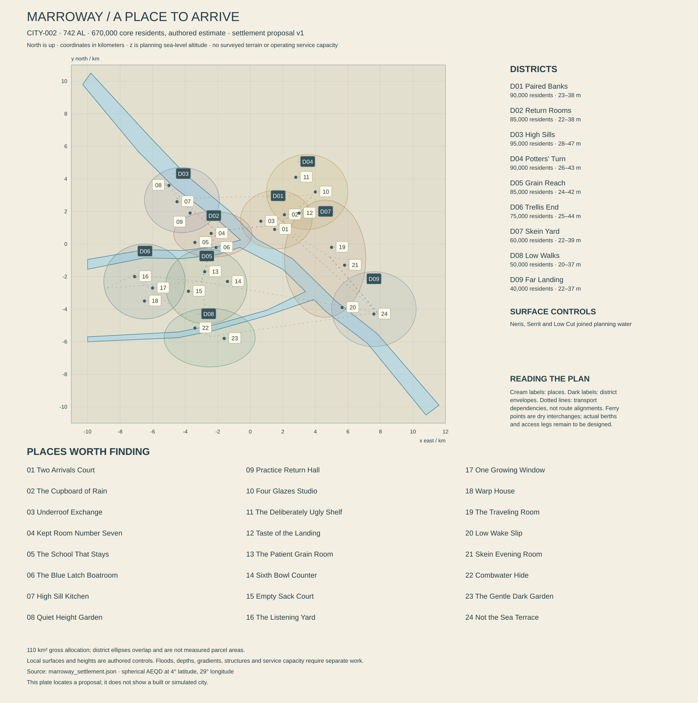

# Marroway — a room kept along the river

**CITY-002 · REG-002, Nine-River Lowlands, Kesh · working proposal 0.1 · 13 October 2026.** Present: 742 AL. Atlas center: 4° N, 29° E. Core population estimate: 670,000. This original city dossier and `marroway_settlement.json` refine the existing river-city anchor. Their local terrain, capacities, buildings and activities are authored proposals, not surveyed geography or implemented game systems. Established history remains distinguished from newly proposed local dates.

The acceptance condition is an inhabited city that remains interesting between its landmarks: a visitor can understand where a boat comes from, why a household keeps two addresses, how food reaches different destinations, and why someone would choose to spend an ordinary good turn here. The plan must support that experience without moving Marroway to the coast or making every conversation about public administration.

The [settlement checks](MARROWAY_SETTLEMENT_CHECKS.md) record authored geometry, service assumptions and their limits. Numbered markers refer to the 24 place dossiers below; this is not a constructed city.

## 1. The city seen through somebody's window

Marroway first appears as many small pieces of brightness beneath broad roofs. The pieces are windows, painted door reveals, glazed storage jars and panels inside boats. Its most elaborate ornament often faces inward. From the river a house can seem restrained; through an open door one sees a room whose owners have spent years adjusting its colors, shelves and folding furniture. The city asks you to come closer without granting permission to enter everything.

The Neris moves through this landscape with weight. It is not a transparent garden stream. Suspended material changes its color and visibility; faster water passes slower margins; floating fragments gather unevenly. The working channel is broad enough that someone on the opposite bank becomes a small moving figure. Nearby, a child can reach a handrail polished by many other hands and examine one precise joint in a landing. Scale exists in that alternation.

Buildings stand on natural rises, raised foundations and engineered ground. Some have open lower spaces designed for temporary wetting. Others have solid plinths, protected service entries and entirely dry ground floors under ordinary conditions. The city is not a forest of decorative stilts. Main public routes remain on continuous raised alignments, while smaller paths descend to gardens, stores and landings. Steps are common; useful alternatives are common too.

A household boat passes with its front room visible behind a shaded opening. The ceiling has narrow painted ribs, each repaired in a slightly different color. On the bank, a shopkeeper is hanging a display whose lowest objects are easy to bring indoors if water rises. Neither scene announces a disaster. Seasonal adjustment is part of competence, alongside making lunch, teaching a class or moving a chair to catch a breeze.

Rauth hangs high toward the west, around azimuth 262.8° and elevation 60.7° in a distant-center reference approximation; finite-distance and libration corrections belong to the almanac. Its presence is familiar, but it does not dictate every painting, street name or private belief. Ilex supplies the long natural day. A roof may shelter a room from glare while a courtyard admits enough light for work. During a long night, ordinary task lamps make small islands of activity; protected native habitat can remain darker beside them.

The emotional proposition is a city where permanence and movement are compatible. Someone can be dependable without remaining at one address. Someone else can stay on the same street all their life without being provincial. A well-kept room, a recurring visit and a journey undertaken for pleasure are equally serious ways of belonging.

## 2. A confluence inland, with a river between it and the sea

The atlas fixes the Neris at **[29° E, 4° N, 18 m]** at Marroway. Its broad course arrives from the northwest and leaves southeast toward the mapped mouth at 32° E, 1° N, nominal sea level. The shortest spherical city-to-mouth distance is approximately **437 km**; an actual winding river route is longer. Marroway therefore has river quays and river freight terminals. Ocean vessels, coastal docks and salt-water habitats are not placed here because the region also includes a coast.

The local plan preserves the atlas control and direction. Its Neris reference profile descends from about 18.9 m at the northwest map edge through 18 m at the origin to approximately 17.2 m southeast. These small differences are authored nominal water-surface controls across a broad lowland reach. They are not a hydraulic calculation, a riverbed profile or proof of a particular discharge. Eighteen meters above sea level does not mean eighteen meters of available generating head inside the city.

An explicitly proposed **Serrit branch** enters from the west and joins near the atlas center. It is a local tributary/confluence refinement supporting the city's established role, not a fully surveyed addition to the planetary drainage network. Its catchment, low-flow behavior and contribution to flooding remain open. The name Nine-River is historical: this plan does not invent nine identical channels to literalize it.

The JSON uses one coherent water polygon for the joined Neris and Serrit shape. Separate small inland waters, where included, have distinct nonoverlapping polygons. This preserves physical connectivity while allowing channels to have their own centerlines and reference levels. The rivers are not overlapping rectangular decals. Their edges remain coarse proposals that require actual terrain, bank slopes, depth and sediment design before construction.

The frame is spherical azimuthal equidistant about 4° N, 29° E, radius 5,900,000 m. x is east, y north, and z is altitude above planning mean sea level. Most inhabited ground is provisionally 24–39 m, with higher artificial or natural ridges locally. These heights establish separation from nominal water; they are not assessed flood standards. Flood probability, defense levels, settlement and erosion need their own evidence. Lower gardens can be designed to wet without implying that every house can safely flood.

The main Neris is several hundred meters wide in this proposal, broadening near the confluence. Freight lanes, informal boat movement, habitat pockets and swimming facilities cannot all occupy its fastest water. Passenger and household berths occupy managed margins with access to land services. Regional cargo transfers at larger yards. Small side landings distribute goods afterward. Bridge positions must respect navigable clearances and approach space; a line on the map is not an approved span.

Upstream rain and local weather are separate causes. A flood notice can arrive under clear sky because contributing basins were wet earlier. Typical high-water periods may improve access to some routes while restricting low paths. Exceptional water threatens specific works. Recession does not instantly restore drinking-water quality, stable banks, electrical safety and navigable depth together. Conversely, a normal rise is not an emergency that suspends all pleasure.

Freshwater rillcombs can occupy suitable oxygenated, stable surfaces; knucklewakes use particular covered margins and prey opportunities. Keeperwing life cycles need both adult resources and damp juvenile habitat. Threshold runners exploit viable settlement-edge resources. Managed kettlebarrels and shuttlefan belong to qualified husbandry and cultivation settings. Duskfold, threadglass and basinbell from coastal or brackish reaches are not transplanted into inland Marroway for visual convenience. The city must look like its position in a watershed.

## 3. What survives from the city's histories

During **62–128 AL**, established canon places the growth of Marroway's river settlements among cultivation enclosures, repair depots and barges linking the coast. Berth practices already existed among arrivals. River households extended them into transferable membership, care obligations and stored belongings across several places. Marroway did not invent family, mobility or generosity, and it did not begin as one centralized municipality.

The drainage failures and contamination of **76 AL**, and the **Witness of Flow agreements of 84–91 AL**, belong to the wider historical spine. Local traces should be specific: amended intake positions, records of which cultivation basin was affected, and works rebuilt after a mistaken drainage assumption. An old flood line is not automatically evidence of the First Famine. Several present buildings display retrospective memorial marks, dated as memorials rather than passed off as original measurements.

**Proposed 93 AL: the Kept Room register.** A surviving agreement links several river households' return rooms and stored property. Its importance is the recorded transfer procedure, not the first human discovery that a cousin might need somewhere to sleep. The original physical building has been rebuilt repeatedly. A preserved copy can matter without requiring the whole street to be an untouched founding monument.

**Proposed 226 AL: the Dry Door standard.** Local builders agree on a family of replaceable door sills, service isolation points and movable lower-room fittings. This belongs within the era of reconciling technical standards. It never made all buildings identical or safe under every water level. Surviving variants show how households adapted a shared interface to very different interiors.

**Proposed 341 AL: the Windowboat exhibitions.** Boat owners, furniture makers and painters open selected domestic rooms for public viewing. Serein's 337 AL Oblique Rooms movement is one influence among several, openly argued over. Marroway makers place more emphasis on a room changing arrangement between travel, sleeping and receiving visitors. The exhibition is remembered for taste, pride, jokes and a scandalously expensive cupboard, not for secretly launching a revolution.

**Proposed 411 AL: the Two Copies practice.** During the wider Relay Winter, a school and several households keep duplicate pupil and care records at separate stops. The practice answers particular unreliable links; it does not imply that present-day Marroway lacks ordinary rapid communication. Current digital systems retain recovery copies and consent rules because a technically available record can still be wrong or inaccessible.

**Proposed 493 AL: the Moving School Accord.** Participating schools recognize study completed along agreed routes and separate educational continuity from a family's entitlement dispute. It develops earlier river teaching, rather than inventing education for moving households centuries after settlement. The accord's strongest modern legacy is not a classroom boat; it is a child able to change classrooms without starting over.

**Proposed 586 AL: Leave Without Forfeiture.** A municipal ruling during the broader Unbinding period distinguishes an adult's departure from a berth household from surrender of personally owned belongings. Care obligations and shared reserves remain separately negotiable. The decision does not resolve every family argument, and not every neighboring authority adopted its wording. Its material trace is often a changed cupboard label or inventory form rather than a statue.

**Proposed 679 AL: the Three Grounds program.** Several districts jointly fund playing grounds, quiet rooms and public toilets along routes previously treated only as freight access. The contemporary argument concerned leisure, household convenience and land value as much as safety. One celebrated pavilion was an architectural failure in rain and was sensibly altered. Civic history includes learning to make something enjoyable.

All these local additions are proposals for integration, not silently inserted planet-wide milestones. The present city contains old rooms in useful condition, recent buildings that people dislike, and ordinary renovations with no grand historical meaning. Age is not a guarantee of wisdom, beauty or decay.

## 4. Homes, households and a credible urban footprint

Nine district allocations total **670,000 residents** within a gross planning allowance of **110 km²**. Their drawn envelopes overlap and are not legal boundaries; area allocations are separate bookkeeping. The city is distributed across raised land near the confluence, with productive and habitat landscapes between some neighborhoods. It is not 110 km² of uninterrupted downtown blocks.

A housing screen uses approximately **260,000 dwellings**, 96% occupied, with 2.68 people per occupied dwelling: 668,928 residents, consistent with the rounded target. Household boats count as dwellings when actually used that way, but remain a minority and require serviced berths. They are not free housing capacity conjured by drawing more water. A transferable household can occupy several ordinary land homes; mobility does not require constant vessel residence.

An illustrative 27 km² of residential parcels, 30% coverage and 3.2 effective residential floors yields 25.92 million m² gross floor area. At 80% usable efficiency, approximately 20.74 million m² remains, about 79.8 m² per dwelling across the stock. The average hides single rooms, shared suites, family apartments and large houses. Three- to five-story buildings are common; higher blocks concentrate near stable raised transport spines. Lower courts and houses occupy other plots. No universal stilt height or compulsory picturesque poverty follows from living beside a river.

The gross area ledger allocates 27 km² to predominantly residential parcels, 17 to employment and freight, 8 to civic services, 20 to streets and transit, 18 to parks, recreation and managed growing, 8 to water and berths, and 12 to reserves and other open ground. Parcel categories use one dominant class, avoiding double counting mixed buildings. Detailed terrain may require revision before these areas become believable boundaries.

Marroway's most characteristic domestic invention is a room that can change without looking temporary. Cabinets fold into sleeping platforms; screens alter sight lines; benches hold personal boxes above likely wetting levels; an inherited panel moves to a new home without pretending the new building is ancestral. Wealth can buy excellent joinery, quiet ventilation and space. Modest homes can be beautiful through careful arrangement without turning deprivation into an aesthetic obligation.

Care has addresses and people. A return room does not allow an abusive former resident unrestricted entry. Household membership does not substitute for named guardians. Schools, clinics and mediators distinguish a right to support from a right to occupy a particular bedroom. Some people prefer a solitary apartment and maintain strong relationships elsewhere. The city must accommodate that choice as readily as an expansive berth household.

## 5. Water, food, power and the work between them

### Supply and return are different networks

Domestic use is screened at **145 liters per resident per 24-hour civil turn**, or 97,150 m³. Another 42,850 m³ covers public, commercial and selected industrial potable uses, totaling **140,000 m³ delivered**. With an assumed 20% distribution-network loss, treated input to that network is **175,000 m³ per turn**. This follows the common settlement schema: distribution loss is not the same as treatment loss or raw abstraction.

For illustration only, a separate 95% raw-to-treated recovery would require approximately **184,211 m³ of raw abstraction** to produce that network input. The roughly 9,211 m³ difference represents treatment residual and process losses requiring their own management. River flow and source quality have not been modeled; none of these figures establishes an abstraction right or a reliable yield.

Primary raw intakes sit upstream of the main urban discharge influence, subject to actual plume and flood assessment. Treatment includes the real work of removing suspended material and addressing changing biological and chemical conditions. Clear water is not automatically safe. Ground storage buffers operations; elevated treated-water tanks with reference water levels around 75–82 m maintain service pressure across the lower city. Those tall structures require powered filling and engineering. Ground reservoirs and high tanks serve different purposes, and neither makes a pump outage irrelevant.

A separate reclaimed-water loop targets 35,000 m³ per turn for qualified industrial washing and landscape uses. The sewer screen collects 125,000 m³ per turn from potable and reused water combined. Thus 175,000 m³ of gross end-use throughput divides into 125,000 collected and 50,000 consumed or otherwise uncollected; collected flow divides into 35,000 reused and 90,000 final treated residual before detailed treatment losses. Network input closes as 35,000 distribution loss plus 50,000 end-use consumption/uncollected plus 90,000 final residual. Some lost or uncollected water returns to the catchment; these are service accounts, not net basin depletion.

Two sewer works rated at a proposed 80,000 m³ per turn each exceed the average 125,000 collection case together but do not provide full one-works-out capacity. Storage, reduced industrial demand, pump backup and failure procedures remain obligations. Storm drainage is separated where feasible, with explicit exceptions in old districts. No native wetland or animal is used as a magical substitute for treatment.

### Resident meals and an additional regional promise

The resident food allowance is **1.7 kg of edible product per person per civil turn**, or **1,139 tonnes** for Marroway's core. A provisional product basket contains 410 tonnes of dry foods, 500 of fresh produce, 155 of cultured or fermented products, and 74 of other preserved foods, oils and condiments. This is a freight basket, not a complete nutrient proof. Native-derived fractions, if any, belong to individually qualified products within it; no native food is required merely to make the totals work.

A separate nutritional screen uses 2,500 kcal per resident, or **1.675 billion kcal per turn**, and 75 g of protein, or **50.25 tonnes of protein**. At 3,200 kcal/kg, the calorie target corresponds to about **523.4 tonnes of mixed dry-food equivalent**. That equivalent must not be confused with the basket's actual dry-product category. Recipes, processing yields, losses, storage and nutrients require a later reconciled food model. A 60-turn dry calorie-equivalent reserve would be approximately 31,406 tonnes, a planning target rather than a verified store inventory.

The major food sources are distributed Nine-River introduced-crop and culture networks, supplemented through wider Kesh trade. Production needs suitable substrates, water control, nutrients, propagation stocks and appropriate light management. Native wetlands remain extensive between facilities. City gardens and culture rooms contribute valuable produce but cannot replace a regional agricultural belt by looking lush. Cultures consume real feedstock; they do not add primary calories for free.

**Orison's separate 700-tonne central case assigns 360 tonnes per civil turn to Nine River producers:** 170 dry, 145 fresh, 35 cultured and 10 other. That commitment is additional to Marroway's resident demand and belongs to regional producers consolidated through Marroway **and neighboring ports**. It is neither the whole region's output nor a harvest grown inside this city. The two stated demand streams total 1,499 tonnes, but not every tonne must pass one Marroway quay. Supplier and route ledgers must prevent double-selling the same stock.

Pella Ruun's established grain story belongs here: sound but unfashionable grain required a different soaking schedule, and accurate paperwork did not compensate for inadequate kitchen preparation time. The right continuation can improve meals and labor allowances without declaring residents foolish for disliking their first experience. Food is care, skill, taste and work as well as tonnage.

### Energy without a river-shaped perpetual engine

Electrical demand is screened at **460 MW average and 840 MW peak**, including households, public services, production, treatment and transport within the core. These are load assumptions, not installed capacity. Regional power connections, local dispatchable generation, solar, wind and storage require an actual reliability model and supply agreements. Heat recovery, cooling, humidity control and thermal storage remain distinct services.

A study portfolio could test 650 MW of combined regional connection rating, 210 MW of local dispatchable plant, 460 MWp of photovoltaics across suitable urban and service land, 250 MW of regional wind and 20 GWh of storage capable of 220 MW discharge. Nameplate values are neither average output nor guaranteed simultaneous availability. Dispatchable generation still requires defined fuel, delivery, emissions handling and maintenance. The city must not count hypothetical imports as certain during a regional interruption.

The longest nominal natural night at 4° N is about **69.1 hours** before local horizon refinements. A continuous 120 MW residual deficit would require **8.292 GWh before losses**. A 350 MW deficit would require 24.185 GWh and exceed both the proposed energy capacity and its discharge rating. These examples describe why the load profile and contractual supply matter. A large battery illustration does not establish coverage.

The low-gradient river offers no credited electricity in this plan. Its 18 m reference altitude is measured relative to sea level hundreds of kilometers away. Any hydropower proposal needs a site-specific available head, flow, ecological and navigation assessment. The city's abundance comes from a mature technical network, not a dam secretly taking an entire river's energy without consequence.

### Freight, production and waste

Marroway specializes in food consolidation, preservation, crop and culture equipment, shallow-draft working craft, compact domestic fittings, woven structural products and river-service expertise. Not every resident works in agriculture. Schools, care, retail, software, entertainment and ordinary administration occupy much of the city. Specialists can earn a living designing one excellent hinge that ships elsewhere.

Cargo uses regional river routes, road and proposed rail corridors. City transfer counts must distinguish incoming unique tonnes from repeated handling. A study range of 7,000–11,000 unique tonnes per turn is an initial demand case for all cargo, not a proven terminal capacity. Many feeder movements consolidate small loads; the impressive largest barge is not the representative household delivery vehicle. Air freight serves urgent and high-value loads rather than making the river irrelevant.

Municipal waste at 0.75 kg per resident per turn gives **502.5 tonnes**, excluding major industrial and construction streams. Reusable packaging, repair, sorting and controlled treatment address different materials. Native fodder residues, terrestrial food waste and human waste cannot be mixed indiscriminately. Dry storage, washable transfer rooms and residue destinations must exist beyond the scenic market. A clean street can reflect competent services rather than a lack of productive life.

## 6. Neighbors, government and words spoken at home

The Lower Basin League coordinates participating authorities, growers, storage cooperatives and transport towns. It does not own the Neris or every farm. Marroway's municipal bodies manage schools, streets, housing and other local services while river agreements constrain particular works across boundaries. Basin Witness procedures provide evidence and downstream standing; they do not confer universal jurisdiction over all personal affairs near water.

Resident assemblies operate at several scales. A landing association manages shared access and schedules. A household maintains care and belongings. District representatives negotiate municipal spending. League delegates address regional commitments. A person may hold an office in one and be an ordinary dissenter in another. Combining application counters can make this manageable without inventing a single benevolent authority that knows everything.

Orison is a major northern customer and a source of repair assemblies, optical integration and technical services. The shortest city-to-city spherical distance is approximately 1,342 km; water freight follows a much longer actual route down the Neris and then through coastal links. Sola offers Aster exchange, crews and touring work through coastal transfers and ocean passage. Serein supplies design expertise, enclosure and interior components through Kesh networks. Hesh participates in specialist equipment, dryland products and exchange services where actual routes support them. Connections to Tern can carry repair expertise and marine-grade components through coastal transshipment. These are named relationships, not direct unbroken navigable lines on the local map.

Ordinary connected communication can be rapid. Receiving a message from Sola is different from receiving its cargo. A family can discuss a room arrangement with distant relatives without waiting for the next boat, while still missing the physical pleasure of a visit. Transport disruptions should affect particular services, not automatically silence every conversation across the planet.

Shore Common has an important Marroway public form through river schools and household networks. **Leri household speech** has established living communities here and in Sola, with fluent speakers, learners and people who retain partial understanding. Neither surname nor berth membership proves fluency. Frame Sign and other supported signed practices have their own users and histories; signs are not spoken words acted out. Transit Clear serves operational messages while dinner can be informal, multilingual and funny.

The eight wider social traditions overlap in homes and workplaces. No district is the exclusive quarter of one tradition or body type. Berth membership is particularly visible because of the city's history, but solitude, small families, employer housing and friendship networks remain normal. Care and access are ordinary design facts: a ferry landing needs a usable shore route, a kitchen needs suitable workstations, and a concert needs interpreters or other access arrangements appropriate to its audience, not just a ramp at the door.

## 7. Nine districts along uneven ground

### MAR-D01 — Paired Banks

**90,000 residents; 11 km²; center (1,600, 1,500, 29).** Paired Banks occupies the eastern side of the central confluence. The name preserves a relationship across water rather than claiming both sides share one jurisdiction. Its streets run from raised inland rooms toward broad public landings. Four-story blocks have compact canopy roofs, deep door reveals and replaceable lower wall panels. Their most elaborate decoration appears where people stand close: cabinet edges, ventilation grilles, door handles and painted soffits.

The district includes principal civic counters, a regional passenger interchange, shops, offices and mixed housing. A sequence of public courts replaces the expectation of one enormous central square. Some host markets by one watch and games by another; others remain quiet. The municipal chamber occupies an adapted warehouse with a good acoustic ceiling and undistinguished service rooms. People value it for useful public work rather than theatrical size.

A raised transit spine connects inland neighborhoods. Routes descend to landings with long, sheltered approaches, while local stairs offer shorter options. Bridge corridors require clearance and bank approaches rather than improbable narrow arches carrying all freight. The district's good ordinary scenes include a pupil meeting two relatives arriving separately, a repair worker choosing a pastry and a neighbor bringing a chair outside. It is central without being the place where all meaning is stored.

### MAR-D02 — Return Rooms

**85,000 residents; 12 km²; center (-2,300, 600, 28).** Between the northwest Neris reach and the Serrit branch lies a district of closely joined courts, storage rooms and household landing associations. Many homes have an extra room with its own entrance. The arrangement supports relatives, guests, adult children returning briefly and paid lodging under different agreements. It is not a universal open-door entitlement.

Walls are warm gray or muted plum, with bright interior trim visible only when shutters open. Roofs overlap in compact steps. Covered galleries connect some upper rooms while leaving light gaps between buildings. Every crossing needs a support and drainage detail; a picturesque suspended passage cannot block service access or turn private bedrooms into public circulation.

This district holds the Kept Room archive, river-school offices, furniture workshops and ordinary shops. Some households speak Leri; others do not. A shared provisioning account may connect relatives far outside the district, while next-door neighbors keep entirely separate finances. The local tram stop has lockers and a well-used waiting room because travel frequently begins with a small bag rather than a heroic departure.

The principal pleasure is domestic invention. Visitors can attend selected open-room events, admire ingenious storage or find a music lesson audible through a half-open door. Most rooms remain private. A city that respects closed doors makes an invitation into one much more valuable.

### MAR-D03 — High Sills

**95,000 residents; 14 km²; center (-4,200, 2,700, 33).** This inland raised district contains substantial housing, the main hospital complex, technical schools and service reservoirs. Its name refers to successive construction habits rather than a single elevation contour. Streets follow a sequence of broad dry ridges and engineered connectors. Lower gardens receive controlled drainage; ordinary living floors remain above them under nominal conditions.

The architecture is sturdy and generous, with pale aggregate walls, dark red thresholds, screened balconies and occasional taller blocks around transit stops. Later accessibility work has replaced some grand entrance stairs with long shared approaches and lifts. The best alterations feel like public rooms in their own right. No one needs to know a secret back entrance to reach the same hospital door as everyone else.

Schools and workshops share specialized facilities under separate schedules. A night-watch worker can use a quiet library room while another neighborhood begins its busy period. Elevated water tanks are visible at the edge, slender service towers with inspectable supports and controlled access. They are working landmarks, not disguised sacred monuments.

High Sills is where Marroway feels most like a place to raise children or settle into a long habit. Playing grounds, medical appointments, modest shopping and small performances matter. Some residents rarely use boats. Their lives belong to the river city as fully as those of captains, and their homes should contain books, hobbies and disagreements unrelated to water.

### MAR-D04 — Potters' Turn

**90,000 residents; 13 km²; center (3,500, 3,200, 31).** Potters' Turn grew around material preparation and firing businesses on a raised eastern route. Its modern production includes ceramics, protective coatings, small technical housings and domestic ornament. Local sediment is not automatically usable clay; workshops select and prepare feedstock, including material brought from elsewhere. Kilns, clean finishing rooms and storage yards are separate spaces.

Rows of modest houses alternate with workshops and public courts. Small ceramic panels frame doors, while larger unglazed surfaces keep the city from becoming a tiled theme park. Color reflects households and maker preferences, not district membership. Contemporary buildings use replaceable facade elements with fine tolerances beside older hand-adjusted work. Wealth often appears as precise quiet surfaces and excellent furniture.

The district supports an art school, several independent music rooms and a popular competitive cooking ground. A gallery can be prestigious without every object being expensive. Residents keep ordinary jobs in other districts and return to rooms above makers' shops. Delivery lanes protect pedestrians from hot or fragile loads without sealing the industry away from view.

Pleasure here includes watching glaze tests emerge, debating whether a beloved mug is ugly, hearing a beginner improve and spending more time choosing a cupboard pull than anyone intended. The city should permit taste to matter for its own sake. No secret electrical function is required to justify a beautiful painted plate.

### MAR-D05 — Grain Reach

**85,000 residents; 14 km²; center (-2,700, -2,600, 29).** Grain Reach lies south of the Serrit approach and west of the downstream Neris. Its stores, inspection halls, milling and preparation businesses connect river transfer to land distribution. The skyline is a family of raised storage bins and compact process towers, interrupted by substantial housing courts. Food does not pass directly from a romantic barge into an unventilated pile behind someone's bed.

Separate lanes serve heavy cargo, smaller delivery vehicles and residents. Stores occupy engineered pads with drainage, pest management, isolation and inspection access. Some old halls survive in different uses. A former sack warehouse now contains a sports floor; a small administrative building is a music rehearsal cooperative. Industrial history is not synonymous with abandonment.

Pella Ruun's current workplace is here, with a public test kitchen nearby. The district is an appropriate setting for her established story because food quality, preparation time and the dignity of eating are visible together. It must also function when that story is resolved or never encountered. Most shipments arrive as expected, cooks are competent and residents have other interests.

The social center is a chain of meal counters, shaded waiting rooms and recreation spaces between shifts. Some places are loud and fast; others allow a tired person to sit undisturbed. Housing has separate entrances, sound control and useful outdoor rooms. A working district can be comfortable without hiding the scale of what it does.

### MAR-D06 — Trellis End

**75,000 residents; 14 km²; center (-6,500, -2,300, 30).** Trellis End is the western edge of intensive urban settlement, with propagation facilities, managed crop rooms, native-fodder yards and housing linked to wider rural routes. It contributes specialized production and knowledge while the bulk agricultural catchment extends far beyond the city map. There is no claim that visible garden plots satisfy metropolitan demand.

Introduced food systems and native cultivation have separate substrate, quarantine and waste procedures. Shuttlefan can provide selected fiber and native fodder under managed conditions. Kettlebarrels occupy husbandry yards with suitable feed, water, rest and trained handlers; they do not graze arbitrary terrestrial scraps. Human nutrition does not follow automatically from domesticating an animal.

The built form combines low service halls with compact residential groups on raised ground. Roofs have purposeful openings, shutters and maintenance routes. Trellises support specific introduced crops or shading components, not random alien vines over every machine. A regional road-and-rail transfer occupies the outer edge, connecting farm and workshop deliveries to urban distribution.

This is also a place of small enthusiasms: household growing experiments, finely made baskets, animal observation, evening walks and fierce opinions about seed storage labels. Some employees love their work; others leave it behind enthusiastically at the end of a watch. Schools teach both the pleasure and the limitations of cultivation. A flourishing plant is satisfying without being a solution to every political problem.

### MAR-D07 — Skein Yard

**60,000 residents; 12 km²; center (4,600, -900, 28).** Skein Yard stands on the eastern side of the downstream reach. It builds and repairs shallow-draft craft, compact room modules, loading equipment and woven structural fittings. The name refers to material preparation and the old pattern of tied working lines. Modern composites and metal share space with fiber products rather than being hidden to preserve a falsely preindustrial appearance.

Large work doors open beneath compact high roofs. Some boat interiors are assembled ashore as coherent room sections before installation. Residential blocks stand back from moving loads, with planted noise buffers and shared courts. Workers can reach home without crossing an active slip. A technical gallery shows selected jobs while commercial and service circulation remain separate.

The freight interchange connects to Far Landing and the central city. Public boat access uses actual shore routes; a transit symbol on land is not a berth. A small flight facility at the outer yard supports urgent parts and passengers under route and noise constraints. Ordinary cargo still uses river and surface networks.

Skein Yard's pride is in things that move well and continue working: a folding door, a lift that aligns cleanly, a drawer that stays shut during travel. The pleasure can be almost comic in its precision. At the end of a watch, people inspect a friend's newly finished room with the seriousness others reserve for sports, then sit down and use it.

### MAR-D08 — Low Walks

**50,000 residents; 10 km²; center (-2,500, -5,750, 26).** Low Walks contains settled raised ground beside protected drainage corridors and a native habitat mosaic. Its low public paths include routes intended to close during particular water states, paired with a higher continuous route serving homes and essential access. The district does not rely on every resident being able to wade, climb or own a boat.

Buildings gather in groups rather than occupying every available edge. Narrow shade roofs, carefully detailed ground transitions and modest interior ornament create a less formal visual language than Potters' Turn. A field station, public gardens, small care residences and ordinary shops coexist with family homes. Wet ground is not vacant land awaiting a developer; neither is every damp patch untouched wilderness.

Native organisms have specific places. Rillcomb observation requires suitable flowing water and stable surfaces. Knucklewake refuge remains separate from recreational paddling. Keeperwing-compatible areas need more than attractive adult feeding plants. Maintenance changes habitat through light, drainage and substrate removal. These relationships should be visible before anyone explains them.

People visit Low Walks to see ordinary changes: a path open again, a flower-like structure folding, a familiar animal absent from its usual margin. Others come for a picnic or quiet conversation and pay little attention to ecology. The district's identity includes that freedom. A beautiful place need not demand expertise or reveal a hidden emergency to justify a long visit.

### MAR-D09 — Far Landing

**40,000 residents; 10 km²; center (7,600, -4,000, 26).** Far Landing is the downstream regional gateway, not the river mouth. It organizes larger river departures, consolidation and transfer schedules for journeys that may eventually continue by sea. A public destination board distinguishes the next river stop from a final destination such as Orison or Sola. That small clarity prevents a fictional continent from shrinking into a ferry ride.

Long shelter roofs, raised passenger halls and freight structures sit behind a broad working bank. Households occupy quieter inland courts with a school, clinic and shops. Some residents have never traveled to the famous destinations on the board. Others move repeatedly between river settlements while retaining this as one dependable address. Neither group is treated as more authentically local.

The interchange has waiting space appropriate to long journeys: reclining seats, private care rooms, luggage storage, meals and places to speak quietly. Regional crews have service access and rest facilities. Inspections and loading are visible at a distance, but visitors do not wander among suspended cargo for atmosphere. Waterfront beauty includes the clean geometry of a useful roof and the apparent slowness of a large vessel turning.

Far Landing's most important scene may be a reunion with no plot complication. Someone arrives, someone recognizes them, and they take time choosing where to eat. The river remains enormous behind this small event. The city should make room for both scales without insisting that every departure threatens permanent loss.

## 8. Twenty-four places with reasons to exist

The following locations are independent institutions, homes, pleasures and working spaces. Their proposed interactions and changes are future content obligations, not implemented mechanics. Coordinates refer to the accompanying local plan. Named residents have lives elsewhere; the city should not keep all of them permanently stationed at their introduction points.

### MAR-POI-001 — Two Arrivals Court

**Paired Banks; (1,500, 900, 28); meeting, movement and a public room.** Two sheltered approaches enter this court from different landing routes. A raised central strip stays clear for through movement, while side bays contain benches, refreshments and luggage stands. The design lets someone wait without obstructing others. Its name recalls the common experience of relatives arriving separately and finding one another here.

Ira Senet operates a refreshment counter with a colleague on another watch. Her independent task is running an ordinary sound business, including preparation, cleaning and breaks. She knows regular customers but cannot identify every passing stranger. On some turns her brother waits in the court while she finishes; on others she leaves promptly for a rehearsal elsewhere.

A visitor can meet a contact, buy a drink or observe a reunion that requires no intervention. An arrival display distinguishes expected, landed and actually at this court. Following the route from one landing reveals why those states differ. Returning changes the people and schedules while preserving the court's useful familiarity.

Assets require two legible approach sequences, seating outside circulation, accessible counters, shade and ordinary working storage. The emotional detail is recognition: a face turns, a hand rises, and a person changes pace. Repeated embraces performed by anonymous pairs would be less convincing than a few complete, varied meetings.

### MAR-POI-002 — The Cupboard of Rain

**Paired Banks; (2,100, 1,800, 30); a private home and an invitation.** Sera Dov's apartment contains a tall cupboard with removable lower drawers, raised personal storage and a folding table hidden behind a painted panel. Its name was given by a child after watching the household prepare for an unusually wet period. The apartment itself did not need to flood for those preparations to be sensible.

Sera repairs domestic fittings for clients but built this cupboard for her own pleasure. She likes showing one clever mechanism and dislikes visitors treating her entire home as an exhibition. Her partner keeps an intentionally untidy shelf that interrupts Sera's compositional ambitions. Their difference is affectionate without requiring agreement about whose taste is correct.

An invitation permits the player to see the room rearranged for tea. Opening a panel reveals a different sight line and makes space for another guest. Touching private storage remains a separate choice, with later ownership systems required to support it. A return might find the room in its sleeping arrangement or closed because nobody is receiving visitors.

Assets need one exceptionally coherent small interior, useful moving furniture, personal objects with clear places, privacy screens and believable illumination. The cupboard should be worth examining because it is beautifully made and loved, not because it conceals a weapon, ancient key or mandatory collectible.

### MAR-POI-003 — Underroof Exchange

**Paired Banks; (650, 1,400, 29); ordinary buying, browsing and local speech.** Beneath a shared roof, small stalls sell household fittings, introduced herbs, printed material, repaired devices and occasional decorative pieces. Storage and preparation occupy the back of each unit; a clear public passage runs through the middle. The exchange is valuable because many small errands can be completed without an expensive journey across the city.

Jori Vell sells secondhand lamps and tests each one at a workbench. Some customers speak Shore Common, some Leri and some other languages; Jori has limited conversational skills and uses ordinary translation support when needed. Fluency is not a test of whether a customer belongs. He has firm opinions about ugly lamps and will cheerfully repair them anyway.

The player can compare repaired objects, hear an original fragment of market conversation or follow a recurring stall's changing stock. A beautiful inexpensive lamp may be more interesting than a rare item with extravagant effects. Returning can show the same object in another customer's bag, or a repaired device collected by its owner.

Production needs restrained but meaningful stock, believable test equipment, visible prices with issuer context, storage and several stall closure states. If object acquisition is later implemented, ownership must distinguish display, reserved repair and sale stock. The scene should remain pleasant when nothing is purchased.

### MAR-POI-004 — Kept Room Number Seven

**Return Rooms; (-2,400, 650, 29); household continuity and a carefully bounded archive.** This return room belongs to a contemporary berth association that preserves copies of the proposed 93 AL register. The present room is much younger. It contains a comfortable bed, a desk, accessible washing facilities and several locked personal boxes. An adjoining public alcove presents a small selection of consented household records.

Meren Oss manages bookings while working part-time elsewhere. She distinguishes an agreed claim to accommodation from permission to inspect another person's belongings. A traveler may be staying here after a pleasant visit, a new job or a separation; the room does not advertise why. Its purpose is dependable reception without making every resident's circumstances public.

A visitor can read a copied inventory showing how one ordinary chair moved between three settlements, then see the surviving chair in the public alcove. Its repairs provide physical continuity without proving every family recollection accurate. Returning might find the room occupied and unavailable, while the public display remains open.

Assets require a useful small suite, secure storage, a distinct public/private threshold, several layers of repair and readable archival provenance. The location fails if the player can casually rifle through personal boxes while the fiction praises privacy. Its deepest reward is understanding what a maintained place can promise without owning the person who returns.

### MAR-POI-005 — The School That Stays

**Return Rooms; (-3,400, 100, 28); education across changing addresses.** The school has a permanent building and visiting classrooms, making its name a statement about continuity rather than immobility. A pupil's work can travel between participating teachers under the Moving School Accord. The public entrance contains displays of actual projects: model rooms, illustrated stories and slightly uneven handmade instruments.

Tarin Mev coordinates transfers and teaches language classes. Some pupils use Leri at home, others are learners, and many study unrelated subjects with the same teacher. Tarin wants children to discover what they enjoy, not become monuments to their families' cultural survival. A language lesson can concern an absurd new joke rather than an ancestral tragedy.

Visitors can attend a scheduled public exhibition, hear a consented student performance or inspect the difference between a current school record and its recovery copy. Children retain privacy and boundaries; the protagonist is not granted unsupervised access because a classroom contains lore. Returning can reveal a project improved through practice, with mistakes still visible in its earlier version.

Assets include a working school layout, quiet and active rooms, storage, accessible teaching surfaces, toilets and routes children can understand. A visiting classroom boat needs real docking and service arrangements later. The essential continuity is relationships and recognized learning, not a vessel appearing wherever the plot needs a teacher.

### MAR-POI-006 — The Blue Latch Boatroom

**Return Rooms; (-2,100, -210, 22); a moored home and domestic theater.** Dara Ruun's household boat lies at a serviced berth near the northern Serrit margin, clear of the intended through lane. The marked coordinate is its proposed supported room position, above local reference water around 18.16 m, with dry shore access at (-2,200, -40, 28). The boat is neither free-floating scenery nor a structure that remains usable if its access disappears.

Dara, Pella Ruun's sister, makes small theatrical figures and performs privately for friends as well as professionally. The relationship is a new local proposal that gives both women a life beyond their jobs. Dara respects Pella's competence and teases her tendency to explain a meal before anyone has tasted it. Their affection does not require Dara to defend every decision at the stores.

On an invited evening, the front room becomes a tiny theater through three folding panels and a changed light. A visitor can watch an original domestic comedy, then see the props packed away so people can sit comfortably. A return may find ordinary laundry and a closed performance cupboard instead.

Assets need a coherent vessel interior, a convincing buoyant support and mooring arrangement, a real accessible shore connection, compact furniture and original puppetry. The public dock is separate from the private room. Its beauty comes from a household making space for both everyday life and unnecessary, delightful invention.

### MAR-POI-007 — High Sill Kitchen

**High Sills; (-4,500, 2,600, 34); shared cooking and an ordinary evening.** A housing cooperative maintains this kitchen for larger meals, classes and residents whose own rooms have limited facilities. It is not the only place inhabitants can cook. Adjustable work positions, clear preparation zones and good storage make it useful to different people without assigning each an inspirational role.

Nela Torren, born 697 AL and approximately 40 Earth-standard years old, has reserved the room to make window pot with friends. The slow grain-and-pulse base will receive several separate relishes. She enjoys a crisp browned bottom and is preparing a second pan because one friend strongly disagrees. This is hospitality expressed through a practical accommodation, not a debate that must end with one correct recipe.

A visitor who has been invited can help with an approved task, taste a portion or listen as the group plans a small excursion. Conversation includes work, romance and a spectacularly poor recent performance. Nobody reveals a vital secret merely because food has created intimacy. On return, another household may use the same kitchen quite differently.

Assets require a complete preparation-to-washing sequence, varied tools, actual portions, accessible stations and evidence of shared ownership. Stored personal ingredients have separate labels. The room should feel generous because its design and agreements work, not because an invisible staff cleans every trace the moment the player turns away.

### MAR-POI-008 — Quiet Height Garden

**High Sills; (-5,000, 3,600, 36); rest near care, without medical spectacle.** This small public garden sits beside the hospital's outpatient route. Its main path is gently graded, with frequent seating, shade and a sheltered indoor alternative. Some planting is introduced and managed; a separate native habitat strip is designed around specific needs. The place is neither an all-purpose healing ecosystem nor a compulsory therapeutic activity.

Ola Denn tends the garden with colleagues and volunteers. Her own pleasure is arranging inexpensive ceramic markers made by a friend in Potters' Turn. She likes some of the imperfect ones best because their edges catch light differently. Patients, visitors and staff use the space, but their reasons for attending the hospital remain private.

The player can rest, notice one marker moved after pruning or meet someone who has simply come for a quiet walk. Conversation is optional. A return can show seasonal maintenance, a bench repaired or the same reassuring view. The garden need not generate a new sad story each time it appears.

Required assets include carefully proportioned seats, smooth transitions, different levels of enclosure, practical storage and planting appropriate to the maintenance capacity. Hospital views should convey ordinary competence: someone brings a drink, another waits comfortably, and a worker takes a genuine break. The location's value is time that does not demand performance.

### MAR-POI-009 — Practice Return Hall

**High Sills; (-3,700, 1,900, 33); dance, friendship and becoming more capable.** A modest neighborhood hall hosts six-step exchange sessions, exercise classes and occasional performances. Storage along one wall allows the floor to change use without stacking furniture in emergency routes. The sprung surface has repair patches of slightly different color, carefully fitted rather than hidden under artificial grime.

Kessa Arven teaches one weekly dance session and works at a neighborhood school during other watches. Her classes are a chosen pleasure as well as paid teaching. Kessa offers versions using hands, wheels, feet or shifts of weight, with partners explicitly choosing the kind of contact they want. Skill can be impressive without making beginners decorative background.

A visitor can observe or join a simple offered-and-answered phrase. Refusing a partner is normal; changing partners need not imply romantic interest. A familiar pair may be flirting, practicing seriously or both. Returning allows recognition of a group improving over time rather than everyone performing a perfect loop from the first encounter.

Assets need clear movement space, several approach and rest options, mirrors or reference surfaces used thoughtfully, sound equipment and authored timing. The system should eventually support actual choices and consent rather than a forced paired animation. Before that implementation exists, a well-composed observed lesson can still communicate effort, humor and the pleasure of getting something right.

### MAR-POI-010 — Four Glazes Studio

**Potters' Turn; (4,000, 3,200, 31); making, color and material evidence.** Four test boards hang above a workbench, each showing a different finish over the same prepared body. The studio produces domestic ceramics and selected protective components, using distinct qualification processes where performance matters. An attractive cup glaze is not automatically approved for food contact or a technical housing's operating conditions.

Emra Solt runs the studio with two partners. Her independent project is a set of cups whose interior color becomes visible only as someone drinks. She wants the effect to be a small surprise rather than a novelty that makes the cup awkward. A partner thinks one version is too restrained, and they have kept both in production to see what customers prefer.

Visitors can inspect permitted samples, watch a demonstration or choose a cup if purchasing and inventory systems later support it. A rejected test piece can be beautiful while remaining unsuitable for sale. On return, a trial may have become an ordinary stocked object, with the test board still recording its earlier forms.

Assets require realistic firing and preparation separation, racks, imperfect samples, selected excellent finished work and a credible clean display area. The studio should teach through objects and use rather than a long mandatory lecture. The most persuasive detail is somebody reaching repeatedly for a cup they find comfortable.

### MAR-POI-011 — The Deliberately Ugly Shelf

**Potters' Turn; (2,800, 4,100, 33); taste, collecting and affectionate disagreement.** A small independent gallery devotes one shelf to objects submitted as examples of terrible taste. Visitors write short defenses beside them. The objects rotate only with their owners' consent, and several are loans from households that continue to love them. The title is an invitation to argue, not an authoritative judgment of culture or class.

Vessa Irl curates the gallery and collects miniature storage chests. She is fully aware that her favorite chest could win the shelf's competition. Her work includes arranging loans, keeping objects safe and maintaining a financially ordinary small venue. She also hosts serious exhibitions, so the joke does not consume the whole institution.

The player can compare several original objects and read concise contradictory responses. A later dialogue may refer to a preference without converting taste into a morality score. Returning could reveal that an unpopular piece has acquired an enthusiastic defender, or that its owner has taken it home again.

Production needs a few carefully designed objects with different aesthetic intentions, readable labels, secure handling and a room with enough restraint to let the pieces matter. Randomly distorted props would miss the point. Each object should be something an actual person might choose, display proudly and defend over dinner with increasing, entertaining conviction.

### MAR-POI-012 — Taste of the Landing

**Potters' Turn; (3,000, 1,900, 29); competitive cooking without catastrophe.** A paved community court hosts a periodic cooking event, with preparation tents, wash stations and shared tables arranged around clear movement routes. On other turns it is a play court or an ordinary shortcut. Its kitchen connections are permanent; the event does not conjure unlimited clean water, refrigeration and waste removal from decorations.

Rovo Tenn organizes the event and competes only in separate sessions to avoid judging his own work. Teams include professional cooks, households and enthusiastic amateurs. Categories recognize different aims: a fine quick meal, a careful preserved dish, or a pleasing use of a common ingredient. Expensive components do not automatically win.

The visitor can taste approved samples, watch a tense but friendly final preparation or help judge one clearly defined category. Ingredients follow the food contract: introduced grains, pulses and cultures form ordinary dishes; any native fraction has its own qualified identity. Returning outside the event reveals the same court occupied by ribboncourse or quiet conversation.

Assets require complete temporary-service logic, several preparation styles, food with believable portions and actual cleanup. The dramatic rhythm can come from a sauce refusing to thicken or a rival producing something excellent. No poisoned plate or corrupt official is necessary to make an afternoon memorable.

### MAR-POI-013 — The Patient Grain Room

**Grain Reach; (-2,800, -1,700, 30); food knowledge and a specific continuing biography.** This test kitchen adjoins a working store but has a separate public entrance. Here Pella Ruun can demonstrate the sound grain whose rollout caused the established preparation dispute. Different vessels show soaked, cooked and finished stages. The room exists for routine recipe trials and staff learning, so it retains a purpose after that particular story ends.

Pella manages stores, not every kitchen's labor. Her useful growth is recognizing that accurate stock records are insufficient if preparation schedules are unrealistic. Cooks and residents retain their own expertise and preferences. Dara, her sister, sometimes visits from Return Rooms and refuses to let a demonstration become a lecture delivered to a captive audience.

The player can compare preparation results, listen to concrete accounts of additional work and support a revised cooking schedule if that narrative is later implemented. Simply paying for a replacement shipment would not settle the continuing workflow problem. On a return, a well-liked ordinary meal and a changed staffing allowance can show improvement without a triumphal speech.

Assets need storage-to-kitchen separation, timed preparation stages, readable batch identity, sensible work surfaces and portions that actually differ. The grain's safety and its taste are distinct questions. Visual storytelling must preserve both, rather than coding one bowl as obviously evil and the corrected version as miraculous.

### MAR-POI-014 — Sixth Bowl Counter

**Grain Reach; (-1,400, -2,300, 28); a dependable meal between watches.** The counter occupies a long narrow room beside worker housing and a small tram interchange. Five bowls from an early serving set survive behind the counter; the sixth broke long ago and gave the business its name after customers kept asking where it was. The story is mildly funny and not an encrypted historical clue.

Omi Ressel runs a watch with three colleagues. They serve window pot, a sharper pulse preparation and several simple drinks, with clear ingredient information and a quieter table near the back. Their work includes cleaning and breaks. Customers are not obliged to share a table or explain why they prefer to eat alone.

A visitor can sit, order and notice how the room changes as one work watch ends and another begins. Two regulars may resume a conversation interrupted several visits earlier. Omi remembers some preferences and forgets others. Returning can provide continuity through the same bowl and familiar service rather than a new discovery every time.

Assets require believable kitchen scale, table turnover, a service path, personal belongings stored out of the way and a restrained menu of attractive food. The missing bowl should remain missing. Filling its place with a secret reward would replace a small credible history with a predictable scavenger hunt.

### MAR-POI-015 — Empty Sack Court

**Grain Reach; (-3,800, -2,900, 30); sport in an adapted working building.** A former sack warehouse now contains a roofed ribboncourse ground, exercise rooms and a modest spectator gallery. Its broad span and loading access made conversion practical. Original storage markings remain in selected places, while new surfaces, toilets and ventilation make it fit for present use. The building is reused, not abandoned with sports equipment scattered inside.

Len Aris coordinates casual sessions and works as a vehicle mechanic elsewhere. He likes rules that keep games readable and dislikes treating every visit as a selection trial. Players agree on walking, rolling or faster variants before beginning. Equipment differs to suit the session while the shared pleasure of passes and anticipation remains.

Visitors can watch, join an appropriate game or simply use the small upper café overlooking play. A clumsy but successful team move can be more satisfying than a flawless athletic montage. On return, another group may use the hall for an entirely different activity, with stored equipment making the transition visible.

Assets need a credible adapted shell, several surface treatments, movement clearances, accessible viewing positions and equipment storage. Crowd behavior should distinguish players, substitutes, friends and people passing through. The original warehouse character survives through structure and selected details, not through dust that a busy sports hall would have removed years ago.

### MAR-POI-016 — The Listening Yard

**Trellis End; (-7,100, -2,000, 30); managed animals and learning to wait.** This husbandry yard keeps a small group of kettlebarrels under trained care. Their native fodder, gut-culture management, rest areas and waste handling are visible parts of the facility. They are distinct domesticated ribbon movers, not miniature doorbacks or six-legged livestock wearing an alien skin. Their feeding fringes and protective margins determine how people approach them.

Tessa Mol supervises handling practice. She knows individual tendencies but does not describe the animals as perfectly obedient companions. One braces when hurried; another follows a familiar route readily. Tessa's quiet satisfaction comes when a trainee notices an animal's hesitation before being told. The yard's work continues independently of visitors.

The player may observe a session, help prepare an approved non-food handling object or learn when to leave an animal undisturbed. Touching is conditional on staff guidance and the individual animal, not an automatic petting prompt. Returning can reveal gradual familiarity, a different training group or a rest period with no public handling.

Assets require anatomically coherent bodies, feeding and bracing behavior, species-appropriate equipment, clean water, managed fodder and separate processing areas. No human milk or meat product is inferred from domestication. The encounter rewards patience and observation rather than turning a living animal into a collectible companion after one successful interaction.

### MAR-POI-017 — One Growing Window

**Trellis End; (-6,000, -2,700, 31); a household experiment and small success.** An apartment's shared entry room contains a narrow introduced-crop growing cabinet. Residents selected one window, one substrate system and a limited set of plants because they wanted to learn what would work reliably. It supplies modest fresh ingredients and enjoyment, not the building's calories. Its lamps, water and nutrient inputs are recorded because someone pays for them.

Fen Oret maintains the cabinet with a neighbor, while both have unrelated jobs. Fen enjoys the plants; the neighbor enjoys the monitoring hardware. Their interests overlap enough to make the project work and differ enough to produce amusing arguments about which improvement matters next. Neither has become a universal agricultural expert.

An invited visitor can compare successive leaves, help record a simple observation or taste a prepared ingredient through the household's ordinary food routine. The first successful crop is satisfying precisely because the scale is modest. Returning may reveal another trial, a failed plant documented honestly or the cabinet temporarily resting between cycles.

Assets require a convincing small controlled environment, changing growth stages, real service access and evidence of shared domestic use. Native material is kept separate rather than treated as generic potting soil. The room should contain coats, messages and an inconveniently placed chair as well as the project, so the plants remain part of a home.

### MAR-POI-018 — Warp House

**Trellis End; (-6,500, -3,500, 30); fiber, pattern and work that becomes decoration.** Warp House makes woven panels, storage baskets and selected structural textile components. Managed shuttlefan supplies a native fiber stream through qualified processing, while other products use introduced or manufactured fibers. The workshop keeps these materials traceable because similar appearances do not establish equal strength or chemical behavior.

Eri Mav designs patterns and teaches occasional public sessions. Her current commission is a set of household screens that must fold compactly while casting a particular broken shadow. A client wants brighter colors; Eri thinks the quieter version will age better. Both versions are reasonable, and the final choice belongs to the person living with them.

A visitor can handle safe samples, watch a pattern emerge or try a simple weaving action if physical interaction later supports it. The workshop also displays worn products returned for repair, showing how design survives use. Returning might find the commissioned screens installed in the traveling-room exhibition elsewhere in the city.

Assets need believable fiber paths, tensioning and finishing equipment, distinct raw and processed stock, hand-scale ornament and safe public separation from working machinery. Patterns should be original and tied to the maker's choices rather than borrowed sacred imagery. A screen is successful when it works in a room, not merely when it looks intricate in isolation.

### MAR-POI-019 — The Traveling Room

**Skein Yard; (5,000, -200, 29); interior design and a room with several lives.** A full-sized domestic room stands inside a workshop hall before installation in a vessel. Visitors can see its supports, service connections and exterior as well as the finished interior. The room changes from travel arrangement to dining and sleeping through ordinary mechanical actions. It is a product of engineering and taste, not a dimensionally impossible cabin.

Rae Ilven leads the fitting team. They are collaborating with Eri Mav on folded screens and with a family that has strong, occasionally incompatible preferences. One person wants an open view; another values enclosure while resting. Rae's skill lies partly in making those choices coexist without pretending that a clever hinge solves every relationship.

The player can walk through the arrangements, compare seated sight lines and notice which cherished personal objects determined the final layout. A later visit may find the room gone to its owner and the next commission taking shape. Eventually seeing it installed elsewhere would be a powerful continuity reward, provided transport and ownership actually support that appearance.

Assets require coherent dimensions, service panels, structure, several furniture states and a believable path from workshop to vessel. Interior beauty should not depend on hiding all practical work. A gracefully placed inspection hatch can be as distinctive as a carved panel when the room is designed as a whole.

### MAR-POI-020 — Low Wake Slip

**Skein Yard; (5,650, -3,900, 22); boat handling and careful movement.** A supported slip-side platform sits near the eastern edge of the downstream Neris. Its local reference water is about 17.66 m, with dry shore access proposed at (5,900, -3,900, 28). The platform is outside the intended main through lane. Detailed structure, changing levels and ramp geometry remain engineering tasks.

Naro Pell tests small delivery craft here. His work concerns turning space, loading and approach behavior, not racing. He has invited a client who uses a mobility device to assess the transfer arrangement; her feedback is part of design authority rather than a ceremonial final blessing. A beautiful craft that cannot serve its intended user needs revision.

A visitor can watch a practiced approach, compare wake effects at different controlled speeds or inspect a permitted sample fitting. Repeating the maneuver well can be satisfying in itself. On return, the craft may carry a revised transfer rail, with the original test notes retained in the workshop.

Assets need a coherent vessel, mooring and platform geometry, shore continuity, suitable public sight lines and water movement that responds plausibly to the small craft. The platform's existence does not authorize swimming in the working channel. Its pleasure is precision: a heavy object comes gently into the right place, and everyone proceeds without fuss.

### MAR-POI-021 — Skein Evening Room

**Skein Yard; (5,800, -1,300, 29); music after work and overlapping lives.** Above a quiet finishing shop, a shared room hosts modest music evenings and listening sessions. Its translated name refers to a social habit, not a natural sunset or mandatory schedule. A public notice gives civil time and sky phase separately. Acoustic improvements protect both the performance and neighboring homes.

Rae Ilven sometimes plays here after work, while Eri Mav attends when a commission allows. The regular organizer, Ren Orrel, repairs domestic audio equipment and enjoys introducing people with different musical interests. He prefers short programs followed by conversation and makes room for newcomers without promising everyone a professional career.

The player can hear an original piece, join quiet company or notice a workshop acquaintance in a completely different role. A skilled designer may be an uncertain musician. That unevenness gives the person depth. Returning can reveal a repeated piece improved through practice, or a session devoted simply to listening to a distant city's release.

Assets need an intimate acoustic room, small instruments, varied seating, storage and practical service routes. The musical content must eventually be composed and performed, not replaced by generic ambient applause. This is a place for enjoyment and friendship; no faction should secretly control every song or require the player to turn the gathering into a rally.

### MAR-POI-022 — Combwater Hide

**Low Walks; (-3,400, -5,160, 20.5); freshwater observation at a modest scale.** A dry observation platform overlooks a narrow flowing branch provisionally called the Low Cut. That branch joins the Neris downstream and is mapped as a local refinement, with catchment and seasonal behavior unresolved. Suitable stable stones and oxygenated shallow patches can support rillcombs; not every visible part of the channel is suitable habitat.

Yari Doss works at the field station and visits fixed observation points. She records feeding activity, substrate condition and absence as well as attractive sightings. Rillcomb combs are feeding structures, while gas exchange follows the adopted anatomical design; the art must not confuse every moving pale surface with a decorative gill. Nearby knucklewake observations are recorded separately.

The visitor can use a low optical viewer, compare dated images or watch a real patch when visibility allows. Murky water may conceal animals without proving they have died. Returning after a suitable interval can show a changed surface film or a different distribution, with no guarantee of spectacular behavior.

Assets require a legible bank section, shallow-water visibility limits, stable substrates, species-specific movement and a comfortable dry approach. The hidden complexity should reward looking closer rather than adding enormous glowing creatures. The most memorable event may be several small combs opening out of sequence while conversation falls briefly quiet.

### MAR-POI-023 — The Gentle Dark Garden

**Low Walks; (-1,600, -5,800, 26); intimacy, habitat and an evening that belongs to its visitors.** This garden uses shielded pedestrian lighting beside darker native habitat areas. Keeperwing resources and juvenile substrates occupy selected managed patches; an attractive adult-feeding plant alone would not establish a viable population. The continuous public route remains understandable and accessible while reducing unnecessary light spill.

Sann Orel maintains planting and lighting with colleagues. She is also arranging a small anniversary meal with her partner at a nearby ordinary restaurant. Her life is not suspended until the garden reaches ecological perfection. Couples, friends, solitary walkers and families use the place, sometimes noticing the organisms and sometimes concentrating on each other.

A visitor can choose a quiet seat, observe a keeperwing when conditions permit or accompany someone on a consensual social visit if relationships are later implemented. Romance is not awarded for selecting one correct dialogue line. Returning may reveal different light settings, plant stages or simply the same comfortable route.

Assets need careful darkness rather than uniform blackness, shield geometry, seated sight lines, useful surfaces and appropriate habitat detail. The garden should not guarantee insects around every lamp or require romantic staging in every empty seat. Privacy, ordinary safety and the freedom to be uninteresting together are part of what makes the place desirable.

### MAR-POI-024 — Not the Sea Terrace

**Far Landing; (7,600, -4,300, 27); departure, scale and a local joke.** The terrace overlooks a broad river turn and a regional passenger yard. Its unofficial name answers visitors who assume that a large vessel and a distant view mean the ocean. A simple route display shows the long downstream passage before coastal transfer. The joke is affectionate, and the view is impressive without needing to be maritime.

Dema Tor maintains the waiting-room library and lends compact reading devices alongside printed books. She recommends short works to anxious travelers and long ones to people who expect to read them, without claiming to know their private reasons for leaving. Her own favorite journeys are modest visits to nearby river settlements.

The player can borrow a story under a later return system, watch loading from a safe position or meet an arriving acquaintance. A departure to Orison lists intermediate handling and travel stages rather than promising an immediate skyline change. Returning can show a familiar book back on the shelf with an authorized reader note, or a vessel absent because it is actually traveling.

Assets require a convincing wide river view, differentiated passenger and cargo operations, comfortable waiting space, readable destination information and a continuous dry approach. No salt spray, ocean surf or marine animal is added for grandeur. The place makes distance exciting by acknowledging what lies between here and somewhere else.

## 9. A city that changes at more than one speed

Marroway needs several clocks. Civil watches govern work and appointments; the 136.755-hour natural solar cycle changes light; upstream inflow travels on its own hydrological schedule; crops, repairs and household visits develop over other intervals. These systems can interact without being synchronized to the player's arrival. A bright street can receive a serious upstream notice, while a rainy turn can remain entirely ordinary.

Return states should preserve achievements and familiarity. A revised kitchen schedule stays revised. A repaired transfer rail remains in use. A commissioned room leaves its workshop and, when its journey is actually represented, appears with its owners. Other changes are cyclical: a court switches between market and sport, a household receives guests, a habitat becomes harder to observe. The city should not destroy a named resident or empty every store merely because an abstract global event timer fired.

Some places ask for careful choices, but many offer pleasure without obligation. Cooking, dancing, collecting, design and music have internal standards and social differences worth discovering. The player can enjoy them without mastering them all. A room can remain private, a character can be absent, and an animal can decline to appear. Those limits make the moments of access feel earned through relationships and circumstance rather than purchased through map completion.

## 10. Construction obligations and continuity boundary

Marroway's reusable architecture should begin with raised inhabited sills, compact canopy roofs, independent public and private thresholds, flood-adjustable lower fittings, continuous causeways, working river landings, modest warehouse spans and exceptionally detailed domestic joinery. Ornament belongs especially to door reveals, cabinets, room screens, lamps and boat interiors. Reusable families should produce different household arrangements rather than identical rooms with random clutter.

Priority scenes are one Paired Banks arrival sequence, an inhabited Return Rooms court and boat interior, a Grain Reach store-to-kitchen relationship, a Skein Yard room under construction, and a Low Walks habitat route. Together they establish urban scale, private life, food, production and native ecology. They do not require the full city to be populated before the physical plan can be tested.

The mapped Serrit and Low Cut branches are explicitly local authored refinements. Neris direction, center altitude, city position and inland status remain fixed from the atlas. Ground heights, water levels, bridge clearances, bank stability, flow, flood cases, substrate conditions and service capacities remain engineering and terrain obligations. Plan geometry is not a claim of flood safety. Demand arithmetic is not a proof of productive yield or reliable supply.

Existing sources are `../00_CANON_AND_ORIENTATION.md`, `../Atlas/nacre_atlas.json`, `../02_SKY_WATER_AND_SEASONS.md`, `../04_HISTORY_OF_NACRE.md`, `../05_LANGUAGES_NAMES_AND_BELONGING.md`, `../06_POWER_AND_EXCHANGE.md`, `../07_REGIONAL_ATLAS.md`, and the ecology, societies and pleasures drafts. The common data contract is `SETTLEMENT_PLAN_FORMAT.md`. New local names, relationships and dates are proposals; original canon identities and the Nine River export basket are preserved. No external assets were acquired and no runtime implementation is represented by this writing pass.
