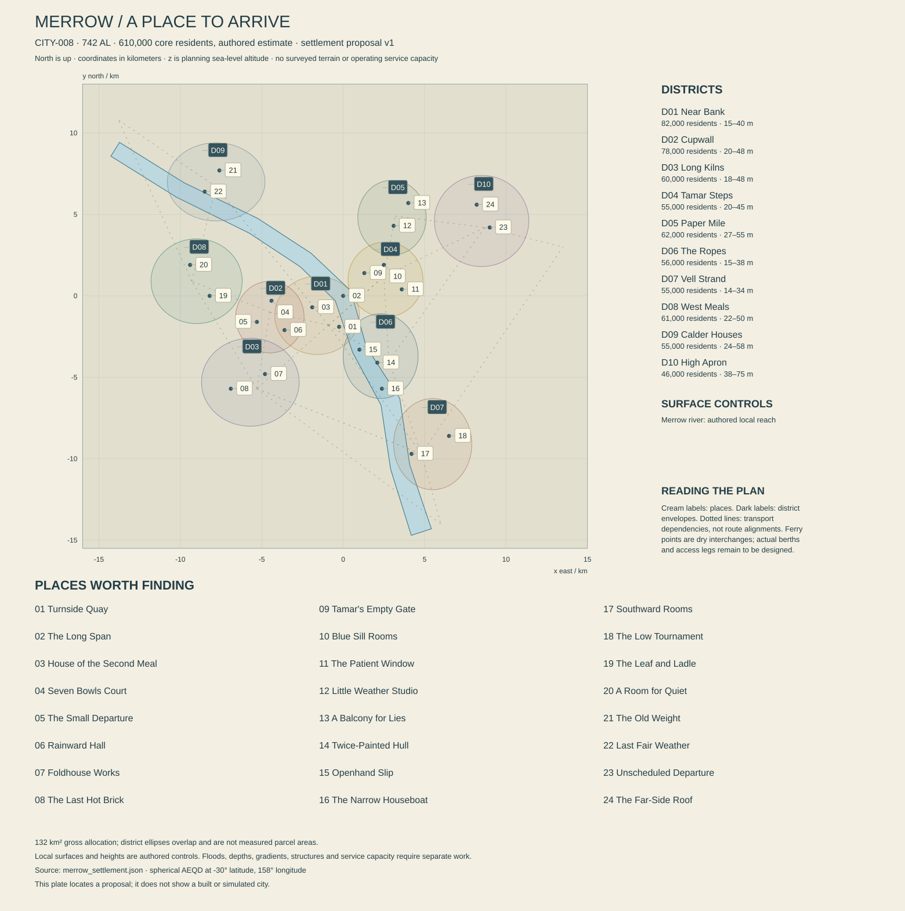

# Merrow — Where the river makes room

**CITY-008 · REG-012, Merrow Estuaries, Morrow · authored proposal 0.1 · 13 October 2026.** Present: 742 AL. Atlas center: 30° S, 158° E. Core population estimate: 610,000. This dossier and `merrow_settlement.json` propose ten districts, twenty-four places and a set of material relationships. They do not certify terrain, water chemistry, navigation, productive capacity or an implemented city. Local dates, institutions and biographies introduced here remain proposals for integration.

Merrow offers a particular freedom: moving from a familiar, densely inhabited place into a much larger system of water, travel and uncertain opportunity. A person can eat well, quarrel with a sister, repair a vessel, hear a new song and depart under questionable papers. Its beauty must survive ordinary weather and the absence of a crisis.

## The arrival: broad water, deep rooms

The first view is horizontal. Long roofs step away from a broad working river, their glazed inner edges catching a pale strip of sky. Aprons carry cranes, freight sleds and passenger shelters. Behind them, narrow entrances lead to unexpectedly generous rooms. A dining court contains three different conversations and a small domestic tree grown from introduced stock. Above it, someone has hung an elaborate cloth inside a window where only the opposite household can see it. The river is large enough to interrupt the city, but close enough that an ordinary person can recognize a particular vessel returning.

Merrow's architectural grammar is called **Glazed Shadow** in this proposal. The phrase describes dark durable bases, deeply sheltered pale interiors, occasional glazed ceramic edges and thin contemporary roofs whose supporting structure remains legible. It is not a requirement to cover everything in reflective tile. Glaze appears at places made meaningful by water, hands and light: a drain lip, a kitchen threshold, the inner edge of a public window. Broad wall surfaces can remain unglazed mineral, composite or coated masonry. Expensive buildings achieve quiet proportions and excellent acoustic separation more often than enormous ornament.

Most inhabited streets contain two to five effective floors, with denser groups and a few taller landmarks. Raised entries and replaceable lower service elements record water exposure without making every room permanently threatened. Public roofs are exceptional, connected routes; household roofs are not automatically a parkour commons. Covered passages combine long views with sudden intimacy. A route can show the river, disappear through a building, cross a court and return to the same water beside a different trade. The revelation is changing proximity rather than Orison's dramatic ascent through a crater.

The skyline contains several scales. Ordinary homes repeat a useful construction rhythm while varying doors, shutters and interior courts. Processing halls use larger bays, substantial service clearances and visible separation between clean and dirty movement. Vessel yards have empty volumes that must remain empty for work. High Apron, on gently rising ground to the northeast, carries wider approaches and flight-service structures. These are not disguised temples. Their elegance comes from confident spans, purposeful openings and the extraordinary silhouettes of machines being repaired.

The city can be loud, funny and reckless. Its corner-pop recordings travel widely. Cooks disagree about sourness with an intensity visitors sometimes mistake for a family feud. Independent captains tell excellent stories about why a vessel has acquired another name. Most people still have work in the next watch, people they want to see and places they do not intend to leave. Adventure enters those lives; it does not render them meaningless.

## The river is not the sea

The unchanged parent river, **RIV-006, Merrow water**, reaches the city at **[158°, −30°, 10 m]**. Its preceding broad control lies northwest at [151°, −28°, 80 m]. Its mapped mouth is south-southeast at [158.222222°, −31°, 0 m]. Projected from Merrow, that mouth lies approximately 19.616 km east and 102.994 km south: **104.845 km even by direct spherical distance**, before channel bends, speed limits or transfers. Merrow's city-center quay is an inland river facility. No vessel reaches an ocean instantly by crossing the edge of this city plate.

The frame uses spherical azimuthal equidistant meters about the atlas center, reference radius 5,900,000 m. x increases east, y north and z is planning sea-level altitude. Bounds are −16,000 to 15,000 m east–west and −15,500 to 13,000 m north–south. One continuous local water polygon follows an authored reach from (−14,000, 9,000, 12.2) through the exact origin (0, 0, 10) to (4,800, −14,500, 8). Intermediate bends are a local refinement, not an amendment to the parent river. The nominal centerline declines downstream; water width, bottom, floods and hydraulic behavior still require design.

The [mapped plan](merrow_settlement.json) and [settlement check report](MERROW_SETTLEMENT_CHECKS.md) preserve authored identity, coordinates, surface placement, connectivity and simple demand arithmetic. They do not establish safe banks or operating transport. District envelopes overlap; their area allowances are separate planning allocations, not ellipse measurements.

The city belongs to a larger estuary region. That does not prove that marine water reaches every downtown landing. In particular, the 10 m reference control and distant mouth do not establish tidal amplitude, salt intrusion or the location of the brackish transition. The local reach is provisionally treated as river water for habitat placement, subject to chemistry and hydraulic review. Native intertidal glass ribbon, brackish gateharps and mature brine-lantern gathering channels remain in suitable downstream regional habitats. This dossier gives those places real departure relationships without moving their biology upstream for a convenient screenshot.

The same distinction applies to the **Blue Sill** history. Hearings, processing firms, households and archives can be in Merrow while the affected native nursery lies farther down its regional system. A witness's journey matters. The city contains a controlled observation facility with separately maintained native-water systems, not an aquarium connected casually to drinking-water drains. MOR-E04's wild amber gathering remains a regional excursion whose exact site needs later mapping. Its absence from a downtown pavement is a useful promise of a world larger than the city.

Native banks, older engineered edges, recent fills and working structures need different physical sections. Nominal district ground spans roughly 16–55 m; selected occupied structures reach higher. A deck's z is not the height of soil beneath it. The wide main channel is interrupted by piers only where separately designed. The Long Span's 24 m deck stands above the local 10 m reference water, but its underside clearance depends on actual structural depth. Moored vessels follow changing water; the JSON records one reference pose rather than promising fixed decks through all conditions.

Flooding, river discharge, tide, surge and engineered release remain distinct processes. A strong downstream surge can affect passage without placing ocean water against every central door. Upstream rain can change flow while Merrow's sky is clear. No Earth twelve-hour tide is adopted, and Rauth's largely fixed tidal figure does not produce an automatic wall of water every watch. Flood defenses need failure paths, drain outlets and refuge routes; a raised road can protect one parcel and trap water against another. The first credible design test is a connected wet landscape with actual levels and paths, not a blue overlay applied uniformly to all districts.

At 30° south, nominal daylight ranges from approximately 62.1 hours at northern solstice to 74.7 at southern solstice, with 68.4 at equinox. The longest nominal night is about 74.7 hours. Cloud, buildings and local exposure change direct light. **Rauth remains below the ordinary reference horizon**. Familiar night scenes use stars, reflected city light, weather and inhabited windows; a giant planet cannot be added for composition. Civil turns stay twenty-four hours. A breakfast room can open under a dark sky because its customers have already slept.

## A history with more than one beginning

The shared chronology places intensified Morrow crossings after 163 AL. The following local anchors add historical texture without claiming that Merrow arose in one completed founding event. A city's present boundary is a poor guide to where its earliest residents believed they lived.

**206–232 AL, proposed: the joined river stations.** Repair landings, crop-service rooms and protected accommodation become durable settlements along several banks. The surviving evidence includes a repeatedly rebuilt stair, buried floor levels and copied allocation records whose original parcels no longer fit the river. No single captain owns the city's origin. Households arriving through different routes keep different commemorative dates, while most residents prefer the current public festival to an argument about which birthday is correct.

**271 AL, proposed within the Morrow cultivation dossier's 247–304 AL research period: the first comparable ribbon records.** Several facilities begin exchanging repeatable descriptions of selected glass-ribbon tissues and preparation failures. This is a coordination milestone, not the discovery that all native life is edible. The resulting knowledge belongs to collectors, custodians, processors and cooks. Present labels preserve distinctions their early records often blurred. A surviving sample bottle can be historically important even after its contents are unusable.

**324–339 AL, proposed: the broad-roof rebuilding.** Prosperous freight and fabrication firms replace some cramped river structures with standard spans and deep sheltered passages. Domestic builders adapt the roof connections at smaller scales. Merrow's recognizable architectural family emerges through copying, repair and disagreement, not a citywide style law. Some old facades still sit inside later frames, visible only from a shared stair. A present luxury dining room may occupy the former inspection bay of an entirely practical building.

**407–436 AL, proposed in the later broken-links era following Relay Winter: the divided departures.** Missing parts, disputed guarantees and unevenly arriving information interrupt routes. Local communication continues, and not every firm fails. Some captains leave, some stay and some acquire equipment through arrangements their descendants describe as either rescue or appropriation. Surviving yards contain evidence of careful stripping alongside isolated abandoned machinery. A vessel's current fittings cannot reliably date its hull. The period leaves specific unresolved claims rather than universal hereditary guilt.

**522 AL, proposed: the Shared Supper circuits.** Neighborhood kitchens, commercial cooks and visiting performers create a recurring exchange of meals across districts. Public dining already existed; the novelty is coordinated travel and a deliberate invitation to people who usually eat within one bank. The circuits later divide into affordable services, fashionable events and several private imitations. An expensive restaurant cannot claim to be the sole authentic heir. The tradition also produces excellent complaints about hosts who care more about a speech than whether the food is getting cold.

**612 AL, established: the Blue Sill hearings.** The planetary history fixes damage from badly managed cultivated-water discharge into a native nursery, earlier worker observations and a partly successful recovery response. This city proposal locates a later public record collection in Tamar Steps; it does not identify every modern wetland as the original damaged site. Gateharps remain proposed ecological participants whose exact historical range needs final placement. No new villain, casualty number or definitive hero is silently added to the shared event.

**614–650 AL, proposed: practical recovery agreements.** Particular operators undertake changes to discharge, access and habitat work with compensation and review. Results vary. Some areas recover, others retain altered communities, and several families resent burdens that fell unevenly. Technical lessons spread farther than any single legal judgment. Merrow's later reputation for qualification comes partly from learning how to find and correct mistakes, not from never making them again. Successful work deserves visible places rather than appearing only as reassuring text beside another catastrophe.

**687 AL, proposed: the Paper Mile recording season.** A group of studios releases small, sharply produced corner-pop records using everyday speech and performers from several districts. The date marks a local commercial wave, not the invention of the genre. Some songs travel to Sola; others fail at home. Contemporary collectors enjoy promotional objects that looked disposable at the time. Musicians now argue about whether the old production style was intimate or merely limited by the equipment somebody could afford.

**734–742 AL, proposed: competing ways into the lower estuary.** Travel firms, independent crews and habitat organizations expand different kinds of regional access. A new bank in the eventual MOR-E04 setting protects particular houses while interrupting a nursery connection; its exact construction date remains open. The city debates routes and livelihoods, but a boat journey can also be uneventful and wonderful. The present is not a countdown to one inevitable collapse. It is a collection of futures residents are already trying to make.

## Ten districts and the rooms between them

The ten allocations total **610,000 residents and 132 km²**. They distinguish geography, building history and useful concentrations of activity. None is a cultural caste or an exclusive employment category. A shipwright can live far from The Ropes; a successful cook can dislike Cupwall's fashionable evenings. Shared traditions, household languages and family networks cross every boundary.

| District | Residents | Gross allocation | Planning center x, y, z m |
|---|---:|---:|---|
| MER-D01 Near Bank | 82,000 | 12 km² | −1,600, −1,200, 22 |
| MER-D02 Cupwall | 78,000 | 10 km² | −4,500, −1,300, 28 |
| MER-D03 Long Kilns | 60,000 | 16 km² | −5,700, −5,300, 27 |
| MER-D04 Tamar Steps | 55,000 | 10 km² | 2,600, 1,000, 27 |
| MER-D05 Paper Mile | 62,000 | 9 km² | 3,000, 4,800, 34 |
| MER-D06 The Ropes | 56,000 | 15 km² | 2,300, −3,700, 20 |
| MER-D07 Vell Strand | 55,000 | 17 km² | 5,500, −9,100, 18 |
| MER-D08 West Meals | 61,000 | 13 km² | −9,000, 900, 26 |
| MER-D09 Calder Houses | 55,000 | 14 km² | −7,800, 7,000, 31 |
| MER-D10 High Apron | 46,000 | 16 km² | 8,500, 4,600, 48 |

**Near Bank** is the dense western arrival district. River-facing passages connect transfer facilities, mixed housing and the Long Span. The public route runs behind working aprons rather than wandering through lifting envelopes. Rooms above freight streets can be quiet through good construction, and a small court can support more conversation than a monumental square. Generations of adaptation leave stairs entering buildings at surprising levels. The river remains visible often enough to orient a newcomer without making every block a waterfront postcard.

**Cupwall** lies farther west, with close-grained apartments, performance halls, schools and ambitious dining. Its name comes from a former communal dish-storage wall, not a requirement that every building be decorated with crockery. Private courts connect through particular public passages; some apparent shortcuts end at somebody's home. Ceramic accents catch diffuse light beneath deep eaves. The neighborhood is sociable without demanding participation. A resident can live comfortably here while never attending the meal that visitors insist defines the district.

**Long Kilns** combines processing, ceramic and enclosure fabrication, logistics and substantial housing. Older tall flues stand beside contemporary sealed equipment and heat-recovery loops. They do not prove that every current process burns fuel beneath an open chimney. Wide service yards contain deliberately empty space. Domestic streets turn their quiet sides toward the works, with schools and recreation kept out of dangerous traffic. Production should be beautiful in sequences: raw material, clean transformation, inspection, useful object, residue with a destination.

**Tamar Steps** occupies older raised ground east of the central river. The district's short changes of level produce an intricate inhabited section without becoming a mountain. Public teaching rooms, small institutions, repair premises and homes share older buildings. The Blue Sill collection sits among contemporary life rather than isolating history in a sacred precinct. A visitor can learn something serious, then turn a corner into an argument over a hairstyle. Its controlled native observation house is a specific facility, not evidence that downtown water has become a brackish nursery.

**Paper Mile** is a name inherited from a publishing concentration, not a measured one-mile ribbon or a city without digital media. Studios, education, acoustic fabrication and shared rehearsal rooms join varied housing. Broadcast light behind a shaded window gives the neighborhood a particular late-watch rhythm. A large proportion of residents work in unrelated trades. Its most memorable architecture consists of narrow entrance courts opening into surprisingly large performance volumes. Posters can be replaced while old screw holes preserve earlier audiences.

**The Ropes** is an east-bank vessel-service district whose historical name outlives several generations of handling technology. Rope, cable, rails, clamps and modern control systems each appear where appropriate. Wet work meets dry fabrication through actual ramps, cradles and lifting equipment. Visiting crews share the neighborhood with long-established households. It offers lawful repair, ambiguous salvage and some plainly illegal business without turning every mechanic into a pirate. Local competence gives independent crews options; it does not guarantee that those options will be used well.

**Vell Strand** is the southern river gateway. Strand here names an inhabited bank, not an ocean beach. Travel rooms, cold-chain transfer, regional work services and ordinary homes stretch toward downstream routes. Some parcels remain deliberately open for water movement, maintenance and future investigation. Low roofs leave a broad sky. The city thins gradually into other settlements and working land rather than ending at a gate labeled wilderness. Regional nursery journeys begin here and take real time beyond the plate.

**West Meals** mixes introduced-crop service facilities, kitchens, housing and inland transport. Productive territory continues well beyond its city envelope. The district's domestic character includes generous shared rooms and small private gardens; its industrial character includes stock quarantine, substrate handling and clean culture spaces. Those are different uses with different inputs. Food abundance depends on systems residents can maintain and afford. The view must include deliveries and storage as well as attractive plants, with people free to care more about the meal than its agricultural provenance.

**Calder Houses** sits north of the upper river bend. Earlier transfer parcels, housing compounds and redundant lifting works have acquired schools, sports grounds and new workshops. The district has room for adventurous movement among inspected industrial remains, alongside mundane accessible routes. Some old structures are retained for affection; others are removed because they obstruct a good life. A northern regional connection makes this more than a terminal suburb. Residents can leave Merrow without first passing through its central entertainment district.

**High Apron** occupies gently rising northeastern ground, with a limited flight facility, technical work, homes and open outlooks. Its slopes are not cliffs. Landing paths, noise, safe separation and service roads influence building placement. Household rooms face away from some spectacular views because quiet matters more. A traveler can see the city's broad arrangement here: inhabited banks, a river that continues beyond sight and roofs that shelter lives smaller than the panorama. At night there is no Rauth above them, however much a visiting artist wishes otherwise.

## Households, food and the material city

An illustrative housing screen uses **244,000 dwellings**, 96% occupied and 2.604 residents per occupied dwelling, implying approximately **609,961 people**. Household sizes and tenures vary. The unoccupied fraction includes repair, delayed succession, seasonal use and some genuine spare rooms; it is not an instantly available reserve for everyone priced out of the center. Boarding houses, supported accommodation, ordinary flats and generous family courts need different interior assets and economic stories.

A residential parcel allowance of 25 km², 28% coverage and 3.2 effective floors gives 22.4 million m² gross floor area. At 80% usable allocation, 17.92 million m² remains, approximately 73.44 m² per planned dwelling. This supports a mixture of compact and larger homes rather than predicting a standard apartment. The remaining land allocation is 24 km² employment, 10 civic, 22 streets and transport, 8 urban cultivation/service plots, 18 parks and habitat, 10 waterfront facilities and 15 reserve or other open land. Together the categories total 132 km². Regional fields and lower-estuary habitats are additional territories.

Resident edible-product movement is set at **1.7 kg per person per civil turn**, or **1,037 tonnes**. A provisional basket is 380 tonnes dry staples, 390 fresh produce, 175 cultured or fermented products, 80 other preserved foods and oils, and 12 individually qualified native ingredient fractions. The last category is a demand target, not proof that all twelve tonnes can be produced responsibly. Qualified native fractions are about 1.16% of basket mass; complete nutrition remains dependent on introduced crops and maintained cultures.

At 2,500 kcal per resident, the separate calorie screen totals 1.525 billion kcal. A 3,200 kcal/kg dry-equivalent calculation gives **476.5625 tonnes**, while 75 g protein per resident gives **45.75 tonnes of protein**. Neither proves the basket composition. A sixty-turn dry calorie-equivalent reserve would be **28,593.75 tonnes** before losses, access limits and the need for other nutrients, preparation and fuel. Storage is distributed among commercial, cooperative and public holdings so that one attractive warehouse does not become the magical stomach of the entire city.

The surrounding agricultural network uses introduced lineages selected over centuries for suitable long-cycle regimes, with controlled stocks and intensive crops receiving explicit environmental support. This is bounded fictional biology. Soil or substrate, nutrients, water, pests, labor, light and processing remain inputs. Fermentation converts qualified feedstock; it does not produce unlimited calories from an attractive tank. Culture stocks need identity, viability and replacements. Native-derived carbon used in any process requires its own compatibility and residue account, separate from a native flavor fraction added to a finished meal.

The resident basket excludes regional residents and export obligations. The shared Orison study reserves **twelve tonnes per turn of distant specialties across REG-011, REG-012 and REG-021 combined**, including five tonnes of native fractions and seven other preserved products. It does not assign all of that allowance to Merrow. This dossier leaves the city share unallocated rather than claiming capacity already promised by Dhal or another origin. The Merrow-to-Tern specialty/equipment relationship, Merrow-to-Dhal processing-equipment relationship and Talweir-to-Merrow design relationship remain additional, currently unquantified commitments. Any later firm food export must be added to the 1,037-tonne resident account and traced to actual production.

Distance changes what is sensible to ship. Dhal lies about 3,589 km away even by the shared direct-distance check, Talweir about 6,845 km and Tern about 7,838 km. Dhal is not upriver. Documents and design revisions can arrive rapidly through ordinary communications, while instruments, viable stocks and heavy equipment need carriers and transfers. Merrow can sell a qualified preparation method or a starter culture that enables local manufacture elsewhere. It need not send every subsequent bowl of food across an ocean to remain economically important.

An initial river-handling workload screen is **7,000–11,000 tonnes per turn of distinct consignments first entering city handling**, including industrial and construction cargo, fuel or consumables, food and recirculating equipment. Rehandling is additional work but not new cargo mass. Actual vessels, berths, cranes, channel windows and rail interfaces must be sized separately. The food basket is a relevant subset of these consignments, not an extra 1,037 tonnes automatically added to every throughput number. Aircraft handle valuable and urgent loads, not the whole mass at negligible cost.

## Water that comes back, power that must arrive

All service quantities use twenty-four-hour civil turns and the 610,000-person core. Domestic potable delivery at **130 liters per person** is 79,300 m³. Another 35,700 m³ for public, commercial and accounted urban production brings delivery to **115,000 m³**. With a 12% distribution-loss assumption, treated network input is **130,681.818 m³**. At 96% raw-treatment recovery, raw abstraction is **136,126.894 m³**, approximately 1.5755 m³/s averaged over a turn. Process residual, about 5,445.076 m³, is distinct from 15,681.818 m³ distribution loss.

The preferred raw source is an upstream river intake with verified chemistry, a protected approach and an explicit contamination response. The plan does not establish its sustainable flow or freedom from salinity intrusion. If a later hydraulic study places saline water at that source, the treatment system and source choices must change; the current recovery number cannot quietly absorb desalination. Groundwater and rain collection receive no firm potable credit. There is no conveniently unlimited freshwater pool beneath the whole city.

A protected raw-storage target of **2.2 million m³** represents about 16.16 turns at the screened raw rate if completely usable. Treated storage of **260,000 m³** represents about 1.99 turns of network input before fire reserve, unavailable volume and neighborhood pressure constraints. Proposed raw treatment in three 75,000 m³/turn trains leaves 150,000 nominal capacity with one unavailable, above average demand but not a demonstrated contingency guarantee. Source quality, maintenance, power and refill can remove that apparent margin.

Reclaimed delivery is **30,000 m³ per turn** for qualified industrial, cleaning and cultivation-service uses. Gross end-use throughput is therefore 145,000 m³. A sewer screen collects 110,000, leaving 35,000 consumed or otherwise uncollected. Collection divides into 30,000 reused and **80,000 final treated residual**, before detailed process losses. The external network balance closes as 15,681.818 distribution loss, 35,000 end-use consumption/uncollected and 80,000 final residual. Some losses return to the catchment; those numbers are not equivalent to net depletion.

Three proposed 55,000 m³/turn wastewater trains give 165,000 nominal throughput. With one unavailable, the remaining 110,000 only matches average collection, leaving no headroom for infiltration or a peak. A real maintenance plan therefore needs storage, operating reductions or another qualified path. Industrial native fractions and hazardous streams do not enter ordinary sewage by default. Lower-river discharge needs receiving-water and habitat limits that account for timing and chemistry. The Blue Sill legacy forbids treating a large moving river as proof that residues have ceased to matter.

The electrical demand study is **410 MW average and 760 MW peak**, or 9.84 GWh per turn on average. The allocation is 135 MW homes and ordinary commerce, 55 public services, 80 controlled food and biological processes, 85 other manufacturing, 35 transport/freight and 20 distribution and additional utility loads. Export expansion outside this account must add its own power. Useful process heat can reduce particular heating demands while cooling and rejection remain real loads.

A portfolio to test includes **300 MW of regional firm-import obligation and 160 MW of local firm-generation obligation**, with plant technology, fuel, transmission and redundancy unresolved. These are desired assured contributions, not verified installed capacity. Candidate renewables add 350 MWp solar and 220 MW wind nameplate, whose variable output cannot simply be added to firm supply. Candidate storage is **20 GWh usable, 320 MW discharge**. A 180 MW residual deficit over 74.7 hours requires 13.446 GWh before additional system losses; the complete 410 MW load needs 30.627 GWh and exceeds both stored energy and discharge power. No citywide long-night guarantee follows from those examples.

Ordinary municipal solid discard at **0.75 kg per resident** totals **457.5 tonnes per turn**. Construction debris, industrial residuals, failed native-processing batches and water-treatment solids remain separate. Recovery needs clean streams, suitable markets and facilities, with finite final destinations. Native detritivores are not a free municipal waste service. Introduced food organics require their own controlled treatment and compatibility checks before any use near native habitat. Beautiful public dining and beautiful nurseries depend on keeping these systems distinct where their chemistry demands it.

## Public freedom and private commitments

Merrow's proposed civic arrangement combines district representation, a municipal service assembly and independently governed regional water and navigation bodies. The **Reach Carriers' Table** coordinates particular shared transport facilities; it does not own every boat. The **Preparation Houses' Exchange** maintains selected process agreements, with competing firms and worker representation rather than one universal food guild. The **Blue Sill Collection** preserves identified records and public interpretation; it does not issue binding rulings on every present dispute. These new institutions require later precise charters before becoming game rules.

The Common Table, Open Wake and Night Choir can have local participants, but none monopolizes food, independent travel or testimony. Eight wider traditions overlap with people who claim several or none. A Berth-associated household may run an expensive business. A Closegarden practitioner can oppose a particular enclosure. A member of a Witness Company can refuse to make a relative's private life into public evidence. Membership supplies relationships and practices, not a moral uniform.

Lake speech is common in public media and education alongside Shore, Wake, household languages and local sign communities. Operational Transit Clear makes a berth instruction unambiguous without making a love song sound like a handover. English rendering carries essential meaning. Public signs identify actual destinations and alternative routes rather than using decorative pseudo-writing as their only information. Street names are stable translated or inherited labels; this volume does not invent a convenient etymology from the starter lexicon.

Independent crews supply genuine adventure. Some carry undocumented passengers away from coercive arrangements; some conceal stolen equipment; some do both on different voyages. A repair yard can defend safe access while refusing to help hide a crime. The player needs ways to investigate, decline, negotiate, travel, trespass or pursue a difficult route, with consequences that follow evidence and relationships. Mere absence of a stamp does not prove wrongdoing, and charm does not erase a harmed owner.

Private life occupies equal narrative space. Meals continue without invitations to the protagonist. Partners may keep separate homes. A person can refuse courtship without becoming a quest obstacle. Disability and access belong in ordinary design: adjustable work positions, clear circulation, resting bays, useful sign sightlines, quieter rooms and reliable ground routes. A difficult optional climb does not make somebody's home accessible. The city should let different people enjoy different kinds of freedom without forcing everybody through the same physical test.

## Twenty-four places with reasons to exist

Each dossier identifies an arrival or focal point rather than a complete footprint. Coordinates match the companion plan. Affordances, relationships and return changes are authored requirements, not implemented mechanics. Regional places described through departure services remain outside the city plate until separately mapped.

### MER-POI-001 — Turnside Quay

**Near Bank; (−250, −1,900, 17); dry arrival point behind the working bank.** The public approach occupies the end of a rebuilt transfer hall, close to the river without placing visitors beneath cargo. Through its open side, a crane appears to carry a piece of somebody's home across the sky: prefabricated rooms, wrapped appliances, a balcony railing. The quay has expanded around an older stair whose landing no longer matches the present apron. That mismatch makes several centuries visible without a plaque explaining every surface.

Tessa Vale, born 699 AL, approximately 38 Earth-standard years old, coordinates passenger and freight use. Her brother Olin works on a small vessel farther downstream and believes family connections should occasionally improve his berth. Tessa sometimes agrees, which annoys colleagues who like both of them. Her immediate ambition is a schedule that includes proper breaks for staff, not an award for heroic endurance.

A visitor can follow a consignment to its land carrier, board a city service or watch the river from a quiet rear gallery. A suspicious package matters through its marks, destination and handling, not an automatic glow. A later visit might reveal its perfectly mundane contents being installed elsewhere, while an apparently ordinary crate has provoked a serious dispute.

Assets require bank and apron sections, real dry-to-berth access, fenders, waiting rooms, lifting clearances and distinct equipment generations. Keep sightlines broad enough to make arrival exhilarating. The mapped point is dry land, not a vessel or an ocean terminal.

### MER-POI-002 — The Long Span

**Near Bank; (0, 0, 24); supported above the river's 10 m nominal surface.** The crossing replaces several earlier structures without retaining their exact alignments. Its broad public bays are roofed selectively, allowing people to choose weather exposure and views. Dry western access is recorded at (−1,000, −300, 22); an eastern approach remains a separate engineering requirement. The fourteen-meter deck-to-water difference is not the navigation clearance beneath the structure. Depth, supports, vessels and flood conditions all matter.

Nalin Orr, born 685 AL, approximately 51 Earth-standard years old, supervises selected deck maintenance. Away from work, Nalin makes ridiculously ornate handles for entirely ordinary cupboards. Risa Kelm has ordered one and keeps changing the dimensions. Their friendship has become intimate enough that a professional disagreement can be funny, embarrassing or both, without requiring a romance plot.

The player may cross directly, sit where two currents meet visually, compare older connection details or descend to a lawful inspection display. A closure can affect one bay while the crossing remains useful. During a major warning, an unavailable approach must have a comprehensible alternative rather than making half the city inaccessible by narrative decree.

On return, a repaired joint may look deliberately different and a familiar seat remain untouched. Build structural depth, drainage, tactile route information, rest positions and acoustically distinct sheltered bays. The strongest image is ordinary people pausing over an immense working river while their errands continue at either end.

### MER-POI-003 — House of the Second Meal

**Near Bank; (−1,900, −700, 24); boarding house and independent kitchen.** Two adjoining domestic buildings were joined when their owners discovered that separate kitchens were less useful than a generous common room. Bedrooms retain different floor levels and views. The second meal is a later sitting for people who miss the first, not compulsory dining or a ration category. A traveler can rent a room, cook privately or take a table without telling the proprietor their life's story.

Risa Kelm, born 694 AL, approximately 43 Earth-standard years old, runs the kitchen with a cousin and paid staff. Risa remembers preferences well but asks before treating an old habit as a permanent requirement. An expensive cupboard handle from Nalin Orr is taking longer than the cupboard. The recurring joke gives both characters something to care about that neither threatens the city nor hides a moral test.

A visitor might share a meal with a crew preparing to leave, obtain practical route advice or notice that a resident has quietly moved their possessions into a smaller room. An invitation can be accepted or declined. A misplaced parcel supports a modest investigation without making every locked bedroom available for searching.

Returning should sometimes reveal exactly the remembered comfort: warm dishes, private thresholds and a chair that fits. At other times a familiar guest has gone, leaving a forwarding address if they wished. Assets need credible kitchens, sound separation, individually altered rooms, luggage storage and evidence that staff also eat and rest.

### MER-POI-004 — Seven Bowls Court

**Cupwall; (−4,400, −300, 30); shared culinary courtyard.** Seven original serving recesses survive inside a larger current arrangement, although nobody limits the menu to seven dishes. Their glazed interiors show repairs in different colors. Public dining grew here through agreements among neighboring households and cooks; present businesses include a cheap lunch counter, a costly reservation room and a stall whose owner mainly wants reliable hours. The court's fame does not make all its tenants successful.

Devra Ellin, born 674 AL, approximately 61 Earth-standard years old, teaches sour preparations using maintained terrestrial cultures and qualified ingredients. Devra prefers a restrained relish that younger cooks call cautious. They answer with a complicated new version whose texture Devra admires while refusing to concede the argument. Their competition supplies pleasure and technical knowledge without a secret alien ingredient solving everything.

Visitors can taste, compare, learn a small preparation or simply eat. A dropped bowl can provoke more immediate emotion than a distant political crisis. Participation never requires tolerating an unsuitable ingredient or pretending to enjoy a flavor. An ordinary worker's inexpensive meal deserves the same visual care as a spectacular tasting service.

Return states include a revised recipe, an empty shop being fitted for another business and the reassuring persistence of a favorite dish. Assets need real food stages, wash facilities, varied tables, weather protection and acoustic pockets. Ceramic color should concentrate at useful surfaces rather than turning the court into a uniformly polished palace.

### MER-POI-005 — The Small Departure

**Cupwall; (−5,300, −1,600, 28); a private apartment opening onto a shared landing.** A broad window overlooks an unremarkable lane rather than the river. Inside, inexpensive furniture has been altered carefully: a foldout work surface, a low storage wall and a cabinet whose back hides a much older paint color. The apartment matters because its occupants have made it sufficient, not because a famous historical event occurred here. Visitors require an actual invitation.

Iren Vol, born 711 AL, approximately 28 Earth-standard years old, plans a long journey through Morrow. Their partner Asha Nerr wants to stay, complete a training course and keep the home. Neither preference is a betrayal. They are working out possessions, money, communication and how much certainty they can honestly offer. Their disagreements include whether taking the good cup is sentimental or inconsiderate.

The player might help with an ordinary move, share food or hear a limited confidence. Advice need not determine the relationship. A folded route plan shows distances, intermediate stops and alternatives rather than three picturesque cities joined by instantaneous arrows. Some preparations can proceed while a difficult conversation remains unresolved.

A return may find Iren away, visiting again or postponing for a reason that belongs to them. Asha's room changes through new work, not merely through absence. Assets should show packing choices, practical communication equipment, domestic privacy and possessions worth keeping without being collectible prizes. Travel becomes consequential through a home that continues when somebody leaves it.

### MER-POI-006 — Rainward Hall

**Cupwall; (−3,600, −2,100, 25); dance and assembly hall.** The roof projects beyond the entrance so arriving crowds can sort themselves before entering the main room. Inside, a sprung floor, variable acoustic surfaces and broad resting edges support several kinds of movement. A narrow strip of older wall records a previous hall that was shorter and darker. The building is used for classes, parties, meetings and occasional quiet rehearsals; it does not need a festival every time the player passes.

Faro Dren, born 692 AL, approximately 45 Earth-standard years old, teaches a social dance built around changing which partner initiates the next phrase. Different physical versions share the musical idea without demanding identical steps. Faro is excellent with beginners and surprisingly impatient when experienced friends refuse to practice. A former student now performs commercially and returns to be treated as an ordinary participant.

A visitor can watch, join an appropriate session, help move a bounded piece of equipment or enjoy conversation at the edge. Consent governs touch and partnership. Declining a dance should remain socially legible and unremarkable. A power interruption can move one rehearsal to a smaller acoustic arrangement, but most visits should let the place work beautifully.

On return, familiar rhythms acquire new participants and a small mistake becomes a remembered joke. Build changing spaces, accessible circulation, seating, actual instrument storage and signs that distinguish public sessions from private bookings. Its spectacle is coordinated pleasure, with effort visible in breath, timing and recovery.

### MER-POI-007 — Foldhouse Works

**Long Kilns; (−4,800, −4,800, 26); qualified preparation and process manufacture.** Foldhouse occupies a broad industrial frame behind housing and service roads. Separate receiving, conversion, inspection and dispatch spaces make the product's journey intelligible. The old name refers to a packaging method; current work uses several systems. A glass-ribbon fraction arriving from a suitable downstream source is a specific lot with tissue identity and preparation history, not a basket of universally edible leaves.

Sela Reth, born 688 AL, approximately 48 Earth-standard years old, supervises process qualification and teaches occasional public sessions. Their daughter has chosen performance rather than manufacturing, to Sela's mixture of pride and incomprehension. Sela's professional problem is a promising yield improvement whose residue changes complicate the existing disposal agreement. Increased output is not automatically an improvement if its material consequences have merely moved elsewhere.

A visitor can observe a separated demonstration, compare retained samples or trace a questionable shipment. The useful evidence may be an omitted temperature interval, a mislabeled tissue or an entirely legitimate difference between sources. Collecting more wild material does not correct any of those errors. A player can decline involvement without causing every line to stop.

Return visits reveal revised tooling, a successful recall or an experiment abandoned for good reasons. Assets need segregated drains, cleaning access, sealed storage, heat rejection, staff spaces and convincing process scale. The building should make sophisticated work visually exciting while preserving the difference between a beautiful sample and a qualified product.

### MER-POI-008 — The Last Hot Brick

**Long Kilns; (−6,900, −5,700, 29); ceramic works and evening workshop.** A historic kiln shell encloses part of a modern fabrication hall. The surviving chimney has an inspection history rather than a perpetual plume. Current heat sources, extraction and controls are distinct from the older installation. Useful recovered heat serves selected adjacent functions when available; it does not warm the whole district for free. The public workshop lies beyond the production boundary, close enough to understand the work without sharing its hazards.

Kav Bren, born 681 AL, approximately 54 Earth-standard years old, fits and repairs industrial ceramic components. After work, Kav makes tiny vessels with deliberately inconvenient handles, then invites friends to explain why each is terrible. Devra Ellin has commissioned a serving dish and insisted it be practical. Their negotiations connect two skilled people whose priorities overlap only partly.

The player can form a small object, compare damaged and repaired components or follow a commission from drawing to installation. Firing, cooling and inspection take actual elapsed work; a completed object need not appear immediately after a button press. A spectacular failed piece can remain a teaching object instead of becoming either valuable loot or meaningless refuse.

On return, a repaired edge may be in use at Seven Bowls Court, while a personal experiment still waits on a shelf. Assets require believable thermal boundaries, lifting equipment, dust control, quiet staff space and diverse ceramic surfaces. Beauty should include an ordinary component made exceptionally well, not only the dramatic glow inside a furnace.

### MER-POI-009 — Tamar's Empty Gate

**Tamar Steps; (1,300, 1,400, 27); former compound entrance and present public passage.** A large frame stands between buildings that no longer belong to one property. Its door was removed long ago; hinge housings remain beneath later repairs. The name Tamar survives in copied local records, but this proposal does not identify one founder or secretly derive the whole district from a myth. A short route passes through the frame, while an upper service walk reaches privately occupied rooms.

Una Dask, born 676 AL, approximately 59 Earth-standard years old, keeps a repair premise beside the passage. Una knows which rooms were subdivided and which apparent openings are merely ventilation. They occasionally carry messages for independent crews, judging requests individually rather than claiming universal neutrality. A trusted customer has recently asked for a favor whose explanation keeps changing.

The visitor can use the ordinary route, inspect public architectural traces or accept a bounded errand. A clandestine meeting might concern escape from an abusive contract, ordinary infidelity, stolen cargo or a mixture the player has to investigate. The upper route offers a possible risky approach only if its physical access and ownership support it. A convenient old beam is not automatically a safe climbing anchor.

Returning can reveal a repaired shutter, a missing visitor or Una declining further work for someone previously welcome. Assets need layered thresholds, different sightlines, credible upper access and inhabited private interiors. The gate creates suspense through ambiguous human purposes while remaining an ordinary, useful way through the city.

### MER-POI-010 — Blue Sill Rooms

**Tamar Steps; (2,500, 1,900, 29); record collection, teaching rooms and public court.** The institution occupies a later building, not a falsely preserved original courtroom. Its collection distinguishes 612 AL testimony, subsequent copies, reconstructed displays and later family accounts. A low blue threshold was commissioned as a memorial after the hearings; it is not the actual nursery bed. Through an open door, the present city remains visible and audible. History does not require removing every sign of current life.

Ama Tess, born 703 AL, approximately 35 Earth-standard years old, prepares exhibitions and helps people find bounded records. Ama dislikes the promotional phrase that Merrow learned its lesson, because it turns continuing work into a completed moral achievement. They also dislike displays so bleak that successful recovery becomes invisible. Their partner works in tourism and makes both criticisms into excellent dinner arguments.

The player may compare a worker's early observation with the later accepted account, find a public process diagram or trace where a particular place lay without assuming today's shore matches the old one. Personal material carries access limits independent of its usefulness to an investigation. A disputed caption can be corrected without discrediting the entire collection.

On return, an exhibition might show thriving recovery alongside a failed intervention and an ordinary family photograph. Assets require readable source layers, spaces for discussion, accessible interpretation and physical evidence that has aged differently from its display case. The rooms should preserve uncertainty precisely enough that it invites investigation rather than becoming a universal excuse to doubt everything.

### MER-POI-011 — The Patient Window

**Tamar Steps; (3,600, 400, 25); controlled native observation house on land.** Several independently maintained basins sit inside a deep, quiet room. Water chemistry, substrate and circulation are matched to particular regional specimens. The facility does not establish a wild brackish habitat at the city's 10 m river control. Its small stock, intake or prepared-water sources, cleaning and residual streams need actual husbandry accounts. The viewer sees a whole ordinary interval, including long stretches when nothing spectacular happens.

Iska Renn, born 708 AL, approximately 30 Earth-standard years old, maintains the observation systems and helps train visitors to notice more than color. Iska is patient with creatures and less patient with a promotional team that wants permanent amber illumination. Mature brine lanterns signal intermittently under particular conditions; juveniles do not glow on command. A sign can explain that without ruining the pleasure of discovery.

A visitor may watch a gateharp's feeding fringe, compare fresh silt-reader traces or see why an apparently empty structure is no longer alive. Handling, feeding and collecting require more than admission. A future practical story can involve keeping one basin stable during scheduled maintenance, with real alternative holding space rather than a dramatic emergency improvised by the protagonist.

Returning can reveal growth, mortality, a changed exhibit or an empty basin being prepared carefully. Assets need separate life-support routes, quiet pumps, maintenance access, suitable viewing heights and organisms with correct anatomy. The house is a place of attention and skilled care; the wild regional estuary remains a different destination.

### MER-POI-012 — Little Weather Studio

**Paper Mile; (3,100, 4,300, 35); commercial recording rooms and a small performance window.** The studio occupies a former publishing floor behind a narrow entrance court. Its public window opens only during selected sessions; the rest of the time good acoustic construction keeps neighboring homes peaceful. Old advertisements from the proposed 687 AL recording wave survive in a stairwell, alongside later artists who disliked that style. Contemporary equipment is present, repaired and occasionally unaffordable.

Jori Ell, born 715 AL, approximately 24 Earth-standard years old, sings with a corner-pop group whose new refrain is becoming difficult to escape. Jori's sibling Sen works at High Apron and is delighted until passengers begin requesting backstage access. The group argues about royalties, rehearsal time and whether the bridge of their best song is genuinely good. None of those concerns makes their pleasure in performing insincere.

The visitor can attend a public session, hear alternate arrangements or help a bounded delivery reach the right room. A private recording does not become available merely because the player owns a microphone. One story follows a copied phrase whose resemblance may be coincidence, influence or uncredited borrowing; meaningful evidence includes dates and work rather than a universal plagiarism detector.

On return, a popular song may sound different live, another member may lead a session, or Jori may be quietly eating between takes. Assets require distinct acoustic volumes, cables, recording interfaces, performers' possessions and believable production schedules. The world should contain music people like, including some the player may find irritating.

### MER-POI-013 — A Balcony for Lies

**Paper Mile; (4,000, 5,700, 37); small theater above a shared commercial court.** The balcony is part of a stage whose apparent domestic facade can be rearranged. From the audience it becomes a residence, a vessel's gallery or an absurdly inaccessible office. Backstage it is clearly machinery, patched scenery and useful floor space. The theater's repertoire includes a Merrow variation of The First Wrong House, while preserving that play's established Sola origin rather than claiming it as a local invention.

Soran Kee, born 666 AL, approximately 68 Earth-standard years old, directs and sometimes performs a supporting role badly enough to annoy younger colleagues. Soran knows it and remains tempted. Their best skill is finding the one practical object that makes a scene funny. A rented door currently refuses to close quietly, threatening a sequence whose entire joke depends on nobody noticing an exit.

The player can attend, assist an invited rehearsal or explore a public backstage session. Improvisation can change a performance without revealing a secret political conspiracy. A more serious story might concern an actor's refusal to have private experience incorporated into a successful scene. The audience's interest does not override that boundary.

Returning offers a revised joke, a different cast or an ordinary dark theater between productions. Build storage for scenery, accessible audience positions, dressing rooms, sightlines, mechanical supports and fire or evacuation routes appropriate to a real occupied venue. A comic performance is an achievement in its own right; its reward need not be an encrypted clue hidden in the applause.

### MER-POI-014 — Twice-Painted Hull

**The Ropes; (2,100, −4,100, 17); dry arrival in a vessel-repair yard.** A working hull rests in a cradle beyond a controlled handling strip, with water access and lifting geometry to be designed separately. Sanded paint exposes two names and a pattern of repairs that does not match either simple ownership story. The machinery is human-built and widely recognizable, but several internal modules have different service histories. A vessel can remain one home through substantial replacement without becoming a mystical ancient artifact.

Nessa Torv leads the repair team. Nessa wants payment, a safe working floor and enough evidence to avoid returning a vessel to somebody who obtained it through coercion. A confident claimant arrives with convincing documents; the present crew has a less tidy account and belongings that suggest a long residence. Their affection for the boat is real, but affection alone does not settle ownership.

The visitor can compare fittings, listen, inspect authorized records or help preserve evidence while urgent stabilization proceeds. Removing a valuable module before resolving a load path can damage both the vessel and nearby workers. There are legitimate reasons to repair before deciding the full dispute, and exploitative reasons to demand immediate release.

Returning may show a new name, an agreed shared payment, a contested departure or a secured hull awaiting further work. Assets need cradle geometry, lifting clearance, access ladders, differentiated paint histories and domestic traces inside industrial space. The adventure lies in a beautiful machine carrying contradictory human histories, with several credible outcomes rather than one obvious villain.

### MER-POI-015 — Openhand Slip

**The Ropes; (1,000, −3,300, 16); supported working deck over nominal water at 9.5 m.** The dry approach is recorded at (1,750, −3,000, 19). This is a small repair and passenger interface, with detailed structures, ramps and vessel positions still required. Its operators publish basic terms while negotiating unusual jobs individually. The name promises willingness to hear a request, not immunity from every law. Some work happens openly; other departures use ordinary privacy to conceal less ordinary purposes.

Varek Oss commands a capable independent crew. Varek can be generous, funny and dangerous, and does not need to be revealed as secretly virtuous for those traits to coexist. A proposed voyage would carry a passenger beyond an oppressive contract's reach. The cargo offered to finance it may belong to an unrelated clinic. The passenger's need does not erase the clinic's loss, while returning everything unquestioningly may expose the passenger to harm.

The player can investigate, refuse, seek another financing route, negotiate a narrower role or knowingly join a risky enterprise. Each path needs material consequences and informed choices. There is no single dialogue option that makes incompatible claims disappear. Ordinary paid repair continues beside the drama.

On return, the crew may be absent, their reputation changed or their next job entirely legitimate. Assets require moorings, dry shore access, clear work boundaries, weather protection and personal details aboard visiting craft. Merrow's pirate freedom should offer real agency and danger without treating harmed strangers as disposable scenery.

### MER-POI-016 — The Narrow Houseboat

**The Ropes; (2,380, −5,700, 15); moored dwelling at a reference water pose.** The companion JSON calculates the local nominal river surface from the channel; dry access is at (3,200, −5,500, 21). The mapped deck is not a fixed foundation, and changing water requires a real mooring and access design. Inside, built-in cabinets use awkward spaces beautifully. A foldout table transforms a passage into a dining room while leaving essential controls and escape routes reachable.

Olin Vale and Mera Uth live aboard while operating selected small-cargo jobs. Olin treats his sister Tessa's scheduling expertise as a family resource more often than she appreciates. Mera keeps a collection of miniature chairs none of which fits anywhere useful. Their home is affectionate and sometimes exhausting. Boat ownership brings maintenance, costs and constraints alongside freedom; neither partner automatically wants to remain afloat forever.

A visitor might share a meal, help with an invited repair or join a legitimate short working trip. Opening a cabinet without asking can damage trust more convincingly than a generic theft alarm. A difficult household decision concerns whether to accept a profitable refit that would remove the room they like most.

Returning can show a rearranged interior, a repaired fitting or a quiet berth while the vessel works elsewhere. Assets need storage, ventilation, mass-conscious furnishings, moorings, safe movement and individually meaningful possessions. The smallest space should feel intensely inhabited, giving scale to the much larger river outside its windows.

### MER-POI-017 — Southward Rooms

**Vell Strand; (4,200, −9,700, 16); dry river-travel reception and departure house.** Rooms overlook the southern reach through deep weather screens. Behind the public waiting area are equipment stores, crew accommodation and a kitchen capable of feeding people who must wait. The actual berth requires a designed connection from the dry bank. Destination boards distinguish intermediate settlements, lower-estuary field sites and the distant ocean transfer. A regional trip is a journey with supplies and elapsed time, not a cut through a convenient door.

Celi An leads excursions and selected working passages. Some customers want difficult travel; others want to sit beside water with good food. Celi considers both legitimate. The wild brine-lantern gathering described by MOR-E04 is one possible downstream destination under suitable conditions, not an event this downtown building produces. Empty evenings and changed plans are explained honestly, while comfortable alternative trips remain worthwhile.

The player can choose a route, compare conditions, join a working crew or follow a report about a blocked nursery connection. That investigation must reach the actual regional habitat and distinguish flood protection, salinity, juvenile passage and household interests. The city house supplies relationships and departure infrastructure; it does not replace the setting.

Returning may reveal photographs from successful travel, equipment drying after a difficult trip or a revised route that preserves access differently. Assets need useful maps, shaded lamps, varied travel equipment, charging, food storage and real boat access. The invitation is both pleasurable and adventurous: beyond the city, the river still has an immense distance to go.

### MER-POI-018 — The Low Tournament

**Vell Strand; (6,500, −8,600, 22); public sports court on land.** A shallow constructed practice basin sits beside dry lanes, with controlled water supply, drainage and removable equipment. It is not an unmarked branch of the atlas river or a native nursery. The local game, Linefold, combines moving small uncrewed floats through gates with accurate throws onto dry targets. Versions use different distances and control arrangements. Skill lies in anticipating another player's change of plan, not exploiting dangerous current.

Milo Rask organizes open sessions and maintains the equipment with a paid team. Milo is a good competitor and a less gracious loser than the introductory speech suggests. A talented newcomer has proposed rules that make an old favorite maneuver ineffective. The argument is vigorous, funny and consequential to people who care about the sport, without needing a concealed faction struggle.

Visitors can watch, practice, enter an appropriate match or help prepare a new arrangement. Wagers, when present, are bounded local agreements rather than compulsory gambling. A person can enjoy the spectacle without playing. The dry version preserves the tactical idea when the basin is unavailable, offering a different pleasure rather than a humiliating substitute.

On return, new teams, repaired floats and revised tactics change the court while ordinary friendships persist. Assets require modest water infrastructure, safe edges, seating, varied controls, storage and convincing float behavior. Surrounding homes should remain homes, with noise and opening arrangements. This is a place where Merrow invests effort in having fun exceptionally well.

### MER-POI-019 — The Leaf and Ladle

**West Meals; (−8,200, 0, 30); crop-service teaching kitchen and public meal room.** The building sits beside controlled propagation rooms and ordinary housing, with larger growing territories continuing beyond the city. Its public windows show selected stages without opening clean spaces to constant traffic. Introduced plants, maintained cultures and qualified native ingredient preparations are labeled as different systems. A handsome canopy of edible leaves in one room does not stand in for the calorie needs of sixty-one thousand district residents.

Alen Sorr works with growers and teaches small groups to connect stock quality with cooking results. Alen's favored line performs well under particular conditions and poorly under others; admitting that has made them more useful and less marketable. Their household prefers a rival grower's fresh produce, which Alen takes with imperfect grace. A shared delivery with Seven Bowls Court connects this practical disagreement to a very good lunch.

The visitor can cook, compare two batches, join a public propagation session or follow a real delivery route into the regional belt. A failed trial can have several causes, including handling and environmental control. The outcome need not expose fraud or reveal a miraculous new crop. Learning can end with a useful meal and a revised question.

Returning may show a successful limited expansion, a retired stock line or an ordinary new menu. Assets need separate clean boundaries, usable work heights, actual washing and storage, daylight and power controls, and staff possessions. The building expresses abundance through competence and choice while leaving agricultural scale visible beyond its frame.

### MER-POI-020 — A Room for Quiet

**West Meals; (−9,400, 1,900, 30); neighborhood reading room and private upper home.** The public room occupies a former carrier's waiting hall. Deep shelves, low windows and carefully placed soft surfaces make it quiet without complete isolation from the street. Collections include fiction, local instructions, old jokes and beautifully produced books that nobody needs for work. The upper residence remains private. A garden contains introduced ornamental plants and a separately maintained native patch whose identity must be specified before detailed asset production.

Rumi Esh manages the room and works part-time on building services. Rumi uses a mobility support whose adjustments remain reachable; the furniture and circulation reflect ordinary design competence. Their favorite pastime is reading dreadful adventure serials with absolute seriousness. A friend has offered an expensive collection that would consume too much space, creating an awkward refusal Rumi keeps postponing.

The player can read, rest, attend a small discussion or seek a bounded reference. Quiet does not mean visitors must never speak, and accessible communication arrangements need not be treated as an interruption. A private annotation can prompt curiosity without granting permission to publish its owner's history. Some visits should contain no task at all.

Returning can reveal a moved shelf, a different conversation or Rumi enjoying the same implausible hero's latest escape. Assets require comfortable varied seating, useful reach ranges, lighting without excessive glare, storage and believable acoustic separation. This room makes the adventurous city's capacity for rest concrete, without presenting rest as a lesser form of participation.

### MER-POI-021 — The Old Weight

**Calder Houses; (−7,600, 7,700, 34); former lifting complex and inspected exploration route.** A counterweight chamber and truncated structural arms survive above an older transfer parcel. Much equipment was removed, leaving empty connection points and a machinery route that no longer works as one system. Contemporary supports carry the public approach independently where required. Beneath the tall volume, current workshops use perfectly ordinary floor space. The place is both a striking ruin fragment and somebody's present workplace.

Keva Dro studies repair histories and helps maintain a climbing practice group. Keva loves difficult routes but does not confuse personal confidence with a structural inspection. A visiting filmmaker wants a spectacular jump across a missing section. Keva offers a demanding alternative that looks less dramatic from one camera angle and far more interesting from another. The disagreement concerns what risk and representation are actually for.

The player can follow a ground route, inspect surviving load paths or attempt a future authored traversal with appropriate physical rules. A loose object can fall into occupied space; a severed cable can matter beyond the obstacle immediately ahead. Uninspected extensions may remain visible destinations for later competence rather than invisible forbidden walls.

Returning shows weather, repairs and changing workshop use without reassembling the removed machine. Assets need comprehensible connections, major structural depth, distinct old and new elements, protective boundaries and alternate routes. Awe comes from reconstructing the scale of former movement, then finding a present way through it that does not erase the people below.

### MER-POI-022 — Last Fair Weather

**Calder Houses; (−8,500, 6,400, 28); dry approach to an upstream travel and repair landing.** The name comes from a much-repeated farewell whose original occasion is uncertain. It is not a prediction that every departure precedes a storm. Public rooms stand back from the bank, connected to a proposed actual landing route that needs detailed survey. Supplies serve nearby settlements, field crews and some longer voyages. The broad river bend remains visible between buildings, giving a clear sense of movement toward the northwest.

Tarin Moss carries selected cargo and messages on routes that do not always reward punctuality. Tarin is considering a more predictable job because a child has begun keeping a list of missed promises. They also love the work. A lucrative unlicensed request could finance a change while placing another crew's livelihood at risk. Familiarity with a difficult region gives Tarin information, not automatic moral authority.

A visitor can hire legitimate passage, compare route reports, repair a bounded item or investigate the proposed cargo's origin. A journey can lead to smaller inhabited places as well as abandoned structures. Choosing the slower authorized route should remain a meaningful option rather than the game punishing caution with emptiness.

Returning may find another carrier using the room, Tarin on a shorter schedule or the same departure ritual with a different promise. Assets need weatherproof stores, regional maps, household traces, useful equipment and real bank access. The city should feel connected upstream to lives and landscapes that continue beyond the player's immediate itinerary.

### MER-POI-023 — Unscheduled Departure

**High Apron; (9,000, 4,200, 52); dry public edge of a limited flight-service facility.** A sheltered concourse looks across an apron where workboats, small transports and maintenance vehicles occupy separate operating areas. The name belongs to a passenger room whose proprietor enjoys the joke; flight itself still requires safe scheduling. No ship launches through a crowd for spectacle. Ground freight, repair rooms and occupied accommodation explain why the facility belongs to a city rather than floating above its economy.

Sen Ell works in coordination and practical support. Their sibling Jori's musical success has produced a surprising number of people claiming to be expected guests. Sen likes the songs but misses being asked about their own work. A visiting independent captain offers a fast route and an incomplete explanation of a recently replaced transponder. The vessel's condition, identity and intent require separate judgments.

The player can travel, watch maintenance, meet a crew or investigate a specific inconsistency. Refusing a suspicious flight leaves other routes through the city and region. An urgent request can matter without making radio communications inexplicably fail. The actual cargo or passenger must provide the reason physical movement is necessary.

Returning can reveal a repaired vessel, a disappointed customer, a legitimate new operator or Sen taking time off for Jori's performance. Assets require traffic separation, service clearances, sound protection, fuel or energy interfaces and ground access. Its promise is scale: a machine can leave the visible landscape, while the people preparing that departure remain recognizably part of Merrow.

### MER-POI-024 — The Far-Side Roof

**High Apron; (8,200, 5,600, 58); occupied building with a public sheltered outlook.** The roof faces the river city and a large ordinary sky. Its supporting building contains homes and a small café, with public access separated from private circulation. The mapped elevation belongs to the outlook, not necessarily the ground. This is not a hidden astronomical machine or a temple waiting for a beam. Its strongest effect is allowing distance to become visible after hours spent inside narrow inhabited passages.

Yara Il serves simple meals and collects descriptions of places people expected to dislike. A visitor from Kesh once wrote that the missing giant made the sky feel unfinished; a Merrow child replied that the giant would block the view. Yara keeps both accounts with permission and declines to choose the correct emotional response. Their own ambition is an extended trip they have repeatedly postponed for ordinary business reasons.

The player can sit, hear the city at a distance, share a recollection or arrange to meet somebody later. Rauth never rises above this ordinary horizon. Weather may hide the far river, making nearer roofs more noticeable instead. A beautiful visit can remain entirely free of an objective, while the same place can hold an important private conversation when a relationship has earned it.

Returning offers new light, familiar food and possibly another person behind the counter while Yara finally travels. Assets need comfortable shelter, credible drainage, useful circulation and a carefully composed broad view. The final reward is a city that seems worth descending into again, with a world beyond it that still feels immense.

## Routes, encounters and consequences

The city plan's transport graph connects every district to declared regional gateways. Local walking, tram and bus dependencies coexist with cargo road and rail links, flight transfer and ferry relationships. Their drawn lines are not navigation splines. Cross-river services need actual bridge or vessel infrastructure, and ferry nodes are dry interchanges whose berths, access gradients and water routes remain separate work. A dense pedestrian neighborhood can have substantial accessible detours without every visible roof becoming public circulation.

Three initial exploration sequences show the city's range. A short ordinary visit runs from Turnside Quay through the House of the Second Meal, Cupwall and Rainward Hall, then returns across the Long Span. A material investigation links Foldhouse Works, a disputed vessel in The Ropes and a source journey beyond Southward Rooms. A more adventurous sequence begins with an ambiguous request at Tamar's Empty Gate, follows evidence to Openhand Slip and leaves the player several credible choices about joining, refusing or changing the voyage. None requires that every other place pause its independent life.

Travel must preserve the scale between those sequences. The southern mouth is over a hundred kilometers away by the shortest comparison; actual water passage is longer. A small craft, a regional service and an aircraft offer different constraints. The player can experience selected long-distance travel through meaningful stages, changing landscape, interruptions and arrivals without requiring every empty kilometer to receive city-density detail. Compression needs an explicit presentation and simulation policy later. This authorship does not silently make the distance disappear.

The current named cast already forms overlapping lives. Tessa and Olin connect freight schedules with a home afloat. Risa and Nalin link public maintenance to an absurdly specific domestic commission. Devra, Kav and Alen connect cooking, material craft and growing through tastes that do not entirely agree. Jori and Sen join music with flight work while wanting identities beyond their relationship. Asha's life continues when Iren travels. These links should produce invitations, misunderstandings, ordinary news and changes visible in rooms rather than a network composed only of quest prerequisites.

Pirate stories need costs that belong to the fiction. A stolen medical consignment has people expecting it. A coerced worker can deserve help even when the captain offering passage has committed other harms. A forged record is evidence with an origin, not a magical token that makes every system believe anything forever. Clever routes, bounded deception and risky physical access can be exciting, but a player should also be able to assemble a better arrangement through knowledge, work and relationships. Reward ingenuity without guaranteeing that all desirable outcomes can be obtained together.

Future object and traversal systems must distinguish physical possibility, ownership and consequences. A loose tool can be movable and owned; a mooring can be reachable and unsafe to release. A broken cup and a damaged pressure enclosure have different effects. These authored distinctions still require implementation.

Return states require believable carriers. A repaired sign changes after work and parts arrive. A process revision changes a product only after qualification. A vessel can leave before the player returns. A nursery response takes life-cycle time and suitable conditions rather than one victorious cutscene. Some familiar places remain dependable through years of visits. Merrow becomes a home when the player can anticipate both change and continuity, and when other people can succeed without waiting to be observed.

## Production priorities and remaining evidence

The first representative environment should contain one complete inhabited route: Turnside's working river edge, an entry through Near Bank, a domestic meal room, a bridge outlook and a transition toward The Ropes. That sequence tests large water scale, believable public/private boundaries, modular construction, distinctly Merrow interiors, advanced industry and an ordinary social life. A distant city skyline alone cannot test those relationships. A later southern segment should make regional departure tangible before attempting every downstream nursery.

Asset families follow the construction grammar: dark bank foundations; broad repairable roofs; deep frames with selective ceramic lining; different public and private thresholds; industrial clean boundaries; real vessel handling; compact and generous domestic rooms; kitchen stages; performance infrastructure; and maintained native observation systems. Variations should record age, repair method, wealth, profession and personal taste rather than only randomized color. Hero objects include a twice-painted hull, the span's inhabited bays, a kiln shell within a contemporary works and the houseboat's carefully fitted domestic interior.

Audio should distinguish water against a working bank, enclosed meals, overhead cargo movement, a quiet roof, acoustic treatment inside studios and a crowded dance floor. Wildlife sound must follow authored local species rather than import Dhal's chime drifters. Glass-ribbon and brine-lantern spectacle belongs to the regional estuary under its actual conditions. The city does not need constant luminous organisms or a visible gas giant to be extraordinary. Beauty can emerge from reflected sky, colored inner walls, a precise machine and people enjoying something together.

Outstanding evidence includes local terrain and banks; flood, backwater and salinity behavior; source and discharge qualification; treatment recovery and residue destinations; real storage and service-site volumes; agricultural and culture inputs; nutrition; export shares; firm power and charging; navigation and bridge clearance; native urban ranges; full regional habitat mapping; and actual implementation budgets. Each requires its own work. A coherent written plan is a strong starting point, not a certificate that those obligations are fulfilled.

Sources are the canon, physical, history and language volumes; power-and-exchange and productive-landscape studies; `Atlas/nacre_atlas.json`, `Atlas/nacre_geography.json` and `Exchange/nacre_exchange.json`; Morrow and Sere/Pale ecosystem dossiers; societies and pleasures drafts; and `SETTLEMENT_PLAN_FORMAT.md`. The actual river and mouth controls refine Merrow's earlier broad coastal description. New local dates, institutions, people and places remain original proposals.
