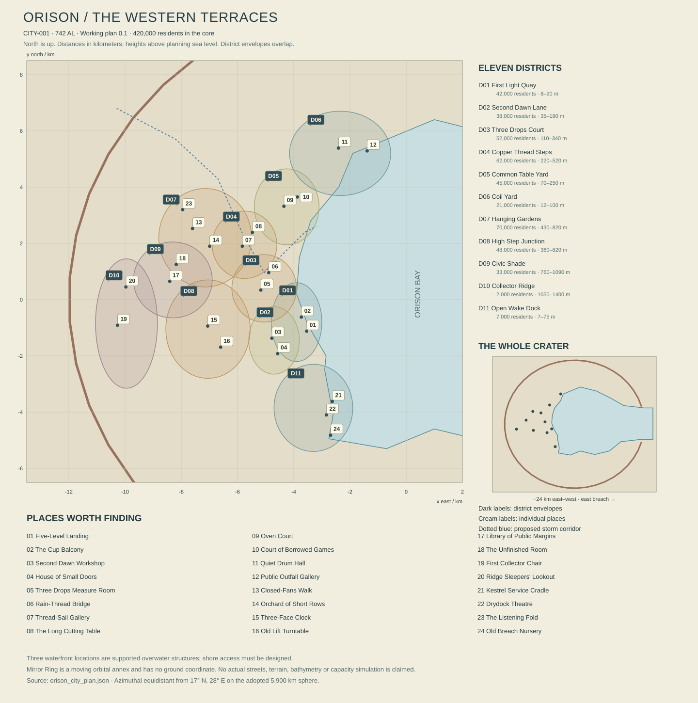

# Orison: the city inside the returning light

City bible, working edition 0.1, 13 October 2026. Orison is CITY-001 in the Saffron Escarpment, REG-001. This document establishes a coherent city plan, district character and twenty-four specific places. The companion [city plan](orison_city_plan.json) contains reproducible planning coordinates. It is an authored geographic proposal, not surveyed terrain, finished architecture, a service simulation or a constructed Unreal level. Existing First Light gameplay anchors are retained; their prototype coordinates are not silently promoted into this city survey.

Orison is beautiful because its parts fit together imperfectly. From the water, the western terraces rise in broad warm bands, interrupted by dark gardens, narrow glass roofs and copper conduits catching separate pieces of sky. Buildings occupy stable benches rather than forming a continuous fantasy cliff. A deep arcade can conceal an ordinary bedroom above it. A carefully balanced civic frontage has an inconvenient household addition on its roof. Indigo fabric moves in a different rhythm from the heavy collector wings beyond it.

The city has enough wealth to make beautiful public rooms and enough inequality to disagree about who can use them. Most residents are neither desperate nor powerful. They work, study, cook, rest, court, compete and complain. Rook's theft matters in this inhabited context. The skyline is meaningful because people have lives in it before a courier arrives.

## 1. A bowl with an open side

Open the [full-resolution plan](orison_city_plan.svg) or the [network and placement register](ORISON_NETWORK_CHECKS.md). The map is a planning illustration: exact points stay fixed, while numbered labels use short leaders for readability. Overlapping district envelopes describe administrative catchments, not continuous building footprints. The water register records a small pumped transfer from wastewater treatment to reuse processing as well as the regulated supply from Three Drops down to Common Table.

The ancient crater's surviving rim occupies an approximate ellipse **24 km east–west by 22 km north–south**. Its eastern side is deeply eroded and breached by the sea. The sheltered central water is a bay, connected through a broad navigable opening rather than a subterranean drain. The city concentrates on the western and northwestern inner terraces, with industrial and transport extensions along the north and southwest shores. Much of the rim is habitat, exposed ground or restricted infrastructure, not continuous housing.

The planning origin lies near the bay center at **17° N, 28° E**. The map uses an azimuthal equidistant local projection on the 5,900 km reference sphere: x increases east, y north. Coordinates and distances are meters. z records approximate altitude above planning mean sea level, not displacement above a flat tangent plane. A later terrain conversion must preserve that distinction; curvature across this city is small for a drawing but meaningful for precise world placement. Nothing here supplies a tidal datum or final vertical survey.

The western rim reaches roughly 1,300–1,550 m in the present plan. Surviving northern and southern rim segments are lower and interrupted. Useful terraces lie between sea level and about 1,050 m. Collector installations occupy selected higher benches. Artificial retaining structures support local steps, not the entire crater wall. Drainage channels, intact rock ribs and unbuilt slope breaks repeatedly separate neighborhoods.

**Low Tides** describes the harbor and lower urban fabric, mostly about 8–150 m. **Ladder** describes the interconnected residential, garden and transfer terraces, broadly 100–700 m. **Crown** describes higher civic and collector territory, broadly 850–1,350 m. Their ranges overlap. They are historical-spatial names, not three elevation-triggered costume changes or perfectly segregated classes. An expensive dock apartment and a modest Crown maintenance household are both ordinary possibilities.

### Shade that has a direction and a duration

Orison is not permanently dark. Its seasonal noon solar altitudes are approximately 59–87 degrees under the current planetary model. A 24 km crater with a roughly 1.3 km rim cannot hide that high star from the whole city. The east-breach waterfront receives ordinary natural dawn. The western rim removes late light from some inner slopes, while nearby walls, building canyons and terrace overhangs create more local shade. Different districts therefore experience different useful-light windows.

Illustrative horizon geometry uses the angle arctan(height difference / horizontal distance). A 1,000 m obstruction viewed from 15 km subtends about **3.8 degrees**. A 1,150 m height difference across 6.5 km subtends about **10 degrees**. A 500 m wall or near slope across 1.6 km subtends about **17.4 degrees**. These examples describe separate sightlines, not one universal skyline. Near-horizon solar motion of roughly 2.4–2.6 degrees per Earth hour would turn those angles into about 1.5, 4 and 7 hours of timing difference along a suitably aligned sightline. Actual delay depends on solar azimuth, season and the full horizon profile; the figures are illustrations, not a local sun simulation.

Collectors redirect available light to particular streets, workspaces and cultivation areas. Electrical lamps provide working light on other schedules. Stored energy and regional generation provide electricity and heat through the long natural night. The value of a lease is access, timing, quality and reliability, not a fictional monopoly on the existence of daylight. At natural midday, open plazas can be bright while a deep workshop remains dependent on its lighting service.

### Reading the city on approach

From the eastern sea approach, three forms make the city recognizable. The first is the low horizontal breakwater and the interrupted line of working cranes. Behind it, residential terraces form broad stepped crescents with dark slots where gullies pass through. Highest is the uneven western rim, with collector frames visibly distinct from occupied buildings. The Lantern Keeper belongs within the lower city's silhouette; it must remain a legible civic object without being inflated to mountain size.

From inland, Orison arrives differently. The traveler first sees ridge infrastructure and open ground, then glimpses the bay through a break between buildings. A descending tram reveals household roofs before waterfront monuments. From above, the seaward breach, western settlement crescent and north harbor works should identify the city without a UI marker. The orbital view must derive from the same coastline and terraces as the pedestrian view.

At the reference city position, Rauth lies at approximately **241.2 degrees azimuth**, measured clockwise from north, and **57.4 degrees elevation**: high toward the west-southwest. The open-bay panorama looks mainly east from the western terraces. These are distinct viewing directions. A composition must not place Rauth above the eastern breach merely to include both landmarks; a camera looking inland from the bay can instead combine the western city and the giant naturally.

## 2. How many people can live here

The working population is **420,000 in the built city**, within a **1.2 million-person service region**. The larger figure includes separate settlements and agricultural communities; it is not another 780,000 residents squeezed into unseen Orison interiors. These are fiction planning estimates, not runtime NPC requirements. Residents listed below belong to each district's administrative catchment, whose approximate drawing extents can overlap and are not legal parcels.

| District | Planning residents | Characteristic altitude | Principal role |
|---|---:|---:|---|
| First Light Quay | 42,000 | 8–90 m | Passenger harbor, markets and dense lower housing |
| Second Dawn Lane | 38,000 | 35–180 m | Repair trades and mixed domestic streets |
| Three Drops Court | 52,000 | 110–340 m | Water distribution, schools and courtyard homes |
| Copper Thread Steps | 62,000 | 220–520 m | Textiles, tailoring and residential terraces |
| Common Table Yard | 45,000 | 70–250 m | Public provisioning, markets and shared rooms |
| Coil Yard | 21,000 | 12–100 m | Industrial service and freight handling |
| Hanging Gardens | 70,000 | 430–820 m | Broad residential terraces and managed cultivation |
| High Step Junction | 48,000 | 360–820 m | Transport interchange, education and mixed housing |
| Civic Shade | 33,000 | 760–1,090 m | Civic services, libraries and residential courts |
| Collector Ridge | 2,000 | 1,050–1,400 m | Optical infrastructure and small service settlements |
| Open Wake Dock | 7,000 | 7–75 m | Independent vessel service and waterfront lodging |
| **Total** | **420,000** | | |

A transparent housing check assumes **2.6 residents per occupied dwelling**, approximately **161,540 occupied dwellings**, and approximately **176,000 total dwellings** at about 92% occupancy. At a mean 65 m² of internal dwelling area, the stock contains roughly 11.44 million m² of dwelling interiors. Allowing circulation and shared building space at a 75% net-to-gross ratio gives about 15.25 million m² of residential building floor area. At an illustrative 4.5 occupied storeys on average, that requires about 3.39 km² of residential building footprint.

Those figures do not prescribe identical apartments or buildings. Small rooms, large households, supported accommodation, shared houses and expensive generous homes contribute to the averages. The broad urban service envelope is provisionally **64 km²**, including slopes, streets, parks, industrial land and unbuilt drainage corridors. Residential footprints occupy only part of it; substantial terraces carry nonresidential buildings or no buildings. Density inside actual housing blocks is much higher than the envelope-wide average of about 6,560 people/km².

This arithmetic is a plausibility check, not a proof of housing sufficiency. The terrain plan must still fit useful plots, service access, daylight, evacuation routes, public space and construction geometry. A population number cannot justify rows of inaccessible facade boxes. A representative occupied block needs credible room depth, stairs, circulation, deliveries, waste handling and a route home for residents with different mobility needs.

## 3. The things arriving before breakfast

### Water follows the slope, but service does not happen automatically

The potable planning case uses **120 liters per resident per 24-hour civil turn** for domestic demand: 50,400 m³. Another 9,600 m³ covers defined public and commercial uses, giving 60,000 m³ of delivered potable water per turn. A notional 10% distribution-loss allowance implies about 66,700 m³ leaving treatment. A proposed 80,000 m³-per-turn treatment capacity provides operational margin; capacity is not the same as everyday consumption.

The principal raw supply comes from a western upland catchment and regional transfer system beyond the city plan. Seasonal local runoff supplements it after appropriate treatment. Desalination is a possible coastal backup, not a free source without energy, intake ecology and brine disposal. No exact river yield is invented here. The regional hydrology volume must demonstrate catchment, seasonal storage and drought coverage before these loads become a viable design.

The city contains approximately 2.4 million m³ of distributed treated or protected reserve capacity in this planning case, equivalent to forty civil turns of the 60,000 m³ delivered load before losses and inaccessible dead storage. The reserves are divided among upper storage, middle service chambers and lower operational tanks. They are not one giant underground lake that the Sunseed can open. A separate nonpotable system supplies cleaning, appropriate industrial uses and some irrigation, aiming to reuse roughly 25,000 m³ per turn from qualified treatment streams. Drinking water, stormwater and reused process water have distinguishable pipes, outlets and records.

Three Drops Court houses important distribution and measurement functions. It does not personally decide every household's water access. Gravity assists downhill movement, while pressure zoning, breaks, pumps and backflow protection prevent lower buildings receiving the full head of a mountain reservoir. Rain has visible routes: roof spouts to street channels, screened catchments to drains, flood corridors to protected outfalls. Clear water is not automatically drinking water.

Common Table Yard's potable branch, ORI-WL-006, comes from Three Drops distribution at approximately 260 m, through pressure regulation to its approximately 155 m service interchange. It does not rise unassisted from the 95 m lower storage node. Reliable supply depends on a maintained upstream hydraulic grade, functioning regulation and adequate capacity under demand; the 105 m elevation difference alone does not prove the pressure at a tap. The detailed hydraulic model must include pipe losses, operating water levels and the district's higher buildings.

### Food has a harbor, a store and a kitchen

The first freight model allows roughly **600–800 tonnes of edible product per civil turn** for the core city, with composition and actual nutrition to be checked in the provisioning volume. An illustrative dry grain-and-pulse component is about 230 tonnes per turn. Thirty turns of that component require about 6,900 tonnes of protected stock, distributed rather than piled under one market. Imported managed crops and food-production cultures provide complete nutrition; qualified native fractions provide particular ingredients.

Hanging Gardens and smaller urban growing sites are valuable but cannot feed 420,000 people by visual implication. A working target is roughly 5–12% of fresh edible product by mass, varying seasonally and excluding any claim to the same share of calories. Most staples arrive through regional agriculture, coastal freight and inland transport. The Nine-River Lowlands are an important connection, not the only supplier or a possession of Orison. Regional farmers have other customers and their own needs.

The later [productive-landscape study](../06b_PRODUCTIVE_LANDSCAPES.md) sizes the exchange ledger's 24-tonne urban fresh target at about 325 hectares of productive canopy under its explicit yield case. Its alternative lighting studies expose a 90 MW daylit or 158 MW four-layer mean fixture load, before environmental services. These are not automatically added to the city's adopted demand: crop mix, daylight access, actual growing systems and the 600 MW end-use account must be reconciled before the target is called supplied.

First Light Quay serves mixed passenger and market deliveries. Coil Yard handles large stores and service freight. Common Table Yard contains public kitchens, independent vendors and wholesale interfaces. Cold rooms, dry stores, preparation spaces and waste collection are distinct interiors. A beautiful stall is the visible front of a longer chain. Its cook may receive supplies before the player wakes, serve one busy interval, clean, close and go to a performance.

### Energy has several owners and several forms

For scale testing, the core city's ordinary average electrical demand is provisionally **600 MW**, including industry and public services, with a planning peak near **1,050 MW**. These are authored load targets needing end-use estimates. A provisional ordinary energy balance assigns 360 MW average to regional supply, 120 MW to local dispatchable plant and 120 MW annual average to variable sources. The variable figure is not firm output during the long night. Regional routes, fuel or other dispatchable feedstocks, cooling and maintenance remain explicit dependencies.

The capacity case allows a regional import limit around 720 MW, local dispatchable capacity around 200 MW and storage dispatch up to 300 MW. Proposed usable electrical storage totals 9 GWh across several installations. The longest nominal natural night is approximately 71.7 Earth hours before local terrain effects. A continuous 120 MW deficit over that interval requires 8.604 GWh, rounded upward to **8.61 GWh** for this planning allowance, before additional losses and reserve requirements. The earlier sixty-hour illustration requires 7.2 GWh, but it is not a full-night coverage case. A 9 GWh storage target therefore establishes no guarantee of coverage: available charge, power limits, conversion and distribution losses, protected reserves, failures and actual supply must all be evaluated.

Local thermal occurrences are observed within the fiction; an economically and environmentally usable electrical geothermal resource remains unproven. Reservoir temperature, sustainable flow, reinjection, drawdown and plant performance need qualification. Such a resource could reduce imports if established, but no verified geothermal electrical output is included in the present balance.

Heat recovery and thermal storage serve some buildings separately. Optical collectors provide illumination, not electricity by definition. Some devices combine photovoltaic and optical functions, but the engineering record must identify which is doing what. A controller cabinet can be essential to a service while containing almost none of its energy. This is the physical foundation of the Sunseed: permission and routing can matter enormously without becoming portable limitless power.

The existing clinic-versus-evacuation choice remains a bounded maintenance-window allocation involving an isolated feeder and available reserves. It does not black out half of the metropolis, permanently condemn a population or settle the city's entire energy constitution. Iona's competence concerns the clinic's infrastructure; Seli's work concerns care, evacuation and broadcasting; Venn connects navigation to relay access.

### Waste and freight are part of the view

Municipal solid waste provisionally averages around 0.8 kg per resident per civil turn, about 336 tonnes before commercial and industrial streams. This is a planning allowance, not a behavioral claim about every household. Reuse shops, material recovery, food residual handling and hazardous waste each need separate routes. An attractive reclamation yard can show sorted ceramic, reusable doors and useful metal without depicting untreated mixed waste as picturesque street decoration.

Wastewater treatment is sized separately from storm drainage and industrial chemistry. A first capacity target is 70,000 m³ per civil turn, to be reconciled with measured return fractions, infiltration and industrial contributions. Qualified reuse reduces some fresh demand. Residuals and brines require disposal paths that do not erase native coastal nurseries. Downstream sampling galleries and service boats give these obligations visible places.

The port's tentative gross freight range is **14,000–22,000 tonnes per civil turn**, including construction, industrial inputs, outward goods and regional redistribution. Only a fraction is food for the core population. Bulk sea movement, local freight rail and scheduled road deliveries remain useful even in a world with spacecraft. Air cargo handles selected valuable or time-sensitive loads. Public plazas are not permanently occupied by forklifts merely because a crate asset exists.

## 4. Moving through the inhabited bowl

The lower city has a shore tram, ferries, freight branches and ordinary streets. Two principal inclined passenger routes connect lower terraces to High Step Junction and Civic Shade. Short lifts bridge particular level changes; accessible routes combine ramps, lifts and nearly level galleries. There is no credible ramp directly climbing 1,000 m in one attractive alley. Higher streets follow contour benches, and vertical shortcuts supplement rather than replace the public network.

The **Shore Line** links Open Wake Dock, First Light Quay, Common Table Yard and Coil Yard. The **Ladder Line** joins First Light, Second Dawn, Three Drops, Copper Thread, Hanging Gardens and High Step through connected contour and inclined sections. The **Crown Line** links High Step to Civic Shade and a passenger terminus below Collector Ridge. The actual engineering may split these names among vehicles; the map records service continuity, not an impossible single tram negotiating every slope.

The ferry connections currently terminate at district interchange planning nodes, not at surveyed berths or vessel positions. Each requires a separate shore-access leg, accessible boarding arrangement and water-level berth location before navigation can be authored. The sea-approach node is a waterway reference; its connection to Open Wake also requires the unresolved berth and shore-access detail. Drawing a line between these points does not authorize a boat to travel through streets or stop at an elevated interchange.

Travel times must follow route geometry. A direct 1 km walk on an unobstructed level path differs from a 1 km map displacement involving 200 m of ascent. The first inhabited neighborhood circuit should be enjoyable on foot; crossing the whole urban envelope should make public transport or a vehicle attractive. A player can walk a long journey without the world pretending it takes five minutes. Passing through intermediate districts should provide changing views, signs, sounds and activities.

Freight has dedicated loading edges and transfer rooms. Deliveries to upper houses use small vehicles, lifts and porters as appropriate, not an endless stream of heavy trucks on ornamental stairs. Emergency access, maintenance access and household circulation share parts of the network but have different needs. A shortcut that requires climbing is an exploration opportunity, not the only means by which a resident reaches a clinic.

The Kestrel's normal city service access is at Open Wake Dock. Low-altitude approaches follow defined corridors away from dense public terraces. A boat in flight does not make every roof a safe landing pad. The eastern breach offers a recognizable departure corridor; ridge approaches require separate conditions and permissions. Noise, exhaust or downwash depend on the future vehicle model and must influence landing design.

## 5. Eleven districts with rooms behind their fronts

### ORI-D01 — First Light Quay

The quay is the city's public face, but it should feel like several working places rather than one monumental promenade. Low retaining walls meet deep arcades; warehouses have become shops without losing loading arches; inhabited upper floors sit behind layered shade. The Lantern Keeper rises from a civic landing beside the principal pedestrian approach. Its collector wings frame a view through to higher terraces, establishing a visual connection between a local gathering place and distant infrastructure.

The district descends from early freight landings and centuries of shoreline adjustment. Preserved dock levels record rebuilding episodes, not an invented Earthlike daily tide. The main passenger hall is spacious and straightforward. Around it, smaller courts contain luggage repair, inexpensive meals, waiting rooms, public toilets, household entrances and lodging. Some prosperous residents choose the noise and access; some crowded houses survive because their occupants have not found better rooms elsewhere.

A waterfront cafe can be pleasant at natural dawn even when a nearby deep arcade still needs scheduled light. Rain creates narrow reflected strips under awnings, while dry intervals reveal the pale stone's warmth. The ordinary sound is conversation mixed with rigging, tram movement and kitchen work. Along the seawall, quieter ledges provide distance from the crowd. Connections rise into Second Dawn and turn north toward Common Table Yard; a ferry offers another route without forcing every journey through the same gate.

### ORI-D02 — Second Dawn Lane

Second Dawn is a district of repaired things and people with interests beyond repairing them. Workshop fronts vary in depth and size. Heavy work occupies grounded masonry rooms with wide doors; light assembly and tailoring share upper timber-framed additions. Visible brackets, wet-season shutters and replaceable thresholds explain how the buildings last. The palette is warm plaster, worn timber, dark work surfaces, copper and less prestigious replacement alloys.

The lane's name refers to the infrastructure arrangements formalized in 248 AL, although buildings here predate and postdate those agreements. The surviving prototype workshop becomes one address within the larger district. Its repair bench, ordinary tools and handled objects belong to a person and a routine. Customers wait on a sheltered edge rather than standing in the machining zone. Behind the public room are stores, a washing point, stairs and somewhere a worker can sit without performing for visitors.

Domestic streets open sideways from the trade spine. A toy maker, a cafe with two competing crackle-fold recipes and an amateur music room give reasons to visit without broken equipment. Apprentices attend classes at High Step but live throughout the city. A household may oppose a Concession contract while depending on one member's maintenance wages. The physical connection to First Light is busy and direct; quieter stairs lead toward Three Drops. Roof access must belong to maintenance or household use before it becomes a traversal route.

### ORI-D03 — Three Drops Court

Three Drops occupies middle terraces where older water routes cross dense residential fabric. Its civic center contains measurement rooms, public taps and a carefully maintained covered court. Three distinct falling-water sounds give the place its local name in the present account: a display channel, a controlled overflow and a rain chain. They are not three magical springs supplying the whole city. During a dry interval, one or more can be silent for ordinary reasons.

Courtyard houses alternate solid walls with shaded openings. Deep sill seats, shared stairs, ceramic splash surfaces and differentiated pipe markings provide close detail. Schools, food rooms and neighborhood services occupy former technical buildings. A child can learn where a gutter leads, then spend the afternoon playing an unrelated card game. Basin Witness practice has a recognizable local office here without governing every resident's identity.

The district sits between multiple routes rather than at the center of all power. Second Dawn lies below and south; Copper Thread rises northward; a transfer passage reaches High Step. Water infrastructure uses its own service access, with pressure zones clearly separated. The strongest visual is a sequence of inhabited bridges crossing a narrow gully: laundry above, a public path midway, vegetation and a storm channel below. The gully must have a real outlet and maintenance reach. In rain, the city briefly makes its section audible.

### ORI-D04 — Copper Thread Steps

Copper Thread is known for textiles and clothing, with a substantial population doing other work. Long workshop windows illuminate cutting tables. Perforated screens produce moving patterns without covering every facade in identical ornament. Drying frames and shade textiles span selected courts, leaving clearance and emergency routes. The steps are not permanently carpeted in fabric for a picturesque screenshot; work appears, is handled and is brought in.

Some older houses belong to families associated with shuttlefan processing; many current workshops buy finished cloth from outside the city. Wet processing and its wastewater remain at suitable serviced locations, not dumped from every upper balcony. Domestic sewing, professional tailoring, commercial manufacture and theatrical costume each require different rooms. An expensive boutique can sit near a lending wardrobe and a plain repair stall without either being the more authentic expression of the district.

The 681–686 AL Copper Shortage is legible in substituted fittings and later preferences for mixed metal borders. New clothes also follow contemporary fashions such as off-center dress and pleat bloom. A public gallery displays work beside views of the bay. Steps rise toward Hanging Gardens, while contour walks connect Three Drops and High Step. Musicians use sheltered corners, but residents can object to late noise. Beauty includes the moment shutters close and the district becomes a series of inhabited windows rather than an exhibition.

### ORI-D05 — Common Table Yard

The Yard combines a major public provisioning address with a much larger mixed neighborhood. Its center is generous rather than ceremonial: open-sided shelters, durable broad tables, ovens, storage rooms, washing areas and room for people to pass without joining a queue. Kitchens have actual ventilation, preparation surfaces and separate delivery access. Staff have changing and rest rooms. A relief service should not require everybody working in it to remain permanently on display.

The district's institutions descend from household practice and municipal compacts, including the 113 AL reserve-kitchen history. Contemporary branches disagree about eligibility and funding, but most visits encounter ordinary meals and competent routine. Private vendors, household cooking and public provisioning coexist. The best bread here is not necessarily the free bread or the most expensive bread; residents argue through taste rather than ideology alone.

Courts beyond the main yard contain schools, a game room, compact gardens and apartments over shops. Some streets are broad enough for periodic markets, others quiet enough for someone reading at an open window. The building grammar favors warm masonry bases and repairable open shelter frames, with indigo concentrated where it actually shades. Lower connections meet the shore tram; the northern service route reaches Coil Yard. An upper walk gives a clear view of working port storage, making the meal's wider context visible without turning every dinner into a lecture.

### ORI-D06 — Coil Yard

Coil Yard is the industrial north harbor, where large objects can be received, inspected, dismantled and sent elsewhere. Its skyline uses grounded sheds, gantries, tanks and a few tall service structures. Residential streets occupy quieter edges and older absorbed plots. The district should have deliberate industrial beauty: repeated structural bays, painted identification fields, precise handrails, changing material stock and light entering a deep roof monitor.

Engineering history here crosses the Measure House tradition and the modern Concession without belonging wholly to either. Independent firms service compatible systems. Public laboratories can verify a claim. Trainees learn by watching work they are allowed to approach, with barriers around real hazards. Some interiors are clean and acoustically controlled; others loud and dusty. One universal rusty factory kit would erase the differences between assembly, testing, storage and waste handling.

Coil Yard has canteens, bathing rooms, music clubs, shops and ordinary homes. A worker can spend their leisure at a miniature-making table rather than continuing to discuss machinery. The shoreline includes protected ecological pockets and monitored outfalls. Their presence affects operations without requiring every facility to be a villain. Freight rail approaches from the north, with passenger links south to Common Table Yard. Small public viewing galleries show working processes safely. The city benefits from places where competence is worth watching.

### ORI-D07 — Hanging Gardens

The Gardens are Orison's largest residential district in this plan. The name refers to connected garden terraces, not seventy thousand people living inside suspended planters. Broad inhabited benches support apartment courts, schools, clinics, shops and cultivation areas. Local structures bridge gullies where engineering allows; most of the ground is firmly supported by rock and retaining works. Exposed edges reveal the thickness of those supports.

Managed introduced food crops occupy controlled plots with service access and appropriate light scheduling. Native display and habitat areas are separated where chemistry, treatment or species needs require it. A garden's visible lushness does not demonstrate universal edibility. Residents grow things for pleasure as well as yield. Some keep ornamental plants, some prefer a clear balcony and a chair, and some are exhausted by a neighbor's enthusiasm for gardening.

The architectural silhouette alternates long pale residential fronts with dark planting voids and small projecting rooms. Copper appears in water and service systems; indigo shading is selective. Terraces frame descending views across Copper Thread to the bay. A higher walk reaches Civic Shade, while High Step provides dependable connections for people who cannot or do not wish to climb. The district's pleasures include evening music, modest orchards under managed conditions and the seasonal posture of native fans seen from a sheltered seat. It should feel like somewhere people would choose to live, with real inconveniences alongside that desire.

### ORI-D08 — High Step Junction

High Step is the city's major middle-to-upper transfer district. Its central hall is a sequence of platforms and nearly level galleries fitted to the terrain, with inclined connections where necessary. The view through the hall reveals several elevations at once: a lower tram arriving, people crossing a broad landing, and higher windows catching direct light. Structural columns and retaining walls make those layers believable.

Transport created demand for schools, lodging, food and specialized services. Today students, commuters, residents and travelers mingle without every person carrying a suitcase. A technical college shares the district with a dance room, inexpensive cafes, family housing and a particularly well-used lending library. Public clocks show civil time and sky phase together. Their clarity belongs to practical design, not a mystical civic obsession with time.

Older lifts and turntables survive beside newer accessible routes. Some remain in service; others host displays or performances. The district should reveal replacement without turning every old machine into a ruin. A visitor can choose an efficient transfer or a slower route with a beautiful outlook. High Step joins Second Dawn, Three Drops, Copper Thread and Hanging Gardens through different approaches, and leads upward toward Civic Shade. Its principal risk is illegibility: too many decorative stairs would make a supposed transport hub feel like an obstacle course. Wayfinding, sightlines and useful landings are part of its visual quality.

### ORI-D09 — Civic Shade

Civic Shade contains administration, libraries, assembly rooms and homes. Its principal facades are calm and carefully maintained: thick pale walls, deep openings, inset copper frames, shaded galleries and modest water features with explicit supplies. Their authority comes partly from giving people somewhere dignified to wait. A public desk should not automatically resemble a military checkpoint.

The district's institutions carry traces of several settlements, including the 506 AL charter. Records here can support claims against the Concession as well as enforce its privileges. Historical layers appear in annexes, reused halls and signs explaining where a service moved. Public access and private work require distinct routes. A person arriving for a mundane certificate should be able to complete it without walking through a staged ideological confrontation.

Libraries, theaters, gardens and the Unfinished Assembly provide reasons to spend time here voluntarily. Wealthier households occupy some desirable addresses; modest service apartments and older retained homes complicate the picture. The bay view is magnificent, but exposed edges can be windy and upper routes inconvenient. High Step connects the district to everyday city life. Collector Ridge rises behind it, separated by open ground and service corridors rather than becoming a decorative roof extension. At night, windows and public paths form restrained points of light across large dark surfaces.

### ORI-D10 — Collector Ridge

Collector Ridge is an infrastructure landscape with a small resident population. Large optical frames occupy stable prepared benches with defined rotation envelopes, braking equipment, service paths and receiver sightlines. Their motion is slow enough to read as heavy work. The frames must not clip buildings or sweep concentrated light through public crowds merely to create spectacle. Where a collector is inactive, its parked position still expresses weight and purpose.

The first major installation dates to 231 AL. Surviving components are identified honestly; most operating equipment has been replaced or rebuilt. Staff houses, a canteen, a school annex and a public viewing room prevent the ridge becoming an empty machine level. Residents can love the view and be tired of the wind. Some maintain small domestic objects in surprisingly sheltered gardens; others spend leisure down in the city.

The ridge contains wild and recovering ground between installations. Access paths avoid fragile native crust and preserve drainage. A viewing walk uses safe sightlines without granting unrestricted access to every control cabinet. The Crown Line ends below the most exposed works, with staff transport beyond. Ordinary electricity and communications feed the optical machinery. A disabled collector does not extinguish Ilex. The place's emotional power comes from seeing immense devices provide limited, specific benefits to recognizable streets far below.

### ORI-D11 — Open Wake Dock

Open Wake Dock occupies the southwestern working shore. Its scale is intimate beside the main port: repair cradles, covered service slips, modest lodgings, crew kitchens and stores fitted between older quay structures. Independent boats vary in ownership and condition. A well-maintained vessel can have mismatched panels; a beautifully painted one can need work. The district should not communicate freedom solely through disorder.

Kestrel's recurring service cradle gives the player a home address while leaving space for neighboring crews with their own plans. A departure board includes ordinary errands, scheduled freight and a trip postponed because someone has chosen to stay for a celebration. Public access stops before hazardous lifting and flight zones. A visitor can still watch maintenance from a safe edge and understand where tools, parts and people come from.

The district's tradition joins rescue obligations, commercial work and personal voyages. Some rooms are temporary homes; others belong to people who have not gone anywhere for years and like it that way. A small drydock becomes a performance space when its work schedule permits. Shore transport connects First Light, while a contour route reaches Second Dawn. The southern edge meets a quiet native nursery and older breach-side rock. Departure and stillness should be neighboring experiences: a ship leaving overhead, a resident eating slowly, small organisms continuing beneath a quay.

## 6. Twenty-four places worth entering

The following dossiers use stable proposed IDs **ORI-POI-001–024**. Positions are authored planning points in the companion map. Each has an independent reason to exist, a visible clue, something the visitor can do, a return condition and concrete production needs. They are not twenty-four compulsory quests or a claim that the entire city's POI population is complete.

### ORI-POI-001 — Five-Level Landing

**First Light Quay; (-3,540, -1,120, 16 m).** Five surviving working levels step down through a landing repeatedly altered as shore works, vessels and cargo practices changed. They do not represent five fixed tidal stages. Different stones, redundant mooring points and a stair that now ends above a roof reveal the sequence. An upper public deck remains busy with passengers while a lower service edge receives small deliveries.

Landing coordinator **Pera Lott** is concerned with keeping arrivals legible, finding seats for tired people and avoiding collisions between luggage and food carts. The player can read the old marks, helpfully yield space, ask about a route or take a ferry. A narrow side gallery offers a quiet view of the same activity. Nothing requires a smuggling discovery to justify entering it.

Return visits change with passenger schedules, weather and ordinary maintenance. A temporarily closed level gains a posted alternative; it does not erase the whole landing. A resident previously waiting can later be the person welcoming somebody else. Production needs stepped quay masonry with distinct repair phases, readable level plaques, mooring hardware, freight handcarts, seating, a sheltered ticket room and water contact detail appropriate to each elevation.

### ORI-POI-002 — The Cup Balcony

**First Light Quay; (-3,730, -620, 42 m).** A small cafe projects from an inhabited arcade above the harbor route. Its narrow balcony is angled toward a gap between the Lantern Keeper's wings and the higher terraces. The view changes as cloth moves and people pass below. Cups are plain, mismatched and carefully clean; the room's beauty lies in the precise fit between a deep shade edge and a bright view.

Owner **Meli Voss** opens around two local commuter peaks and closes for a rest between them. She likes customers who notice the music and does not require them to talk. The player can sit, eat, overhear a harmless discussion or find a route landmark from above. A lower-backed seat and a clear approach provide the same view to a seated visitor.

On return, the menu, listeners and light vary while the familiar room persists. A good cup is not a consumable stat upgrade by default. Asset needs include a structurally supported balcony, useful door clearance, mixed cups, small plates, adjustable shade, weathered railing contacts, a compact preparation interior and a restrained layered harbor soundscape. The vista must match the actual city plan.

### ORI-POI-003 — Second Dawn Workshop

**Second Dawn Lane; (-4,780, -1,370, 92 m).** This is the city-scale address of the existing workshop anchor. A deep public room opens beneath an arcade, with a grounded heavy bench, reachable tool storage and a separate clean surface for delicate work. Ordinary cells, lamps and housings remain visibly distinct from the Sunseed. A returned item carries a repair tag rather than appearing as anonymous collectible clutter.

The resident repairer has customers, invoices, lessons and an after-work life. Iona can use the workshop through established professional relationships without becoming its permanent proprietor. Visitors may inspect a demonstration, discuss a repair, handle permitted ordinary objects or notice a service path connecting the lane to a higher landing. Private cupboards remain private even when an object is physically movable.

Returns reveal completed jobs, a changed work arrangement, a cleaned bench or a closed shutter during rest. Prior player actions can alter a specific relationship without freezing normal business. Production preserves qualified existing bench and prop work, adds believable rear storage, wash point, household stair and delivery access, and reviews every placement against use. Detail concentrates on joints, tool contact, labels and functional reach rather than uniform surface grime.

### ORI-POI-004 — House of Small Doors

**Second Dawn Lane; (-4,570, -1,920, 68 m).** A toy maker has filled one shop wall with miniature doors. Each opens differently: a sliding panel, a carefully counterweighted hatch, a tiny pair of curtains, a deliberately overcomplicated ceremonial entrance. An old full-sized pressure doorway frames the shop, providing a quiet visual rhyme between arrival-era hardware and playful craft.

Maker **Ressa Nim** develops new pieces with a group of neighbors who test whether the mechanisms are satisfying to use. Some customers buy toys; others simply enjoy the display. The player can try permitted samples, ask which design is new or watch a child teach an adult how a latch works. The shop is not secretly an archive of access codes.

On a return visit, a mechanism the group disliked may have been revised, while familiar favorites remain. One miniature can be displayed in an upper home the player later visits, connecting places through affection rather than a quest chain. Assets include distinct tactile door mechanisms, a waist-height and lower test surface, fine cutting tools, packaging, illustrated instructions and a real domestic back room. Mechanical behavior should be limited to deliberate hero samples instead of simulating every tiny hinge.

### ORI-POI-005 — Three Drops Measure Room

**Three Drops Court; (-5,170, 340, 225 m).** The measure room sits where several historic distribution routes meet. Its public face has three small observation windows showing distinct flows; the working interior contains instruments, sample storage and a table where records can be compared. Pipe colors and labels distinguish potable, reused and display water. A visitor should learn that visually similar water can belong to different systems.

**Mara Dess**, the basin witness from the societies foundation, works here among other staff. Her purpose includes routine measurement and teaching, not perpetual investigation. A visitor can follow a public explanation, compare a historical mark with a current reading or ask why one display is silent. Specific evidence can later matter in a leak dispute, but the room remains useful when nothing is wrong.

Return conditions include scheduled sampling, maintenance and seasonal supply changes. Findings update with identified evidence rather than instantly reflecting distant events. Production needs serviceable instruments, separate sample vessels, legible charts, public and staff circulation, dampness tied to actual outlets, a sheltered queue edge and a downstream sightline. Water motion must correspond to the represented route; decorative waterfalls cannot substitute for a distribution diagram.

### ORI-POI-006 — Rain-Thread Bridge

**Three Drops Court; (-4,890, 960, 260 m).** An inhabited bridge crosses a narrow storm gully. Its houses are modest and individually altered, while the main support and drainage path remain readable. During rain, roof chains produce several fine curtains beside the public walkway. In dry weather, the same chains hang quietly over worn basins. The structure is attractive in both states.

Residents use the bridge as an address, a route and a place to stop briefly. A school caretaker tends a small public notice frame; an older resident grows herbs in a protected box. The player can cross, look into the gully from a safe recess, identify the outlet or hear the changing rain sounds. Household windows do not obligingly expose private interiors for tourism.

A later visit may show repaired planting, a different notice or a storm channel carrying debris after weather upstream. Serious overflow requires a specific event, not random spectacle on every crossing. Assets include a plausible bridge load path, varied inhabited infill, chain drains, screened inlets, vegetation appropriate to runoff, maintenance access and safe resting recesses. The lower channel must connect to the water network in the map rather than end behind scenery.

### ORI-POI-007 — Thread-Sail Gallery

**Copper Thread Steps; (-5,830, 1,900, 390 m).** A public gallery displays large textile experiments in a tall, narrow court. Adjustable frames hold cloth at different tensions, allowing visitors to see opacity, movement and shadow. The view through the upper opening includes garden terraces rather than an unrelated painted skyline. Some exhibits are practical shade studies; others exist because the maker likes the shape.

Curator **Tavi Renn** plans a rotating program with apprentices, established designers and household sewing groups. A visitor can move along several viewing heights, read a concise maker note, sketch or attend an evening presentation. One low viewing bay gives a particularly good silhouette against the sky. The player need not acquire a rare fabric to make the exhibition happen.

On return, the frames can contain new work or be empty during installation. An earlier piece may reappear as a shade at another civic address, with its maker credited. Production needs reusable but adjustable frames, a small number of distinct cloth forms, credible suspension, safe clearances, a preparation room, folded storage and carefully authored shadow behavior. The institution's point is to make differences visible, so every exhibit must not use the same cloth mesh and texture.

### ORI-POI-008 — The Long Cutting Table

**Copper Thread Steps; (-5,470, 2,390, 350 m).** Several independent tailors share a long, well-lit cutting room while maintaining separate clients and methods. The table has replaceable top panels, marked working zones and movable task lights. Garments in progress differ from display clothes. A window seat lets a customer wait without standing among sharp tools.

The room's ordinary pleasure is competent attention. A customer tries a pleat-bloom sleeve while a maker checks how it falls when seated and moving. Another tailor works on plain durable trousers with equal care. The player can observe, request an alteration, discuss an exhibited pattern or recognize an off-center design seen earlier in Serein. No argument over ownership is required to give the shared room character.

A return can reveal a finished garment on a known resident, a new apprentice or a rearranged cutting zone. Appointments and working hours matter. Assets include differentiated cutting and fitting tools, patterns with meaningful markings, several garment states, adjustable mirrors, accessible fitting space, usable storage and domestic-scale refreshments. The table needs convincing reach and circulation. An enormous slab covered in repeated scissors would not communicate actual tailoring.

### ORI-POI-009 — Oven Court

**Common Table Yard; (-4,350, 3,320, 160 m).** The oven court combines public cooking capacity with a pleasant sheltered eating space. Heavy masonry ovens sit behind a clear preparation edge; broad doors lead to stores and washing rooms. The dining side uses smaller groups of tables rather than one endless ceremonial banquet. A person can join friends, eat alone or take food away.

The cooks plan ordinary meals and reserve capacity. One likes a strongly browned loaf, another a softer finish. Their disagreement entertains regulars without threatening anybody's livelihood. The player can eat, watch a safe public demonstration, leave a vessel for washing or learn where particular ingredients arrived from. Food availability follows the provisioning model, not the player's contribution score.

On return, menus and staff change, while the institution's dependable rhythms remain. During a named disruption the court may expand service; after recovery it returns to ordinary use rather than keeping emergency banners forever. Assets include functioning spatial separation of raw preparation and serving, ovens with maintenance access, varied reusable vessels, protected stores, staff rooms, waste sorting and comfortable seats. Steam, heat shimmer and sound should arise from specific processes at plausible intensity.

### ORI-POI-010 — Court of Borrowed Games

**Common Table Yard; (-3,870, 3,650, 115 m).** A shaded court holds Latch tables, illustrated card sets and a small ribbon-course space marked on the paving. Equipment can be borrowed from a staffed cupboard. The room is public but not empty of rules: tables have time limits when busy, and noisy play yields to scheduled quiet sessions.

Regular **Jalen Orr** cares deeply about keeping the discs smooth and not very much about winning. Two friends maintain an elaborate record of games neither remembers accurately. Visitors can watch, join a willing group or sit beside the activity. A table's release aid is ordinary equipment, not a special performance of inclusion. Some people arrive only to talk while somebody else plays.

Returns reveal different groups, revised house rules or a new illustrated deck. A recognized player may be invited back without acquiring an obligation. No champion guards the only meaningful reward. Assets include correctly scaled game furniture, readable rules, varied seating, shaded spectator edges, equipment storage and a nearby wash point. The space should retain visual interest while unoccupied through wear patterns, arrangement and the view to neighboring homes, rather than relying entirely on crowd density.

### ORI-POI-011 — Quiet Drum Hall

**Coil Yard; (-2,410, 5,390, 31 m).** The hall tests rotating housings and other precision assemblies inside isolated work bays. From a public gallery, visitors see a large drum apparently doing very little while instruments show the test's progress. The quiet contrasts with the heavier yard outside. A sectioned retired assembly explains what is concealed by an ordinary smooth casing.

Technician **Sova Pell** uses the facility for independent qualification when appropriate, alongside firms with different resources. Staff care about repeatable results and leaving the work area in order. A visitor can attend a demonstration, compare a tested component with a decorative imitation or follow the route a part takes from receipt to dispatch. Later stories may use these records, but ordinary competence is sufficient reason to visit.

On return, another assembly occupies the bay, a test is paused for adjustment or the gallery hosts students. A failed test is not automatically a scandal. Assets include an acoustically distinct interior, isolated foundations, lifting clearances, instruments, sample racks, a viewing barrier and a convincing sectioned hero object. Sound design should communicate controlled vibration without bathing every scene in an undifferentiated industrial roar.

### ORI-POI-012 — Public Outfall Gallery

**Coil Yard; (-1,390, 5,290, 14 m).** A narrow gallery extends over a serviced coastal edge near a monitored outlet. Its point is to make an otherwise hidden relationship observable. Visitors can compare flow records, see sample points and look toward native habitat outside the working discharge zone. The structure stands on explicit supports; its planning point is over water rather than an accidental house in the bay.

An ecology class visits regularly. Staff explain why clear appearance alone does not establish safe chemistry and why a harmless-looking film may be biologically active. The player can observe native feeding at a permitted distance, read a recent report or simply use the sheltered view. No specimen needs collecting for the visit to count.

Return visits respond to tide, flow, season and actual industrial operation. A maintenance closure has a reason and a safe alternative viewpoint. If a future event damages habitat, recovery must be visible over appropriate time rather than restored by one interaction. Assets include supported deck modules, guarded sample access, replaceable interpretation panels, specific outfall geometry, native shoreline assemblies and a carefully bounded water surface. The gallery must not imply that the whole harbor shares one uniform ecological condition.

### ORI-POI-013 — Closed-Fans Walk

**Hanging Gardens; (-7,600, 2,530, 705 m).** A sheltered public path follows a managed native planting whose fans change posture with conditions. The route lets visitors see overlapping stages from one place: exposed plants, shaded plants and younger growth near a protected wall. The planting does not perform one synchronized mechanical animation at sunset.

Caretaker **Eda Vey** coordinates this display with cultivation work elsewhere, while neighbors use the path as an ordinary short walk. Benches offer different views and levels of exposure. The player can notice which fans moved first, compare a simple observation board or hear the soft changes in wind through the forms. A child drawing the same plant inaccurately can be as much part of the place as an expert observer.

Returning under different weather or sky phase reveals real differences, but some visits look reassuringly familiar. The plants are not loot containers. Assets require several growth stages and posture states, plausible roots and soil boundaries, fallen material appropriate to the ecology, irrigation where needed, benches and a sheltered maintenance entrance. Lighting should let the anatomy read without making every leaf luminous. The distant city below provides scale while remaining geographically consistent.

### ORI-POI-014 — Orchard of Short Rows

**Hanging Gardens; (-6,990, 1,900, 585 m).** This small managed orchard is a neighborhood pleasure and teaching site, not the city's hidden food solution. Introduced fruit stocks grow in controlled soil and appropriate shelter, with cultivation requirements to be detailed in the agricultural register. Short rows preserve access and views. A plain service room holds tools, records and a place to wash hands.

Residents arrange tasting days when harvest allows. Some know the plants intimately; others enjoy sitting nearby and never volunteer to prune. The player can attend a tasting, identify an adopted tree on a household photograph or take a public path through the site. Buying a jar does not transfer ownership of a living plant or require an inventory system now.

Returns follow growth, maintenance and harvest seasons. Outside fruiting periods, the place still offers structure, shade or open views. A tree replacement appears as a young tree with a recorded history, not an instant mature clone. Assets include a deliberately limited introduced orchard set, training supports, ground treatment, distinct native planting boundaries, harvest containers, a work shed and seating. The orchard's modest extent should be apparent in aerial views; it cannot expand visually to imply planetary agricultural sufficiency.

### ORI-POI-015 — Three-Face Clock

**High Step Junction; (-7,060, -940, 590 m).** A clear public clock at the transfer hall shows civil time, local sky phase and imminent departures on separate readable faces. The design prevents those categories becoming one mysterious dial. Its casing is a civic object with a restrained copper edge, service panels and a base people use as a meeting landmark without obstructing circulation.

Station host **Neri Pell** spends more time giving ordinary directions than explaining philosophy. Travelers wait, recognize friends and occasionally meet at the wrong side of the clock. The player can use it to understand a departure, choose a scenic slower route or notice that an appointment refers to a civil turn rather than sunrise. A mistake can be funny without portraying residents as incapable of their own time system.

On return, departures and people change while the clock remains dependable. Maintenance replaces one face temporarily with a simple readable board, preserving function. Assets include legible typography, distinct information fields, varied waiting positions, a maintenance hatch and sightlines from every arriving platform. A beautiful but unreadable animated symbol would fail the place's purpose. The clock must agree with the eventual calendar and transport state, not improvise independent time.

### ORI-POI-016 — Old Lift Turntable

**High Step Junction; (-6,600, -1,690, 470 m).** A retired freight transfer mechanism occupies a broad intermediate landing. Its rails and turning bed show how cargo once changed direction between two routes. The current passenger path passes beside it, accessible without climbing over machinery. A small display identifies which parts survive and which were replaced for safety.

Local teacher **Iven Rell** sometimes brings a group to compare old and new route diagrams. Amateur performers also use the circular platform during scheduled events. The player can trace a former rail line, watch a rehearsal or follow a public side passage that offers a useful alternative view. The old mechanism is not secretly the only functioning route to the upper city.

Returning can reveal a performance, a quiet empty platform or a maintenance inspection. Historical interpretation changes only when evidence changes; an event poster is allowed to be temporary. Assets include accurate transfer geometry, retained rail fragments, safe edges, removable stage fittings, readable route diagrams and an adjacent storage room. Weathering should distinguish abandoned movement surfaces from places still touched and cleaned daily. The site demonstrates adaptive reuse without pretending that every machine remains operational forever.

### ORI-POI-017 — Library of Public Margins

**Civic Shade; (-8,410, 650, 980 m).** The library keeps public documents alongside literature, illustrated histories, music and ordinary lending stock. Its name comes from annotated copies through which generations of readers argued with official accounts. A high entrance leads to quieter rooms arranged around a sheltered court. Windows frame pieces of the city rather than one uninterrupted luxury panorama.

Archivist **Perren Ash** works with contextual records here as well as external testimony networks. Their colleagues include a children's librarian and a reader who specializes in popular serial fiction. The player can investigate a document, attend a reading, compare a map or simply find a comfortable seat. Access to intimate records follows actual restrictions; entering a public library does not authorize exposure of everybody's life.

Return visits show new displays, changed reservations, familiar readers and occasional corrections attached to older material. A published correction remains beside the original instead of deleting its history. Assets include several kinds of storage, accessible desks, quiet and active rooms, meaningful shelf labels, public catalog furniture and believable staff spaces. Books and records need varied purpose and wear. The library should feel usable even when no central mystery points toward it.

### ORI-POI-018 — The Unfinished Room

**Civic Shade; (-8,180, 1,250, 950 m).** An Assembly house contains a public room with an intentionally unoccupied place, a small kitchen and quieter adjoining spaces. The empty place may be a chair or a sheltered recess depending on the meeting. It signifies acknowledged absence and incomplete knowledge; it is not an active portal, a guaranteed communication with the dead or a copied sacred image.

Caretaker **Dema Orrel** hosts discussions, celebrations, meals and some funerals. A visitor can attend a public gathering, sit quietly or help arrange chairs when invited. Some participants understand the practice religiously; others do not. The room can contain disagreement without making every visit a debate about belief. Its most common sound may be people enjoying one another's company after the formal event ends.

Return visits follow a published local program. A private ceremony has a respectful boundary and an alternative public room. Assets include adaptable seating, several exits, a quiet alcove, domestic kitchen detail, discreet storage and light that can be adjusted without theatrical effects. The space must work for people who hear, see, move and socialize differently. Its dignity comes from consideration and proportion rather than monumental scale.

### ORI-POI-019 — First Collector Chair

**Collector Ridge; (-10,270, -910, 1,370 m).** The chair is the retained support foundation associated with Orison's first major collector of 231 AL. Much of the operating assembly is later work. A carefully bounded public view reveals old masonry, successive fixing patterns and the contemporary articulated frame beyond. Labels separate surviving evidence from reconstruction instead of calling every polished bolt ancient.

Maintainer **Hel Soren** leads occasional visits when operations permit. Their purpose is accurate explanation, safe service and getting home on time. The player can compare the installation's receiver line with a visible terrace below, inspect a retired joint or understand why the collector parks in a particular position. The dramatic object provides a specific service; it does not illuminate the entire planet.

Return visits show operating, parked or maintenance states tied to conditions and scheduling. An inactive frame can be beautiful against an open sky. Assets require a convincing anchorage, articulation and brake geometry, service clearances, separate public access, a retired component display and a clear distant receiver target. Any simulated beam must respect occlusion and safe operation. A giant moving ornament without those relationships would weaken the premise it is meant to express.

### ORI-POI-020 — Ridge Sleepers' Lookout

**Collector Ridge; (-9,970, 450, 1,305 m).** A modest sheltered lookout faces away from the busiest optical works. Its reclining seats began as a place for off-duty staff to rest and now serve a wider public during permitted hours. East-facing seats look over the bay; a separate west-southwest-facing group looks toward Rauth, near the city's reference azimuth of 241.2 degrees and elevation of 57.4 degrees. The giant does not move to combine both views in one convenient composition.

An astronomy club meets here, but many visitors know little about astronomy and simply like the space. A resident brings long-room music at a level the group agrees on. The player can observe the city, hear a concise explanation, lie back or leave without receiving a research assignment. Clear weather is welcome, not guaranteed.

On return, cloud can hide the distant view while making the nearer rim more dramatic. During suitable dark intervals, restrained local lighting preserves comfort and visibility without pretending that all surrounding infrastructure vanishes. Assets include weather shelters, adjustable or varied seating, safe edges, limited interpretation, wind-responsive small details and a physically consistent sky. The scene should remain rewarding without fireworks, rare loot or an astronomical event scheduled exclusively for the player.

### ORI-POI-021 — Kestrel Service Cradle

**Open Wake Dock; (-2,630, -3,620, 13 m).** The cradle is Kestrel's recurring Orison service address. Its asymmetrical boat fits a specific arrangement of supports, access and clearances. A visitor can see where cargo arrives, where a mechanic reaches the hull and how crew enter safely. Adjacent boats have different fittings; the whole dock is not a row of identical player ships.

The local service team has bookings beyond Rook's vessel. Venn's navigation relationships, Iona's technical work and Seli's care commitments connect the boat to the city without requiring them to stand permanently at assigned stations. The player can return home, inspect a repair, speak to a willing crew member or watch another vessel depart. Borrowed equipment has an owner and a return place.

Returns reveal work completed, a neighbor's absence, new supplies or a changed crew conversation. Kestrel retains persistent custody and condition through eventual implementations; prose alone does not verify those systems. Assets include an original compatible cradle, actual support paths, docking hardware, cargo handling space, shore services, safe public barriers and ordinary crew belongings. The ship's silhouette must remain distinct from premade scenery and legible against both water and workshop roofs.

### ORI-POI-022 — Drydock Theatre

**Open Wake Dock; (-2,840, -4,100, 18 m).** A small retired service basin hosts performances under removable weather cover. The old work edges provide seating after careful adaptation; the stage uses a broad level platform with safe backstage access. Marks of former vessel work remain visible, but the space is maintained as a theater rather than left dangerously picturesque.

The local company performs comedy, music and occasional visiting programs. Their immediate concerns include timing, costumes and whether the cafe has made enough food. The player can watch, choose an opt-in audience card during The First Wrong House or hear a rehearsal from outside. A performance can be good without revealing concealed political evidence afterward.

On return, the basin may hold a different show, an open rehearsal or a quiet cleaning shift. Posters identify dates and duration in the common civil system. Assets include adapted drydock geometry, removable seating and cover, accessible sightlines, caption positions, backstage storage, changing rooms and a cafe edge. Acoustics must distinguish the basin from a generic indoor stage. Crowds should have room to enter, leave and pause without turning the only exit into scenery.

### ORI-POI-023 — The Listening Fold

**Hanging Gardens edge; (-7,950, 3,200, 805 m).** A rock fold beside a public upper path creates a sheltered pocket with an unusual sound relationship to the city below. Under some wind conditions, fragments of harbor activity arrive clearly; under others, nearby leaves and footsteps dominate. This is a local acoustic proposal to test against final geometry, not a promise of perfect long-distance listening in all weather.

Residents value the place for different reasons. One practices drawing, another rests after walking, and a pair of friends meets there because neither has a large home. The player can stop, compare the view with the sounds or notice a changing cloud edge crossing distant terraces. The site needs no named official guardian and no hidden mechanism to justify its existence.

Returning may offer a different sound balance, new plant growth or the same familiar quiet. A bench can be occupied without the occupants becoming quest givers. Assets are restrained: convincing exposed rock structure, native planting suited to the pocket, drainage, a supported path edge and a few carefully placed seats. The city vista, sound propagation and weather response carry more importance than adding decorative clutter or a monument.

### ORI-POI-024 — Old Breach Nursery

**Open Wake Dock southern edge; (-2,690, -4,820, 8 m).** A sheltered coastal pocket preserves native nursery habitat beside older breach-side rock. The public observation deck projects a short distance above water on visible supports. Its lower surfaces and nearby roots host life adapted to changing salinity and flow. Human access remains on the deck and marked path rather than inviting visitors to trample a living margin.

A local observation group records rillcombs, basinbell structures and other approved assemblage members where their habitat contracts permit. The native organisms have feeding and reproductive purposes independent of visitors. The player can watch, sketch, compare a dated observation card or notice how the busy dock sounds diminish around the bend. Nobody needs to capture a creature to prove the visit occurred.

Return conditions follow water movement, season and ecological history. Absence can be ordinary; a future disturbance requires evidence before blame or intervention. Assets include precise shallow-water geometry, supported viewing structure, native life at several scales, debris appropriate to flow, public guidance and a maintenance approach. The final ecology pass must verify salinity ranges and species coexistence here. This is a specific habitat, not a universal assortment of every attractive creature in the catalog.

## 7. Mirror Ring: an orbital annex with its own frame

Mirror Ring is associated with Orison through ownership, work, family and service history. It is not a twelfth ground district placed above Collector Ridge on a static x/y map. The first service annex was commissioned in **318 AL**. Rebuilds have changed much of its hardware while preserving its name and obligations. Its exact moving orbit, attitude, illumination windows and traffic rules require the orbital engineering volume.

The architectural language uses pressure shells, maintenance frames, protected transfer routes and visible isolation boundaries. A public or crew-facing interior should feel inhabited: a shared meal room, personal storage, a quiet berth, a notice about a performance missed on the surface. Utility equipment occupies service spaces sized for actual access. Windows show the world according to orbital position, not a permanent postcard of Orison below.

Optical work and relay services form part of the annex's purpose; electrical supply, thermal rejection, stationkeeping and life support remain separate. A low-orbit reflector cannot illuminate a deep-night receiver while itself hidden in the world's shadow. Passes, geometries and alternate services determine what is available. Sunseed authorization can affect a bounded interface without granting command of every orbital asset.

Travel to the Ring must preserve cargo, custody, people and knowledge across frames. The current prototype's direct flight does not prove a physically scaled orbital transfer. The future experience can make transfer intelligible and exciting while recording any compression explicitly. Arrival should reveal a different kind of domestic place, not merely a combat corridor with a planet outside.

The companion JSON records the Ring as `ORI-ORB-01`, with `local_xyz_m` absent and an explicit unresolved orbital specification. Its city relationship is a service connection, not a falsely measured straight line. Later orbital POIs need their own stable identities and coordinates. None of the twenty-four ground dossiers silently consumes that work.

## 8. Production interpretation and city acceptance

Orison requires reusable architectural families with actual differences in construction: quay retaining masonry, deep arcades, framed domestic additions, civic castwork, industrial bays and pressure-related service components. Repetition should express shared manufacture and skill. District identity comes from arrangement, section, use and material history, not a new texture palette applied to the same street everywhere.

The 4,200-entry asset catalog remains a source of stable planned requirements. This document does not rename those assets or count each placement as new geometry. Map POI needs to existing families first, then record real gaps. Hero work includes the Lantern Keeper, selected collector mechanisms, Kestrel's original cradle, distinctive game furniture and a few tactile domestic objects. Premade assets can support background and ordinary construction after adaptation and qualification; none can establish the original city silhouette on its own.

Weathering follows exposure and use. Salt contact differs from dry upper masonry. A threshold is polished where people cross it; a protected underside need not receive the same black dirt as an outlet. Rain produces runoff, wetness and changing sound along authored paths. It must not flood every courtyard with identical puddles. Native vegetation follows habitat and management, while introduced ornamental or food plants have their own needs.

The first city coherence review should trace four complete journeys: a household returning from First Light to Hanging Gardens; a food delivery from Coil Yard to Oven Court; water from upper storage through Three Drops to a lower tap and treatment; and Kestrel's arrival, service and departure. Review the same journeys in dry daylight, rain, a natural dark interval and a changed local service schedule. Those are future observable checks, not results claimed here.

At pedestrian scale, examine a complete building front, entrance, back room and service route. At district scale, examine readable vertical connections and a functioning public address. At city scale, compare the harbor, ridge and orbital views against one geometry. Inspect natural horizon profiles before authoring collector benefits. Verify population and service assumptions against the actual plotted terrain rather than allowing prose to rescue an impossible plan.

Still outstanding are surveyed elevation and bathymetry, final district boundaries, regional hydrological yield, detailed energy end uses and firm-supply contracts, full language and signage, ecological range qualification, street-by-street interiors, the full population's institutions, further POIs and actual construction. This edition establishes a deep coherent starting city specification. It does not claim those remaining tasks are finished or that writing has achieved the requested visual benchmark.
