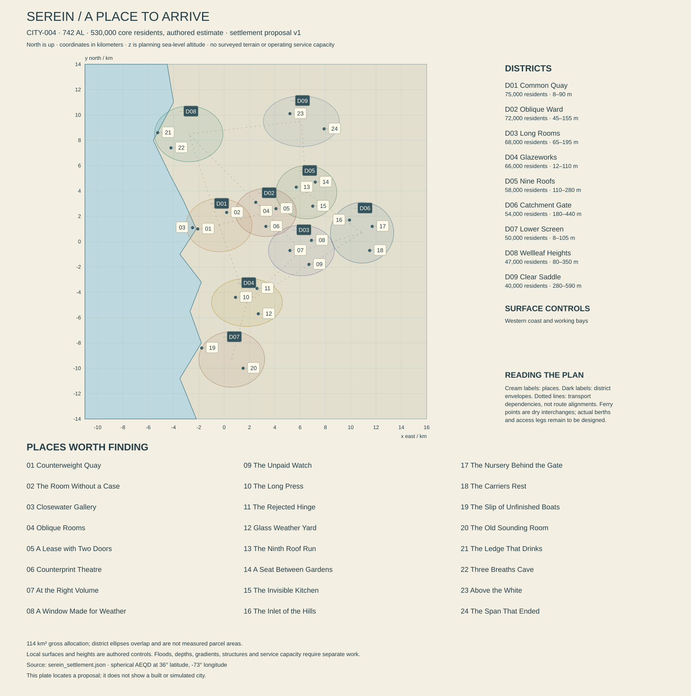

# Serein — the room beyond the weather

Working city proposal, edition 0.1, 13 October 2026. **CITY-004, REG-006**, at the unchanged atlas anchor **36° N, 73° W**. The resident estimate is **530,000** in **742 AL**. [The settlement record](serein_settlement.json) maps nine districts and twenty-four places using spherical azimuthal equidistant meters about that anchor, radius 5,900,000 m. New local institutions, dates and biographies below are authorial proposals. Existing history, regional ecology, Tam Arel's lounge and Neris Vale's window commission are retained. This is a design dossier, not a surveyed, supplied or constructed city.

[Settlement geometry and account checks](SEREIN_SETTLEMENT_CHECKS.md) document the authored relationships tested by the shared checker. The plate is a planning map, not surveyed terrain.

## 1. The pleasure of seeing a place appear

A crane emerges first: not its feet or the object it carries, only a long moving arm above pale roofs. Then a cleared interval reveals the rest of the harbor. A whole building-sized wall section is suspended over a vessel, turning slowly while workers guide it into a prepared cradle. Beyond it, somebody has opened a kitchen window. A cloth hangs over the sill, small and vividly yellow against the industrial scale.

Serein's invitation is to inhabit that difference. It makes enclosures for distant cities, but its most prestigious objects are often the parts of a room that people stop noticing because they work so well. There are famous windows, excellent hinges, unpopular shared chores and beautifully designed houses in which ordinary families are arguing about dinner. Public baths, small theaters and roof gardens are achievements residents can use, rather than ceremonial rewards reserved for a victorious protagonist.

The coast also offers danger and freedom: exposed headlands, a sea cave reached under particular conditions, vast fabrication halls, roof routes, old survey works and inland heights above a low marine layer. A journey can move from a crowded court into a startlingly empty landscape without leaving the city region. Weather changes what is visible and reachable; it does not turn every competent resident into someone waiting to be rescued.

Serein's central contradiction is practical. A cooperative can build a wonderful shared life while quietly making the most accommodating members do too much of its work. A designer can sincerely want universal comfort and still produce a room only fashionable people can afford. The player should encounter beauty with owners, costs and alternatives, not learn that beauty itself was a deception.

## 2. Coast, relief and a sky that can be obscured

The local frame is **27 km east–west by 28 km north–south**, x −11 to +16 km and y −14 to +14 km. Land is the base surface. One connected western water polygon defines the nominal coast and its bays, at sea-reference altitude zero. The outline refines the coarse western Kesh coast; it does not establish depths, tidal range or the level reached by storms. A point inland from that line can still occupy a steep slope. A deck above zero is not thereby safe from waves.

Serein is not a river-mouth city in the parent atlas. Its **source_river_id is null**. Smaller drainage, upland collection, storage and piped transfers can exist without inventing a new major river or changing an established basin. The mapped water is sea, not a freshwater reservoir. The Inlet of the Hills is a waterworks receiving area on land; its name does not connect a salt harbor to domestic taps.

The western shore alternates resistant headlands, softer embayments, uplifted benches and accumulated coastal deposits, consistent with the geological volume. Common Quay occupies a proposed sheltered working indentation near the center. Lower Screen uses a southern bay for fabrication and maritime service. Wellleaf Heights occupies northern relief above a more exposed coast. The eastern neighborhoods rise toward Catchment Gate and Clear Saddle. Local planning altitudes range from low waterfront controls to an upper district reaching about 590 m; they are not a single evenly tilted plane.

An inland street can have a wet windward face and a relatively dry sheltered passage. Water follows cracks, drains and soil horizons, leaving different evidence on different substrates. Thin native soils over resistant rock contrast with deeper weathered pockets and imported cultivation media. Cutting a foundation can intercept seepage that previously fed a ledge. Fine material washed from a work yard can smother a neighboring habitat without the entire coastline becoming polluted. These relationships give excavation and repair visible consequences.

The working climate hypothesis combines relatively cool coastal water with a marine inversion, allowing low cloud to occupy the shore while some upper terrain remains clear. It is a bounded regional assumption, not a completed ocean-circulation model. Fog can lift under changing wind or mixing without a storm; clear intervals can be long and welcome. The city must look convincing in bright weather as well as in its famous mist. Wet surfaces continue drying after visibility improves.

NOAA's marine-layer explanation supports the distinction between inversion, cloud ceiling and fog at ground level. USGS research likewise distinguishes cloud shading from actual fog contact and emphasizes spatial variation in interception. Serein uses those mechanisms as analogies, not a copied Californian seasonal calendar. [NOAA: the marine layer](https://www.noaa.gov/jetstream/ocean/marine-layer); [USGS: coastal cloud cover and fog inundation](https://www.usgs.gov/publications/spatial-and-temporal-patterns-cloud-cover-and-fog-inundation-coastal-california).

The natural solar cycle remains **136.755 standard hours**. At 36° N, idealized daylight ranges approximately **60.4–76.3 hours**, with a longest night of about **76.3 hours** before terrain refinements. Civil turns remain 24 hours. A bathhouse closing watch is not necessarily sunset, and fog need not disperse every human morning. Rauth's reference center is about **13.28° high**, in the direction of the sub-Rauth point, broadly east and slightly south here. From the western waterfront it is inland, not hanging above the open western sea. Hills, buildings and low cloud can hide it. Clear Saddle offers candidate views that still require an actual horizon profile.

Cliff access depends on more than a low tide. Rock structure, previous disturbance, seepage, waves and unstable debris affect different sections. USGS coastal-cliff research describes localized, episodic failures; a long-term average does not predict the condition of one ledge on one visit. This supports changing inspections and route choices, not a universal collapse timer. No Earth erosion rate is assigned to Serein. [USGS: landsliding and cliff retreat](https://pubs.usgs.gov/fs/2004/3099/).

## 3. The histories people select

Serein's first sustained settlement belongs to the **129–216 AL crossing era**. The inherited history explicitly includes negotiation with survey crews, extractive camps and research stations already using this coast. The popular claim that the city began without inherited debt is therefore a myth of interpretation, not authorial fact. Imported equipment, paid labor and other people's stores helped make the first durable rooms possible.

**164 AL: the Common Quay household register, local proposal.** A surviving register records families, unrelated room sharers, technicians and recurring visitors under several kinds of occupancy. It is useful evidence of settlement but not a universally agreed birthday. One founding organization later describes its stores as a gift; another archive records a repayment. Both can refer to different portions of the same transfer. Current residents are not responsible for solving every ancestral account before being allowed to belong.

**337 AL: Oblique Rooms, inherited anchor.** The exhibition popularized deliberate asymmetry in interiors, portraits and garments. Affordable arrangement diagrams carried the movement beyond patrons' houses. Today's district and gallery preserve that influence without claiming their entire present fabric survived from 337. The valuable inheritance is a way to look at a room: a person does not always want the chair, light, view and other occupants arranged on the same axis.

**409–416 AL: the borrowed-pattern shops, local proposal within the later broken-links era.** Some incoming technical updates fail to reach the correct workshops while older versions continue circulating. Builders improvise with available interfaces and keep local records. A few substitutions cause trouble; many work and become familiar. The surviving patterns are not uniformly unsafe relics. The question at an old assembly is which revision was used, what service it has seen and who can still inspect it.

**501 AL: the Long Rooms agreement, local proposal within the repair era.** Several building associations fund shared bathing, laundry, quiet rooms and guest beds. Their agreement makes comfort a collective service while leaving domestic choices plural. The arrangement's ordinary success helps explain why people defend it. Its weakness is that some recurring care is described as neighborliness long after the work becomes predictable enough to deserve a budget.

**584 AL: the substitute-duty decision, local proposal within the Unbinding period.** Participating cooperatives end a category of inherited personal maintenance duty. Ongoing property contributions survive through declared fees or voluntarily chosen work, with accommodation and appeal. This does not settle every present employment contract. A later board can still create coercive pressure by making fees unaffordable or treating refusal as disloyalty. The modern argument should identify the actual arrangement rather than declare all shared work bondage.

**623–627 AL: the stopped upper span, local proposal.** A proposed freight link toward Clear Saddle is halted after additional ground investigation and a revised traffic case. Work already done remains conspicuous. The cancellation prevents further expenditure; it is not automatically proof of incompetence or corruption. Some residents nevertheless lose anticipated custom, and unfinished structures require long-term responsibility. The abandoned promise becomes a landscape people use and reinterpret.

**681–686 AL: the Copper Shortage, inherited planetary period.** Serein's manufacturers substitute, recover stock and redesign selected interfaces. Some changes are desirable and persist. Others become awkward maintenance obligations. A dark alloy plate on a pale frame can therefore carry a specific service history, but color alone does not date it. Makers keep records, reuse parts and occasionally choose an older appearance simply because they like it.

**728 AL: the roof-access revision, local proposal.** Several buildings separate public roof passages from private gardens after growing use exposes unclear responsibility. The new arrangement preserves useful public routes while closing some convenient informal shortcuts. Young runners disagree with particular boundaries; older residents disagree among themselves. Freedom of movement has real value, and privacy does too. The current city offers opportunities to improve an arrangement rather than insisting that every fence is right or every trespass is liberation.

## 4. Nine districts and a distinct building language

The **114 km² gross allocation** includes district streets, yards, civic uses and local open space. Ellipse envelopes overlap and do not measure this area. The geographic frame is much larger and includes sea, slopes and unallocated land. Each district has homes and ordinary services; its specialist identity is not every resident's profession.

| ID | District | Residents | Gross km² | Planning altitude range | Character |
|---|---|---:|---:|---:|---|
| SER-D01 | Common Quay | 75,000 | 13 | 8–90 m | Maritime arrival, domestic streets, public display rooms |
| SER-D02 | Oblique Ward | 72,000 | 13 | 45–155 m | Design history, cooperatives, theater and publishing |
| SER-D03 | Long Rooms | 68,000 | 12 | 65–195 m | Dense homes, baths, shared care and comfortable interiors |
| SER-D04 | Glazeworks | 66,000 | 14 | 12–110 m | Large enclosure manufacture, testing and recovery |
| SER-D05 | Nine Roofs | 58,000 | 11 | 110–280 m | Linked roof courts, sport, gardens and working homes |
| SER-D06 | Catchment Gate | 54,000 | 13 | 180–440 m | Inland supply, propagation facilities and road exchange |
| SER-D07 | Lower Screen | 50,000 | 10 | 8–105 m | Ship fabrication, coastal neighborhoods, older surveys |
| SER-D08 | Wellleaf Heights | 47,000 | 16 | 80–350 m | Cliff habitats, protected courts and landscape access |
| SER-D09 | Clear Saddle | 40,000 | 12 | 280–590 m | Upper routes, mixed settlement and unfinished works |

The original visual direction is **Silver Rooms**: pale protected surfaces, dark service frames, oblique domestic bays, deep sheltered thresholds and roofs that form usable routes. Silver describes the light, not a city clad in precious metal. Dry mineral plaster can appear warm; wet stone darkens; glazed edges carry restrained cool color. Small amber or red interiors provide contrast without turning every night scene orange. Serein is neither Orison with grey walls nor Sola with taller roofs.

An ordinary residential block groups rooms around protected courts while separating the wet outer circulation edge from sheltered entries. Bay windows turn toward useful light or a chosen view rather than marching in identical sawteeth. Roof routes widen at meeting places, cross service zones through controlled interfaces and divert around private gardens. A lift and stair may share a visible structural frame while arriving on different sides of a court. These choices create legible routes, not a continuous rooftop obstacle course laid over implausible buildings.

The industrial scale is more severe. Panel halls expose long repetitive bays, traveling handling equipment, huge flat assembly surfaces and doors sized for actual products. A finished room unit moves on a carrier with defined restraint points. Whole ship sections reveal the difference between structural skin and domestic lining. The drama comes from weight, clearance, rhythm and many people coordinating movement. Machinery needs a working purpose before it receives ornamental glowing strips.

At small scale, Serein is a city of edges: drain lips, replaceable gasket strips, recessed handles, removable skirting and carefully terminated screens. Aging should follow exposure and access. A spotless interior can coexist with a weathered external frame. Dampness is not uniform dirt. Identical leaks on every ceiling would make the city's renowned enclosure industry absurd. Give some assemblies long, successful lives, others repairable defects and a few failures with specific causes.

The modular asset grammar should distinguish structural bay, enclosure cassette, sheltered access edge, roof court, ground interface and furnishing insert. Each needs a small useful range of dimensions and join conditions. Hero exceptions include the long press, the incomplete span, the oblique exhibition room and a particular shared bath. Repeatable details gain variation through household taste, date, repair and manufacturer; they should not acquire random asymmetry unrelated to assembly.

## 5. Households, voices and people with other plans

A housing screen proposes **212,000 occupied units averaging 2.5 residents**, totaling 530,000. Another 5,000 ready vacancies and 3,000 units unavailable for work bring stock to 220,000. Ready does not mean affordable or accessible to every applicant. At an illustrative 36 m² of private residential floor per resident, the core needs 19.08 million m² before common circulation and facilities. Adding 30% gives 24.804 million m²; five effective floors would imply about 4.96 km² of residential footprint. Those are consistency checks, not a city of uniformly five-story buildings.

The city has private rentals, owner occupation, varied cooperatives and supported housing. Cooperative membership can secure a good room and bind a person to decisions they dislike. A newcomer can be competent and kind without knowing the favored aesthetic vocabulary. Some boards count visible workshop labor more readily than organizing meals, translating a meeting or accompanying a neighbor. The Unpaid Watch makes that imbalance tangible without portraying every cooperative as fraudulent.

Shore Common is widely useful. Serein's fashionable performance style uses learned phrase timing and contrasts between formal and intimate delivery; fog does not make everyone speak softly. Frame Sign has substantial local transmission, with people using it in workplaces, comedy and ordinary family life. Other household languages and visiting varieties appear through particular people. Translation is capable; a perfectly understood request can still be unwelcome, tactless or institutionally disputed.

Ages are approximate standard Earth years from AL birth differences at the shared 742 AL reference, with birthdays still to specify.

| ID | Person | Birth AL; approximate standard age | Public work and private direction |
|---|---|---|---|
| SER-PER-01 | Neris Vale | 692; 44.5 | Established enclosure designer; wants respected work without becoming its publicity department |
| SER-PER-02 | Tam Arel | 705; 32.9 | Established lounge music selector; wants to compose one piece that survives being heard quietly |
| SER-PER-03 | Ilun Seth | 682; 53.4 | Cooperative building manager; Sava's partner; wants a succession plan that does not make him indispensable |
| SER-PER-04 | Sava Mor | 685; 50.7 | Frame Sign teacher and resident organizer; Jun's parent; wants a private garden with no committee attached |
| SER-PER-05 | Jun Vey | 710; 28.5 | Roof runner and courier; wants to leave the expected apprenticeship route without losing family affection |
| SER-PER-06 | Ari Cenn | 699; 38.3 | Coastal guide and former survey technician; wants to publish a beautiful map that admits where it stops knowing |
| SER-PER-07 | Selen Raal | 674; 60.5 | Cliff-habitat observer; wants an ordinary holiday during the next release season |
| SER-PER-08 | Emi Noll | 700; 37.4 | Propagation supervisor; fascinated by domestic lighting design and embarrassed by an extravagant lamp purchase |
| SER-PER-09 | Tess Aru | 669; 65.0 | Publisher and design teacher; formerly Neris's mentor; wants to write something nobody will use as a standard |
| SER-PER-10 | Kero Inu | 711; 27.6 | Ship fabricator; Rei's partner; wants to complete a long coastal journey in a boat they helped build |
| SER-PER-11 | Rei Talen | 708; 30.3 | Materials tester and recreational climber; wants a room where tools are allowed to remain unfinished |
| SER-PER-12 | Osa Renn | 644; 87.3 | Retired pattern maker; enjoys disagreeing with fashion; wants an old working room remembered for its jokes |

Neris and Tam are friends through a shared building, not two halves of a single artistic temperament. Ilun helped Jun obtain a first job and now struggles to hear that Jun wants something else. Sava supports leaving but is tired of becoming the translator for every family disagreement. Kero admires Rei's caution in testing and finds it frustrating during leisure; Rei admires Kero's ambition and resists becoming its unpaid logistics department. Ari and Selen cooperate where their evidence overlaps without pretending navigation and habitat observation are the same profession.

Characters should appear doing something besides their public function. Emi buys a lamp that is impractical but delightful. Osa interrupts a historical presentation to remember a ridiculous meal. Tam may refuse to select music at a private gathering because that would make it another work watch. These small freedoms make departure, return and disagreement credible.

## 6. A service account that supports the rooms

All figures are authoring screens per **24-hour civil turn**, not measured yields, supply contracts or installed capacity. Ordinary accommodation assumes 12,000 guest beds at 80% occupancy, or **9,600 temporary occupants**. Their relevant demands are additional to core food and separately included in specified water/commercial lines. Ship crews and unusual event peaks need their own additions.

### Water: fog is a supplement

Domestic use at **125 liters × 530,000** gives **66,250 m³**. Other potable allowances are 11,000 m³ public services, 12,000 qualified industrial use, 6,000 commerce and 4,750 port/transient service, totaling **33,750 m³**. The ordinary guest domestic portion is 1,200 m³ within the last line. Total delivered potable water is **100,000 m³**. At 20% physical distribution loss, treated network input is **125,000 m³**, with 25,000 lost between entry and accounted delivery.

The candidate treated-source allocation is 80,000 m³ from upland catchment/storage systems, 10,000 from qualified groundwater, 5,000 from managed roof collection and 30,000 desalinated product. All require real sites and source protection. For illustration, a 95% freshwater treatment recovery means the first three product streams, totaling 95,000 m³, require 100,000 m³ raw water and leave 5,000 m³ process residual. At 45% desalination recovery, 30,000 m³ product requires about 66,667 m³ seawater and leaves about 36,667 m³ concentrate. These separate stages are not distribution loss.

Fog capture has **zero firm bulk credit** in this baseline. A future measured contribution could displace another input when available; it must not be added to the same catchment water twice. Demonstration collectors may produce useful local water after appropriate handling while remaining negligible at city scale. USGS cloud-interception research shows substantial site variation associated with water movement and vegetation structure. It supports measuring exposure and competing ecological needs, not assigning a universal yield to green cliffs. [USGS: cloud-water interception](https://www.usgs.gov/publications/cloud-water-interception-hawaii-developing-capacity-characterize-spatial-patterns-and).

Separate reclaimed supply targets **25,000 m³** for qualified process and landscape uses. Gross end use is therefore 125,000 m³: 100,000 potable plus 25,000 reuse. Collection of 85,000 leaves 40,000 consumed, evaporated or otherwise uncollected. Of collected flow, 25,000 returns to the reuse loop and **60,000 m³** becomes treated residual before more detailed process accounting. Fresh network input closes as 125,000 = 25,000 distribution loss + 40,000 end-use consumption/uncollected + 60,000 final residual. This is not a claim of net catchment depletion or harmless marine discharge.

Upper districts need pumped supply and distinct pressure zones; the height of a reservoir cannot be casually used as pressure at every doorway. A 300,000 m³ treated-storage target covers **2.4 ordinary distribution-input turns** at 125,000 m³/turn, before unavailable volume and other handling losses. Three turns is only a hypothetical zero-loss equivalent against the 100,000 m³ delivered demand. Distributed access, water quality and essential-service priorities determine its practical value. Desalination intake and outfall positions must be assessed against habitat and source contamination. A visually clean harbor does not certify them.

### Meals, agricultural light and regional obligations

Core edible product at **1.65 kg per person** is **874.5 t**. The basket assigns 300 t dry staples, 360 t fresh produce, 150 t maintained-culture products and 64.5 t other introduced products. It requires no native nutritional fraction. Optional native ingredients replace a specifically qualified part of a recipe; they do not become complete food because the coast is rich in life.

| Proposed origin | Dry t | Fresh t | Culture t | Other t | Total t/turn |
|---|---:|---:|---:|---:|---:|
| Managed production within Serein | 0 | 30 | 5 | 0 | 35 |
| Wider western coastal production, REG-006 | 90 | 240 | 50 | 30 | 410 |
| North Gate regional network, REG-008 | 40 | 20 | 25 | 15 | 100 |
| Nine-River producers, REG-002 | 110 | 60 | 35 | 15 | 220 |
| Red Ledger production, REG-004 | 60 | 10 | 10 | 4.5 | 84.5 |
| Talweir regional stabilized culture products, REG-009 | 0 | 0 | 25 | 0 | 25 |
| **Core allocation** | **300** | **360** | **150** | **64.5** | **874.5** |

These are additional demand allocations, not proof of spare harvest capacity. Nine-River commitments to Orison, Marroway and Sola cannot be reassigned to Serein without replacing them. The western hinterland includes many settlements and managed agricultural sites beyond this map; it is not ninety hectares of picturesque roof gardens. Introduced crops need maintained soils or media, nutrients, partner cultures and controlled interfaces with native habitats.

Selected staple lines are an explicit fictional product of centuries of breeding and selection for Nacre's long natural cycle. Their performance is not assigned to unmodified Earth wheat by analogy. Vulnerable fresh crops, propagation stock and some cultures use controlled civil photoperiods with paid lighting and thermal services. Other managed crops can follow the natural cycle. The city has no universal night-lit agricultural horizon whose energy is missing from every account.

Ordinary guests add **15.84 t** to core food, giving **890.34 t** before passing travelers. A separate **20 t** vessel-provision line is additional. A 9,000 t dry-category reserve equals thirty turns of the core 300 t dry line, not thirty turns of all food or nutrients. Nutritional adequacy, product water content, processing losses and affordability require a reconciled menu model. Culture products consume real feedstock and do not generate calories from electricity alone.

### Electricity, industry and material return

Electrical demand is screened at **450 MW average**, **820 MW peak**. The average allocation is 150 MW homes, 70 public/commercial services, 120 manufacture, 30 water, 40 local transport and 40 controlled agriculture/cultures. Heat, drying, cooling and recovered thermal flows need separate engineering. Useful waste heat requires matching temperature, timing and location; it does not make every bath free.

A candidate average supply allocation is 225 MW regional imports, 160 local dispatchable generation, 45 mean wind and 20 mean solar. Possible study ratings are 450 MW import connection, 280 MW dispatchable capacity and 150 MW storage discharge with **7.5 GWh usable energy**. Ratings are unverified design targets, not firm available supplies. A nominal 76.3-hour dark interval with both variable sources absent and the average import/dispatch allocation held leaves a 65 MW deficit, requiring **4.9595 GWh** before further losses. Losing another 112.5 MW of imports raises the deficit to 177.5 MW and energy to **13.54325 GWh**, exceeding both storage targets. Reliability therefore needs actual dispatch, load flexibility and contingency work.

Regional imports have a route, a counterparty and competing uses. Local dispatchable supply needs a qualified technology, fuel/service chain and site; mature licensed fission is possible in canon but not selected for a particular building here. Fog does not eliminate solar generation, nor does a bright interval guarantee a high daily yield. The average portfolio cannot be used to claim every factory can start at peak simultaneously.

Unique inbound city-handled freight has a proposed **9,000–15,000 t per turn** study range, including raw stock, parts, resident goods and consignments transferring onward. Rehandling and outbound lifting are separate workload, not additional unique cargo. Complete room assemblies, enclosures, domestic equipment and vessel sections are export specialisms with distinct routes and handling requirements. Neither the protagonist's boat nor a universal delivery menu moves industrial bulk instantaneously.

Municipal solid arisings are screened at **500 t per turn**: 424 t from residents at 0.8 kg and 76 t from the defined commercial/visitor stream. Proposed handling categories are 150 t repair/recycling candidates, 165 t compatible introduced organics, 65 t separately qualified native-fiber and mixed-material streams, 30 t controlled material and 90 t residual disposal. These sum; they do not establish recovery yield. Major fabrication waste, dredging, construction spoil, ship waste and sewage solids are additional where outside that definition. Native material and terrestrial food residues retain separate chemistry and process requirements.

## 7. Life on the ledges and liberty in the streets

**Wellleaf, ECO-04**, and **windspindle, ECO-14**, have core proposals in REG-006. Suitable fog-catching cracks support wellleaf rosettes; suitable roost cavities, launch conditions and seasonal airborne food support windspindles. A beautiful sheer face with no establishment substrate or shelter need not host either. A soaked animal is not a weightless ribbon, and lower gravity does not permit indefinite hovering. Windspindles sort captured particles at perches and rest when conditions fail.

Wellleaf water gathering leaves enough for the organism and associated habitat. Removing a whole rosette removes its stored resources and protected center. Lights can alter plant behavior locally without making every illuminated court an ecological disaster. Overflow may contain salts or contaminants and is not automatically potable. Cliff detritus has reclaimers whose local community still needs finer authoring; remote named decomposers should not be copied here without a range or introduction decision.

Shuttlefan materials and kettlebarrel stock can reach qualified managed facilities through documented trade. That does not establish wild populations on every slope. Threshold runner remains a human-carried candidate requiring a specific introduction history, not a default street animal. Basinbell, pale hinge, rillcomb, knucklewake and Morrow's lake fauna are not interchangeable coastal dressing. Serein's marine producers and consumers need their own full regional web; the city dossier does not fill that gap with unrelated creatures.

Public movement has several forms. A maintained street, paid transport service, cooperative roof passage, guided cliff route and unrestricted countryside path are different arrangements. Good wayfinding makes them legible. The roof runner can seek a legitimate faster route, negotiate access, knowingly trespass or decide the view is enough; the world should respond to conduct and consequences instead of treating every fence as an invisible moral wall.

Danger also has carriers. A dropped object threatens people below. A sea cave can become inaccessible while the water outside still looks beautiful. A damaged panel under load is not a safe climbing wall because its silhouette invites traversal. A reliable guide can recommend a different adventure rather than simply refusing access. The city should offer exhilarating freedom through alternatives, competence and learned knowledge, with mistakes that persist at the scale they actually affect.

## 8. Twenty-four places

Place coordinates are authored focal points. Most mark dry public rooms or approaches, not the entire extent of a building. Closewater Gallery has explicit supported-water placement and dry shore access. Three Breaths Cave marks its land-based expedition room; the actual cave geometry and passage remain separate. Each encounter has a purpose outside the player's arrival.

### SER-POI-001 — Counterweight Quay

**Common Quay.** The public approach runs beside a handling court large enough to receive enclosure sections several ordinary rooms across. From its protected gallery, a visitor sees an assembly rise past the upper windows of neighboring buildings. Its broad face briefly changes the light on the street. Workers farther away become small figures whose separate gestures suddenly reveal how coordinated the movement is.

Kero Inu sometimes accompanies a finished section from the southern fabrication yards. They know its interior details and take particular pride in a concealed access panel. Neris Vale is more concerned with what the recipient will first see. A surface reflection can make a sound panel look warped; a dimensional record and closer inspection distinguish appearance from a real defect.

The player can watch from the public route, attend a booked demonstration or carry an authorized small item through the appropriate entrance. Taking a shortcut beneath a suspended load has consequences for other people as well as personal risk. A safe alternative through the domestic street provides a different view and a chance to meet workers after their watch.

Clear weather reveals the harbor's full scale. Fog can hide the distant end while close work continues under its own qualified conditions. Returning after a shipment finds an empty cradle, new assembly marks and a different destination on the board. Assets need believable handling interfaces, restraints, clearance, ground wear and workers' shelter. The spectacle is a city making something too large for one person to move.

### SER-POI-002 — The Room Without a Case

**Common Quay.** Neris Vale has arranged an exhibition as a room someone could actually use. Visitors can sit beside an enclosure assembly related to the established Brin commission, inspect service access and compare changing exterior conditions. A display case would make the object easier to admire at a distance and harder to understand. The room's comfortable chair is as important as its beautiful window.

The current disagreement concerns the sound Brin assembly whose minor surface flaw troubles Neris. The receiving cooperative would rather keep it and use the proposed replacement budget on another household's door. Messages, inspection records and photographs establish what is known. A projected image is clearly identified; the original installed assembly remains in Brin until an actual authorized journey moves it.

The player can examine the distinction between appearance and performance, ask whose work should receive credit or help communicate an agreed alternative. Neris's fear of professional judgment is sincere. So is the household's wish to spend resources where they matter more. Neither concern disappears merely because the player prefers one.

On return, the exhibition may show a corrected credit, the recipient's own account or another completed domestic object. The room remains useful even if Neris declines to change the presentation. Assets include visible seals, serviceable joints, a precise small flaw and comfortable ordinary furnishings. The emotional outcome should live in how people describe the work, rather than a universal reputation reward for choosing the kinder-sounding answer.

### SER-POI-003 — Closewater Gallery

**Common Quay.** A narrow supported gallery projects over nominal sea water beside a working approach. Its mapped deck is 8 m above the reference zero, with a dry shore-access control at a higher land position. Structure, span, waves, access gradients and operating limits remain to be engineered. The purpose is a close public view of large hulls without sending visitors into a freight lane.

Ari Cenn brings trainees here to practice describing movement accurately. A nearby vessel can seem motionless against fog until its relation to a fixed marker becomes visible. Kero enjoys pointing out fabricated details as they pass. An ordinary visitor might care more about the changing band of reflected color below the rail, and the place should reward that attention too.

The player can observe, sketch or join an announced training session. Dropping an object into the water is a real loss and possible hazard, not a harmless animation reset. Retrieval depends on permission, conditions and equipment. A challenging side encounter could concern recovering an authorized sensor after traffic clears, with several acceptable decisions about whether it is worth the effort.

The gallery sometimes closes while the shore room remains open. Returning during quieter movement gives a different experience from watching a departure. Assets require substantial supports, continuous access, a credible barrier, fixed reference markers and water interacting with the structure. The scene should make sea-level change and vessel scale perceptible without pretending this early plan proves marine safety.

### SER-POI-004 — Oblique Rooms

**Oblique Ward.** The contemporary gallery recreates several spatial ideas associated with the 337 AL exhibition. A doorway reveals a seat obliquely; a reflected view leads the eye toward a person rather than a monument; a movable screen changes which conversation feels private. Original surviving fragments are labeled separately from reconstructions and new work. Visitors can disagree about the movement while enjoying its inventions.

Tess Aru teaches here and knows which famous diagrams produced uncomfortable imitations. Osa Renn remembers households improving those imitations with plain shelves and unfashionable curtains. Their conversation complicates the usual story in which a brilliant designer invents a style and the public merely copies it. Occupants also design through use.

The player can try alternative arrangements, attend a discussion or follow a favorite detail into the surrounding district. A chosen arrangement changes a temporary demonstration, with the consequences visible in sight lines and circulation. It does not rewrite every resident's home. A particularly interesting decision preserves an awkward element because it matters to the person who uses the room.

Exhibitions turn over more slowly than daily visits. A later return might reveal a household adaptation promoted from anecdote to display, with its maker's consent and credit. Assets need working screens, furniture with appropriate scale, plausible lighting and views that survive actual camera positions. The pleasure lies in discovering that a small angle can change a room's social possibilities, without invoking impossible geometry or treating asymmetry as automatically sophisticated.

### SER-POI-005 — A Lease with Two Doors

**Oblique Ward.** One apartment has an ordinary street entrance and a second door onto a shared roof passage. Its lease includes access to a small workroom used by successive residents in quite different ways. Sava Mor is helping a prospective occupant understand those arrangements. Ilun Seth wants to preserve a useful circulation route and has underestimated how exposed the apartment feels when strangers pass its windows.

The evidence is spatial before it is legal. A visitor standing on the passage can see where curtains are usually drawn. The existing occupant's carefully placed mirror lets them recognize arrivals without sitting directly beside the door. A cleaner's route and a neighbor's access need explain why simply closing the passage would affect more than one household.

The player may review a public proposal, help test an alternative screen or listen when invited. Entering the home requires the occupant's permission. A meaningful solution can combine a shifted route, better visibility and a revised agreement; it need not grant one party everything they initially request. A person may also reject the lease and choose another home.

Returning after a change reveals ordinary use: a window opened more often, a new workbench or residents still preferring privacy. Assets include two distinct thresholds, readable sight lines, adaptable screens and lived furnishings. The room makes an abstract housing argument concrete while leaving its occupants free to have interests beyond becoming an example of cooperative life.

### SER-POI-006 — Counterprint Theatre

**Oblique Ward.** This small theater shares a building with an active publishing workshop. Printed programs change during a production as performers revise a scene; older versions remain on a public comparison rail. Serein's learned performance timing can be heard alongside visiting styles and Frame Sign productions. The venue's identity comes from the pleasure of revision, not from every performance exposing a political secret.

Tess Aru has written a short piece she refuses to present as a lesson. Tam Arel contributes a deliberately sparse sound sequence. Sava dislikes one joke and enjoys another that Tess expected to fail. A signed performance requires its own authored language and visual composition; captions and clear sight lines support different audiences without claiming one format replaces all others.

The player can watch, return for a revised ending or attend an open rehearsal. Offering a response is optional. A publisher might ask which version should enter an inexpensive home-performance edition, creating a real choice about expense, clarity and artistic intent. The most popular response need not be the one the writer adopts.

The building changes character when printing continues after the audience leaves. Warm machinery, drying sheets and a few tired performers make a quieter second scene. On return, a remembered line can sound different in a new context. Assets include modest backstage rooms, usable production equipment, versioned texts and a stage arranged for actual sight lines. The encounter rewards listening closely and coming back, rather than collecting a final definitive version of a living work.

### SER-POI-007 — At the Right Volume

**Long Rooms.** Tam Arel's established lounge scene occupies a public bathhouse with dry seating independent of bathing. Different back supports, individually adjustable reading lamps and a quieter side section allow people to use the room in several ways. Fog can move through the view between roofs while the interior remains warm and legible. The architecture does much of its work without demanding attention.

Tam selects long-room recordings and asks whether the volume is comfortable. One friend brings drawings, another intends to do nothing. Bread and a small sour relish arrive from a cafe using maintained human-compatible ingredients. The pleasure is ordinary consideration performed well. Tam's own unfinished composition sits among work notes, and they are uncertain whether to share it with familiar listeners.

The player can sit, read, converse when welcome or move on. Encouraging Tam to play the piece is different from demanding a performance. A quiet answer about volume should remain a quiet answer. The room does not become a confessional simply because people are relaxed, and leaving early need not offend anyone.

Return visits carry a different recording, a remembered seat or Tam absent while another host works. The bathhouse has cleaning intervals and an actual water and heat account within city services. Assets need acoustic separation, tactile surfaces, useful lighting controls, dry paths and food that looks pleasant at a small scale. The scene succeeds when spending time here feels worthwhile without a reward marker or a crisis waiting behind the next door.

### SER-POI-008 — A Window Made for Weather

**Long Rooms.** A cooperative guest suite is famous for a broad recessed window that makes unsettled weather enjoyable from indoors. The assembly's success lies in its seals, drainage, structure and service history as much as its appearance. A visitor can watch streaks gather and separate on the outer surface while the sill inside stays dry. Clear weather reveals a more ordinary neighborhood view.

Neris sometimes brings students here, with the household's agreement. Osa thinks the designers overestimated how often anyone wants to look outside and has placed a comfortable chair facing a bookshelf. Both arrangements remain. A small repair record shows a replaced part whose successful maintenance is less photogenic than the original installation but essential to its long life.

The player can book the room, visit an open demonstration or simply see the facade from public space. A request to photograph the interior may be accepted or declined. During a real adverse-weather episode, occupants follow actual guidance; the window is not an invulnerable theater seat for any possible storm. Forecast and operating limits give confidence its proper scope.

Returning under different conditions changes the image without changing the room's identity. A copied detail may later appear in another household at a cheaper scale. Assets require convincing glass layers, water paths, a protected sill, accessible service interfaces and personal furnishings. The place should show the pleasure of being well housed while making it clear that a famous object is still something people use and occasionally repair.

### SER-POI-009 — The Unpaid Watch

**Long Rooms.** The shared care room contains a kettle, a quiet resting space, cupboards of ordinary supplies and a timetable whose empty entries conceal considerable work. Ilun counts formally assigned maintenance watches. Sava has begun recording the smaller recurring tasks residents perform between them: accompanying a neighbor, arranging interpretation, preparing a room after a difficult night and making sure somebody eats.

The new record does not prove that all kindness should become a billed transaction. It reveals that the cooperative has relied predictably on a few people while praising their generosity. Tam values the room and dislikes the assumption that they will always provide music for it. Jun initially sees the dispute as another endless meeting, then recognizes a familiar name on too many entries.

The player can help document an actual task with consent, attend a public discussion or contribute within a clearly chosen commitment. A useful outcome might fund a service, rotate duties fairly or reduce an unrealistic promise. Paying one bill does not settle the recurring labor question. Nor does a passionate speech supply trained care.

On return, the room can function more calmly while some resentment takes longer to fade. An unchanged arrangement may also remain plausible if residents reject the proposed tradeoff. Assets need subtle evidence of repeated use, private storage and information boundaries, adaptable furniture and a timetable with meaningful omissions. The conflict matters because the room is valuable, and its ordinary success has hidden part of its cost.

### SER-POI-010 — The Long Press

**Glazeworks.** A production hall extends far enough that its repeated structural bays become a landscape. The central line forms and assembles large enclosure components under controlled conditions, with separate joining, inspection and finishing stages. The title names a recognizable part of the process rather than a machine that turns arbitrary rubble into finished houses. Input stock, rejected work and handling space remain visible.

Osa Renn helped develop a retired pattern still used for small orders. Rei Talen tests current products and can explain why two nearly identical panels belong in different service conditions. Kero collects a completed assembly whose hidden interfaces will matter on a vessel. Public visitors see this work from a protected route that occasionally passes close enough to hear one precise joint being checked.

The player can attend a tour, inspect a permitted record or support an authorized comparison when a replacement part is disputed. A damaged production line could create a later bounded emergency, but the hall should first be memorable while functioning well. Improvised access across active machinery places workers and goods at risk; alternate public and service routes are part of the design.

Shift changes alter the sound and lighting gradually. A returned order or a scheduled changeover can reveal different products on the same equipment. Assets require consistent structural scale, actual material flow, lifting clearances, waste handling and human workstations. The reward is understanding how thousands of private rooms depend on a few enormous shared spaces, then recognizing those products elsewhere in the world.

### SER-POI-011 — The Rejected Hinge

**Glazeworks.** Rei Talen keeps several rejected hinge assemblies on a teaching board, each with a different reason for rejection. One binds after exposure, another is difficult to inspect, a third performs adequately but cannot be repaired economically. Their external similarity makes the comparison useful. A fourth was rejected only because a fashionable client disliked its appearance, and the board identifies that distinction.

Jun wants a lighter fitting for a roof-route installation. Neris suggests an elegant variant whose maintenance access is awkward in the proposed position. Rei is willing to experiment but refuses to call a promising prototype qualified before its relevant tests. Their caution is professional judgment, not fear of innovation. Osa remembers an older solution that deserves examination rather than automatic reverence.

The player can compare evidence, help gather an authorized use observation or choose among clearly described design tradeoffs. A favorite shape may remain suitable for an indoor cabinet even if it fails an exposed structural role. The outcome should follow the intended application; one item need not become universally best or useless.

Return after enough testing can reveal a changed recommendation, a successful revision or a project responsibly abandoned. Between trials the room is a workshop where people joke, eat and misplace ordinary tools. Assets require distinct failure evidence, fixtures with a purpose, dated observations and tactile finished examples. The encounter makes expertise interesting by giving it uncertainty, argument and visible consequences at the scale of one moving part.

### SER-POI-012 — Glass Weather Yard

**Glazeworks.** Recovered enclosure panes stand in supported racks arranged around a broad inspection court. Some reflect the sky; others carry opaque coatings, fine internal structures or a history of damage. As a person moves, fragments of nearby buildings appear and disappear between them. The yard is visually extraordinary without requiring mirrors to create energy or windows to function as unexplained portals.

Emi Noll has come looking for an appropriate second-use enclosure component for a propagation room. Tess sees an exhibition possibility; the yard operator needs the circulation space to remain usable. A beautiful pane may be unsuitable for Emi's cleanable interior, while a dull-looking panel meets the actual need. Rei's material records help distinguish optical appearance, contamination and remaining service limits.

The player can accompany a permitted selection, buy an assessed component or explore the public viewing strip. Climbing unsupported racks is dangerous to people and valuable material. A legitimate elevated inspection route offers a remarkable view without erasing those risks. Theft would create a missing accountable object, not an endlessly replenishing resource node.

Fog softens the reflections; a clear interval multiplies distinct images and makes scratches more visible. On return, the arrangement changes as real stock arrives and leaves. Assets need believable support, protected edges, handling equipment, composition labels and differences within the glass itself. The place connects industrial recovery to new rooms and gives the city a spectacle made from useful material in transit rather than purposeless monumental decoration.

### SER-POI-013 — The Ninth Roof Run

**Nine Roofs.** Jun Vey helps organize a voluntary route through several participating roof courts. The mapped place is its gathering point; the eventual course needs continuous geometry, load-bearing surfaces, barriers and alternatives. Participants choose between a brisk walking line and more demanding approved sections. Spectators can enjoy the event from comfortable ground and lift-served positions. The roofs remain buildings people inhabit before they become scenery for athletic movement.

Jun wants to extend the route across a compelling gap. Rei sees a possible engineering solution; Sava knows the neighboring household has asked for privacy. Their disagreement involves a real opportunity, not an obstacle invented solely to frustrate adventure. A different line may be slightly slower and visually better, while preserving a resident's quiet room.

The player can run an open section, practice, watch or help test a proposed route under agreed conditions. Unauthorized shortcuts remain physically possible where the later geometry permits them, with consequences appropriate to damage, intrusion or risk. An invisible wall should not substitute for an authored boundary. Falling and dropping objects must affect the actual spaces below.

Weather changes which surfaces are usable, while residents' schedules change which courts participate. Returning after a revision makes learned movement rewarding without requiring every building to rearrange itself. Assets need varied footing, graspable details, convincing landings, route information and ordinary rooftop belongings. The pleasure is earned fluency through a real neighborhood, accompanied by the possibility that Jun chooses a different future from the one their family expected.

### SER-POI-014 — A Seat Between Gardens

**Nine Roofs.** A broad bench sits where two cooperative roof gardens meet. One favors managed introduced culinary plants; the other keeps a small qualified native observation planting. Their drainage and media remain separate where chemistry requires it. The bench looks toward both, making it a good place for people who enjoy plants and for those who simply want somewhere to sit above the street.

Sava imagines a private garden here and is amused by the contradiction. Selen visits the native section occasionally, while Emi helps with propagation records on the food-growing side. Their expertise overlaps in careful observation but differs in the organisms and goals involved. A luxuriant plant can be unproductive, stressed or inappropriate to its location; a sparse tray can be exactly where it should be in a planned cycle.

An invited visitor can help with an ordinary task, compare dated observations or share an offered meal. Harvest belongs to an actual arrangement. Removing a sample for curiosity can damage someone else's work, while a permitted cutting carries its identity and care requirements. The bench also supports conversations entirely unrelated to either garden.

Returning reveals growth at plausible rates, a relocated container or a period when one section rests. Fog may wet exposed leaves while protected media need a different water decision. Assets include soil and media differences, practical work surfaces, controlled drainage, useful shade and personal choices of seating. The scene should make the roof feel inhabited through pleasure and effort rather than covered with interchangeable decorative greenery.

### SER-POI-015 — The Invisible Kitchen

**Nine Roofs.** A neighborhood supper club serves meals behind a modest screen so guests encounter scent and taste before the presentation. The name is theatrical: the actual kitchen remains inspectable under its ordinary food-service arrangements. Some sessions emphasize conversation, others sound or texture. Diners can choose a normal visible service, and staff explain ingredients and accommodations without turning a preference into an examination.

Tam enjoys the room because nobody asks them to judge a dish from its color. Neris finds that surprisingly difficult. Emi contributes a small introduced herb crop and wants honest responses rather than compliments about local production. A cook adapts a favorite recipe when a qualified ingredient is unavailable, making a different dish instead of disguising the change.

The player can book a meal, attend an open demonstration or compare two preparations. Taste is personal; the scene does not reveal a universally correct answer through a skill score. Nutritional and allergy information remains available even when visual presentation is delayed. Any native-derived finish has a specific qualified identity, with an introduced substitute when that condition is absent.

Return visits follow changing menus and familiar habits rather than escalating culinary danger. A disappointing course can become a funny shared memory, and a particularly good one may reappear at an ordinary household gathering. Assets require sensible portions, distinct food textures, preparation continuity, clean service routes and comfortable seating. The place questions Serein's devotion to beautiful surfaces while offering another genuine pleasure, rather than proving that visual design was always superficial.

### SER-POI-016 — The Inlet of the Hills

**Catchment Gate.** The visitor room overlooks the receiving end of a proposed upland water system. Large pipes, isolation spaces and treatment buildings emerge through trees and service yards, giving the inland city its own industrial scale. The name describes incoming supply, not a sea inlet or an invented parent river. Raw source, treated product and reclaimed service are separately identified throughout the account.

Ilun brings building representatives who want to understand a revised storage contribution. Emi cares about reliability for vulnerable propagation stock. A water operator can explain why fog on the street does not prove catchments have replenished, and why a tank's apparent fullness says little about its accessibility during a particular failure. Instruments and records matter alongside the impressive view.

The player can attend a public explanation, compare an authorized sequence of observations or follow a permitted service trail. Access to active works has clear boundaries and alternatives. A later disruption should identify its actual component and consequences; restoring one pump must not instantly repair damaged pipes, water quality and every household account.

During normal operation, the scene is calm and powerful. A return may reveal scheduled cleaning, a changed source mix or a new observation that revises an earlier assumption. Assets need credible pipe supports, gradients where relevant, separate process zones, dated public diagrams and ordinary staff facilities. The encounter should leave the player able to understand one useful distinction while preserving the much larger work that keeps the city's domestic rooms comfortable.

### SER-POI-017 — The Nursery Behind the Gate

**Catchment Gate.** Emi Noll supervises a propagation facility supplying introduced crops and maintained partner cultures. Public teaching rooms overlook selected clean bays. Other rooms have narrower access because their contents are vulnerable, not because every closed door hides wrongdoing. Arrival records distinguish seed, living tissue, microbial culture and stored instructions; none becomes instantly usable stock merely by reaching the city.

The current demonstration compares a selected staple line adapted within the fiction to Nacre's natural cycle with a vulnerable line grown under controlled photoperiods. Both have real energy, nutrient and labor accounts. An attractive lamp in Emi's office came from a personal design obsession and has no bearing on whether the crop lighting is correctly specified.

The player can learn, carry an authorized sealed transfer or ask why a batch remains on hold. A suspected problem needs observations and qualification rather than a visual rule that dark leaves are bad. Following an investigation might reveal a handling mistake, an inappropriate assumption or a sound batch delayed by incomplete provenance. Any correction should preserve the relevant evidence.

Returns occur on biological schedules. A successful propagation cycle can supply several households while another line rests or fails honestly. No native slope is cleared simply because a cultivated organism seems useful. Assets require meaningful clean/dirty interfaces, distinct growth stages, traceable containers, controlled light and workers' ordinary possessions outside sensitive areas. The room makes living stock valuable through continuity and care, not through a magical rare-seed glow.

### SER-POI-018 — The Carriers Rest

**Catchment Gate.** This road-side public house serves people whose next destination lies beyond the city frame. Drivers, passengers, route workers and local residents share several rooms with different noise levels. A large window looks toward an ascending inland road; another wall holds current route notices beside ordinary advertisements. A regional connection is visible as a succession of places rather than a menu that erases distance.

Kero and Rei sometimes plan their coastal journey here because Ari's route colleagues visit. Jun listens to stories of work elsewhere and slowly distinguishes an appealing life from a good anecdote. One regular has traveled widely and prefers a small circuit of familiar settlements. Another is excited about a first long departure. Neither attitude is treated as the more courageous way to live.

The player can buy a meal, join an offered conversation, arrange a qualified onward service or walk a nearby public route. Cargo, passenger access and private work arrangements remain distinct. A lift offered by an acquaintance has an actual destination and limits; accepting it should not imply ownership of the vehicle or automatic access to every future journey.

The room changes with departure patterns and weather, while its recognizable tables provide continuity. A later return may reveal a person home again, an updated road notice or a private plan now abandoned without tragedy. Assets include genuine luggage, route-specific clothing and equipment, comfortable waiting, repair access outside and food suited to lingering or leaving. The place should make the wider continent feel reachable and large at the same time.

### SER-POI-019 — The Slip of Unfinished Boats

**Lower Screen.** A dry public gallery looks across several construction stages: an exposed frame, a partly enclosed hull and a nearly finished vessel whose domestic rooms are still open to view. The mapped point is on land. Actual launching geometry, tide windows, water depth and operating clearances require their own design; a sloping surface in the art is not proof that every vessel can enter the sea.

Kero Inu works on a boat large enough for a long coastal journey but small enough to retain an intimate interior. Rei notices a proposed storage arrangement that would make one maintenance task unnecessarily difficult. Their argument takes place inside something unfinished, where changing a partition is still possible. It also exposes how differently they imagine living together in a confined moving home.

The player can follow the public route, join an authorized inspection or help compare a permitted layout. Handling machinery and active work remain real hazards. A bounded later emergency might involve protecting people during a failed movement, with competence and available equipment determining what is possible rather than an instant strength upgrade.

Returning can reveal a completed room, a postponed launch or an empty construction position after a successful departure. The boat continues somewhere else; it need not reset into its old cradle for convenience. Assets require coherent structure, believable assembly sequence, utility access, hull restraint and lived scale inside. The spectacle is the gradual transformation of industrial material into a place someone intends to call home.

### SER-POI-020 — The Old Sounding Room

**Lower Screen.** An earlier coastal survey station survives inside a later maritime service complex. Its preserved room contains instruments, annotated sections and a proposed harbor entrance that was never built. Some visitors mistake the drawing for a lost navigable passage. Ari Cenn uses it to explain the difference between surveyed conditions, design intentions and subsequent alterations to a coast.

Osa remembers a period when the station doubled as a rehearsal room, a use omitted from its solemn public history. Tess wants to publish both accounts. Their disagreement concerns emphasis rather than whether technical work mattered. A patched floor and several mounting holes can support the domestic account, but evidence should be dated before every unexplained mark becomes a stage fitting.

The player can compare records, visit a permitted present-day viewpoint or help document an authorized correction. Exploring the old alignment requires actual contemporary access and conditions; an archival line is not a safe route. A later journey could discover intact survey markers, removed equipment and carefully abandoned spaces whose emptiness tells a more credible story than untouched rooms full of valuable supplies.

Return after revision finds the historical proposal clearly distinguished from current navigation, perhaps with a recording of Osa's ridiculous rehearsal memory. Assets include instruments with functions, revision layers, old/new building interfaces and visible adaptation. The place gives exploration intellectual risk as well as physical risk: a confident but mistaken interpretation can send somebody looking for a world that never existed.

### SER-POI-021 — The Ledge That Drinks

**Wellleaf Heights.** A dry observation point near the proposed upper coast overlooks wellleaf growing in suitable cracks. The plants guide intercepted droplets toward protected centers, with overflow falling irregularly rather than as a perfectly synchronized curtain. Different ages and damaged margins make the stand a community with history. Its presence depends on actual exposure, substrate and reserves, not a green material applied to every rock.

Selen Raal measures selected patches and has left others deliberately untouched. Ari can recognize good viewing conditions but defers on the meaning of a change in plant state. During a productive release front, windspindles may arrive to feed and return to suitable perches. Their narrow membranes, launches and grasping behavior must follow the authored anatomy. Many visits have no aerial gathering at all.

The player can observe, compare records or help with a permitted monitoring task. Removing a rosette for its water damages the organism and its small sheltered community. A removable gutter can have a legitimate local use where collection leaves adequate resources, but the scene does not grant an unlimited drinking-water source or citywide fog yield.

Returning after a dry sequence reveals a different condition from returning after fog, and recovery takes time. Assets need cracks with depth, varied age structure, plausible droplet paths, secure visitor footing and distinct perches. The wonder comes from noticing a whole exchange of water, food and movement occurring along a small part of a vast cliff, while other apparently similar surfaces remain unoccupied.

### SER-POI-022 — Three Breaths Cave

**Wellleaf Heights.** The mapped dry expedition room stands inland from a coastal cavity reached only through a separately surveyed approach. Three Breaths is a historical name, not an instruction to time entry by counting inhalations. The proposed spectacle is successive chambers where outside light, reflected water and resonant sound change dramatically. Actual cave dimensions, connections and marine conditions remain to be authored before traversal.

Ari guides qualified visits and knows why a calm view from the room can conceal unacceptable swell at the entrance. Selen studies a separate ledge above the approach; habitat access and visitor access have different conditions. A display of several past routes explains why one was retired. Good guiding offers alternatives, including an upper coast journey that can be magnificent while the cave remains unavailable.

The player can prepare for a permitted expedition, choose another route or knowingly attempt an unauthorized approach when the eventual physical world allows it. The consequences come from water, footing, weather and rescue limits. The cave does not seal itself because a quest began. Carrying an appropriate light does not solve a submerged exit or an unstable ceiling.

Return visits can reveal a changed inspection status, different illumination or evidence of a recent event preserved for study. Assets need coherent entrances and exits, water levels, rock structure, reflected light and a credible equipment room. The encounter should provide genuine exhilaration and uncertainty while giving the player enough evidence to make a meaningful decision about going, waiting or turning back.

### SER-POI-023 — Above the White

**Clear Saddle.** A public high route reaches a broad resting place from which the city can sometimes appear as disconnected roofs above low cloud. On other visits the same viewpoint is inside cloud or entirely clear. The scene depends on the actual layer height and visibility; it cannot be guaranteed by the location's name. Its mapped planning elevation is 485 m, with continuous terrain and route grades still to establish.

Tam comes here to listen to a recording without a room around it. Jun prefers arriving by the longer active route; Sava sometimes takes transport to a nearer accessible approach. Their experiences can meet at the same seat. To the east-southeast, a sufficiently open horizon may reveal low Rauth; the giant is not moved over the western sea to improve the composition.

The player can choose among future qualified approaches, sketch the changing view or continue toward inland country. A clear skyline can reveal the incomplete span and suggest another journey. Wind, exposure and fatigue still matter outside the fog, so a dramatic reveal is not an automatic declaration that every route has become comfortable.

Returning under a different sky makes remembered landforms useful. Ordinary details persist: a repaired seat, a dated route notice, the marks of a shared picnic. Assets require a large coherent horizon, convincing cloud height and motion, terrain that supports the approach and enough shelter to make resting plausible. The reward is an expanded sense of the region's scale, including the realization that the famous fog is only one state of a much larger landscape.

### SER-POI-024 — The Span That Ended

**Clear Saddle.** The upper freight proposal stopped during 623–627 AL, leaving completed supports, unfinished approaches and a gap that never carried traffic. From the mapped dry public viewpoint, the remaining structure frames a distant part of Serein. Its scale makes an unrealized decision physically present. Some portions can be maintained for access, while others remain closed until their condition and responsibility are established.

Tess collects accounts from households that expected the link to bring work. Ilun values the original decision to stop before spending more on an unsuitable plan. Jun sees possible recreational use, and Rei wants evidence before anyone loads old components differently. These positions can coexist. A canceled project can have been the right decision and still have left people disappointed.

The player can investigate records, follow an approved route, propose a new use or explore outside that arrangement where the eventual world permits it. A spectacular shortcut has real height, exposure and landing requirements. Material removed without permission may be serving an unnoticed structural role; the object system must preserve that relationship when destruction is eventually designed.

Returning after an agreed intervention might reveal a modest viewing platform rather than the grand restored railway some hoped for. Without intervention, the landscape still offers an extraordinary view and a history worth understanding. Assets need credible unfinished interfaces, weathered but differentiated structure, halted earthworks and present maintenance evidence. The final impression is a world large enough to contain ambitious things that stopped, leaving later people free to choose what comes next.

## 9. Four journeys through the city

**The enclosure and the person inside it** links Neris's public room, the Long Press, a familiar bath lounge and the remote Brin recipient. Records can travel quickly while physical replacements require real handling and routes. The crucial question is what the assembly makes possible for its occupants. A successful outcome can preserve the existing window, credit maintainers and redirect funds to a door, while Neris continues caring about beauty. The story should end in a usable room rather than a declaration that performance always makes appearance irrelevant.

**A route worth sharing** connects Jun's roof run, the apartment with two doors, Nine Roofs and Clear Saddle. The player experiences the appeal of movement before encountering its conflicts. A revised path can be enjoyable, public and maintainable, with privacy preserved through actual spatial changes. An unauthorized route can remain possible and have proportionate consequences. The long-term reward is knowing a city well enough to move fluently through it, not acquiring universal permission to enter every home.

**A coast that rewards a return** connects Ari's old survey room, the wellleaf ledge and Three Breaths Cave. The sequence asks the player to distinguish historical plans, observed conditions and a forecast. A postponed cave visit can lead to an excellent upper route and a later successful expedition. Selen's ecological observations enrich the journey without becoming a magic predictor of swell. A failed choice can produce a bounded rescue, lost equipment or changed trust, while the landscape remains indifferent to the player's narrative importance.

**The unfinished home** follows Kero and Rei through recovery stock, testing, a partly built vessel and the Carriers Rest. A romantic ambition acquires material dimensions: what can be repaired underway, who performs maintenance, which supplies must be bought and whether both people want the same journey. The player can contribute without choosing their relationship for them. A vessel's eventual departure creates an absence in the yard and a real location elsewhere, giving world scale a domestic consequence.

These journeys can overlap through people and objects without requiring one hidden faction behind every problem. A dock assembly may contain a part Osa designed. Tam's quiet composition may be played aboard a new boat. Sava's preferred screen may appear in another household. Such connections make the city coherent while leaving ample lives that the protagonist never fully learns.

## 10. Making Serein convincing in production

Begin with a continuous sequence: Common Quay's industrial scale, an inhabited Oblique Ward court, a Long Rooms interior and one genuinely useful roof connection. A second sequence can connect a working fabrication hall, Lower Screen's vessel and the coastal landscape. These sequences establish several kinds of life before expansion fills the map. Scenic vista, room geometry, object use and route continuity should support one another at their actual scales.

The essential asset families are sheltered residential bays; structural/service frames; enclosure cassettes and operable screens; shared baths and quiet-room furnishings; fabrication machines with input/output logic; handling cradles and ship sections; roof access and drainage; and species-specific cliff habitat. Hero objects are exceptions within those families, not excuses to give every chair a bespoke production pipeline. Conversely, a universal facade kit cannot communicate the difference between a nursery, a panel hall and a private apartment merely through signs.

Author state changes with identifiable carriers: a forecast updates a route decision; an inspection alters one access condition; a paid repair changes a particular room; a propagated stock reaches a named recipient; a person chooses to leave. Weather, civil schedules, biological cycles and production orders remain separate clocks. Most services work most of the time. Some visits offer familiar comfort, some new knowledge and some real danger. None requires every city system to break together.

Before construction, reconcile coast and relief, local drainage, habitat patches, sources and disposal, service alignments, actual pressure zones, housing access and the unresolved manufacturing capacities. Preserve the existing city anchor and native food contract. The JSON's counts, relationships and arithmetic can be checked now; surveyed landforms, navigability, full nutrition, reliable supply and a playable city cannot be certified by this document.

Serein is successful when its impressive public work and private freedom remain visible together: someone can marvel at a vast moving panel, find a room that feels right, leave that room for a difficult coast journey and return to people whose lives continued while they were away.
