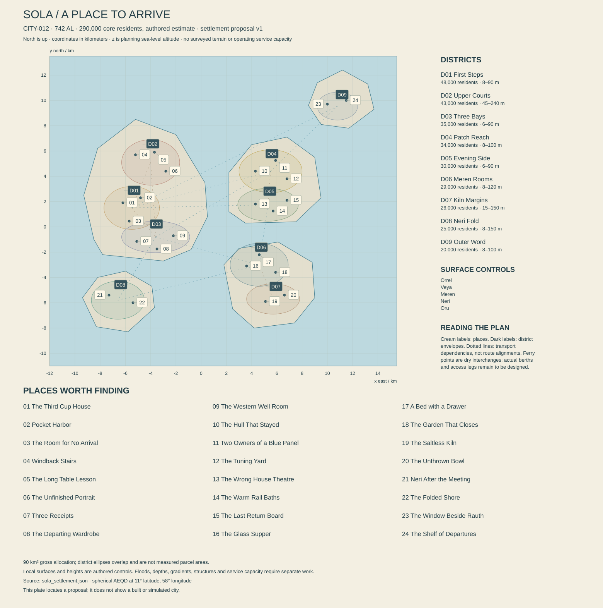

# Sola — Five islands, several ways to stay

Working city proposal, edition 0.1, 13 October 2026. **CITY-012, REG-021**, centered at **11° N, 58° E** on Nacre's unchanged 5,900 km spherical reference. The core resident estimate remains **290,000** in **742 AL**. This dossier and [settlement data](sola_settlement.json) author a city; they do not establish surveyed islands, qualified water yields, navigation, functioning public services or new Unreal content. New local dates, institutions, people and island names below are proposals for integration. The 147 AL service-harbor foundation, 198 AL surviving comedy, regional role and physical sky are inherited anchors.

The [settlement checks](SOLA_SETTLEMENT_CHECKS.md) record authored geometry, service assumptions and their limits. Numbered markers refer to the 24 place dossiers below; this is not a constructed city.

## 1. Arriving somewhere people live

The first thing you notice is somebody carrying a lamp that is switched off. Its shade is too wide for the ferry gate, so another passenger lifts one corner while its owner argues cheerfully about which way to turn. Across the water, five portions of city occupy different heights and distances. There is no single skyline to announce that you have arrived. A warehouse roof, a climbing line of cream courts and a pale ceramic chimney are individually recognizable before the city is.

Your terminal already knows where the guesthouse is. The host has added a useful correction: buy the ordinary ticket, keep the receipt, and do not take the boat whose destination has the same first word. At the interchange a public translator handles the announcement competently. What it cannot tell you is that the woman beside the cupboard has reserved the corner seat for a neighbor whose knee hurts. You learn that by being there.

Sola makes the distance between continents intimate. People arrive with freight, professional ambitions, family obligations and plans to leave again. Some remain for two turns, some for thirty local years. A temporary address can become the place where a person falls in love, learns a trade or finally sleeps. Permanent residents also need rooms in which nobody asks where they came from. Hospitality is a pleasure and a profession; it is not the sole purpose of an island's population.

The city has a characteristic promise: a person may assemble a good life across several shores. It has an equally characteristic failure: the arrangements connecting those shores can count journeys while overlooking the people making them. A ferry may run punctually yet leave a carer without a usable return. A guesthouse can be generous and still depend on its host's unpaid daughter. These are tractable, specific conditions rather than an assertion that every kindness conceals a trap.

The visual ambition is an inhabited archipelago seen at several scales. Across a channel, ceramic eaves mark the rhythm of buildings. In a court, shaded apertures and patched screens reveal different rooms. At arm's length, a shared cupboard has three replacement hinges and somebody's deliberately polished handle. The world should support the pleasure of moving toward an island because you recognize one small thing waiting there.

## 2. What the five-island plan means

The local frame spans x **−12 to +15.5 km**, y **−11 to +13.5 km**, east and north respectively. It uses spherical azimuthal equidistant coordinates about the atlas center. All z values are proposed sea-level altitudes, not displacement from a tangent plane. The default surface is water at nominal reference zero; five disjoint land polygons refine the coarse Aster concept outline. Their zero reference describes the intended shoreline datum, not flat islands. Interior topography, tides, storm levels, shelf depth and engineering bank profiles remain separate work.

The map center need not contain a capitol, airport or monument. In this proposal it lies at Orrel's eastern margin, between the historic harbor cluster and the crossings to Veya. The municipal center is an agreement among places. Coordinate convenience does not decide political importance.

**Orrel**, the largest western island, holds the original three landing grounds, associated with present First Steps, Upper Courts and Three Bays. Upper Courts developed uphill from its founding shore approach; the modern district ellipse does not locate a boat landing at its elevated center. This preserves the history's ridges and difficult overland connection: the founding grounds are on one island, separated by relief and disputed access, rather than silently rewriting 147 AL as simultaneous occupation of five islands. Later buses and graded paths improve the connection without flattening the ridge. Weathered volcanic surfaces, buried old shore benches and narrow drainage cuts are geological design candidates. They are not a surveyed eruption sequence. Broad roofs collect water; channels beside paths carry dirty first runoff away from protected storage.

**Veya**, east of Orrel, carries Patch Reach and Evening Side. Its northern work courts have room for awkward fabricated objects; the southern neighborhoods contain performance rooms, baths and closely packed homes. Neither half is socially pure. Repair workers live above shops on Evening Side, while Patch Reach has a much-loved small dance room. The gap between islands is real water. Service lines crossing it must eventually follow usable passages and reach actual berths.

**Meren**, southeast of the original harbors, combines household cultivation, long-stay accommodation and ceramic manufacture. Its proposed northern slopes support controlled growing rooms and domestic streets; its southern terraces hold kilns and material recovery. These are human land uses, not claims that native soils naturally feed Earth crops. Contained media, imported nutrients, partner cultures and handled waste remain part of every introduced cultivation scene. Meren's quieter image also contains night work, debt and people who enjoy machinery.

**Neri**, southwest of Orrel, has a distinct sheltered fold and a more exposed outer shore. Its single mapped district contains several neighborhood centers, not one village square repeated across twenty-five thousand lives. An assembly, primary care, groceries, schools, repair work and domestic pleasures exist locally. Residents cross to other islands because they want or need particular services, not because Neri is an empty dormitory. A coastal path follows an authored setback behind a recovering margin. The proposal does not put an unprotected promenade wherever a camera wants a sea view.

**Oru**, northeast of Veya, is the outer inhabited island in this city frame. It has relay work, visitor households and observation paths, as well as cooks, cleaners and ordinary children. Its island identity does not turn all residents into navigators. The compact district leaves unbuilt land within the larger island polygon; vegetation, drainage and relief there require their own habitats. Beyond the frame, Aster continues over much greater distances. Five nearby islands cannot stand in for the entire regional chain.

The adopted sky gives Sola approximately **66.3–70.5 hours of daylight** across the seasonal extremes, with the complementary natural nights. A 24-hour civil turn continues through both. Rauth's center is approximately **30.99° above the reference horizon** in the idealized local geometry. Its approximately fixed sky direction is toward the sub-Rauth point, broadly westward and slightly southward here, not wherever an artist places the sea. Buildings and ridges can conceal it. Cloud, phase and atmospheric conditions change its appearance; it is neither a dependable streetlight nor a clock that rises once per turn.

Regional weather permits wet slopes, sheltered harbors and seasonally changing exposure. This dossier does not assign exact rainfall, prevailing winds or a monsoon date before circulation work. An east-facing court is not automatically the dry side. Roof details, shaded passages and recovery stores anticipate rain and spray, while local forecast instruments determine which exposed crossing is acceptable now.

## 3. A history that leaves different kinds of rooms

The following local sequence is proposed except where explicitly identified as an existing world-history anchor. Dates are local AL years. None denotes thousands of human years on Nacre.

**147 AL — the durable service harbor, inherited anchor.** Three Orrel landing grounds connect expedition stores, repair needs and households whose responsibilities were already diverging. The sea route is often quicker than the track. The record does not establish that the islands were empty of native life, that every participant arrived willingly, or that one founding family owned the whole coast. Present claims using that story need specific deeds and limits.

**176 AL — the first Veya wintering lease, local proposal.** Wintering is an inherited shipping expression for a longer layover, not a claim that 11° N has an Earth winter with snow. A repair company pays for roofs and lodging near a sheltered approach. Several cooks and fabricators become resident partners rather than remaining employees. The surviving lease includes both wages and shares in water storage. Later popular versions remember only the friendly meals. Its awkward clauses explain why some family buildings own fractions of a collective cistern without owning the water indefinitely.

**198 AL — The First Wrong House, inherited anchor.** The earliest surviving script uses courtesy, mistaken invitations and audience-chosen endings. Its history continues through amateur rooms as well as professional theaters. No present theater can prove an uninterrupted building lineage back to the original performance. That uncertainty provides room for competing productions rather than a fake ancient stage preserved intact.

**263 AL — Meren cultivation courts, local proposal.** Maintained terrestrial stocks, clean media and partner cultures move through authorized propagation networks already several generations old. These courts supplement imports; they do not discover universally edible alien vegetation. Ceramic vessels and shade screens develop together because the growing rooms need washable surfaces and controllable exposure. Some household gardens descend institutionally from those courts, although living stocks have repeatedly been replaced.

**407–414 AL — the separated ledgers, local proposal within Relay Winter.** Ship notices, credit confirmations and temporary-residence records reach different harbors at different times. Some families suffer losses; others stay voluntarily when employment elsewhere disappears. A famous receipt survives because it records a debt canceled by agreement, not because it incriminates a villain. The modern Three Receipts collection puts that unexciting reconciliation beside more dramatic cases. Island radio and physical traffic continue; Sola is not cut off by an impossible planetary silence.

**492 AL — the Return Seat agreement, local proposal.** Participating harbors require publicly supported meeting schedules to account for a return journey. This agreement belongs to the repair-era family of institutional experiments following the Open Ledger period. It does not confer a free private boat on everyone. Interpretation still turns on which gatherings qualify, who pays for extra crews and how alternatives accommodate people who cannot use every vessel.

**582 AL — landing service separated from descent, local proposal within the Unbinding era.** A participating Sola assembly rejects one class of inherited personal labor claims while retaining specified obligations attached to waterfront property. Owners may owe a published contribution or provide qualified service; descendants do not automatically owe bodily labor. Later contracts sometimes disguise personal coercion as training or accommodation debt. The dossier treats that as contestable conduct, not an exotic picturesque custom.

**648–655 AL — Neri's common crossing account, local proposal.** A coalition of residents and carriers replaces individually negotiated school crossings with a publicly visible service account. Families retain varied schedules; the agreement is not a universal life timetable. Its cultural inheritance is the habit of leaving space in a meeting for a person returning from another island. The habit sometimes becomes performative delay, and current residents are entitled to find it irritating.

**694 AL — the separate visitor book, local proposal.** Municipal service estimates begin reporting temporary occupancy separately from core residence. It improves budgeting without deciding belonging. A person can be emotionally at home before census rules count them as a core resident. Conversely, an owner can keep an address while spending most turns elsewhere. Those distinctions remain visible in housing and representation rather than collapsing into a visitor-versus-local morality test.

**731 AL — the Neri shore setback, local proposal.** Several households move paths, storage sheds and a small public room away from an eroding margin. They do not all leave the island. Photographs preserve beloved domestic arrangements as well as engineering evidence. Recovering habitats and a new path now coexist with memories of inconvenience, fair compensation and one unresolved boundary appeal. A repaired place can remain emotionally complicated after the useful work succeeds.

## 4. Neighborhood allocations and built grammar

These gross area allowances sum to **90 km²**. They include district streets, yards and local open space as a planning account. They are not measured areas of the overlapping ellipse envelopes, island land areas or footprints of completed buildings. Every district has ordinary schools, shops and care; the character column describes a concentration.

| ID | Island and district | Residents | Gross km² | Proposed altitude range | Distinct emphasis |
|---|---|---:|---:|---:|---|
| SOL-D01 | Orrel: First Steps | 48,000 | 12 | 8–90 m | Arrival courts, long-established homes, domestic hosting |
| SOL-D02 | Orrel: Upper Courts | 43,000 | 13 | 45–240 m | Ridge neighborhoods, language rooms, roof paths |
| SOL-D03 | Orrel: Three Bays | 35,000 | 10 | 6–90 m | Historic southern landing, stores, departure trades |
| SOL-D04 | Veya: Patch Reach | 34,000 | 12 | 8–100 m | Fabrication, repair, apprenticeships and music |
| SOL-D05 | Veya: Evening Side | 30,000 | 9 | 6–90 m | Performance, baths, mixed domestic streets |
| SOL-D06 | Meren: Meren Rooms | 29,000 | 10 | 8–120 m | Controlled cultivation and long-stay households |
| SOL-D07 | Meren: Kiln Margins | 26,000 | 8 | 15–150 m | Ceramics, recovered materials and quiet terraces |
| SOL-D08 | Neri: Neri Fold | 25,000 | 9 | 8–150 m | Outer-island civic life and sheltered shore routes |
| SOL-D09 | Oru: Outer Word | 20,000 | 7 | 8–100 m | Relays, visitor households and observation rooms |

Sola's architectural direction is **Porcelain Weather**: dark durable bases, pale mineral courts, glazed rain edges, open-sided circulation and removable shaded infill. Porcelain is a visual shorthand for the family of ceramic finishes, not a claim that every wall is made of fragile tableware. Some facades are unglazed, some mineral-coated and some visibly composite. Roofs favor connected collection edges with accessible gutters and inspectable overflow routes. Ornament concentrates where a hand or stream of water already goes.

Orison's Brass Sanctuary remains distinct. Sola does not gain identity by replacing its brass with a different metal while reusing every facade. The island grammar has modest stacked volumes around shared courts, long screened landings, split roof pitches that frame the sky, and ceramic edge units in several sizes. Major public rooms can be expressive without every doorway becoming a ceremonial monument. Large sheds use wider structural spans, straight freight clearances and replaceable weather panels, visibly different from homes.

Each island modifies that grammar. Orrel combines irregular inherited plots with carefully inserted access runs. Veya exposes frame bays and repair brackets because large objects move through them. Meren groups cooking and cultivation around washable work courts. Neri uses smaller detached roof groups and sheltered connections where gaps preserve drainage and retreat options. Oru's houses bunch behind chosen relief while leaving observation windows between them. These are authored responses to proposed terrain; final slope and wind analysis can revise a detail without deleting the identity.

Color has use and history. A household may repaint one panel because it loves the color. Navigation signs use a checked service palette independent of fashion. Temporary cloth is tied where it can actually be secured; glazing changes reflection with angle; salt exposure does not produce identical damage on every surface. Avoid universal rust, random hanging cables and ornamental emergency lights. A freshly cleaned stair belongs in a lived city as much as a patched wall.

The first asset families should support five scales: shoreline civil edges, island street sections, court buildings, room furnishings and hand objects. A ceramic drip edge, a folding host's table, a passenger cupboard and a repair-frame corner should recur with explainable variation. Hero assets earn bespoke form through a place's history: the stopped hull, the shifted shore room and the theater's reversible invitation wall. Native plants must use separately qualified Aster design, not the convenient Kesh foliage pack without range decisions.

## 5. People who keep appearing for different reasons

Ages below are approximate **standard Earth years** at the common 742 AL reference, rounded from AL birth differences. Birthdays within the current year remain to be assigned. These people are not a complete census or a fixed daily cast for all 290,000 residents.

| Stable ID | Public name | Birth AL; approximate standard age | Work, relationships and a private ambition |
|---|---|---|---|
| SOL-NPC-01 | Nela Sen | 680; 55.2 | Hosts Third Cup; Tavi's parent; wants six turns in which somebody else decides dinner |
| SOL-NPC-02 | Tavi Sen | 712; 26.7 | Repairs visitor furniture, shares a partnership with Jem; wants a workshop address separate from the family business |
| SOL-NPC-03 | Jem Oran | 706; 32.1 | Makes miniature harbors and teaches; loves Tavi, competes amicably with Mira; wants to build one object too large to carry home |
| SOL-NPC-04 | Mira Des | 702; 35.6 | Ceramic artist, Pelin's partner; rejects automatic claims of prestige; wants a very ordinary cup in thousands of homes |
| SOL-NPC-05 | Pelin Var | 708; 30.3 | Deaf portrait maker using Frame Sign and written Shore; organizes quiet viewings; wants to finish a portrait without explaining the subject's access needs |
| SOL-NPC-06 | Rami Elt | 695; 41.8 | Established ferry scheduler; Dena's cousin; enjoys terrible comedy and wants to act once without being asked to fix the timetable |
| SOL-NPC-07 | Dena Ulo | 690; 46.3 | Water operations coordinator, Esen's parent; sings badly with commitment; wants time for a certificate in architectural drawing |
| SOL-NPC-08 | Esen Harl | 719; 20.5 | Cultivation apprentice and enthusiastic percussionist; uses a different association name from Dena; wants a season of work beyond Aster |
| SOL-NPC-09 | Sori Cal | 653; 79.2 | Retired pilot, Nela's long-standing friend; accepts help but dislikes being organized; wants to learn to draw moving water |
| SOL-NPC-10 | Omi Nav | 686; 49.9 | Island habitat observer working with Bel; keeps painstaking field records and startlingly silly domestic films |
| SOL-NPC-11 | Bel Fen | 671; 63.2 | Former relay technician and local archive contributor; wants to replace a famous departure photograph with a less dramatic family picture |
| SOL-NPC-12 | Neris Lom | 700; 37.4 | Visiting director who now has a long-stay room; friends with Kavi; wants a production people attend twice for different endings |
| SOL-NPC-13 | Kavi Net | 701; 36.5 | Harbor accounts mediator and amateur cook; likes Neris's work but contests its subsidy; wants to leave public service before becoming cynical |
| SOL-NPC-14 | Jora Amet | 711; 27.6 | Porter and clothing restorer, Tavi's friend; wants departures to feel stylish rather than humiliating |

Their networks cross institutions. Nela hosts Neris but does not support every theatrical request. Rami can be correct about crew limits and still take criticism badly after an exhausting turn. Dena supports Esen's wish to leave while worrying about what the application does not cover. Mira lends Jem tools and refuses to rescue his schedule every time. Pelin's language and deafness shape particular encounters without explaining their taste, generosity or impatience.

No one becomes emotionally intimate because the player completes one delivery. Return visits, remembered preferences, an apology accepted or declined, and shared ordinary time carry relationships. Small ambitions can resolve offscreen if the player never engages. Tavi may find a bench elsewhere; the resulting change at Third Cup should make sense without a quest completion banner. Sola becomes alive when people can succeed without the protagonist.

## 6. Staying, belonging and the public journey home

The core housing screen assumes **116,000 occupied residential units at a mean 2.5 residents**, yielding 290,000. It includes varied households and collective residences through equivalent occupied units; it does not claim every household contains two adults and half a child. Another **4,000 ready but unoccupied units** and **2,000 units unavailable for works** make a proposed stock of 122,000. Ready vacancy is not automatically affordable, publicly accessible or available on the island a person needs. A later housing model must separate tenure, household sizes, accessibility, bedroom counts and duration.

Guest accommodation has a separate ordinary target of **24,000 beds**, with **18,000 temporary occupants** at a 75% aggregate occupancy scenario. A proposed 12,000 additional licensed seasonal or institutional beds could bring an event ceiling to 36,000; this is an authoring target, not inspected capacity. Ship crews sleeping aboard and passing passengers are separately counted when they take city meals, water or transport. Moving a visitor into core residence changes accounts; it must not create two people.

Public Shore speech is widely useful, while Wake, Lake, household Leri, Frame Sign and other repertoires appear through specific families and routes. Transit Clear governs constrained operational messages, not every dinner conversation. Translation normally works. A disputed room invitation may concern permission or an old nickname even after every word is correctly translated. Sign-language scenes need actual authored communication and appropriate consultation; dock gestures and generic hand loops cannot stand in for a conversation.

The **Aster harbor assemblies**, already established regionally, share responsibility with island councils, service cooperatives, property owners and qualified carriers. This proposal gives Sola a joint service chamber with island delegations and separately published temporary-resident submissions. The latter permit testimony and participation in service design; they do not automatically reproduce the same voting rights as every settled tenure. Eligibility, appeals and privacy need detailed fictional law before an enforceable game system. An emergency cot is never treated as consent to a labor debt.

The Return Seat practice focuses on actual journeys. A publicly supported hearing identifies the departures that enable attendance, the return options, access requirements and the cost of extending a session. Recording a broadcast can help, but remote participation is not automatically equal when testimony involves protected records or a person needs an interpreter. Conversely, insisting on physical presence when a good remote option exists can exclude people needlessly. Residents argue about the workable arrangement, not whether technology or tradition is inherently virtuous.

Nine mapped land interchanges form fourteen service dependencies. Three are regional gateway relationships: First Steps, Three Bays and Patch Reach. The graph does not draw a navigable ferry route, an approved mooring or a direct pedestrian bridge. On-island bus and walking links still need slope, path width and accessible alternatives. Ferry links need land approaches, berths, ramps, clearances, surveyed passages, vessel compatibility, weather limits and crew arrangements. Protected short crossings and exposed outer legs may have different operating states.

Ordinary service seeks two virtues: useful repetition and understandable exceptions. A missed boat should usually mean a comprehensible wait, a meal, a conversation or an alternative route. Serious interruptions produce changed menus, school plans and work patterns before citywide catastrophe. Last departures are not universally at night, because watches and natural sky phases drift relative to one another. Boards display date, civil time and sky conditions separately. A good island day can include three crossings and no adventure whatsoever.

## 7. The service account: enough detail to expose a gap

Every quantity here is a planning demand or allocation, not measured production. A civil turn is 24 Earth-standard hours. The city must eventually be tested under ordinary weather, maintenance, visitor peaks and correlated failures. These accounts establish what has to be supplied and avoid using attractive architecture as proof of capacity.

### Water, from distinct sources to distinct uses

Core domestic use is **290,000 × 110 liters = 31,900 m³ per turn**. Other potable allowances total **20,100 m³**: 2,160 for the ordinary 18,000 temporary occupants at 120 liters; 6,000 for public care, schools and services; 5,000 for food preparation and qualified cultivation; 4,000 for shops and industry requiring potable input; 2,940 for port and crew service. This gives **52,000 m³ delivered**. Not every liter is swallowed, and crop production cannot be inferred from its water line.

With a provisional **20% physical distribution loss allowance**, **65,000 m³ of treated water** must enter the network: 52,000/0.8. The resulting 13,000 m³ difference is an acknowledged loss target to improve, not a customary tithe. The JSON's network-input field begins after source treatment. It is not total raw abstraction or seawater intake. Meter error is a separate accounting uncertainty, not a physical water loss; a later audit must not count both a corrected meter discrepancy and actual delivered water as missing flow.

The candidate network-entry portfolio is **38,000 m³ desalinated product**, **20,000 m³ treated water from managed stored runoff**, and **7,000 m³ qualified groundwater**, per turn. These sum to 65,000, but none is established yield. Rain must be collected somewhere; storage, evaporation, first-flush diversion, environmental flow and treatment rejects are additional. Groundwater is capped by a future island-specific hydrogeological account, not assumed sustainable because a well can initially supply it. A drought scenario cannot keep the same runoff contribution indefinitely.

At a deliberately illustrative **45% desalination water recovery**, 38,000 m³ product requires about **84,444 m³ seawater intake** and leaves about **46,444 m³ concentrate**, before separately quantified cleaning and other operational streams. This is mass-balance scaffolding, not a chosen membrane specification. Source contaminants, remineralization, final-water quality, outfall dilution, intake entrainment and sensitive habitats require qualification. The ocean is not a waste bin whose size proves safety. A rain-fed source and an aquifer source have different losses and cannot borrow this recovery fraction.

Earth research informs the questions, not fictional yields. USGS describes how coastal groundwater pumping can draw saline water toward freshwater zones; Sola therefore requires monitored interfaces and island-specific abstraction limits rather than a universal lens formula. WHO's desalination guidance treats source quality, treatment and final-water handling as linked risk-management problems. Neither source certifies native-water chemistry on Nacre. [USGS: saltwater intrusion](https://www.usgs.gov/mission-areas/water-resources/science/saltwater-intrusion); [WHO: safe drinking-water from desalination](https://www.who.int/publications/i/item/WHO-HSE-WSH-11.03).

An additional **12,000 m³ reclaimed supply** serves approved flushing, process and landscape uses through separate infrastructure. Gross end use is consequently 64,000 m³, although only 52,000 is newly delivered potable water. The screening loop collects **42,000 m³**, reuses 12,000 and releases **30,000 m³ treated residual water**. The other **22,000 m³** of gross use is consumption, evaporation and uncollected flow, not all beneficial loss. Fresh input closes as 65,000 = 13,000 distribution loss + 22,000 consumption/uncollected + 30,000 residual discharge. Reuse is an internal loop, not twelve thousand new cubic meters from nothing. Sewage solids, treatment rejects and storm inflows require separate mass accounts.

A **156,000 m³ treated emergency storage target** represents **2.4 ordinary turns** at the 65,000 m³ network input needed to deliver 52,000 m³ under the stated 20% distribution loss. Dividing by delivered volume alone would give three turns while omitting that already declared loss. Stores must also be distributed, accessible and protected, and some water remains operationally unavailable. At a reduced essential delivery screen of 32,000 m³ with the same loss fraction, network input is 40,000 m³ and the nominal stock represents **3.9 turns** before further isolation and handling deductions. Emergency isolation may change the loss fraction; that requires a separate operating case. Clinics and dependent households receive explicit planning attention; a visitor is not denied essential water because the budget calls them temporary.

### Food, with local growing rooms in proportion

The core edible-product allowance is **1.65 kg per person per turn**, or **478.5 tonnes**. Its working composition is 160 t dry staples, 200 t fresh produce, 80 t maintained-culture products, 8.5 t conditionally qualified native fractions and 30 t other introduced products. These are purchased or delivered food masses, not equal nutritional units. Calories, amino acids, micronutrients, water content, dietary needs and affordability remain to be evaluated separately.

| Intended origin | Dry t | Fresh t | Culture t | Conditional native t | Other t | Total t/turn |
|---|---:|---:|---:|---:|---:|---:|
| Nine-River network, REG-002 | 90 | 60 | 20 | 8.5 | 10 | 188.5 |
| Talweir regional network, REG-009 | 45 | 65 | 10 | 0 | 5 | 125 |
| Controlled production within Sola | 0 | 60 | 30 | 0 | 5 | 95 |
| Aster growers outside the city frame | 10 | 15 | 10 | 0 | 10 | 45 |
| Red Ledger managed production, REG-004 | 15 | 0 | 10 | 0 | 0 | 25 |
| **Core demand allocation** | **160** | **200** | **80** | **8.5** | **30** | **478.5** |

These origins are proposed procurement relationships, not amendments claiming unused productive capacity in other dossiers. Red Ledger's cultured line is stabilized product suitable for storage, not a tank of delicate live organisms shipped casually. Velis can supply documented stock and expertise without being invented as Sola's bulk grain farm. Local 95 t production requires its own area, light, nutrient, labor and controlled-culture account; the gardens are a target to qualify, not scenery proving self-sufficiency.

The **8.5 t native line is conditional**, using the limited-overlap contract for specified processed oils or small compounds. No Aster taxon becomes edible through this table. It is assigned to a proposed established processing chain in Kesh, whose species, tissues, process and batch qualification must be authored and checked. Until that exists, replace the line with 8.5 t human-compatible introduced oils or other nutritionally reviewed product and revise the basket accordingly. Complete protein and micronutrient provision still depend on introduced agriculture and maintained cultures. A pretty island pod is not a meal.

Ordinary temporary occupancy adds **29.7 t** at the same product allowance, bringing core plus guests to **508.2 t**. The 36,000-guest event ceiling would add 59.4 t instead, producing 537.9 t before other visitors. Departing ship provisions have a separate **35 t per turn** planning line, outside resident and guest consumption; passing passengers and unusually large crews need explicit additions. These categories cannot be hidden inside the core census.

A dry-staple stock target of **4,800 t** equals thirty turns of the core's 160 t dry line. It is not thirty turns of complete food for every person, and continuing guest, ship and regional obligations shorten its availability. Stock rotation supports ordinary meals and cookery classes. Refrigerated fresh reserves need different periods and power. Inspections, pest control and ownership matter as much as tonnage; privately held food unavailable to public buyers does not become a civic reserve by appearing in a warehouse.

### Electricity, freight and waste

The electrical demand case is **360 MW average**, **620 MW peak**: 120 MW homes and ordinary domestic services, 80 MW public/commercial services, 60 MW manufacture, 30 MW water systems, 40 MW local mobility and 30 MW hosting/port functions. It includes ordinary temporary occupancy and stated local industry, not all regional shipping propulsion. Numbers allocate demand; they do not establish transformer locations or feeder capacities. At the average, one turn consumes 8,640 MWh.

A candidate average portfolio assigns 170 MW to qualified regional imports, 100 MW to dispatchable local supply, 55 MW mean wind contribution and 35 MW mean direct solar contribution. These sum to 360 MW only as an illustrative average. Wind and solar averages are not firm capacity. Licensed fission is an established world option; no particular reactor, fuel contract or island site is selected here. Geothermal cannot be assumed just because Aster is volcanic.

For a conservative dark interval of approximately **70.5 hours**, losing the two variable contributions while holding imports and dispatchable supply at 270 MW creates a 90 MW average deficit: **6.345 GWh** before further losses. An **8 GWh usable storage target** would exceed that one energy deficit, but proves neither peak delivery nor reliability. Storage power, reserve margin, maintenance, cold starts, correlated cable failure and load timing remain open. A diagram cannot grant the islands an inexhaustible cable through the seabed.

Gross regional port traffic has an independent **18,000–28,000 tonnes per turn** planning range, defined here as distinct consignments first entering city handling during the turn. Rehandling within the city does not create new cargo mass; outbound handling work still creates equipment demand and must be counted separately for berth/crane design. Much traffic transfers between regions without feeding Sola. Export manufacture, packaging, mail, spare parts, bulk materials and vessel supplies require their own accounts. The core food basket is a subset of relevant inbound consignments, not an extra category to add twice.

Municipal solid arisings have a preliminary **358.4 t per turn** screen: 232 t from core residents at 0.8 kg, 14.4 t from ordinary guests at the same allowance, and 112 t from commerce and public services. Proposed handling categories are 140 t repair/recycling candidates, 120 t compatible organics, 18.4 t controlled or contaminated material and 80 t residual disposal. These sum arithmetically; they are not achieved recovery yields. Mass is as collected, with moisture stated at later measurement. Ship waste, construction spoil, dredging, sewage solids and industrial streams outside this municipal definition are additional.

Native fibers, introduced food residues, mixed chemicals and living cultures cannot all be fed into one miraculous composter. Terrestrial microbial systems require suitable substrates and controls; native material follows its own qualified processing. Recovery yards have quarantine, inspection, storage and rejected loads as well as pleasing repair work. The important consequence is spatial: there must be places to set an object down, inspect it, clean it and move it again. The Unthrown Bowl gives that ordinary process a human scale.

## 8. Ecology and the edges people share

Sola sits within a volcanic-arc dispersal history, not a universal tropical garden. Its native land assemblages remain an Aster authoring task. This city proposal creates **observation contracts rather than new species IDs**: attached shore producers on sheltered native substrate; small consumers using protected crevices; decomposition in moist island litter; and offshore visitors where prey, current and season permit them. Production must later give each body its own anatomy, energy account, reproduction, range and interaction network. Until then, an artist's placeholder is not a taxonomic or food decision.

Existing ecology permits threadglass and softoar **visitor or extension candidates** in appropriate current-connected waters beside REG-021. It does not guarantee a bloom outside every window or a large animal arriving whenever the player returns. Threshold runner is only a proposed human-carried candidate requiring a documented introduction and viable habitat. None is automatically a resident house pet. Basinbell, pale hinge, keeperwing, Morrow's lake fauna and Velis cultivation partners retain their separately bounded ranges. They cannot be relocated here because a scene needs color.

Imported garden plants remain managed introductions with traceable stock, media and containment. A pot on a balcony may hold a maintained terrestrial culinary plant; the distant native slope is not therefore made of the same organisms. A shed may shelter an introduced companion animal if its food, veterinary needs and introduction history are authored. This dossier does not populate every harbor with familiar Earth gulls and cats by default.

Neri's shore recovery is a useful process before any charismatic animal appears. Drainage is redirected away from erodible fill; human access is concentrated on durable land; construction debris is removed selectively; surviving habitat is observed over real time. A quiet interval allows recruits to establish where substrate and wave conditions permit. A later storm can reveal a weak point without destroying every gain. NOAA's living-shoreline work emphasizes site conditions, wave energy and regional differences; that supports the need for an appropriate design, not a guarantee that native mats stabilize any exposed coast. [NOAA: living shorelines](https://www.habitatblueprint.noaa.gov/living-shorelines/).

Observers can enjoy a beautiful behavior without extracting it. Omi's field films show a small shore colony opening sequentially as a shadow moves. The taxon, mechanism and range remain deferred; a player may learn to distinguish observed sequence from the explanation being tested. Do not convert that placeholder into a supernatural tide clock. Elsewhere a blank observation sheet is a legitimate result. A living world includes encounters that do not occur on command.

## 9. Twenty-four places with reasons to return

Each place has one stable map ID and a dry authored focal point. Building extent, access route and interior geometry are still to design. Coordinates do not place a whole building on one mathematical point. Time variations below use civil watches and actual conditions, never an assumption that each working turn begins with sunrise. The people already introduced retain lives outside these encounters.

### SOL-POI-001 — The Third Cup House

**First Steps, Orrel.** Nela Sen's house offers a first cup to someone arriving, a second to someone staying and a third only when the kettle happens to be on. The title is affectionate advertising, not a binding hospitality ritual. A shaded court opens onto three generations of mismatched guest rooms. Tavi's repaired chairs sit beside one extravagantly uncomfortable original that Nela refuses to discard because she likes its silhouette.

The useful evidence is domestic: a cupboard marked for guests, another whose doors remain closed, and a meal slate that distinguishes an invitation from a purchased service. A visitor can infer where public hosting ends without finding the family portrayed as secretive. Tavi's sketches show a possible workshop elsewhere; they are neither eviction papers nor proof of a family rupture.

The player may pay for lodging, help move a chair with permission, join an offered meal or leave the household alone. Nela wants time away but has not yet chosen whether to close rooms or employ relief. A useful conversation can put actual costs beside Tavi's wish for independence. Nobody should decide for them through a dialogue shortcut.

A return after several turns may find another host serving Nela's recipes differently. After a longer interval, Tavi's old bench could become a reading corner. Essential assets are deep door reveals, replaceable cupboard labels, three distinct cups, folding tables and room wear that follows actual use. The reward is becoming familiar enough to know which chair needs a cushion.

### SOL-POI-002 — Pocket Harbor

**First Steps, Orrel.** Jem Oran makes tiny working scenes in a former luggage office. Most depict ordinary journeys: somebody missing a boat, a lamp passing through a gate, a grandmother returning a borrowed pan. These are locally invented mechanical toys, influenced by the wider Pocket Weather enthusiasm without pretending Jem began the movement in Brin. Their charm comes from observation rather than excessive miniature detail.

Children can work at a low communal bench while adult collectors examine quieter pieces in a side room. Tavi supplies furniture repairs; Mira occasionally makes glazed weights. Jem wants to build a scene too large to fit through his own door and has marked its outline on the floor. Visitors first assume the marks are a future machine bay. Close attention reveals little street names.

Participation can be as simple as identifying a moment worth representing. Paying for an object, lending a safe reference or attending a demonstration offers different relationships to the workshop. Children are not unpaid production labor, and a rare component need not become a compulsory errand before the room is enjoyable.

During a public demonstration, the shop is noisy with overlapping interpretations. At a closed working interval, Jem adjusts one hesitant gesture repeatedly. On return, a familiar figure might have acquired an extra action suggested by another resident. Asset needs include mechanical linkages, spare parts trays, unfinished surfaces and several credible scales of fabrication. A finished toy does not simulate the whole harbor; its carefully chosen omission is part of the art.

### SOL-POI-003 — The Room for No Arrival

**First Steps, Orrel.** This neighborhood room has no visitor display, historical narration or obligation to host a traveler. It is publicly accessible under ordinary quiet-use rules, but its furnishings favor people who already know where they are: a repairable reading lamp, a drawer of incomplete puzzles, comfortable seats facing one another and two seats facing a blank wall. Its absence of a spectacular view is deliberate.

Sori Cal draws water here from memory because the harbor itself keeps distracting him. Nela sometimes brings a book and falls asleep before opening it. A visitor who listens hears somebody practicing an apology through a private earpiece, then stopping to drink. The city continues beyond the shutters without requiring a plot inside every room.

The interesting choice is restraint. The player can read an available local text, sit, ask before joining a table or continue elsewhere. Collectible-looking objects remain other people's belongings. A penciled mark beside a lamp records the preferred height of its ordinary user, not a cipher. Repeated observation should make the room more legible without revealing that it was secretly an intelligence station.

Opening times follow staffing and neighborhood use. A rare booking for repair closes it temporarily with an intelligible notice and an alternative nearby. Return visits bring small continuities: the same puzzle nearer completion, Sori's drawing improved, a new cushion in an old chair. The key assets are convincing ordinary furniture and enough acoustic separation for quiet to feel like something the city actively provides.

### SOL-POI-004 — Windback Stairs

**Upper Courts, Orrel.** The historic stair climbs through a sequence of sheltered cuts and short exposed landings. Its name survives from an older local account of discomfort, not a guaranteed wind direction. A later graded route and lift system must supply an accessible alternative before this becomes a complete traversable district. The mapped point is a dry upper landing, not a claim that all intervening slopes are safe.

Pelin Var comes here for changing shadows on faces; Dena Ulo studies the repairs between flights for a drawing course she keeps postponing. At one turn of the stair, the original parapet survives below a higher replacement. Its differing fastener pattern makes the alteration readable. It does not, by itself, establish whether the reason was safety, fashion or changed use; the maintenance plate supplies the narrower answer.

People may choose the stair for exercise, conversation or the feeling of arriving on foot. A player can compare the old and new routes, ask to see Dena's sketch or stop at the sheltered seat. Climbing over a domestic boundary is not automatically public access merely because it makes a useful shortcut.

During a wet interval, handrails and drains become visually active while some exposed landings close. Under clear long daylight, cloth screens cast slow changes across the mineral wall. Returning after maintenance reveals a repaired section without the entire staircase transforming. Assets require believable steps, landings, drainage exits, graspable rails, access signs and masonry joints following the construction history.

### SOL-POI-005 — The Long Table Lesson

**Upper Courts, Orrel.** A Leri household-language group borrows a dining room above a cooperative store. Lessons end with an ordinary shared meal, because asking for another spoon and disagreeing about a sauce are useful forms of practice. Nela attends irregularly; she speaks readily but reads some family records slowly. A young teacher is excellent at explanation and hopeless at estimating how many people will stay for food.

The room contains living participation rather than a museum of endangered words. Corrected shopping lists sit beside a new joke, recordings with consent restrictions and one ambitious unfinished play. None supplies decorative pseudo-Leri for production. Actual source lines must be authored and checked later. The player's translation can explain what a lesson concerns while preserving who is confident, learning or simply tired.

A visitor can join an open practice session, help lay tables after asking, commission translation or respect a closed household gathering. An invitation to hear a family recording does not authorize copying it into a public archive. The meaningful decision may be whether to suggest a practical new lesson topic rather than celebrate an elder as a symbol.

On return, students use expressions from earlier meetings in different contexts. Nela might bring a recipe with an awkward note she wants to understand, or the class might stage an intentionally terrible scene from the local comedy. Asset needs include erasable working surfaces, varied handwriting, movable chairs, personal devices and cooking objects whose everyday use prevents the language from becoming mere wall ornament.

### SOL-POI-006 — The Unfinished Portrait

**Upper Courts, Orrel.** Pelin Var rents a bright room with a deep adjustable screen. The current portrait shows Mira Des holding an entirely ordinary cup. It remains unfinished because Mira has changed how she wants her work represented, not because Pelin lacks a magical pigment. Early studies emphasize the hands; later ones make room for the expression she uses when somebody mispronounces her name.

Frame Sign, written notes and competent interpretation support visits. The scene's subject is art, patience and affection. Pelin's deafness changes how a visitor should gain attention and arrange a conversation, but it does not supply the mystery or moral. A hearing character can misunderstand a portrait perfectly well without a translator malfunction.

The player may attend a scheduled viewing, buy an available print, ask permission to photograph a study or leave the intimate work private. Mira is considering a useful mass-produced cup rather than another gallery commission. Pelin admires that ambition and dislikes the pressure to turn the portrait into its advertisement. Both positions can remain unresolved without the relationship failing.

Natural light and screened electric work light create different painting conditions across the long cycle. A return might reveal a completed hand and a repainted background, or a finished portrait temporarily facing the wall while the pair choose where it belongs. Production needs convincing incomplete work, not twenty copies of one texture at different opacity. Small objects should have positions the artist can remember, and the visitor should have a place to stand without blocking the sitter.

### SOL-POI-007 — Three Receipts

**Three Bays, Orrel.** A modest archive occupies the clean upper floor of an active stores building. Its central display contains three records of one Relay Winter consignment: dispatched, received at a harbor and finally acknowledged by its intended custodian. The intervals between them matter. None alone proves that a named person received the goods on time. The institution earned its name by teaching that distinction clearly.

Kavi Net sometimes uses the room to explain current accounts without pretending history settles them. Bel Fen contributes a family recollection that contradicts the old caption's emotional tone while leaving the documented quantities intact. The records reveal a negotiated cancellation of part of a debt. Competence and generosity belong beside delay and loss; every surviving paper need not hide a crime.

A player can compare dates, ask which interpretation is supported, help identify an object with permission or attend an open demonstration. Private identity information is withheld in some records, and a blank field does not automatically prove a cover-up. The useful discovery can be that a popular claim rests on the wrong stage of delivery.

Visits during cargo working hours carry muted vibration through the floor. At quieter watches, spoken readings and signed presentations make the room a place to gather. Returning after a correction finds the old caption retained in the revision history. Assets include handling drawers, facsimiles distinguished from originals, accessible display heights and ordinary freight visible below. The archive gains authority by showing how its own account can change.

### SOL-POI-008 — The Departing Wardrobe

**Three Bays, Orrel.** Jora Amet keeps a clothing-restoration bench beside a porter cooperative. Travelers bring garments that have endured journeys badly: a shoulder stretched by luggage, a formal hem altered in haste, a favorite pocket finally torn through. The workshop also serves residents who are going nowhere. Its name expresses Jora's belief that leaving should not require looking newly purchased.

Tavi brings repaired hangers and sometimes stays to talk. A small rotating display shows the same coat before and after several owners' alterations, with each contributor's permission. The sleeves tell a visible history of different bodies and tastes without implying that one form is more advanced. A protected label preserves a name its current wearer no longer uses publicly.

The player can request a repair, buy an unclaimed item through the documented sale process or help choose an alteration. Taking a waiting customer's garment is ordinary theft, not harmless collection of scenery. A commission can prioritize sentiment, comfort or appearance; Jora should explain the tradeoff instead of announcing a universal best version.

Just before a regional departure, the room becomes busy with manageable urgency. Afterward, Jora may work slowly on a personal jacket with an impractical lining. A return reveals how clothes reappear on people elsewhere, not merely as completed inventory icons. Asset needs include plausible sewing and bonding equipment, adjustable forms, offcuts sorted for reuse and a few distinctive garments with coherent ownership histories. Texture variation should follow handling rather than generalized dirt.

### SOL-POI-009 — The Western Well Room

**Three Bays, Orrel.** Dena Ulo meets residents in a public room beside an enclosed monitoring installation. The name predates modern supply arrangements. The visible access is to records, samples and an observation window, not unrestricted entry to a drinking-water source. An old wellmouth remains sealed below a displayed section drawing; its continued presence does not prove it can supply the neighborhood.

The interpretive point is a careful distinction between pumping now and supplying sustainably. Dena can show how a water-quality trend, a neighboring abstraction and an uncertain subsurface model change the operating decision. Native-water chemistry still requires fictional qualification. The display must never become a claim that a simple formula makes every island aquifer predictable.

A player may accompany an authorized sample delivery, compare public observations, ask about a household complaint or leave with a clearer understanding. A brackish sample could reflect local intrusion, handling error or another source; the story provides evidence before selecting the explanation. There is no instant button that restores an aquifer after a pumping reduction.

At routine public hours, the room can be calm enough for Dena to sketch its old arches. A temporary restriction changes notices and supply alternatives before becoming a dramatic shortage. On return, a trend may have stabilized while uncertainty remains. Assets include sealed sampling points, date-specific records, separate raw and treated routes in diagrams, and domestic water objects that show why technical distinctions matter to residents. The reward is an intelligible decision, not ownership of the water system.

### SOL-POI-010 — The Hull That Stayed

**Patch Reach, Veya.** A retired working hull occupies a dry cradle within a repair court. It became an apprenticeship room after repeated calculations showed that another major rebuild would be a poor use of material. Its shape remains useful: sections expose how doors, tanks and conduits once shared a constrained volume. The public entrance follows a supported land approach. It is not an abandoned vessel mysteriously floating forever without mooring work.

Sori Cal remembers disliking this type of boat when it was new. Younger instructors value details he calls annoying because those details teach important compromises. Jem studies it for his oversized miniature; a serious drawing of one awkward corridor hangs beside a joke diagram showing how passengers actually used it. Neither memory automatically defeats measured evidence.

The player can attend a demonstration, help move a permitted teaching object, discuss a design or walk through the public section. Locked work areas contain active training and safety boundaries rather than compulsory hidden treasure. A technical comparison can lead to a choice about which section should remain visible in a proposed extension, sacrificing one valuable view to preserve another.

Across watches, the hull alternates between instruction, maintenance and a small film club. A later visit may find Jem's model preserving the corridor at an unexpected scale. Assets require a convincing structural section, dry cradle supports, adapted access, removed equipment interfaces and carefully finished new insertions. The pleasure is recognizing that a vehicle can acquire another useful life without every component becoming scrap.

### SOL-POI-011 — Two Owners of a Blue Panel

**Patch Reach, Veya.** Two adjoining workshops share a long blue weather panel. One maintains its outer face; the other owns the frame to which it attaches. Their agreement works well until a proposed opening affects both light and rain exposure. The disagreement is ordinary and current, not a hidden remnant of an evil founding contract. A readable sketch shows the change each proprietor actually wants.

Mira supplies test tiles for the new edge, while Kavi mediates a cost account. Tavi thinks the discussion could be simpler and discovers that each apparently fussy requirement protects something real: a clean assembly bench on one side, a comfortable domestic room on the other. The blue color is beloved by neither owner, yet both assume the other insists on it.

A player can listen, compare the two daily uses, contribute a measured observation or decline involvement. A fair proposal needs consent and a workable replacement schedule, not the theft of a signature. The pleasing discovery is that a design option can improve both rooms once an untested assumption is spoken aloud.

The panel looks very different under reflected sea light, direct sun and screened work lamps. On return after an agreed alteration, a small change in the street reveals a larger change in the relationship. If no agreement occurs, the shops still function. Asset needs include distinct internal uses, fastening access, sample tiles, marked dimensions and weather wear corresponding to exposure. One shared object should tell the story without turning an entire district into a wall of bureaucratic notices.

### SOL-POI-012 — The Tuning Yard

**Patch Reach, Veya.** A fabrication court becomes a percussion rehearsal room during agreed intervals. Resonant discarded forms hang from a temporary frame; ordinary tools remain secured beyond the gathering. The instruments are deliberately selected and tuned, not a claim that every piece of industrial scrap produces beautiful music. Esen Harl is learning to listen before entering and finds that much harder than striking loudly.

Jem brings a small mechanical pulse-maker that drifts slightly. Mira lends ceramic resonators with different shapes and warns players which are still test pieces. Workers from neighboring benches join for pleasure, while some close their shutters and do something else. Participation should not be mandatory proof of community spirit. A posted schedule records the negotiated quiet intervals as carefully as performances.

The player can listen, join a beginner exercise when invited, help arrange seats or ask how a particular sound is made. A useful contribution might be noticing that the room's response changes when a freight door opens. That observation supports an experiment; it does not instantly make the player a master musician.

Rehearsals vary with bookings rather than occurring at every sunset. During freight work, the same yard has another purpose and a different rhythm. A return can reveal Esen choosing restraint, a new instrument or a relaxed argument about an old arrangement. Assets need plausible suspension, protected striking surfaces, hand positions and spatial sound that responds to enclosure. The reward is learning to hear the workshop as a place people inhabit beyond their jobs.

### SOL-POI-013 — The Wrong House Theatre

**Evening Side, Veya.** Neris Lom's current production of The First Wrong House begins in a foyer arranged like somebody's domestic court. Patrons choose between two clearly marked invitations; both are valid entrances with equivalent access, leading to different opening scenes. The joke concerns mistaken assumptions about welcome. It must not strand a player who needs a particular route or turn accessibility into the punchline.

The 198 AL script is an inherited cultural anchor. This theater's building and staging are later inventions, and its publicity distinguishes them. An exhibition shows several endings, including one nobody performs anymore because the actors find it tiresome. That is a matter of taste, not automatic suppression. Rami Elt has accepted a very small role and fears colleagues will recognize themselves in his bad performance.

The player can watch, return for a different ending, attend an open rehearsal or discuss a proposed late performance. Extending the program interacts with the ferry account, crew rest and Neri's assembly; buying a ticket does not settle those obligations. Neris can accept a less prestigious time and still make excellent art.

At a later visit, an altered invitation or audience response changes the experience while the underlying comedy remains recognizable. Quiet intervals allow set repair and casual conversation in the foyer. Assets include reversible domestic scenery, clear actual exits, audience seating options and a modest backstage with personal belongings. The ambition is a place people remember laughing, not another stage built solely to deliver a mission briefing.

### SOL-POI-014 — The Warm Rail Baths

**Evening Side, Veya.** The baths occupy a set of small courts with different temperatures and levels of conversation. A dry sitting rail receives recovered warmth through a controlled system, providing comfort without requiring every visitor to enter a pool. The name describes that modest feature. It does not imply free geothermal heat, unmetered freshwater or an endlessly replenished decorative waterfall.

Cleaning, water quality and access are ordinary skilled work here. Jora Amet brings carefully repaired robes; Nela sometimes visits when somebody else covers the guesthouse. Sori prefers a shaded seat near the exit and has no wish to join the loudest gathering. Notices distinguish pool rules, quiet sessions and changing-room preferences without turning the room into a wall of warnings.

The player can pay, use a concession or join a publicly supported session under the actual local arrangement. A conversation may concern a wedding, an embarrassing performance or nothing consequential. Photography and taking belongings require consent. A pleasant bath does not secretly reveal everybody's biography simply because they removed work clothes.

Service intervals matter: some basins close for cleaning while other rooms remain available. Long-night work lighting creates warmth through reflected surfaces, not universal orange gloom. On return, familiar bathers may recognize a preference or save a seat; they need not provide a new task. Assets require dry/wet transitions, convincing drains, handholds, textile storage and a coherent heat-and-water diagram for later engineering. The scene's lasting value is bodily comfort within a city that knows how to provide it.

### SOL-POI-015 — The Last Return Board

**Evening Side, Veya.** Rami Elt's public service desk overlooks a dry interchange court. The board shows departures, connection conditions and the last ordinary return opportunities to each island. It does not portray straight graph edges as sailing tracks. A small model distinguishes the passenger's land approach, a future qualified berth and the water leg whose operational state must be checked separately.

The existing regional story becomes specific here: Neris wants a late performance, while Neri speakers need to get home after an assembly. Neither gathering is frivolous. Rami can show why the apparently spare vessel is not a spare rested crew. Kavi brings a funding option with an expiry condition; Dena wants a clear notice early enough to arrange Esen's return.

Useful choices include supporting an additional properly staffed service, changing a performance time, enabling meaningful remote participation or preserving the existing departures. Each affects different people. A player cannot solve the account by ordering an exhausted crew to be heroic. An alternative launch still needs suitable access and operating clearance.

The board is often unremarkably accurate. Its narrative power comes from showing changes promptly when conditions require them. On return, amended times and reimbursement records reveal what actually happened. Rami may then leave the desk to rehearse, a small proof that somebody else can cover his work. Assets include legible civil clocks, update history, accessible announcement channels and a sheltered waiting court. The reward is a workable evening whose success belongs to many participants.

### SOL-POI-016 — The Glass Supper

**Meren Rooms, Meren.** A cooperative dining room looks through clean glazing into controlled growing bays. The view is intentionally honest: trays at different stages, a cleared section awaiting cleaning and lamps used according to crop plans. The meal is not magically harvested from everything visible. Bread and much of the staple basket arrive through regional networks; maintained cultures and selected local produce contribute their own lines.

Esen Harl helps explain the work and is sometimes too eager to describe a speculative yield as next turn's dinner. Dena corrects the claim without humiliating the apprentice. Nela visits to borrow a recipe, while Kavi tests an unfashionable grain preparation in the public kitchen. Ingredients have documented introduced or specifically qualified origins; decorative native leaves do not become garnish by proximity.

The player can share a meal, attend a booking for an ingredient demonstration or inspect the public account. Choosing a seasonal substitution may support a useful experiment, but taste and nutritional adequacy are different judgments. A delicious dish can fail to supply a complete diet; an adequate meal can still be poorly prepared.

During long dark intervals the growing rooms need their stated energy and temperature controls. Some bays deliberately rest while meals continue from stores. Returning reveals a tray progression, a revised recipe or Esen's application to work elsewhere. Assets include distinct clean and public zones, washable vessels, crop records and ordinary bowls worn by use. The key experience is enjoying good food while understanding enough of its origin to care about it.

### SOL-POI-017 — A Bed with a Drawer

**Meren Rooms, Meren.** This long-stay house gives every guest a lockable drawer that can remain rented between visits. The offer is practical: leave a winter coat, a favorite cup or a tool that would be awkward to carry. It is not an automatic permanent-residency right. Clear agreements distinguish lodging, storage, inspection conditions and abandoned property, so hospitality does not quietly become ownership of another person's possessions.

Neris keeps a drawer here even while staying closer to rehearsals at Third Cup. Bel Fen stores letters awaiting visits from relatives. Tavi considers renting a small workroom upstairs and dislikes the pressure to explain that decision as either family rejection or an entrepreneurial triumph. It could simply make daily life easier.

The player can rent space, retrieve their own deposited objects, deliver an authorized parcel or join an offered common-room supper. Someone else's drawer is not a randomized loot container. A misdirected notice can lead to ordinary verification and correction rather than an implausible translator mystery. Staff can be helpful without exposing private histories to a stranger.

Over repeated visits, a once-empty shelf acquires objects with actual owners. Rooms change occupants at comprehensible intervals; favorite chairs and routines provide continuity. A household may decide to remain, move or return elsewhere without being rewarded according to one correct idea of belonging. Assets need credible storage, different lengths of occupancy, movable partitions and accessible routes. The city feels large when even a small drawer can connect the present room to a life continuing on another continent.

### SOL-POI-018 — The Garden That Closes

**Meren Rooms, Meren.** Behind an ordinary street door lies a household garden whose public opening occupies only part of its life. Managed introduced food plants grow in qualified media; a separate native observation corner remains unharvested and taxonomically unresolved in this edition. The host explains the distinction plainly. Lushness is not evidence that everything shares one soil chemistry or can be composted together.

Omi Nav helps maintain records for the observation corner. Pelin visits for the way its shadows divide a face, while Esen is interested in the cultivated bays. Their interests overlap without one being the authentic way to appreciate the place. A neighbor closes a screen during a private meal, and the resulting lost view is an ordinary exercise of domestic privacy.

The player may enter during open hours, join a permitted observation or ask about a plant. Collecting a specimen needs actual authorization and a documented purpose; attention can be rewarded without removal. A faint movement in the native corner is recorded as an observation, not immediately assigned to an imported Kesh animal because its silhouette seems familiar.

The garden's closing time follows household use and care requirements. It does not become a failure state when the player arrives late. A notice offers another public green room nearby. Return visits show growth, pruning, cleaned media trays and sometimes absence after a successful transfer. Asset needs include separate drainage, practical shade frames, believable work surfaces and a door whose private side is as carefully designed as its public face. Beauty here belongs partly to somebody's ordinary home.

### SOL-POI-019 — The Saltless Kiln

**Kiln Margins, Meren.** Mira Des works with a small group making durable domestic ceramics. Saltless is the workshop's inherited name for a particular finishing tradition, not a scientifically complete description of every material on site. Its recipes require qualified feedstocks and process trials; native mineral appearance alone does not establish safe food contact or suitable firing behavior. The building separates hot work, clean finishing and public display.

Mira's latest ambition is a cup cheap enough to enter thousands of households without hiding the labor that makes it. Jem wants one with an exaggerated handle for a toy. Pelin likes a quieter form and refuses to pretend that partnership confers design authority. Their arguments concern weight, comfort, appearance, cost and what a person can actually wash.

A player can try safe finished samples, commission work, attend a public demonstration or compare a repaired old cup with a new one. Rejects are not automatically useless, but neither are they automatically safe for cooking. Some become clearly marked test objects or nonfood decorative pieces. A pleasing choice may involve accepting an imperfect-looking finish that performs its intended job well.

Firing and cooling schedules differ from visiting hours. A closed hot-work bay can coexist with a welcoming front room. On return, trial pieces acquire recorded outcomes and a household may be using a design previously seen unfinished. Assets require credible shelves, separation, heat protection, glaze tests and handling marks. The kiln should feel like a place where skill produces ordinary comfort, not a fantasy furnace that grants quality to anything placed inside.

### SOL-POI-020 — The Unthrown Bowl

**Kiln Margins, Meren.** A material-recovery room displays a large bowl that several owners independently decided not to discard. Its repairs are neither invisible nor lavishly gilded. One changes the foot; another adds a grip; the latest retires it from food service and gives it a new use holding cloth. Its value lies in a sequence of appropriate decisions, not a moral rule that every broken object must be preserved forever.

Tavi uses the room while negotiating access to a separate bench. Jora brings fabric offcuts, and Mira explains why one ceramic repair cannot restore a vessel to its former service. Materials are sorted by known composition and contamination. A mixed native fiber composite does not enter a terrestrial compost bin simply because it looks organic.

The player can submit an object for assessment, buy a repaired article with a stated condition or help move a permitted load. Sometimes the responsible recommendation is replacement and controlled disposal. Sometimes a cheap alteration gives years of useful life. An item's sentimental owner has a say, while a worker can refuse a repair they cannot qualify.

The room alternates between busy receiving intervals and satisfying stretches of quiet work. Return visits can show the large bowl doing something newly mundane while Tavi's bench gradually becomes personal. Assets include quarantine shelving, repair tools, rejection records, storage clearances and objects at several honest stages of assessment. The experience should make maintenance interesting through judgment and attachment, without turning every interaction into a failure that only the player can rescue.

### SOL-POI-021 — Neri After the Meeting

**Neri Fold, Neri.** The assembly room opens onto a covered domestic court where the discussion often becomes more useful after the formal session. Residents compare notes, share food and wait for relatives returning from other islands. The room is not Neri's only public institution. Nearby ordinary services should make clear that twenty-five thousand people have a full local life beyond sending petitions to central Sola.

Kavi visits to explain an account; Rami sometimes attends as a resident's invited guest rather than the authoritative voice of transport. A disputed late sailing has supporters and opponents on Neri itself. One parent values it, another would prefer a better earlier connection, and a worker wants an actual day off. The island does not speak with one authentic opinion.

The player can listen to a public session, contribute relevant evidence, help with an offered meal or talk about something unrelated afterward. Private testimony remains private. A proposal's success must appear in published arrangements and workable staffing, not simply in applause for a persuasive visitor. Choosing to leave before the final conversation can be perfectly reasonable.

Some gatherings occur during daylight, others in ordinary long night. A clear interval after rain makes the court especially pleasant, with drying clothes above and children inventing a game below. On return, the meeting may concern a completely different matter while the same kettle and chairs persist. Assets need a dignified adaptable room, accessible speaking arrangements, domestic service corners and signs that distinguish official decisions from handwritten hopes.

### SOL-POI-022 — The Folded Shore

**Neri Fold, Neri.** The mapped dry meeting point serves a set-back path and a small room moved inland during the proposed 731 AL shore adjustment. A folded paper model shows where walls, sheds and paths stood before the move. It is deliberately simple enough for a child to compare with older photographs. The present shoreline, flood levels and safe route still need surveyed geometry; the map point is not a berth or a guarantee of coastal access.

Omi Nav keeps observations here with Bel Fen. Their records distinguish removed fill, redirected runoff, surviving native substrate and patches whose recovery remains uncertain. A cleared view can look less lush while being more useful to the process. Conversely, attractive colonization does not establish stabilization, species identity or ecological success by itself.

The player can compare dated views, join an authorized observation or help carry ordinary equipment. Collecting the most photogenic organism is not the default reward. Residents may disagree about whether the relocated room still feels like the same place; technical improvement does not erase attachment to the former one. Compensation and the remaining boundary appeal have their own records.

Return after a storm may reveal an inspected closure, a surviving patch or a changed sediment edge. Return too soon may reveal nothing except careful ongoing work. Assets include the moved room's cut-and-rejoined fabric, a dry setback path, dated photographs and durable observation positions. The central pleasure is seeing change at a believable rate, including recovery that proceeds without demanding a dramatic intervention.

### SOL-POI-023 — The Window Beside Rauth

**Outer Word, Oru.** Bel Fen's favorite public window frames an ordinary stretch of sea beside the direction of Rauth. The giant is not perfectly centered. A visitor can turn to see it, while a person seated quietly can watch traffic and weather instead. The design refuses to make every near-side room an astronomical monument. Its opening must ultimately be aligned with the adopted sky geometry and actual local obstruction.

Sori Cal practices drawing here when the crossing suits him. He finds a boat's changing reflection harder than the giant's broad form. Bel remembers bringing an off-hemisphere friend whose first response was irritation at how much sky Rauth occupied. Neither reaction is the canonical emotional response to a gas giant. A caption gives physical context without prescribing awe.

The player can sit, compare a horizon sketch, ask about a visible vessel or simply look. Weather may obscure Rauth while the scene remains worthwhile. A supposed unusual light requires a timestamp, direction and local evidence before it becomes a mystery; ordinary traffic and reflection remain possible explanations.

Across the natural cycle, sky phase, cloud and illumination alter the view while the giant's approximately fixed direction remains. Returning can reveal a new drawing, a familiar visitor or no one. Assets need a comfortable frame, restrained interpretation, correct sky placement and water behavior consistent with conditions. The reward is the freedom to enjoy an enormous world at the scale of a window, without a collectible appearing at its center.

### SOL-POI-024 — The Shelf of Departures

**Outer Word, Oru.** A household-run public room keeps a shelf of objects left by people who knew they would return. Some did. Some changed their plans. Each displayed object has permission, an agreed story and a means of withdrawing it; private stored possessions remain elsewhere. The shelf is neither an abandoned-property sale nor a shrine declaring every traveler lost.

Bel Fen has offered a famous departure photograph, then asked to replace it with a small family picture taken after an uneventful return. Neris likes the famous image's drama; Nela understands why Bel wants another emphasis. The disagreement is affectionate but consequential. A person should be allowed to choose which part of their own life becomes public memory.

The player can read authorized accounts, contribute a temporary object under the room's terms, carry a permitted message or decline to turn a private experience into an exhibit. A dated correction can reveal that a journey took longer than the caption once claimed without transforming the traveler into a liar. The useful discovery may be an ordinary later chapter that public history omitted.

At some watches the room hosts small farewells; at others somebody drinks tea beneath objects they barely notice anymore. Return visits alter the shelf according to actual departures, returns and permissions. Asset needs include visibly different display and storage systems, modest handling records, personal seating and objects with histories beyond rarity. The city's last impression should be a place capable of remembering somebody without owning the meaning of their journey.

## 10. Journeys that connect the places

**An ordinary visitor becomes less temporary.** Begin with a room at Third Cup, a public lesson and a commission at the Departing Wardrobe. The player learns how much can be handled easily by good public information. A later return reveals Tavi's possible move, Nela's time away and an object kept at A Bed with a Drawer. None requires an escalating conspiracy. The causal continuity comes from people choosing how much of their lives to share and what practical commitments they can afford. A player's own stored object or preferred seat can carry more attachment than a ceremonial citizenship award.

**A performance acquires a return journey.** The theater, Last Return Board and Neri assembly form the local expression of the already authored exchange story. Show both gatherings before presenting a decision. A proposal should identify a vessel, qualified crew, access arrangement, funding source and timetable consequence; those remain requirements to author, not magically completed details. A successful outcome changes actual boards, staffing and household plans. An unsuccessful compromise need not produce a fatal incident. Missing a worthwhile performance, paying for an unwanted bed or deciding to participate remotely are meaningful outcomes at human scale.

**A beautiful cup becomes an ordinary object.** Follow a sketch at the portrait room through kiln trials, a meal at Glass Supper and a repair judgment at the Unthrown Bowl. Mira's aim is usefulness at an accessible price; Pelin's image and Jem's enthusiasm create opportunities and distractions. The design decision affects weight, comfort, production effort and washability. A later household scene uses the cup without discussing its origin. That ordinary adoption is a stronger reward than every resident proclaiming the player's contribution. A rejected prototype remains interesting as evidence rather than a failed collectible tier.

**A shore changes without becoming a spectacle.** Compare the Folded Shore's old room, water records and native observations through several conditions. Omi and Dena have related interests but different evidence: shore recruitment does not prove aquifer recovery, and an improved sample does not prove habitat repair. A plausible event chain begins with actual runoff or construction disturbance, changes access and monitoring, then produces a bounded response. Recovery can require several seasons and revise the original expectation. A quiet public picnic on a usable setback path is a legitimate culmination even while a farther habitat remains closed.

These journeys overlap without converging on one secret organization. Nela can attend the play, Mira can need water, Rami can enjoy a cup and Omi can love a photograph. Connections make the city legible; they do not prove every citizen exists to advance the same mission.

## 11. Conditions, closure and return

Sola needs an authored state calendar with independent causes. Natural sky phase changes illumination over roughly 136.755 hours. Civil watches organize work and sleep. Seasonal moisture changes source availability and exposure. Particular weather closes particular routes. Visitor bookings alter demand. A workshop firing, a portrait sitting or a private meal has its own timing. These systems can interact without being collapsed into a single universal day/night schedule.

The ordinary condition should be comfortable competence. Ferries usually connect; stores rotate food; shops maintain a useful stock; the baths clean their pools. A closure should name its scope and alternative before a player assumes the whole island failed. During an exposed crossing restriction, sheltered services may continue if independently qualified. Radio messages can arrive while passengers wait. A cancellation does not manufacture a communications blackout for dramatic convenience.

Under a short supply interruption, budgets change visibly. Kitchens substitute, cargo priorities shift, hosts contact arrivals and water operators protect essential service. Inventory may be plentiful but unevenly accessible. Food reserves do not cure a missing culture partner, a passenger launch does not carry unlimited bulk water, and electrical energy storage does not create desalination capacity. These limits produce choices only when tied to an actual source, duration and available alternative.

Under recovery, places retain evidence. Temporary signs come down, but a repaired handrail remains. A successful route adjustment may require a new funding line next year. A moved room keeps a mismatched floor section. Relationships can improve while material problems persist, or a practical solution can leave someone disappointed. Do not reset every consequence at a loading boundary or describe one act of kindness as permanent trust from an entire island.

The quiet baseline is equally important. Some visits should reveal the same kettle, a clear crossing and a cup that still fits the hand. A world that always presents a new crisis at every familiar door becomes a performance for the protagonist. Sola must be capable of having a good turn without their intervention.

## 12. Production acceptance and remaining authoring

The map is acceptable as an authored proposal when its stable city anchor and spherical frame match the atlas; its five island polygons are closed, disjoint and non-self-intersecting; all twenty-four places and nine interchanges lie on intended dry land; district population and area sums reconcile; every place has a valid district and compatible planning altitude; and every district connects to a declared regional gateway in the service graph. Those observations establish relationships, not a traversable city.

Before any crossing becomes playable, author shore access, a berth, a qualified passage and vessel operation. Before a district becomes terrain, reconcile coast, relief, drainage, erosion setbacks and building load assumptions. Before a crop or native organism becomes an asset placed repeatedly, establish its range and life requirements. Before a food fraction becomes ordinary stock, specify compatibility and processing. Before a service demand becomes a claim of supply, prove an appropriate source, capacity, losses, reserve and recovery plan.

Art production should begin with a representative inhabited sequence rather than all five islands at once: one First Steps court, a credible land interchange, a bounded crossing view, an Evening Side domestic block and a room whose owner can close its door. The sequence must show Sola's own construction grammar, readable destinations, convincing household use and the difference between public and private access. A spectacular harbor panorama without those properties does not establish the city.

Several major questions remain deliberately open: island-native taxa and food webs; actual ocean currents and bathymetry; tidal and storm-water extremes; fine settlement slopes; housing tenure and accessibility distribution; port and ferry throughput; safe freshwater yields; energy plant and cable sites; legal eligibility details; and differentiated rural Aster settlements beyond this frame. They are concrete dependencies for further worldbuilding, not reasons to fill empty space with repeated assets or invented engineering claims.

Sola's authorship criterion is that a resident's route makes sense from breakfast to a return home, a visitor can find a reason to stay, and neither experience consumes the entire meaning of the islands. Its best worldbuilding will be visible in choices people have already made: a window aimed beside the giant, a cup designed for ordinary hands, and a departure board that remembers someone still needs to get back.
