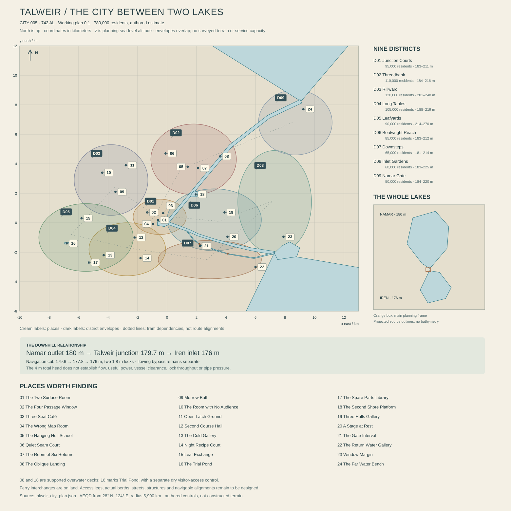

# Talweir — the city between two kinds of water

**CITY-005 · REG-009, Talweir Lake Country, Morrow · working city bible 0.1 · 13 October 2026.** Present: 742 AL. City planning center: 28° N, 124° E. Core population estimate: 780,000. All new local names, dates and physical details below are original authorial proposals consistent with the current planet spine. They are not surveyed terrain, an engineering design, simulated residents or completed Unreal content. The accompanying `talweir_city_plan.json` records the geometry and dependencies needed to review this proposal.

The acceptance condition is a city that can be understood through ordinary movement: a person can arrive from either lake, find a home and a meal, identify why a workshop occupies its bank, and trace its water and deliveries without an invisible transfer. The city should remain worth visiting when no mission is active.

The [plan register and checks](TALWEIR_PLAN_CHECKS.md) expose the authored geometry and dependencies. Numbered markers refer to the 24 place dossiers below. District envelopes guide composition; they are not parcel boundaries, terrain or a constructed city.

## 1. An arrival with room to sit

Your boat enters a reach wide enough for the wind to lose its urgency. Ahead, the roofs do not climb a crater. They spread sideways, opening into courtyards and then joining again through covered passages. Pale masonry carries dark horizontal bands where earlier verandas met the wall. Roofs have blunt, folded ends, with deeply recessed rain channels and an occasional impossibly thin contemporary extension. Beneath them are ordinary doors, not an uninterrupted wall of picturesque shops.

A boatwright has hung three unfinished hulls above her workshop floor. Their undersides face the street, displaying different answers to the same water. At the next landing a ferry lowers its platform while passengers remain seated. A child is watching a floating ring of native lakewindow through a gap in the deck. Two older residents finish an argument about a performance neither enjoyed. Behind them, a kitchen is preparing the second part of a meal that began before you arrived.

The city has an astonishing amount of edge. There are working edges, quiet edges, edges where people meet a relative and edges where they prefer to be alone. Most waterfront housing stands on land behind a continuous public route. Some buildings extend over the water on engineered supports. A few licensed vessels are homes. None of these arrangements makes the whole city an ornamental floating village.

You cannot see Rauth here. The giant is below Talweir's ordinary reference horizon. Ilex crosses a sky whose long changes have become familiar through roofs, work schedules, plants and water. At night the broad upper channel holds discontinuous reflections. Lit rooms appear separated by immense dark stretches that are, in fact, somebody's garden or a public resting place. The city's beauty is not that everyone remains awake. It is that people have left enough evidence of care for a stranger to feel that waking life will continue.

## 2. The mapped water, and what has not been measured

Talweir occupies the bend between **Namar**, nominal surface 180 m, and **Iren**, nominal surface 176 m. It is a freshwater connection with four meters of total nominal head. It is not a tidal sea strait, a cliff waterfall or two names for one undifferentiated lake. Exact water levels, flow distributions, bathymetry, floods and seasonal mixing remain unresolved. The numbers establish an authored relationship, not a promise of constant depth.

The atlas already places the river through three controls: Namar's outlet at 124.1° E, 28.08° N, 180 m; the city junction at 124° E, 28° N, 179.7 m; and Iren's inlet at 124.08° E, 27.98° N, 176 m. On the city's local map, the first lies approximately 9.1 km east and 8.2 km north of the origin, while the last lies approximately 7.3 km east and 2.1 km south. The outlet and inlet are about 10.5 km apart directly. The existing trunk takes a westward dogleg through the city; this plan preserves it.

That dogleg is Talweir's physical explanation. The **Upper Reach** approaches from the northeast, losing only 0.3 m in nominal water surface before reaching the origin. The **Lower Reach** then travels east and slightly south to Iren, losing the remaining 3.7 m. The channel corridor is roughly twenty kilometers long before detailed centerline refinement. On a globe it is a tiny bend. On foot it is a metropolitan geography.

The local proposal places a broad, slow upper channel beside terraces of existing land. Its precise width varies, with a working envelope of approximately 120–300 m; small backwaters are separate from the through lane. Below the junction, an engineered navigation cut parallels a flowing bypass. Two nominal lock steps divide approximately 3.7 m of descent into manageable stages, with upper, intermediate and lower navigation pounds. They do not require the entire river to fit inside lock chambers. Fine sill levels, safe velocities, lock dimensions, flood capacity and minimum ecological flows await engineering. The JSON encodes the intended connectivity and level transitions without pretending the intervening bank is already a terrain mesh.

At the city origin, the Upper Reach, Lower Reach and a short urban basin meet. The basin serves local passenger interchange, small deliveries and sheltered practice. It is not a third great lake. A headwall marks its western end; the city continues beyond it on land. Two rail crossings and several modest bridges join the banks. Their approach ramps occupy space in the district plans, while lift spans and clearance-controlled working bridges keep passage possible for taller boats. A bridge opening changes the route for a few minutes; it does not stop the whole city.

The coordinate frame is azimuthal equidistant on Nacre's adopted 5,900,000 m reference sphere, centered at 28° N, 124° E. Positive x is east; positive y is north. Coordinates are meters. z means altitude above planning mean sea level, not tangent-plane displacement. Projected whole-lake polygons preserve the source points exactly apart from coordinate conversion. Their angular continental outlines are deliberately kept separate from the proposed fine channel banks. A coastline vertex is not evidence of a surveyed beach, and local buildings must not be snapped to its coarse straight segments.

Most residential ground is provisionally 184–230 m, locally higher in western Rillward and Leafyards. These are planning clearances above nominal water, not assessed flood protection. Working decks can be lower; basements beside the channel are limited and require water management. Dense housing is not placed on the lock bypass. The map leaves room for floodable gardens and approach banks before land values consume them in fiction or in the editor.

Namar's approach is authored as the more open, wind-exposed receiving water in the local view: long sight lines, stony patches, suspended material arriving from distant catchments and sheltered pockets behind shore works. Iren's inlet includes shallower lateral coves with fine sediment and protected vegetation. These are local inlet conditions, not assertions that all of Namar is deep or all of Iren is warm. Their surface heights do not prove temperature, nutrient state or shared ecology. Lakewindow occupies suitable sheltered margins; turning cups need appropriate flow and substrate; reeddivers use patchy refuges. No species fills every bank merely because the water is fresh.

## 3. How the city became more than a crossing

This local chronology adds proposed anchors within the established history. It does not move the first arrivals to Morrow or retell the whole planet through Talweir.

**After the intensified Morrow crossings beginning around 163 AL**, survey and navigation installations acquired permanent households. The proposed **Talweir Gauge Rooms, 181 AL**, recorded the two lake surfaces separately. Some later civic speeches call this the city's founding. Household records place unregistered shore occupancy earlier, while several present districts originated much later. The surviving gauge room wall is not a complete arrival compound.

**The Bend Works, 238–251 AL**, regularized a usable navigation passage beside the lower flowing channel. Their first gates were smaller than the current works. Contemporary accounts emphasize delayed freight and worn hulls rather than a heroic conquest of water. Later enlargements rebuilt nearly all working machinery. Foundation stones, an abandoned gate recess and altered approach roads remain better evidence than a reconstructed picturesque gate.

**The Court Extensions, 306–349 AL**, connected housing behind the original banks. Shared drying rooms, schools, modest public gardens and freight access became as important as landing frontage. Talweir learned to build rooms that faced the lake without making the public path pass through someone's kitchen. Some landlords resisted continuous routes; some households preferred the privacy of inland courts. There was no unanimous shoreline culture.

During the broader **469–548 AL repair era**, mobile performance stages increasingly served smaller lake settlements as well as the city. **The Four Landing Circuit, proposed 512 AL**, standardized docking fittings for touring stages without standardizing the shows. The fittings were later replaced but the booking calendar survives. The city became a place where crews learned what worked before taking a performance onto exposed water.

In **563 AL**, Emet Ral and collaborators released **Six Returns**. Its returning phrase changed meaning through what other voices placed around it. Talweir's current fame owes something to that work, but Ral did not invent music, cooperation or the lake itself. The preserved rehearsal room is disappointingly ordinary to visitors expecting a monumental birthplace. That ordinariness is part of its value.

The **Lake Articles of 641 AL** established overlapping arrangements for navigation, shore use, water and cultivation. They did not create a single lake state or abolish municipal government. Subsequent channel changes made some annex maps misleading. Current practice distinguishes the fixed wording, dated survey attachments, later rulings and actual present water. A public map can show all four without pretending they agree automatically.

**The Level Door program, proposed 689–707 AL**, rebuilt a network of steep landings with longer ramps, movable transfers, seating and sheltered waiting. Advocates included people using mobility devices, caregivers moving children, injured workers and freight handlers. Some interventions are elegant and others visibly compromise inherited buildings. They remain ordinary civic infrastructure, not a tour of exemplary exceptions.

## 4. People, rooms and the area between buildings

The nine district population allocations total 780,000. They are planning estimates for living residents, not live NPC budgets, uniform density tiles or a claim that every household has been invented. District envelopes in the JSON guide composition; their rectangular extents overlap and are not cadastral boundaries. The corresponding gross area allowances total 117 km², including streets, local water, employment, civic buildings and reserved land.

A first housing check assumes approximately **310,000 dwellings**, 95% occupied, averaging 2.65 residents per occupied dwelling: about 780,425 people, consistent with the rounded census target. The remaining units include ordinary vacancy, refurbishment, temporary letting and household transition, not 15,500 available luxury homes. Many homes are small; some households share multiple connected units. A single average conceals that variety.

An illustrative 32 km² of predominantly residential parcels, 29% building coverage and 3.3 effective residential floors produces about 30.6 million m² of gross residential floor area. At 80% usable efficiency, that is roughly 24.5 million m², or about 79 m² per dwelling across the stock. These assumptions establish that the city does not require endless towers. They are neither building regulations nor an optimized housing plan. Four- to seven-story street buildings coexist with low garden courts, workshops with rooms above, and a limited number of taller modern blocks. The resulting skyline has long rooflines and occasional vertical punctuation.

The gross land allowance is 32 km² of residential parcels; 18 of employment and freight yards; 9 of civic uses; 21 of streets, transit and public paths; 17 of parks, recreation and managed growing space; 8 of local channels and berths; and 12 of setbacks, reserves and other open land. Mixed buildings are assigned to one dominant parcel class to avoid counting their land twice. These categories will change after terrain and transport testing.

Housing ownership varies within districts: resident cooperatives, individual landlords, municipal stock, employer leases and berth households all exist. A prosperous boat designer may rent beside a retired cleaner who owns her rooms outright. Most residents need no boat to reach work. Wheelchair users, people with low vision and people who cannot tolerate crowded ferries have terrestrial routes; public access includes toilets, resting places and understandable signs, not only ramps drawn at impossible gradients.

## 5. The city keeps itself supplied

### Water and the right to return it

A planning case allows **150 liters per resident per civil turn** for domestic use, plus 63,000 m³ per turn for civic, commercial and selected industrial uses: 180,000 m³ delivered through the potable network. Allowing 20% combined raw-to-delivery losses yields 225,000 m³ abstracted and treated per turn. These are demand assumptions, not measured lake yield. Drought, pollution events, treatment losses and large process users need independent operating cases before approval.

An upper raw-water intake lies upstream of the dense core, outside a proposed navigation lane and away from the immediate outfall. Screening and treatment are essential; attractive clear water is not potable. Pumping raises treated water to western service reservoirs at approximately 238 m and 255 m. Gravity distribution then serves lower pressure zones through regulating stations. Higher buildings and industrial processes have declared boosters. The lakes' four-meter difference cannot supply the western reservoirs without powered lifting.

Lower-bank users have a separately isolatable trunk. The Namar Gate service main has its own booster and elevated local storage because distance, friction and interruption matter. An Iren intake is a proposed secondary raw source, not automatically equivalent treatment water. Because Iren receives the city's downstream water, the candidate position has not established adequate separation from discharge plumes; no reserve yield is credited before source-protection and treatment assessment. Different chemistry or microbial loads can change its operating envelope. A cross-connection is normally isolated; it must not transfer untreated lake water directly into the potable network.

The sewer model collects an average 155,000 m³ per civil turn, with two treatment works provisionally rated at 95,000 m³ per turn each. This 190,000 total does not establish storm or failure capacity. Separate storm drainage, overflow storage, pump backup and one-works-out scenarios remain required. A proposed 50,000 m³ per turn of reclaimed water supplies selected industrial wash and landscape uses; it is recovered flow, not additional raw supply counted a second time. The collection estimate includes returns from both networks. Thus a simple screening balance has 230,000 m³ of gross end-use deliveries, 155,000 collected, and 75,000 consumed or otherwise uncollected; treatment divides the collected volume into 50,000 reused and 105,000 final residual, before separately resolving treatment losses. Those use fractions remain assumptions to test. Loss and uncollected flow can still re-enter the wider catchment, so these network accounts do not measure net basin depletion. Treated residual discharge enters the flowing Lower Reach bypass under a sampling regime. Native turning cups are not the treatment plant, and lakewindow does not make sewage harmless.

### Food without a magical lake harvest

Most human calories come from introduced crops and maintained biological cultures. Lake Country farms supply grains, pulses, tubers, oils and protected horticulture through several routes. The native lake web supplies ecological functions and carefully qualified materials; it is not an unlimited source of human-edible fish. A menu saying “lake curls” means wheat ribbons, cultivated greens and a legume preparation, not a claim that reeddivers are dinner.

At 2,500 kcal per resident per civil turn, the core needs about **1.95 billion kcal per turn**. At an illustrative mixed dry-food equivalent of 3,200 kcal/kg, that is roughly **609 tonnes per turn** of calorie-equivalent food. It is not actual delivered mass: a separate edible-mass allowance of 1.6 kg per resident gives approximately 1,248 tonnes per turn including food water. A protein target of 80 g per resident is 62.4 tonnes of protein per turn, which must appear in crop and culture balances rather than being inferred from total calories.

A provisional annual calorie split is 75% from the wider Lake Country catchment, 22% from other connected Morrow farming districts, and 3% from production inside the city allocation. Cultures consuming imported sugar or grain do not create extra primary calories; their feedstock stays in the balance. City gardens are valuable for fresh produce, pleasure, teaching and household resilience even when their caloric contribution is small. Daylength-tolerant crop management, protected propagation and supplemental lighting belong in agricultural specifications, not in a promise that familiar seeds grow unassisted everywhere.

Rotating reserves target 75 civil turns of dry calorie-equivalent staples, approximately 45,700 tonnes, distributed among flood-separated stores. That is a planning resilience target, not proof of a fully funded reserve. Fresh food rotates much faster. Velis can supply clean seed, clonal starts and biological cultures in relatively small shipments; it does not send Talweir's daily bulk grain across the planet. Aven is thousands of kilometers away and cannot be treated as a convenient fresh-food neighborhood.

### Electricity, heat and moving heavy things

An initial demand envelope is **620 MW average electrical load**, with a 1.1 GW working peak case for the core's domestic, civic, workshop, treatment and transport uses. Heat demand is separate. The purpose is to expose the scale of supporting infrastructure, not to assert a completed power system. Regional grid connections, local dispatchable generation, wind, photovoltaic generation and storage form a mixed portfolio. The city does not share Orison's illumination contracts as its governing system.

The proposed study portfolio includes two regional feeds totaling 500 MW connection rating, 190 MW of local dispatchable plant, 600 MWp of photovoltaic capacity distributed across the city and surrounding service land, and 300 MW of regional wind capacity. Nameplate figures are not simultaneous or firm output. A 30 GWh storage target with 250 MW discharge capability is a candidate to test, not already sufficient coverage. Feedstock, imported power contracts, charging surplus, maintenance and network constraints all remain obligations.

At 28° N the longest nominal natural night is approximately **74.2 hours**, before terrain and atmospheric refinements. A continuous 150 MW residual deficit through that interval consumes **11.13 GWh before losses**; a 400 MW deficit requires 29.68 GWh and exceeds the proposed storage discharge rate. These examples prevent a large battery number from being mistaken for a reliability proof. Heat recovery and thermal storage can reduce electrical peaks but do not erase long-night energy demand.

The four-meter lake drop is not a metropolis-sized energy source. At an entirely illustrative 40 m³/s and 80% efficiency, using 0.88 Earth gravity, taking all four meters would yield about **1.10 MW**. Actual flow, allowed head capture, habitat requirements and navigation needs have not been established. No local hydro output is counted in the supply portfolio. Small demonstrators can be beautiful without becoming the city's hidden perpetual engine.

Bulk freight uses the water corridor, regional rail and roads. A working logistics study range of 6,000–9,000 tonnes per civil turn covers food, materials, industrial inputs and outgoing products; it is not a verified trade forecast. Initial modal shares of 60% water, 30% rail and 10% road are test assumptions. Lake freighters transfer to smaller city craft at designated yards, avoiding the fiction that every apartment receives a container vessel. Flight serves urgent freight, people and specialized jobs; a small landing facility has ground links and does not replace the urban distribution system.

### Production and things people discard

Talweir exports repaired and newly built small craft, modular floating stages, transfer mechanisms, precision housings, water-quality instruments, performance work and training. High-grade alloys, electronics, bearings and some resins arrive from other production centers. Local workshops make valuable objects by combining material with expertise; they do not fabricate arbitrary components from anonymous scrap. Several quiet firms earn more from replacement seals than the famous boatyards earn from beautiful hulls.

A municipal waste study uses 0.8 kg per resident per civil turn, roughly 624 tonnes, excluding major construction and industrial streams. Sorting, reusable packaging return, controlled biological treatment and residue disposal are separate operations. Repair shops reduce replacement demand; they do not make every waste safe. Human and introduced-crop waste require appropriate treatment before any agricultural use, while native organic material follows different compatibility checks. The city has dry yards and covered transfer halls because wet mixed waste is a physical problem, not a texture to spread around poor streets.

## 6. Government without a single lake throne

The municipality handles housing standards, streets, schools, care, local public transport and much sanitation. Lake Articles bodies address defined navigation, abstraction, discharge and shore-use matters across several municipalities. The **Two Surface Office** publishes linked water observations; its records do not give it power to evict a household. The **Passage Board** maintains navigation procedures and channel notices; it cannot decide every land dispute because a doorway faces a canal. The **Shore Assembly** is a municipal forum with elected district members and published hearing rules, not the government of all Lake Country.

Jurisdiction becomes tangible in offices with different doors and different appeal routes. A rented market boat may need a berth agreement, a food license and navigation compliance while its occupants remain residents of a shore district. Residents can dislike this complexity without secretly desiring one ruler. Public counters accept a linked application and direct it internally; the ordinary person should not need a lawyer to obtain a landing pass.

The eight wider traditions intersect here. Berth households maintain return rooms; Basin Witnesses contribute measurement procedures; Measure Houses certify fittings; Ravel houses organize exchanges; Closegarden custodians tend crop stocks; Road Houses receive overland visitors; Witness Companies perform and preserve testimony; members of the Unfinished Assembly leave space for the absent or unknown. None owns an entire district. The Common Table operates kitchens and provisioning partnerships. Open Wake members visit and share rescue procedures, while local captains maintain their own associations. The Night Choir is one source of records among several, with ordinary limits on consent and privacy.

Money and rights remain distinct. Local balances can be quoted through the regional clearing mark for accounting, but a berth reservation, water entitlement or residency right is not automatically purchasable by converting it into a number. Specific prices belong in the economy volume. For the city author, the useful question is what a transaction changes, who recognizes it and which obligation remains afterward.

## 7. Nine districts with lives behind their waterfronts

### TAL-D01 — Junction Courts

**95,000 residents; 9 km² gross allowance; center approximately (-500, 400, 195).** This is the oldest continuous urban fabric around the dogleg's western turn. The civic image is a sequence of square courts opening unexpectedly onto the rounded basin. Three- to six-story buildings have pale mineral walls, dark sill bands and generously framed doorways. Roof extensions span between strong old walls; they do not copy Orison's high copper terraces. One deliberately open sight line lets a person standing inland see moving water through four consecutive passages.

The district contains the Two Surface Office, the principal passenger interchange, ordinary schools, leased offices and a great deal of housing. Several early sealed service rooms survive as cupboards, archives or inconvenient vestibules. Their original machinery is mostly gone. The present municipality is distributed among adapted buildings so a civic visit passes a bakery, a play court and somebody's laundry route. Record keeping is not staged in one enormous authoritarian palace.

Bridge Street crosses the upper basin at a controlled opening. A continuous step-free route follows the western headwall; the bridge is a useful shortcut, not the only connection. Public water access uses separate ramps down to floating transfer decks. Emergency and maintenance vehicles can reach the hard bank without driving through the pedestrian courts. Ground floors alternate open businesses and private thresholds, with small buffers so a household can open its window without joining a public meeting.

Junction Courts is a place to learn the city by watching. Commuters change vehicles, students compare obsolete maps, and visitors discover that an official waiting room has one of the best small Latch tables. Evening does not empty it: some people are beginning a watch while others meet for a short walk. The district's memory includes civic reform, but its present pleasures include reliable lunches, a book repair stall and the sound of wheels crossing alternating stone and timber surfaces.

### TAL-D02 — Threadbank

**110,000 residents; 13 km²; center (1,800, 4,300, 198).** Threadbank occupies the western side of the Upper Reach and reaches inland through long residential courts. Its name refers to old tow lines and later textile businesses, not a sacred weaving metaphor shared by every inhabitant. The waterfront has broad, shallow roof profiles with patterned undersides visible from boats. Narrow high windows illuminate workrooms; lower living windows face quieter courts.

The district mixes upholstery, sail and awning work, household manufacturing, instrument finishing and schools. Buildings frequently contain a workshop front, a service lane and a separate residential entrance. An apprentice should be able to leave work without climbing through an employer's house. Older houses have external stairs; later additions provide shared lifts or gently graded alternate routes. Accessibility has changed some treasured facades, creating an ordinary architectural history of adaptation.

The upper-bank tram is the fast spine. Covered side streets connect it to landings, while an inland cycle and mobility route avoids busy workshop fronts. Freight arrives in scheduled short vehicles and small barges at a few shared loading points. The towpath is now public; its surviving line posts become leaning rails, play boundaries and material evidence. Not every old object is protected from use.

Threadbank keeps rehearsal rooms above workshops because daytime industrial noise once made cheap rents possible. Acoustic improvements have made some spaces desirable, which creates a rent story without defining every resident through displacement. On an ordinary visit, one hears someone repeating a difficult bar, sees a sailmaker arguing cheerfully about a jacket's folds and finds a court where a repair club has opened only three of its twelve projects. Several canal-facing houses are prosperous, and several inland courts are coveted for their quiet. Waterfront proximity is not a complete class map.

### TAL-D03 — Rillward

**120,000 residents; 16 km²; center (-3,800, 2,900, 218).** Rillward is the inland city many visitors initially miss. Its broad residential blocks follow modest rises and shallow drainage lines. Streets bend around retained groves and playing grounds; they are neither a perfect grid nor a maze designed to obstruct the player. Clay-colored paving, light aggregate walls and dark green service doors produce a cooler, quieter visual field than the waterfront.

This district holds the largest general hospital, several secondary schools, the western service reservoir approaches and a substantial share of municipal housing. Health services occupy a connected campus with ordinary streets through it. Staff housing and inexpensive cafés sit beside specialist shops rather than behind a sealed medical fence. A tall ventilation and lift tower is a landmark because of its clear ribbed structure and planted base, not because every medical building needs a glowing symbol.

The main tram crosses the district on a reserved surface route. Short electric feeder loops reach residential courts; wide footways offer seats at predictable intervals. The reservoir service road is separate from the public garden route. Water hardware remains inspectable without giving tourists access to live potable storage. Surface drainage follows visible shallow channels toward planted retention grounds before controlled discharge; these gardens have wet and dry states.

Rillward's household diversity is visible in use: a room converted for an elderly relative, a large shared kitchen beside single apartments, a music teacher receiving pupils through a side door. Some residents work entirely within the district. Others value arriving home somewhere that does not sell the lake to them. Pleasure includes public bathing, ribboncourse, evening gardening and a small comedy venue with famously unflattering seats. A person can spend an excellent afternoon here without approaching water larger than a fountain.

### TAL-D04 — Long Tables

**105,000 residents; 13 km²; center (-2,700, -1,800, 198).** Long Tables begins behind the southern basin frontage and spreads into food stores, markets, housing and performance courts. Its public rooms are longer than its facades suggest. Doors open onto shared passages that widen into kitchens or covered dining halls. Roof lanterns admit changing light through baffled glazing; interior finishes are washable, repaired and warm in their variety rather than uniformly distressed.

The name is partly descriptive and partly advertising. The district contains brief lunches, takeaway counters, private dining rooms, cheap late-watch meals and people who dislike communal eating. A long meal proceeds in small courses so arrivals can join without demanding a restart. Hosts identify ingredients clearly, including introduced proteins and processed native components where certified. Beautiful alien shapes on a plate cannot substitute for a coherent food source.

The wholesale edge sits beside rail and road access farther west. Small distribution vehicles enter service lanes while the public market remains walkable. Cold storage, wash rooms, refuse rooms and staff rest spaces occupy real floor area. The Common Table works alongside independent businesses and household kitchens; it does not own every generous act. A local food college shares test rooms with safety inspectors and voluntary cooking clubs under separate schedules.

Above the markets live families, solitary tenants, performers and people with no culinary occupation. Courtyards allow sleep during noisy public hours; sound separation is an asset requirement. A public route loops from the basin through the covered market to a large playing ground. The district's most recognizable silhouette is a series of shallow roof vaults ending at different lengths, like rooms that have continued growing. Its most characteristic scene is smaller: someone deciding to stay for one more dish because the conversation has finally become interesting.

### TAL-D05 — Leafyards

**90,000 residents; 18 km²; center (-5,500, -1,000, 230).** Leafyards is the western production and growing district, where the city becomes more open before reaching regional farms. Protected crop nurseries, culture facilities, repair yards and ordinary housing share a network of broad service streets and smaller residential paths. Transparent roofs appear in strips, interrupted by opaque workrooms and planted courts. Glazing is not a universal skin; heat, glare, cleaning and energy cost matter.

The city grows propagation stock, leafy crops and selected high-value foods here while bulk calories come from a much wider catchment. Crop rooms have changing schedules over the long solar cycle, stores of nutrients and substrates, and separation from native material processing. Visitors see a range of building ages: an old enclosed growing hall, later naturally lit additions and recent shaded courtyards where household gardeners exchange introduced plants. Native habitat plots are labeled as a different practice.

The regional rail yard and western road gate lie at the district's edge. Heavy freight stays away from the main residential promenade. The district houses one of the major electrical connections, thermal stores and industrial treatment branches; their screened compounds are designed objects with service clearances, not invisible utilities. A public technical school trains operators and fabricators, and its café is popular because students make unusually good furniture.

Leafyards' pleasant spaces are expansive. Model-boat builders use a shallow test pond separate from the raw-water network. A weekend walking route passes flowering introduced crops when their cycle permits, then a native demonstration margin where no picking is allowed. Residents have different relationships to the facilities: employee, neighbor, cooperative member, retiree or simply someone who found a good apartment. The district should feel capable and busy without becoming a factory biome occupied only by workers in identical coveralls.

### TAL-D06 — Boatwright Reach

**85,000 residents; 12 km²; center (3,200, 200, 188).** The land between the Upper and Lower Reaches narrows toward the city junction, then broadens eastward into the boatbuilding district. Its practical advantage is access to both water levels through the controlled passage, plus rail and road transfers at the eastern yard. It is not an island unless later terrain work proves a particular cut divides it.

Workshops present immense doors under comparatively low roofs. Hull forms hang inside on mobile supports; outside, covered slipways interrupt the continuous street wall. Finished vessels wait in controlled berths, while residential courts stand back from fumes, impact noise and moving loads. The highest structures are gantries, a few engineering offices and an old brick-colored drying tower adapted for climate-controlled finishing. Silhouettes are horizontal, interrupted by elegant mechanical spans.

The district specializes in small craft for different uses: lake crossings, quiet observation, food delivery, mobile care, touring stages, maintenance and pleasure. A universal beautiful boat would make less sense than a family of carefully related compromises. Narrow practice hulls, broad stable working decks and covered accessible passenger craft share fasteners and service fittings where compatibility helps, without sharing identical bodies. Skilled finishing matters as much as heroic heavy construction.

A public craft promenade reaches selected viewing bays without crossing active slipways. Schools visit during scheduled windows; buyers enter different doors; residents can reach home without passing through a sales floor. Evening activity includes competitive model trials, small concerts and meals on moored platforms. This is where Talweir's second shore becomes visible: silkminutes gathering beneath a quiet deck, and a reeddiver appearing as an interruption to conversation rather than an enemy encounter. The city earns that moment by retaining suitable water and refuge nearby.

### TAL-D07 — Downsteps

**65,000 residents; 9 km²; center (2,900, -2,500, 188).** Downsteps occupies the south bank beside the controlled lower descent. Its name overstates the terrain: the visible change is a sequence of modest level differences, gate structures and approach ramps, not a waterfall district. From a well-chosen bench one can watch a boat become a little lower against a fixed wall. That patient alteration is one of the city's signature sights.

Housing stands behind the working bank, with schools, a transit depot, lodging houses and shops serving residents as well as crews. Older terraces have limestone-colored faces and red-brown lintels; recent buildings use lighter prefabricated panels within similar street widths. Lock machinery is concentrated rather than scattered across every facade. The important ornament is mechanical legibility: a gate's load path, a level mark, a sheltered line-handling position.

The lock bypass and two navigation steps have distinct public and service edges. A long accessible bridge crosses where a short steep stair would otherwise dominate the composition. Its landings provide useful public rooms and views, while the quick stair remains available. Pedestrian crossings of moving structures close locally and provide signed alternate routes. Emergency evacuation does not assume everyone can climb a ladder from a chamber.

Downsteps includes the lower treatment works and sample gallery, separated from homes by working space and landscape rather than hidden behind an imaginary odorless fence. Residents take pride in a neighborhood music school and a sports court more often than in water law. Children learn gate procedures because boats are interesting. A retired operator can be a terrible amateur actor; a visiting performer can know nothing about locks. The district needs such uneven expertise to remain a place of people rather than an illustrated infrastructure manual.

### TAL-D08 — Inlet Gardens

**60,000 residents; 15 km²; center (7,300, 1,400, 191).** This eastern district overlooks Iren's approach and the sheltered coves north of its inlet. Built density decreases unevenly toward habitat margins, managed shore gardens and small institutional campuses. Some expensive houses have spectacular views; public paths and modest cooperative blocks interrupt any easy assumption that the shore belongs to one income group.

The characteristic buildings have low angled roofs around open centers. Native lakewindow provides a local analogy, but the buildings do not literally imitate a plant at every scale. Deep verandas and ventilated screens create shaded rooms with oblique views. Materials favor pale plaster, dark structural wood composites where supply permits, ceramic thresholds and replaceable woven shades. The visual accent is soft green reflected from water and planting, not an obligation to cover every wall in vegetation.

The inlet field school, a rehabilitation residence, public gardens and a small landing network share access roads. Paths near breeding refuges can close or shift with actual conditions. The stable inland route remains open unless independently affected, so habitat protection is not expressed as arbitrary failure of every accessible path. Observation hides include seated sight lines and space for quiet groups. Some residents come solely to read a book.

Inlet Gardens is Talweir's easiest place to mistake maintenance for nature. Habitat islands, sediment traps and planted buffers each have histories and limits. A deliberately submerged old service road is neither an ancient ruin nor proof of a disaster. The district's pleasures include choosing the right bench for a long conversation, following changes in one inlet across visits, and visiting an indoor conservatory when outdoor wind makes the lake unpleasant. It should offer spaciousness without suggesting that nobody works, commutes or struggles to find a room here.

### TAL-D09 — Namar Gate

**50,000 residents; 12 km²; center (8,700, 6,800, 190).** Namar Gate is the upstream threshold, with freight transfer, passenger landings, shore housing and open-water services. Its position just southwest of the mapped outlet lets the city meet the lake without pretending the city origin lies on Namar's shore. The district's northern view opens outward, giving visitors their first sense that the water continues far beyond the local map.

Long shelter roofs angle away from the prevailing design exposure, pending climate refinement. Massive mooring and transfer structures are separated from the smaller human-scaled buildings behind them. A cluster of modern apartment blocks stands inland around a school and public bath. The foreground can be thoroughly working while the horizon remains almost empty. Lake scale comes from that disproportion, not a skyline repeated along every shore.

Regional boats exchange cargo with smaller craft and rail services here. Passenger interchanges are land-based nodes connected to real berths by ramps and transfer platforms; a map symbol is never a vessel parked on dry land. Service notices distinguish local shelter from outside crossing conditions. A calm basin cannot promise a calm Namar passage. Waiting rooms offer quiet compartments, shared tables and charging points as ordinary amenities.

Many residents belong to families spanning smaller shore settlements. Others arrived for a job and have no inherited relationship with boats. The district's informal attractions include a shop that builds unusually fine folding chairs, a floating-stage maintenance yard and a low bluff where people watch weather rather than departures. Night life is intermittent across civil watches, with reliable food for crews. Namar Gate should feel like the edge of a great inland route, not the frontier of civilization or a port that exists only when the player boards a ferry.

## 8. Twenty-four places worth finding

Each dossier is a proposed place with a stable ID. Actions are design affordances, not implemented mechanics. Returning changes what there is to notice; it does not require every visit to trigger a crisis. Interior access, physical object interaction and persistence need their own later production contracts. NPC ages are omitted unless established elsewhere; no unlabelled AL subtraction is used as biological age.

### TAL-POI-001 — The Two Surface Room

**Junction Courts; (-620, 180, 195); records, observation and civic history.** A narrow room opens behind an unexpectedly broad public counter. Two brass-edged columns record Namar and Iren separately, while newer displays show the dates, locations and uncertainties of the readings. The room exists because one lake level cannot stand in for the other. Its earliest wall belongs to the proposed 181 AL gauge installation; most instruments and the entire accessible entrance are later.

Leda Orven supervises the public record desk. Her independent work is to reconcile incoming observations, preserve their provenance and help residents obtain usable copies. She is proudest of a mundane improvement: a person can now request several agencies' records without repeating their address at every counter. She does not know every local secret.

A visitor can compare current marks with a dated paper section, listen to a concise explanation, or notice a corrected old calibration label behind the newer frame. The discovery is that competent institutions leave evidence of revision. On a return visit, levels and submitted reports may differ while the room itself remains reassuringly familiar. A school group might occupy the explanation bench.

Required assets include a modest layered interior, two distinct gauge assemblies, readable dates, sample drawers, accessible counter sections and ordinary staff possessions. No holographic omniscient lake model is required.

### TAL-POI-002 — The Four Passage Window

**Junction Courts; (-1,350, 700, 197); pure composition and neighborhood life.** Four successive openings align from an inland lane toward the basin. They belong to different buildings, erected and altered at different times. The alignment survived because residents preferred the view and because delivery carts needed a usable passage. It is an authored architectural accident maintained by choice, not a secret axis left by an ancient civilization.

Nami Pell rents a ground-floor room in the second court and restores paper lamps. Her worktable turns toward the passage when she wants company and away when she wants concentration. Visitors see clamps, drying sheets and a half-finished lamp, but the room remains a home workplace with a threshold. She sometimes lends a stool to someone drawing the view; she owes the player no tutorial.

Standing at several positions changes which portions of water, sky and painted wall overlap. A simple photographic or sketching affordance can reward that attention without scoring artistic taste. Children occasionally cross the far opening, briefly changing the composition. Returning under another sky phase produces a genuinely different image from the same geometry.

Assets need four convincing building depths, continuous accessible paving, doors that lead somewhere, movable domestic shades and carefully controlled sight lines. The place fails if it becomes a thin scenic facade or if clutter permanently blocks the one spatial idea that makes it memorable.

### TAL-POI-003 — Three Seat Café

**Junction Courts; (-260, 650, 193); games, conversation and reliable small pleasures.** The café has considerably more than three seats. Its name remembers the three chairs its founders could afford, now mounted on a wall with an affectionate note admitting that one is a later replacement. The best table is near the sheltered basin-facing window, where the staff keep a Latch board with adjustable deflectors and a mounted release guide.

Arun Des, born 672 AL and approximately 62 Earth-standard years old, is the established regular from the leisure bible. He plays precise, unhurried shots and accepts opponents without turning every game into instruction. His reason for being here is an ordinary appointment with friends and good tea. He has already arranged the support he uses; the visitor is not asked to provide it.

The player can join a short match under the documented Latch rules, watch an elegant shot or sit nearby without playing. Losing need not obstruct anything. The café's food and company are the reward. A later visit might reveal Arun working through a difficult deflector arrangement with a younger regular, or absent because he has another life.

Production requires a readable physical board, reachable seating positions, release-guide animation, distinct refreshments, conversation spacing and ambient customers who finish things. A tournament ladder and a special currency are unnecessary to make the scene worthwhile.

### TAL-POI-004 — The Wrong Map Room

**Junction Courts; (-950, -80, 195); legal history without a puzzle lock.** This public study room displays several incompatible maps of the same shore. One is the adopted 641 AL Articles attachment; another records a later channel survey; a third shows current municipal addresses. Transparent overlays explain the category each map serves. The title began as a librarian's joke and became the room's official translated name.

Pera Noll maintains the collection and hosts quiet reading sessions. Her actual work includes locating addresses in old inheritance records and teaching apprentices not to erase uncertainty while digitizing a line. A family may use the room to understand a grandparent's home, while an engineer consults a dated bank section for a different purpose. Neither must be embroiled in a conspiracy.

A visitor can align overlays and discover that an apparently missing street survives under a changed jurisdiction and name. The affordance teaches how to read the city rather than opening a hidden vault. An optional annotation can be saved as a personal map note. Later additions might mark a verified survey correction, visibly dated instead of replacing the older evidence.

Assets include table-scale maps, physical alignment guides, translated legends, accessible magnification, document supports and shelving that suggests a larger working collection. Crucially, the map layers must disagree for specific reasons; random visual noise cannot stand in for historical complexity.

### TAL-POI-005 — The Hanging Hull School

**Threadbank; (1,400, 3,800, 198); craft education and material intelligence.** Three training hulls hang above a wide workshop aisle. One is narrow and quick to turn, one supports a stable working deck, and one carries a sheltered passenger compartment. Below them, students build small sections rather than entire boats at once. The school occupies a former awning hall whose roof span made the conversion economical.

Tavi Neral teaches assembly and inspection. She is preparing her students for certification and for the less easily examined skill of recognizing when a familiar solution does not fit a new use. Her class contains apprentices, returning workers and hobbyists attending different sessions. Their work is paid or educational according to a visible schedule, not indistinguishable unpaid labor.

The visitor can handle approved sample joints, compare the movement of two loaded model sections or watch an instructor reject an attractive but inaccessible service panel. Nothing requires sabotaging a machine to reveal how it works. Returning shows actual progress on one cohort's project, while the three reference hulls remain.

Asset needs are a believable clear-span hall, lifting and safety hardware, partially assembled forms with sensible inner structure, sample materials, varied work heights and storage for unfinished projects. The most important detail is the underside: a hull must have more design than its photogenic exterior silhouette.

### TAL-POI-006 — Quiet Seam Court

**Threadbank; (-100, 4,700, 203); domestic space, clothing and gentle comedy.** Behind a noisy commercial street, this small court is enclosed by homes and a cooperative sewing room. Soft suspended shades create patches of reflected color rather than a permanent festival canopy. The name refers to an agreement about work noise during certain civil watches; it does not guarantee silence at every hour.

Asa Drem coordinates the sewing room's booking board while making elaborate off-center jackets for clients who enjoy being noticed. Several neighbors use the same machines for practical repairs. Asa's immediate concern is finishing a dramatic cuff that keeps folding in the wrong direction. The problem is funny, solvable and hers. She can enjoy a visitor's opinion without becoming a quest dispenser.

A public seat allows the player to watch cloth respond to movement, try a limited garment preview if that system eventually exists, or listen to two neighbors invent increasingly implausible uses for the failed cuff. The court makes fashion a social pleasure rather than a set of rarity colors. A return visit can show the successful garment leaving on its buyer while everyday work continues.

Assets require distinct textiles, functional machine stations, domestic windows with privacy control, layered shade movement and believable garment silhouettes. Laundry should indicate residents' lives and weather conditions; it should not become compulsory decorative clutter stretched across every route.

### TAL-POI-007 — The Room of Six Returns

**Threadbank; (2,100, 3,700, 199); music, ordinary heritage and attentive listening.** The room associated with the 563 AL work by Emet Ral and collaborators sits above a former finishing workshop. It is smaller than visitors expect. A repaired timber-composite floor, later acoustic panels and an old recessed cupboard matter more than a grand monument. The surviving attribution identifies collaborators rather than reducing the recording to one miraculous genius.

Ressa Tor manages rehearsals and a modest public listening program. Her job is to keep the room useful to living musicians while protecting the few documented historic elements. She sometimes removes tourist furniture because a group needs rehearsal space. The place is successful when people make new work here, not when it becomes perfectly still.

Visitors can hear a short returning phrase placed against several different parts, then compare how its apparent mood changes. This is an original musical production obligation, not permission to imitate an existing copyrighted score. On another visit a young ensemble may play an unrelated, uneven new piece. The room's reputation does not guarantee every performance is excellent.

Assets include a compact acoustic interior, accessible upper-floor arrival, varied instruments, rehearsal annotations, replaceable chairs and carefully authored sound. There should be no mandatory collectible hidden inside a protected instrument. Listening, remembering and choosing to stay are enough for the location to function.

### TAL-POI-008 — The Oblique Landing

**Threadbank; (3,600, 4,500, 184); accessible movement and a beautiful pause.** This landing's transfer platform meets the bank at an angle because an older wall and a later bridge pier left a constrained approach. The Level Door program rebuilt it with a long sheltered ramp and a movable final connection. What could have become a tangle of rails instead forms a sequence of generous framed views upstream.

Deni Alvek operates a small timetable kiosk beside the upper entrance. Most of the work concerns ordinary journeys: a class returning late, a passenger preferring a quiet boat, a delivery that needs a different transfer deck. Deni does not control all ferries or know every passenger personally. Their well-kept planter is a source of more unsolicited advice than the timetable.

The player can follow the actual route from street to floating deck, sit where the angle catches a breeze or board a scheduled local service when transport exists. The map node refers to the interchange above, not a ferry stranded at its coordinates. On return, deck height and the final ramp's slope can vary within the future engineered range.

Assets need fixed supports, articulated connections, protected waiting space, tactile and readable wayfinding, and a genuinely navigable approach. The supported platform is intentionally over water; its shore access must remain connected when detailed terrain replaces this planning sketch.

### TAL-POI-009 — Morrow Bath

**Rillward; (-3,500, 2,100, 218); rest, sociability and bodily privacy.** Morrow Bath is an ordinary municipal bath and exercise complex, named for the continent by founders with more ambition than originality. Its public entrance leads to a warm court rather than directly to bathing rooms. Different sessions and private compartments accommodate varying preferences, care needs and comfort with communal space. No resident's culture automatically determines which they use.

Meral Doss maintains the booking and water-quality routines. She also leads a low-pressure floating exercise session, where the point is comfortable movement rather than athletic achievement. Staff have a service corridor, real rest space and storage for cleaned equipment. Heat comes from the district network and heat recovery, not an unexplained geothermal spring.

A visitor can use a quiet rest room, join a suitable session or simply buy a drink in the outer court. The location supports a change of pace without demanding a health buff or revealing private medical information. Returning at another civil watch changes the social mix: workers finishing a shift, parents with children, a carefully quiet session.

The asset set requires several scales of room, discreet accessible transfers, drainage and ventilation detail, washable finishes and privacy-respecting sight lines. The bath's beauty should come from reflected light, good proportions and the confidence of well-maintained public space, not voyeurism or excessive ornament.

### TAL-POI-010 — The Room with No Audience

**Rillward; (-4,400, 3,400, 222); amateur performance and permission to be mediocre.** A former storage room beneath a neighborhood hall hosts a comedy club whose name began when nobody attended its first evening. The small stage has excellent acoustic treatment and famously uncomfortable original chairs, now mixed with better replacements. A wall notice invites complaints about the chairs before complaints about the jokes.

Kira Fen books performers and works elsewhere during another watch. The club is her chosen pleasure, not a desperate business that must be rescued by a stranger. She maintains a clear consent rule for audience participation: declining is ordinary and should remain funny only if the person chooses to make it so. Performers include accomplished regulars and beginners who may never return.

The player can sit through an original short routine, watch a disastrous prop behave exactly as its maker designed, or attend an open rehearsal. The material concerns apartments, fashion, appointments and human vanity as well as local politics. A return visit changes the lineup while recurring jokes create familiarity.

Assets need a small adaptable room, imperfect but intentional furnishings, a genuine backstage route, readable booking notices and animation that can support timing. Comedy must be authored in actual lines and actions later. A generic crowd laughing continuously would destroy the specific pleasure this place promises.

### TAL-POI-011 — Open Latch Ground

**Rillward; (-2,800, 3,900, 212); public games across different abilities.** This recreation ground combines table games, a ribboncourse court and an open strip for informal practice. Its name persists from a much smaller predecessor. Paths pass between activities, giving spectators somewhere to stop without standing in the playing area. Drinking water, shade, toilets and equipment storage make the place usable for more than a picturesque minute.

Vedo Ar coordinates equipment loans. He is training two new attendants and trying to recover a particular set of fabric ribbons from people who keep taking them home accidentally. His main purpose is to keep ordinary play available, including supported release guides, different ball weights and walking or rolling variations. He does not classify every participant into a heroic overcoming story.

Visitors may join a short informal game, borrow a tabletop set or watch a group invent rules the staff wisely decline to standardize. The ground offers social observation without requiring competitive mastery. On return, weather or sky phase changes which areas are popular; some friends reliably claim the same table.

Production assets include a coherent surface system, several equipment variants, seated and standing sight lines, reachable storage and clear circulation. The important simulation distinction is between active players, waiting players and people enjoying company. A field populated solely by repeating sports animations would feel deserted in another way.

### TAL-POI-012 — Second Course Hall

**Long Tables; (-2,200, -1,000, 196); food, conversation and generous duration.** A narrow entrance opens into a hall that bends around a planted court. Its kitchens serve successive small dishes rather than one monumental plate. Diners can join at several points in the meal, and a shorter menu remains available for people with appointments. The name promises continuation, not an obligation to stay.

Hessa Morn manages a team that includes cooks, servers, cleaners and trainees with separate responsibilities. Today she is testing a cultivated-herb broth for lake curls. The wheat ribbons and legume preparation have traceable terrestrial food origins; any native-derived ingredient requires its own named, processed and qualified supply. Menu poetry cannot overrule the biology contract.

A visitor can order, share a table by mutual agreement or choose a quieter alcove. Nearby conversations have beginnings and endings. One group may discuss a performance while another carefully avoids discussing work. Returning can reveal a seasonal dish or the same reassuring staple, without a fresh dramatic incident attached to every meal.

Assets need functioning circulation from store to preparation, serving and washing; several table arrangements; realistic portions; washable surfaces; and acoustic separation for quieter spaces. The long room should feel inhabited through service rhythm and diners' behavior. Endless identical bowls and unmoving patrons would undercut the entire idea of a meal that unfolds.

### TAL-POI-013 — The Cold Gallery

**Long Tables; (-4,300, -2,200, 208); provisioning, design and an unexpectedly good view.** An enclosed public gallery crosses above part of a wholesale food transfer hall. It was included during a later rebuilding so students and residents could see how food reaches the city without entering work zones. Below are insulated containers, inspection stations and short transfer lanes. Above, a carefully framed western window catches changing light across the roof landscape.

Nerin Solt supervises one shift of incoming produce. Their independent task is matching actual deliveries with temperature records, storage capacity and the next distribution departures. Most loads are ordinary and accepted. A doubtful batch has a defined holding area rather than becoming a citywide crisis by narrative default.

The visitor can follow one sample consignment through a diagram and then identify its physical route below. A modest interactive display distinguishes edible mass, calorie equivalent and packaging, making the city more understandable without turning freight into an examination. Returning shows another working pattern and perhaps a different crop in the public sample case.

Required assets include a full separation between public and operational space, insulated containers with varied use histories, equipment clearances, sensible loading heights and workers with destinations. The gallery's calm depends on real work occurring below. It should not become a spectacular conveyor that endlessly carries food back into the same hidden wall.

### TAL-POI-014 — Night Recipe Court

**Long Tables; (-1,800, -2,400, 198); household teaching and the pleasures of repetition.** Four buildings share a court with a licensed teaching kitchen on one side. “Night” refers to its original late-watch sessions, not a rule that it opens only during natural darkness. Its sign displays both civil scheduling and sky phase so visitors do not confuse the two. Introduced herb pots sit above a washable work ledge.

Aru Mett teaches a small class while compiling household variations of the same inexpensive dish. People contribute versions because they enjoy arguing about texture and because the record may interest their children. Participation does not transfer ownership of a family's entire history. A posted consent sheet separates public recipes from private notes and photographs.

A visitor can watch a demonstration, smell a prepared sample or help with an approved simple action if interaction systems support it. The scene should allow expertise, uncertainty and humor without making one elder the voice of a whole culture. On return, the class might be practicing a previous recipe rather than constantly inventing a new festival dish.

Assets include a credible small kitchen, varied containers with actual uses, cleaning and handwashing stations, seating and work surfaces at different heights, and a restrained set of ingredient props. The court's character comes from precise domestic habits, not an excessive pile of exotic-looking food that nobody can identify.

### TAL-POI-015 — Leaf Exchange

**Leafyards; (-5,800, 300, 238); gardening, patient knowledge and modest commerce.** The exchange occupies the edge of a propagation campus, with a public courtyard and controlled growing rooms behind. Residents bring introduced plant cuttings, buy approved starts or ask why a familiar crop failed under their particular window and schedule. Native specimens belong to a separate education program; they are not casually mixed into food-growing substrates.

Leva Som coordinates the public nursery. Her staff maintain records of cultivars, suppliers and plant health while encouraging household experiments within sensible limits. Leva particularly enjoys clients who return to report that an unremarkable plant is doing well. The job contains abundant ordinary success, not merely contagion alarms.

The player can compare growth under several demonstrated light schedules, choose a non-invasive household plant if housing systems later allow it, or attend a short propagation lesson. The opportunity is to acquire a relationship with something slow. A later visit may show the same demonstration plants at a new stage, with failures identified honestly alongside successes.

Assets require production benches, quarantine separation, realistic labels, substrate storage, older and newer enclosure forms, and controlled plant variants. The growing campus must show resource inputs and waste handling beyond its attractive public edge. Its educational value comes from carefully bounded choices rather than a miraculous seed that makes any alien soil immediately fertile.

### TAL-POI-016 — The Trial Pond

**Leafyards; (-6,800, -1,400, 230); model craft and a hobby with no larger destiny.** A shallow artificial pond sits within a park between housing and workshops. Its water system is isolated from potable storage and the lake navigation network. Long straight edges support measured trials; curved planted ends make the basin pleasant when no one is testing anything. A low accessible deck lets spectators see models at close range.

Tess Varen builds tiny delivery craft with unnecessarily elaborate cabins. She knows they are inefficient and considers that part of their charm. Several regulars pursue faster designs, while a child nearby is delighted merely to keep a model moving straight. The club has rules for batteries, retrieval and sharing the water, not a qualifying ladder for all participation.

A visitor can launch a borrowed simple model, watch two radically different designs complete the same course or inspect the club's collection of spectacular failures. Nothing of planetary significance lies beneath the pond. Returning offers new models and familiar rivals, with some days reserved for quiet practice.

Assets include believable small mechanisms, retrieval tools, shallow-water rendering, safe deck edges, storage lockers and a board showing practical operating conditions. Models need not reproduce full vessel physics during the earliest implementation, but their visible motion must respect the surface and their own propulsion. The pond should remain enjoyable to observe without touching a controller.

### TAL-POI-017 — The Spare Parts Library

**Leafyards; (-5,300, -2,700, 226); repair, shared tools and local expertise.** This cooperative lends tools and stocks documented replacement parts for household and small workshop equipment. The public room resembles a library because items are cataloged and returned, while the rear contains inspected storage and work bays. Its facade displays several beautiful obsolete handles that no longer fit anything in normal service.

Oren Dask manages intake inspection. He distinguishes a useful reusable part from a dangerous object that merely looks intact, and he records what a borrower actually needs before suggesting a replacement. His work depends on suppliers and certification; he cannot repair every advanced device with enthusiasm and a drawer of screws.

The player can compare compatible fittings, observe a simple repair or borrow an approved tool under whatever later ownership rules govern such objects. The location is a natural future integration point for pickup, return and inventory systems, but this dossier does not implement them. On return, a familiar repaired appliance may be back in use at the front counter.

Assets need a legible catalog, graded storage, cleaning and inspection surfaces, varied common parts and a few carefully chosen obsolete objects. Important props require ownership and handling states eventually. Filling shelves with thousands of decorative parts would add less character than showing ten objects with clear purposes and different histories.

### TAL-POI-018 — The Second Shore Platform

**Boatwright Reach; (1,950, 1,920, 184); native wildlife and an unhurried meeting.** A supported platform projects into a sheltered side pocket of the Upper Reach, away from the main navigation lane. Its adjustable working edge is used to test deck balance with secured loads. When work finishes, a small public section becomes a place to sit above the water. This is the physical home proposed for the ecology draft's second-shore encounter.

Mira Tenn is the boatwright testing a platform design. She brings a meal and waits after some trials because she enjoys watching the water beneath. Concentrations of silkminutes can become visible in suitable light; a reeddiver may pass through them. Mira knows repeated local patterns but does not promise an appearance every night or claim the animals come to meet her.

The visitor can help with an approved observation, sit quietly or look through a low viewing opening. The reward is learning to distinguish a moving layer from reflected dust. Returning under different conditions may reveal nothing obvious, which should remain an honest outcome rather than trigger a replacement spectacle.

Assets require connected shore access, support piles, load-test equipment, a safe public boundary, layered underwater visibility and species-specific movement. No glow is inherent in the organisms. The platform must preserve nearby refuge and suitable water rather than conveniently producing wildlife wherever the player looks.

### TAL-POI-019 — Three Hulls Gallery

**Boatwright Reach; (3,900, 700, 188); beautiful engineering and choices made visible.** Three full-sized craft occupy adjacent dry cradles in a sales and exhibition hall. They share service fittings but differ in purpose: an exposed practice boat, a stable maintenance platform and a covered passenger craft. Cutaway panels show selected internal structure without destroying the impression that these are usable vessels. The hall opens toward an active yard through controlled viewing windows.

Renn Isca demonstrates vessels to buyers and visiting classes. Their job is partly commercial and partly technical: an elegant boat unsuitable for its purchaser becomes an expensive failure. Renn asks about journeys, loads, access and maintenance before discussing finishes. They are proud of the plainest craft because it solves a difficult transfer problem well.

Visitors can walk the passenger deck, compare seated sight lines and inspect how a maintenance worker reaches a service compartment. A future purchase interface is optional; understanding the objects already makes the place worthwhile. On return one cradle may contain a customer's nearly completed vessel, while a sign explains the missing demonstration craft's current use.

Assets need coherent vessel interiors, realistic access paths, cradle and restraint hardware, multiple material finishes and readable assembly detail. These three craft should become strong reusable families for the wider city. Superficial hull swaps cannot replace the different circulation and working arrangements their purposes require.

### TAL-POI-020 — A Stage at Rest

**Boatwright Reach; (4,100, -950, 185); touring culture seen between performances.** A mobile stage stands in a dry maintenance court beside its transfer slip. Without an audience it resembles a folded building: roof leaves nested together, rails stowed, seats packed by size. Its fittings descend from the Four Landing Circuit's compatibility work, although none of the current load-bearing parts dates to 512 AL.

Pali Em supervises the touring company's maintenance interval. The crew has time for rehearsal, repairs and ordinary leave before traveling to smaller lake settlements. They are not stranded unless a later authored event specifically makes them so. Pali's current delight is a newly quiet hinge that will stop intruding on a delicate musical entrance.

The player can watch part of the unfolding sequence from a marked safe position, examine a route calendar or attend a short open rehearsal in the court. The mechanical transformation is theatrical even without a show. Returning after departure leaves the actual empty cradle, a few workers and a dated notice rather than a duplicate stage spawned for convenience.

Production needs a mechanically plausible folded state, assembly animation or carefully staged phases, secure connections, backstage service spaces and a real route from court to water. The structure should express contemporary technical competence. Elaborate motion with no supported loads would turn a distinctive piece of civic equipment into visual magic.

### TAL-POI-021 — The Gate Interval

**Downsteps; (2,230, -1,570, 184); observation, timing and understated grandeur.** A stepped public garden overlooks the first navigation lock without crossing its working edge. Its best seat is aligned with a fixed wall mark, allowing a visitor to watch a vessel change height by a small but unmistakable amount. A long graded route serves the same view as the shorter stairs. Trees and screens shelter conversation without concealing operations.

Sada Verr works in lock maintenance and visits the garden when off duty because her partner likes it. She is not stationed there to explain the machinery indefinitely. Other visitors include enthusiasts with notebooks, commuters waiting for someone and people who ignore the lock entirely. That mixture keeps the place from becoming a compulsory engineering lesson.

The player can observe a complete passage, learn the difference between a chamber and a bypass, or simply listen as different surfaces become exposed. A returning visitor might see routine inspection with navigation using a published alternate schedule. The city does not need a failure to make change visible.

Assets require correct relative water levels, chamber geometry, gates with credible seals and hinges, line-handling positions and clear public separation. Two nominal 1.8 m lock steps plus the upper approach's approximately 0.1 m fall account for the lower system's 3.7 m descent; final surveyed stages remain an engineering obligation.

### TAL-POI-022 — The Return Water Gallery

**Downsteps; (6,000, -3,000, 184); treatment, evidence and a useful public institution.** The lower works include a small visitor gallery above the final sampling room. Windows show actual equipment and a short section of the treated-water route, while diagrams distinguish raw intake, drinking-water treatment, sewer treatment, reuse and final discharge. It is deliberately possible to understand these as different processes without mastering the whole system.

Dorel Hann coordinates sampling and public visits. Their team checks whether current operations satisfy specific requirements and reports results with dates and limitations. The gallery does not display a permanent green assurance lamp. Most days are uneventful because staff are competent, equipment is maintained and samples fall within the expected range.

Visitors can compare a simplified process diagram with the visible pipe routes or examine sealed reference samples. Native turning cups appear in ecological education material, explicitly separate from the treatment process. A return visit might feature another school group's questions or a newly replaced pump, documented as ordinary maintenance.

Assets need distinguishable service lines, contained sample handling, public and staff circulation, ventilation, storage and credible access to equipment. The final outfall connects to the Lower Reach downstream of principal abstractions under a future modeled operating regime. A beautiful planted edge is welcome, but it cannot serve as the only explanation of how a city returns its water safely.

### TAL-POI-023 — Window Margin

**Inlet Gardens; (7,900, -950, 185); habitat, close looking and comfortable solitude.** A low observation room stands beside a sheltered inlet pocket, with windows and open bays at several viewing heights. Its name refers to nearby lakewindow rings, whose open centers hold reflected sky. A marked public path stays on firm land; a narrow staff route reaches monitoring points closer to water. The structure is a contemporary field-school building, not an abandoned shrine.

Ria Nemm monitors several habitat plots while supervising students. She records absent organisms as carefully as present ones. Lakewindow cover, dissolved oxygen, sediment and refuge conditions do not always vary together, and a reeddiver's disappearance does not automatically prove poisoning. Her work rewards repeated attention rather than a single dramatic reading.

A visitor can compare photographs from the same fixed view, observe actual rings or sit quietly with no scientific objective. On return the margin might be sparse, folded, expanded or partly cleared to maintain a defined channel. These changes need authored or simulated causes before implementation, not a random decorative shuffle.

Assets require distinct ring growth stages, shallow and deeper water zones, appropriately limited visibility, readable monitoring markers and an inviting ordinary room. The place should support long rests as well as brief discovery. Native organisms are neither collectible houseplants nor food rewards merely because the visitor has learned their names.

### TAL-POI-024 — The Far Water Bench

**Namar Gate; (9,250, 7,700, 188); scale, weather and a destination without a task.** A broad sheltered seat occupies a low shore rise above the upstream approach. Its back protects against some winds while leaving two open ends for different views. The foreground includes a few working boats and part of the maintained bank. Beyond them, Namar continues until atmospheric visibility and the world's curvature make the far water unreadable. No opposite city skyline is invented to fill the horizon.

Eda Rell often brings a folding chair she has made herself, despite the bench being perfectly adequate. She tests small improvements for her workshop and enjoys seeing whether anyone notices them. Visitors may also find her absent, the seat occupied by strangers, or nobody there at all. The view does not require a designated interpreter.

The player can rest, watch a remote rain band when weather supports one, or compare the sheltered approach with rougher open water farther out. Returning changes light, visibility and activity without guaranteeing spectacular conditions. A quiet clear interval is not an inferior version of a storm.

Assets need a convincing water horizon, restrained shore detail, a continuous accessible land approach, seating with real proportions and sound that distinguishes nearby work from distant weather. Rauth must never rise into this view. Its absence is part of Talweir's sky, leaving the lake room to feel enormous on its own terms.

## 9. Routes, visits and the city between set pieces

The first city arrival should support three different readings. A passenger entering at Namar Gate sees open water become a managed channel and then an inhabited bend. A regional rail passenger reaches Leafyards and Rillward before encountering the famous waterfront. A visitor from Iren watches modest lock passages reveal that two lakes can be close while remaining physically different. Each journey has a clear sequence and honest elapsed distance. No first visit needs to show every district.

Within the core, useful trips have alternatives. Junction Courts to Long Tables is a pleasant terrestrial walk. Threadbank to Boatwright Reach can use a bridge and tram connection or a ferry with actual access legs. Inlet Gardens to Namar Gate is a longer eastern journey, not two adjacent map icons. The JSON's straight transport links are network intent only; route length, stops, safe alignments and travel time require later geometry. A vehicle is not granted passage through a building because two nodes share an edge.

Most district interiors should contain unremarkable destinations: a small grocery, a school entrance, shared laundry, a sheltered bicycle store, a clinic appointment room, a private garden and a shop that is closed because its owner has finished work. Repetition becomes convincing when the same functional family supports different households. A return-board near a Berth household's door, a folding chair under repair and a child's unfinished model can make a room specific without adding a unique monumental mesh.

Ecological encounters belong to conditions and space. Lakewindow margins need shelter; turning cups need suitable flow and substrate; silkminute layers need a plausible water column; reeddivers need prey and refuge. The two lakes exchange water and organisms without becoming identical populations. Boat traffic, turbidity, oxygen and changing margins affect encounters locally. A rainy day cannot automatically raise every lake to flood stage, and a long clear night cannot automatically freeze the entire system.

Public performances have preparation, admission, gathering, duration and dispersal. Small ones can occur without a festival controller. Food businesses have deliveries, preparation, service and cleaning. Homes have privacy. The world should make these activities legible before attempting to simulate every person continuously. A carefully authored repeated appointment can feel more alive than thousands of aimless walking agents.

The original eight pleasant encounters remain useful anchors, especially Arun's café game. Several new locations deliberately ask nothing of the player: the Four Passage Window, Room with No Audience, Trial Pond, Second Course Hall and Far Water Bench can simply be enjoyed. Optional stories can later grow from them without replacing their independent purposes. Consequence does not mean every pleasure must conceal a disaster.

## 10. Art and production obligations

Talweir's architectural kit should begin with useful families: court walls and doors; shallow folded roofs; upper workroom windows; covered passages; mixed private and public thresholds; workshop spans; hard banks; articulated landings; small bridges; lock equipment; rail and freight interfaces; and ordinary interior service rooms. Material families include pale mineral masonry, dark structural bands, clay paving, replaceable woven screens, restrained ceramic detail, composite timber products and contemporary metal where it performs a visible job. They need provenance, weathering rules and believable joints.

The city cannot be built by recoloring Orison. Orison's crater terraces and copper-rich vertical drama contrast with Talweir's long roofs, broad public edges, low level changes and freshwater horizons. Some imported objects and shared technical standards should recur across both cities because they inhabit one civilization. Regional distinction comes from composition, use and adaptation, not forbidding every shared bolt or chair.

Priority hero work comprises the Junction basin sight lines, one inhabited Threadbank court, the two-stage navigation passage, a functioning boatyard block and an Inlet Gardens observation margin. The twenty-four POIs specify asset needs but do not demand twenty-four isolated kits. For example, the three hull families can support transport, school, sales hall and yard; the accessible landing system can vary across several shore conditions. Reuse should preserve meaningful structural differences rather than hide the same silhouette behind different decals.

The future development sequence should first validate terrain and water continuity at coarse scale, then routes and inhabited building depth, then one complete district segment with interiors, sound and ordinary activity. Weather and day/night presentation must use the planet contract while allowing readable play. Water levels, lock operation, wildlife cycles, object pickup and persistence remain planned systems. A dossier does not prove them implemented, and an attractive image does not validate their interactions.

Outstanding engineering decisions include seasonal lake ranges, bathymetry, catchment flows, flood return cases, channel and lock capacity, bridge clearances, sediment budgets, water-treatment envelopes, power reliability, exact agricultural yields and housing costs. Outstanding narrative decisions include household histories across more than one generation, specific municipal election procedures and the full original musical material. These are bounded next questions attached to a coherent city, rather than excuses to leave its water, streets or people undefined.

## 11. Canon and source boundary

This dossier derives its fixed location, city identity and population from `../Atlas/nacre_atlas.json`; lake surfaces, polygons and the existing river dogleg from `../Atlas/nacre_geography.json` and RIV-004 in the atlas; sky timing and Rauth visibility from `../02_SKY_WATER_AND_SEASONS.md`; historical anchors from `../04_HISTORY_OF_NACRE.md`; regional intent from `../07_REGIONAL_ATLAS.md`; and ecological limits from `../Drafts/MORROW_ECOSYSTEMS.md`. Social and leisure continuity comes from `../Drafts/SOCIETIES_FOUNDATION.md` and `../Drafts/PLEASURES_AND_EVERYDAY_LIFE.md`.

New local dates are explicitly proposed, not extracted historical facts. Capacities are transparent design assumptions. The local geometry is a refinement proposal tied to source controls, not a claim that the continental atlas already contains these banks. No external asset pack, real-world sacred form or existing game's city is treated as a template to copy. This pass authors a place and its reviewable dependencies; physical construction, procurement and runtime verification remain separate work.
