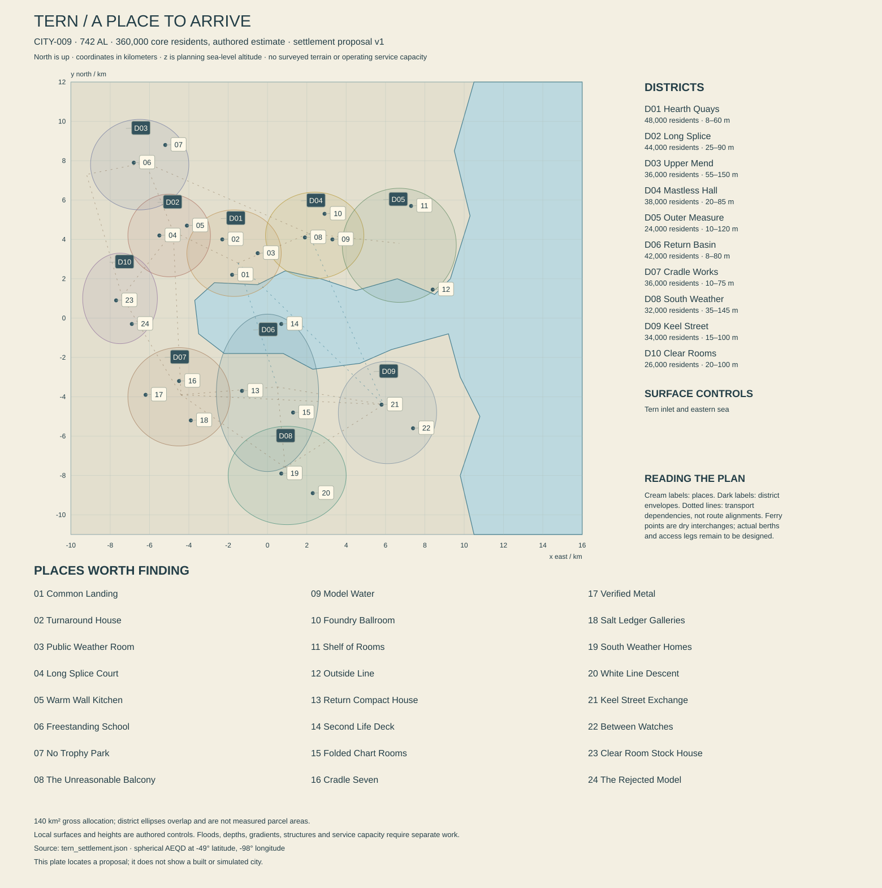

# Tern — A city that knows how things come apart

Authored city dossier, 742 AL. CITY-009, REG-015, Tern Storm Coast, Sere; 49° south, 98° west. Core population estimate: 360,000. This proposal establishes ten districts, twenty-four mapped places and explicit service assumptions. It describes a world to construct, not new Unreal content, a surveyed port or demonstrated infrastructure. Local dates and new biographies are proposed additions within the established planetary history.

The [mapped settlement data](tern_settlement.json) and [generated relationship checks](TERN_SETTLEMENT_CHECKS.md) accompany the dossier. Those checks concern authored geometry and accounting; they do not certify vessel access, buildings or service capacity.

## The first view is of somebody else's unfinished work

A ship hangs partly out of the water inside a dry repair enclosure. Its hull is open along a line that should have been invisible, revealing conduits, stiffeners and an unexpectedly domestic strip of flooring. Workers have protected a painted cupboard before removing the structure beside it. Across the inlet another vessel is already leaving, beautifully ordinary, with no visible sign of the weeks of work that made departure possible. Tern makes both conditions public: things taken apart and things trusted enough to go away.

The city is not defined by constant emergency. On a fine interval, ferries cross a bright working basin, the public promenade fills, and apprentices argue about a regatta result long after the boats have stopped moving. A shop sells excellent coats whose buyers mostly remain indoors. A retired captain lets a child explain the model-boat controls incorrectly, then offers one useful suggestion. Beyond the sheltered water the sea may still carry a swell generated somewhere no one here has seen.

Tern earns much of its income by returning useful things to service. Marine repair, heavy equipment, inspection, rescue training and durable products matter more than a fantasy of endlessly launching new ships. Its yards depend on imported material and specialized components. Some machines are made locally; others arrive from distant manufacturers, and their failures send arguments across oceans. The city exports labor, judgment, tested work and trust as well as physical goods. An immaculate joint can contain a more consequential history than a spectacular wreck.

Industrial scale shapes the skyline without swallowing every life. Wide repair halls need long spans and heavy access; homes need quiet, privacy and familiar thresholds. Routes step behind yards, rise across modest coastal ground and return to the water at public openings. Freight occupies particular corridors. People can live a good life without spending every journey between trucks. Smaller businesses repair cooking equipment, tailor clothes, publish illustrated manuals, teach music and make deliberately impractical objects from material too interesting to discard.

Tern also has secrets worth entering. A former service gallery can reveal an obsolete dock layout. A vessel's supposedly replaced component can remain in a protected store. A retired ship may host a private rehearsal, a covert meeting or an argument among relatives. These places have owners, power sources and access histories. The player's freedom comes from understanding them well enough to choose an approach, not from a universal rule that every unlocked door contains abandoned treasure.

## A harbor on a planet, not a bowl of decorative water

The settlement uses the unchanged atlas coordinate and a spherical azimuthal equidistant local frame. Positive x is east, positive y north; all z values are meters above the planning sea reference. The reference sphere has a 5,900 km radius. The local frame extends 26 km east-west and 23 km north-south, encompassing urban districts, open ground and part of the approach. The 140 km² gross urban allocation is a separately authored land-use account, not the area of the frame or the sum of overlapping district ellipses.

One continuous sea polygon enters from the east and turns into the industrial inlet. This is an explicit local refinement around a coarse coastline, whose nearest atlas control lies east of the city. It does not move Tern or imply a continental river ending at its center. There is **no parent river assigned to CITY-009**: `source_river_id` is null and the channel list is empty. Regional freshwater catchments and small local drainage still need authoring. A convenient pipe or culvert must not quietly become a new permanent river.

The eastern approach widens toward the open sea, while the inner shores provide different combinations of exposure, depth and access. The plan's outline alone cannot prove shelter. Wave direction, period, diffraction, reflection, surge and local bathymetry remain open. The word protected describes the design intention and established port role, not an engineering result derived from a polygon. Exact breakwater alignments, dredged approaches and sediment consequences require a later port study.

Nominal sea surface is zero. No twice-daily Earth tide has been imported by habit. Nacre's local water-level behavior needs its own astronomical and coastal model, and weather-driven changes can matter independently of tidal phase. Signs distinguish measured water level, current, offshore swell and harbor restrictions. A visitor should be able to see why a calm inner berth does not certify a comfortable journey outside, without receiving a lecture on every departure.

Working waterfront controls sit around 8–20 m; much ordinary housing occupies roughly 25–100 m ground, and selected upper routes reach about 145–150 m. These are authored elevations rather than construction surveys. Foundation conditions can vary sharply across rock, filled parcels and older basins. A terrace of apparently matching houses may conceal different support and drainage problems. Detailed stormwater routes must avoid sending polluted yard runoff through a public shore habitat simply because gravity points that way.

Heavy industrial access requires honest dimensions. A candidate large repair enclosure might accommodate a vessel about 230 m long and 42 m wide, but this is a design class to investigate, not the certified capacity of a mapped dock. Its gates, supports, lifting systems, water displacement and power need calculation. Smaller facilities can handle many more common vessels and components. Several modest jobs may create more income and local activity than a single celebrated hull, giving the working port variation instead of one cinematic giant repeated everywhere.

The only explicitly supported-water POI is a retired vessel moored at [700, -300, 9]. Its deck control is above nominal water; its dry embarkation point is [700, -2300, 15]. People reach it by launch, with boarding arrangements to be designed. The connecting record is not a two-kilometer footbridge. Mooring loads, access during bad weather, fire precautions and evacuation remain real obligations even for a charming reused boat.

## The weather has several audiences

At 49° south, Tern receives approximately 55.6 hours of geometric daylight around northern solstice and 81.1 around southern solstice. Equinox daylight is about 68.4 hours inside a 136.755-hour natural solar cycle. The longest nominal night is therefore about 81.1 hours. These are open-horizon values. Nacre's effective seasonal tilt is about fourteen degrees; Tern does not acquire an Earth-style polar night, and winter is not a permanently dark season.

Civil turns remain twenty-four hours, with watches used for public schedules. A shift ending after first watch may end in daylight on one visit and darkness on another. Ordinary sleep, schooling and appointments continue through long natural intervals. Offshore work also follows weather windows, which can interrupt a convenient civil plan. Forecasts help households prepare without making everyone's life an endless sequence of canceled commitments.

Rauth is below Tern's ordinary reference horizon: its center is approximately 5.66° below, with the upper limb roughly 0.69° below. The planned urban heights do not create a routine broad giant view. A specially authored higher or refracted sightline might someday show a distorted edge under stated conditions; this dossier does not claim one. Public art can depict Rauth from recordings or another city. It must not trick the camera into finding an enormous permanent planet over every harbor scene.

The seasonal design expects repeated maritime disturbances, with a more demanding interval provisionally weighted toward southern cooling and winter. Exact temperature, storm frequency, precipitation and current patterns remain climate questions. Good weather is equally important: clear departures, sheltered walks, warm rooms with open doors, regattas and productive ordinary watches. A storm coast without relief becomes emotionally and ecologically monotonous.

Different users read different hazards. A repair manager needs gust limits at a lifted load. A passenger wants likely motion and arrival reliability. An outer-shore guide cares about wave runup at one ledge, while a housing caretaker watches drains and roof attachments. Rescue dispatch combines conditions at the destination with vessel readiness and crew fatigue. One universal red weather icon cannot replace these relationships. Automation and remote instruments usually work; a missing observation is significant because the system is normally capable.

Recovery has duration. A road can reopen while a quay still needs inspection. Clean water in the sky does not remove debris beneath a berth. A reopened school does not mean every household's heating is restored. Equally, successful preparation can leave a neighborhood almost untouched, and that result deserves depiction. The city should sometimes celebrate crews returning after uneventful professional work, not only after narrowly surviving a disaster.

## Shore life is not a seafood menu

Tern's signature native habitats connect exposed feeding shelves, protected gaps, nursery straps, damp wrack and particle-bearing channels. These are different environments within walking or boating distance, not one generic coastal biome. **Breaklace, ECO-049**, forms living straps and perforated fans across suitable rock. Its upper surfaces shift with wet angle; it is not discarded fishing net. Stored reserves help living knots persist through the long night, while damaged attachments change subsequent growth.

**Hingewheels, ECO-050**, are anchored filter-feeding colonies whose curved houses fold under strong flow. They are neither rolling animals nor living water-treatment machines. Feeding depends on suitable particles and exchange. **Crease couriers, ECO-051**, carry softened native scraps as food and shelter, not as presents or collectible loot. Their nursery material can vanish when a well-intentioned cleanup polishes an entire beach bare. **Storm cradles, ECO-052**, use broad paddles and gripping limbs to work feeding shelves and sheltered nurseries; their 1.6–2.8 m adult bodies are not seals with unusual heads.

No human food use is qualified for these four species. Tern meals rely on introduced crops, maintained cultures and separately qualified ingredients. Native animal resemblance does not establish terrestrial nutrition. A harbor restaurant can be adventurous through seasoning, preparation, reliable culture stocks and imported products without serving whatever moved beneath its windows. Velis contributes specialized living-stock expertise and shipments; it is not automatically the bulk pantry for all of Sere.

Habitat recovery follows causes. Selective cleanup can remove contaminated material while retaining clean wrack and attachment remnants. A restored water passage can improve exchange but still fail to recruit young. Empty hingewheel houses persist after occupants die. The player can learn these distinctions by returning to a familiar shore rather than reading an ecological progress bar. A beautiful living margin also deserves uneventful visits in which nothing needs repair.

## An industrial history with more than one founding story

The global history already establishes Tern's growth through heavy repair, storm refuge and mineral freight, and its lasting rivalry with Velis through sport, training and rescue funding. This dossier proposes a local **276–303 AL** phase of consolidation around several repair landings. It does not claim that a lone heroic founder created the harbor. Earlier temporary use can remain incompletely documented without turning every missing record into a conspiracy.

The proposed **382 AL Common Landing works** joined previously separate public arrivals through a new approach and shared handling facilities. Surviving foundations, altered level marks and a repeatedly replaced shelter tell that history at human scale. The common access created opportunities for small carriers while making some old businesses less convenient. Its anniversary can be celebrated sincerely by people whose ancestors disagreed about the original project.

During the proposed **452–477 AL Cradle Expansion**, larger repair enclosures and improved material handling encouraged residential growth on both shores. The city did not acquire every present capability at once. Some precision components remained imports; smaller shops developed around maintenance and adaptation. Today's mixture of old spans, newer automated cells and unusual courtyard dimensions follows successive choices rather than a perfectly coherent master plan.

Apprenticeship regattas belong to the established period of prosperity and institutional rebuilding in the global history. Their exact first event remains unassigned here. The current city retains practice days, neighborhood followings, model pools and affordable public viewing. Velis crews are rivals, guests, relatives and former classmates. Rivalry should produce playful expertise as well as disputes, with people changing allegiance for reasons as trivial as liking a competitor's boat.

The **549–624 AL Passage Cases** shaped rights of exit, transit and service across the world. Tern's local stories concern access through working waterfronts and obligations after a vessel changes employer or registry. This dossier creates no counterfeit exact date for a famous existing case. Older records can preserve contested wording; modern public routes should still be usable without litigating each inherited clause at every gate.

A proposed **653 AL Split Inspection inquiry** investigated a structural failure whose warning signs had been divided among separate contractors. It was not simply a story of one malicious inspector hiding everything. Information was locally accurate but never assembled into a complete account. Current handover practice, independent inspections and record formats preserve some lessons, while competition and schedule pressure continue. The inquiry left successful professional reform as well as grief.

The proposed **704–721 AL Second Life program** converted selected retired vessels and industrial rooms for training, business and public use. Some conversions succeeded; others proved expensive or unsuitable. Reuse is a decision, not an inherent moral victory. A boat requiring continuous pumping may be a poor permanent classroom even if its silhouette is beloved. Tern can preserve one object carefully and dismantle another honestly without betraying its identity.

## Institutions that disagree without becoming nations

The **Return Compact** retains its established identity: participating Sere rescue, repair and refuge agreements funded through specified dues, carrier contributions and public appropriations. It borrows from older Open Wake articles without making every participant an Open Wake partisan. Tern yards, Velis cultivation carriers, small refuges and independent crews have different interests. Readiness costs money even when nobody needs rescue, and a low incident count can be evidence of good preparation rather than useless equipment.

The proposed **Tern Harbor Assembly** coordinates municipal port land, public access and specified common services. Private, cooperative and public operators retain different facilities. The **Cradle Exchange** schedules shared industrial capacity and qualified subcontracting without owning every workshop. The **Upper Rooms Federation** links housing bodies around selected repair and heat arrangements. Names are translated institutional labels, not newly invented linguistic roots or proof of one planetary administrative system.

Disagreements need concrete stakes. A repair slot promised to a large employer can displace a small carrier whose crew has nowhere affordable to wait. A public rescue operator can provide excellent service while exhausting volunteers. A tenant organization can want quieter freight hours and also fear losing well-paid local work. Employees may disagree with both management and their own representatives. Political affinity crosses households, professions, adaptations and the world's eight overlapping traditions.

Ordinary movement remains generous. Public shore walks, neighborhood streets, markets, theaters and selected observation routes do not require a universal port license. Working floors, pressure systems, private vessels and unsafe structures have specific boundaries. The player can explore legally, gain an invitation, deceive somebody, break a rule or leave, with consequences grounded in what actually happened. A city of expertise need not be a city of compulsory procedure screens.

Wake speech is widely used alongside household languages, other contact varieties and sign communities. Transit Clear supports handovers and mixed crews. Naren Vos's Frame Sign and Kesh household connections remain canonical; they do not make Naren an outsider who must explain all Deaf life to every visitor. Translation devices function normally. Misunderstandings can arise through expertise, humor, uncertainty and conflicting intentions rather than arbitrary software failure. Essential information remains legible in English presentation.

## A service account with a working boundary

The following figures use a **twenty-four-hour civil turn** and the **360,000 core residents**, plus the ordinary urban work explicitly included in the demand case. They are illustrative requirements. Visiting crews, vessel provisions, exceptional refits and additional regional exports need separate quantities. A ship's displacement is not the mass of new cargo passing through the city during its repair. Counting it as such would grossly exaggerate freight productivity.

### Housing, ground and household choices

Propose 145,500 dwelling units, 95.6% occupied, with 2.59 people per occupied unit. The resulting screening accommodation is approximately 360,264 people, close to the atlas estimate. The unoccupied fraction includes renovation, succession and units poorly matched to present needs; it does not prove spare housing is affordable or immediately usable. Households vary in size and structure. Crew lodging and ordinary homes overlap socially without being the same residence account.

Residential parcels occupy an assumed 24 km². At 27% average coverage and 2.8 effective floors, they provide 18.144 million m² gross floor area; 78% usable gives 14.15232 million m², about 97.3 m² per planned unit. These are averages for sizing, not a standard apartment imposed on everyone. The other gross allocations are 31 km² industry and freight, 24 km² transport and utilities, 35 km² habitat and public open land, and 26 km² other civic, commercial and mixed use. Together the categories total 140 km².

### Water from two separately costed routes

Domestic potable demand is 130 liters per resident, or 46,800 m³/turn. Other accounted urban demand is 25,200 m³, giving **72,000 m³ delivered potable water**. At 14% distribution loss, treated input to the network is **83,720.930 m³/turn**. The difference, 11,720.930 m³, is a network loss allowance, not treatment reject.

The source study assigns 70% of that treated input to regional freshwater works and 30% to desalination. Regional product is 58,604.651 m³; at 96% recovery it requires **61,046.512 m³ raw freshwater**, leaving approximately 2,441.860 m³ process residual. Desalination supplies **25,116.279 m³ product**; at an assumed 45% recovery it takes **55,813.953 m³ seawater** and leaves approximately **30,697.674 m³ reject**. These are nominal volume calculations, not a resolved salt or density mass balance.

The regional source is a future mapped dependency, not a river conjured at the city coordinate. Its catchment, rights, drought flow, treatment and transfer energy remain unresolved. A proposed 1.8 million m³ raw freshwater reserve equals approximately 29.49 turns of the assumed raw share if full and usable. Treated storage of 250,000 m³ equals about 2.99 turns at total network input. Inspection volume, fire reserve, dead storage and actual delivery constraints will shorten simple endurance.

Desalination needs an intake, suitable pretreatment, power, membranes or another selected process, reject handling and an acceptable receiving environment. The illustrative electrical input is 3 kWh per m³ product, about **3.14 MW average**, inside the public-water allocation below. This is an authored sizing assumption, not a vendor promise or universal technology performance. Intake impingement, biological fouling, chemicals, concentration and outfall mixing remain independent obligations. A distant-looking patch of ocean is not a disposal authorization.

An additional **18,000 m³/turn reclaimed supply** serves qualified nonpotable purposes. Total end-use delivery becomes 90,000 m³. The screening sewer collection is 66,000 m³, leaving 24,000 m³ net consumption or uncollected return. Treatment divides collection into 18,000 reused and 48,000 final effluent. Stormwater and separately handled industrial fluids remain outside this foul-water balance. Reuse is an internal circulation, not a second new freshwater source.

Three wastewater trains proposed at 30,000 m³ each yield 90,000 nominal combined capacity. With one unavailable, 60,000 remains below the assumed 66,000 collection. The plant is therefore not fully redundant at that demand. Storage, reduced flows or another planned arrangement would be required during maintenance. Industrial pretreatment and segregated residues protect these processes; dilution with seawater cannot erase material that remains environmentally consequential.

### Food, materials and the city waiting to depart

At 1.65 kg edible product per person, core food movement is **594 tonnes/turn**. A separate dietary screen uses 2,400 kcal per person, or **864 million kcal**, and 75 g protein, or **27 tonnes protein**. Product mass alone proves neither target. At 3,200 kcal/kg, a complete dry calorie equivalent would be 270 tonnes/turn. A forty-five-turn equivalent reserve is **12,150 tonnes**, with actual nutrient composition, processing and cooking needs still to specify.

A proposed calorie-source split is 22% nearby Sere production, 28% other Sere regions, 48% other continents and 2% urban cultivation or cultures. These shares are targets, not demonstrated regional surplus, and they do not partition the 594 tonnes by freight mass. Introduced lineages adapted through centuries of selection support appropriate natural-cycle production; controlled rooms consume light and environmental services. Velis stock expertise and small valuable shipments remain distinct from bulk food tonnage.

Every vessel provision order is additional to the resident basket. A convoy of visiting crews can change demand without changing Tern's permanent population. Warehouses may hold stock for owners who have already committed it elsewhere. A useful emergency arrangement therefore needs physical volume, suitable composition, authority and delivery, not merely a hopeful total on a screen.

Freight screening spans **5,000–9,000 tonnes/turn**, including food, components, replacement structure, industrial inputs and outgoing products within the studied urban work. It is not a throughput certificate. A refit returns much of its original hull to sea, while scrap, new material and consumables move through different accounts. Qualified metal recovery requires composition knowledge and processing; a prestigious ship cannot be repaired with any visually similar alloy found in a heap.

### Power, heat and material return

The electricity demand case is **440 MW average** and **790 MW peak**, equivalent to 10.56 GWh per average turn. Its allocations are 110 MW homes and commerce, 35 MW public services and water, 190 MW accounted core industry, 70 MW transport and 35 MW other services. Additional exceptional refits or regional export expansion are not already hidden inside these values. The demand shape matters as much as the average, particularly when heavy work overlaps with ordinary life.

Candidate firm supply is 230 MW regional import plus 250 MW local generation. This is a study of requirements, not commissioned capacity. The local technology, fuel, cooling, waste handling and outage plan remain to select within the world's advanced but finite industrial capability. Separate candidates of 250 MW installed wind and 160 MWp solar are not firm additions. Experimental wave devices may be interesting local work, but no unverified output is credited merely because Tern has impressive seas.

Storage proposed at **24 GWh usable** with a **300 MW discharge limit** could carry a 250 MW deficit for 81.1 hours, requiring 20.275 GWh before additional margins. It cannot run the entire 440 MW mean city load through that interval: 35.684 GWh exceeds energy capacity and 440 MW exceeds discharge power. Even a 300 MW deficit for 81.1 hours would require 24.33 GWh, slightly beyond the stated energy. At the 790 MW peak, the candidate 480 MW firm total leaves 310 MW before other sources or load action, above storage's discharge limit. This exposes an adequacy question rather than certifying supply.

Recovered industrial heat can serve selected nearby loads with suitable temperature and timing. It does not arrive in every home for free, and backup matters when a yard stops operating. Heating, drying and industrial cooling follow different demands. Resilient circuits prioritize medicine, refuge space, water, communications and suitable vessel safety loads, while noncritical work can be rescheduled under explicit arrangements. Priority changes allocation; it cannot manufacture electricity.

At 0.85 kg municipal solid discard per resident, ordinary collection is **306 tonnes/turn** before separately accounted industrial wastes. Reusable components, qualified metal, food residues, contaminated coatings and process filters require different paths. Some material is valuable; some costs money to handle safely. Tern's repair culture is credible because it recognizes both, and because workers can reject an unsafe reuse rather than being praised for endless heroic improvisation.

## Ten districts around several kinds of water

District envelopes locate proposals and may overlap. Their allocations sum to 360,000 residents and 140 km². A district is neither a single profession nor a faction territory; its leading role identifies what a visitor first notices, while homes, care, private work and leisure continue behind it.

| ID | District | Residents | Allocation | Height envelope |
|---|---|---:|---:|---:|
| TER-D01 | Hearth Quays | 48,000 | 12 km² | 8–60 m |
| TER-D02 | Long Splice | 44,000 | 12 km² | 25–90 m |
| TER-D03 | Upper Mend | 36,000 | 16 km² | 55–150 m |
| TER-D04 | Mastless Hall | 38,000 | 11 km² | 20–85 m |
| TER-D05 | Outer Measure | 24,000 | 14 km² | 10–120 m |
| TER-D06 | Return Basin | 42,000 | 14 km² | 8–80 m |
| TER-D07 | Cradle Works | 36,000 | 18 km² | 10–75 m |
| TER-D08 | South Weather | 32,000 | 17 km² | 35–145 m |
| TER-D09 | Keel Street | 34,000 | 14 km² | 15–100 m |
| TER-D10 | Clear Rooms | 26,000 | 12 km² | 20–100 m |

**Hearth Quays** welcomes arrivals without pretending the city exists for visitors. Public landing, boarding rooms and weather information share streets with homes, schools and useful shops. The waterfront is interrupted by working zones, but clear routes lead behind them. Clothing and luggage reveal people staying for a watch, a repair season or the rest of their lives. A generous entrance makes the industrial city approachable; a visible working edge reminds visitors that some schedules precede their arrival.

**Long Splice** contains dense housing, shared services and small workshops linked to several generations of yard employment. Buildings have been joined, subdivided and repaired without losing every older detail. Quiet interiors matter as much as expressive frontage. The district's reputation for practical stubbornness produces jokes that residents enjoy selectively. People here can be excellent with machines and hopeless at hosting, or the reverse. A common wall can carry pipes, old sound insulation and competing memories of who first asked for the repair.

**Upper Mend** occupies higher ordinary ground northwest of the inlet. Schools, recreation, housing and regional road access give it a life that does not face the sea every minute. Its views reveal the port as a set of connected places rather than one skyline. Wind and exposure vary by street. Residents plant suitable introduced ornamental stock, maintain sheltered corners and enjoy broad paths where possible. The name expresses a history of building above older work, not a promise that everything uphill is wealthy.

**Mastless Hall** concentrates performance, model making, technical teaching and varied homes. The name survives from a structure once used for large assemblies, although present buildings are mixed in age and purpose. Repair skills migrate into scenery, musical instruments and ordinary household invention. Theaters borrow workshops and workshops borrow lighting expertise. This interchange produces excellent work and absurd projects, without implying that all leisure must train people for their jobs.

**Outer Measure** faces changing exposure near the eastern approach. Observations, shore paths and modest residential clusters share ground with equipment servicing and habitat study. The district contains places to watch rough water from safety and places that remain inaccessible when the sea makes them unsuitable. An honest closure leaves other pleasures available. Its inhabitants are not a tribe of stoic storm worshippers; many prefer a calm view and a good lunch.

**Return Basin** includes rescue institutions, crew households, training and reused vessels. Readiness has domestic infrastructure: places to sleep, leave belongings, eat well and care for relatives. The district also contains people whose work is unrelated to rescue. Public admiration can become an unreasonable expectation that every resident should volunteer indefinitely. Stories should recognize both extraordinary effort and the right to rest, change profession or refuse a dangerous request.

**Cradle Works** is the clearest industrial landscape, with large spans, controlled yards, material recovery and heavy access. Homes and public rooms occupy protected edges rather than appearing randomly inside lifting zones. Its visual power comes from understandable loads, sequence and scale. Some surfaces are immaculate because their condition matters; others retain harmless history. A dirty corner does not establish exploitation, and polished machinery does not prove ethical ownership.

**South Weather** holds residential rises, local recreation and routes into the wider southern country. It is not constantly more hazardous than the rest of the city because of its name. An old material cutting and traces of earlier construction make the land legible beneath modern streets. Households can feel distant from harbor bustle without being remote settlements. Children here may recognize the port first as something seen from a bus window.

**Keel Street** brings freight, markets and shift-based pleasure close together without mixing all functions indiscriminately. Goods have receiving points, service roads and actual destinations. Cafés and small venues remain open at hours useful to working residents. Expensive cargo passes buildings occupied by people with quite different incomes, creating opportunities and resentment that require individual stories. A street can be both commercially efficient and somewhere to linger.

**Clear Rooms** specializes in selected clean services, stock handling and precision work within a substantial residential district. Sensitive cultures arriving from Velis need maintained conditions and capable recipients, not a beautiful label alone. Ordinary homes remain ordinary homes beside those facilities. Naren's rejected model belongs here on a private shelf, demonstrating that the city can connect technical excellence with affection for an object that nobody would approve for production.

## Twenty-four mapped places

The coordinates identify arrival or focal points, not complete footprints. Experiences, choices and return states are future narrative and environment requirements. They do not claim working climbing, collection, destruction, NPC simulation or other new game systems. Each place should reward presence before it asks the player to solve anything.

### TER-POI-001 — Common Landing

Hearth Quays; [-1800, 2200, 10]; land. A broad arrival shelter stands over repeatedly rebuilt foundations associated with the proposed 382 AL works. Public passengers pass behind a separate handling strip, with good views of activity and enough room to stop. Old level marks remain beside contemporary measurements. They are records of particular conditions, not decorative proof that the current building is invulnerable.

Bina Lorr, born 695 AL and approximately 42 standard years old, meets a visiting engineer here before a difficult inspection. She plans repair work at Cradle Seven and has promised to finish early for her child's performance. Her former partner Jo Tal knows that a promise about yard hours can be sincere and still unreliable. Bina wants to do both things well without accepting that professional competence requires permanent availability.

The player can arrive independently, follow a marked public route or become involved when a visitor's equipment goes to the wrong transfer point. The useful trail is physical: container size, handling marks and actual destinations. A misleading message need not imply a malicious hacker; dispatch can simply have reused an old instruction. Resolving it gives somebody time back rather than saving the whole port. On return, a familiar arrival may have become an ordinary commuter while another leaves with more luggage than they brought. Assets require realistic ramp possibilities, weather protection, luggage storage, clear sightlines and separate freight movement. The landing should feel spacious enough to welcome a stranger and specific enough that a resident knows exactly where to wait.

### TER-POI-002 — Turnaround House

Hearth Quays; [-2300, 4000, 27]; land. This lodging house caters to people whose ship has stayed longer than expected. Some rooms are paid by employers, others by residents themselves, and the difference matters without defining the entire social hierarchy. The common kitchen has excellent appliances and conflicting labels. A back room offers private calls with enough sound separation that family life does not become entertainment for the corridor.

Omi Terrel, born 681 AL and approximately 54 standard years old, manages the house after leaving a sea-going career. Omi remembers routes fondly and has no wish to resume them. A long-staying guest assumes that every offer of work must be welcome; declining becomes an ordinary, slightly awkward conversation about the life Omi actually chose. Meanwhile a younger resident is desperate to get away and cannot understand the attraction of staying.

The visitor can rent a room, share a meal, hear competing travel advice or help with a bounded custody dispute over stored belongings. One locked room contains a former guest's unfinished model, maintained by agreement rather than mysteriously abandoned. Entering it without permission can harm a relationship even if no valuable item is taken. Later a delayed crew may finally depart, leaving an empty table that the house fills in its own time. The building needs distinct room histories, drying storage, accessible accommodation, shared tools and a street connection beyond the tourist waterfront. It offers a temporary home without prescribing whether departure or belonging is the better ending.

### TER-POI-003 — Public Weather Room

Hearth Quays; [-500, 3300, 29]; land. The forecast room occupies a former ticket hall with views toward the inlet. Its displays separate inner water, outside swell, gust exposure, route reports and equipment availability. A large physical model helps explain directions, while contemporary computation does the difficult forecasting. Visitors can understand an ordinary departure without mastering the whole system. Staff distinguish uncertainty from missing information and neither from a confirmed closure.

Evi Nall, born 716 AL and approximately 23 standard years old, works here while training in public science communication. Evi wants to make films in other regions and feels guilty when mentors describe that ambition as a loss to Tern. Colleague Meren Daal encourages travel, partly because a returning perspective can improve local work and partly because a person does not owe their entire life to a useful institution.

A playable encounter can compare a spectacular local sky with a less visible remote swell warning. The choice concerns which trip to take, postpone or reroute, not whether the player believes science. On a fine interval the advice may simply confirm a good outing. After a storm, archived predictions can show both successful warnings and a correction worth making. Evi's later film might feature another city without implying that Tern failed them. Assets require actual instrument feeds, public seating, legible captioned explanations and several simultaneous conditions. The room should create excitement about the wider ocean by revealing how much happens beyond the visible horizon, with competent information making adventure possible.

### TER-POI-004 — Long Splice Court

Long Splice; [-5500, 4200, 48]; land. Several residential blocks share a sheltered court crossed by heating and service routes installed in different eras. The buildings do not all have the same owner. A recent joint repair succeeded because residents agreed on access and payment without resolving every older dispute. New panels sit beside good surviving work, and a deliberately preserved painted wall records a performance that nobody remembers in quite the same way.

Bina Lorr lives here with her child Piri for part of each civil cycle. Jo's home and kitchen are close enough that care does not depend on a long cross-city trip. Their separation was neither scandalous nor painless. A room intended as Bina's private study has become shared storage, while Piri would prefer both adults to stop asking whether the arrangement feels sufficiently fair every time a bag changes hands.

The visitor can attend a courtyard event, find a trusted local service or help compare a proposed access change against actual daily routes. A technically neat plan might force one household to cross a noisy yard while benefiting many others. Alternative layouts create a meaningful discussion without requiring a villain. On return, a completed alteration can make the court easier to use and leave the relationships pleasantly imperfect. Art needs separate private thresholds, quiet rooms, visible but protected service connections and genuine inhabited floor plans. The place gives industrial employment a domestic context without assuming every family conversation concerns the yard.

### TER-POI-005 — Warm Wall Kitchen

Long Splice; [-4100, 4700, 45]; land. Jo Tal's café uses a shared heat system for suitable preparation and comfort, with its own backup and properly accounted cooking equipment. One wall remains pleasantly warm during operation, attracting regulars who claim a favorite seat while denying that seats can belong to anyone. The menu includes toasted long loaf and warm savory spreads, preserving Tern's established relationship to a food made differently in Velis.

Jo, born 690 AL and approximately 46 standard years old, is a skilled cook and an enthusiastic amateur performer. He and Bina co-parent without expecting friendship to erase old habits. When Piri's school performance approaches, Jo volunteers too much backstage help and nearly turns a small role into another job. Naren Vos gently points out that support can include leaving a competent crew alone.

Players can eat, meet a friend or watch a small performance whose success has nothing to do with a hidden political message. A temporary heat interruption changes the menu and seating rather than automatically shutting the business. Jo can accept practical help without needing a stranger to reinvent cooking. A return may reveal that an improvised cold dish has become popular, while the famous warm seat is available again. Build real preparation flow, washing, stored ingredients, staff rest and a believable heat interface. Good food, jokes and slightly overambitious hospitality make the infrastructure's value tangible. The café should sometimes be a complete destination, with no task concealed beneath its generosity.

### TER-POI-006 — Freestanding School

Upper Mend; [-6800, 7900, 97]; land. The school's inherited name celebrates independence from an employer's old training compound, not a strange structural feat. Present lessons range across ordinary sciences, language, history, arts and practical work. A fabrication room sits beside an equally well-equipped music room. The buildings offer sheltered outdoor space without enclosing every view of the harbor beneath glass.

Reth Orr, born 684 AL and approximately 52 standard years old, contributes occasional demonstrations after a long career in hull work. Reth's adult child Fen is retraining in fabrication and finds parental expertise both useful and exhausting. Teacher Asa Nenn wants pupils to see many possible futures, including careers beyond Tern, rather than treating local industry as their assigned destiny. Piri's performance is part of this wider school life, not a publicity event for the port.

A visitor may see a public exhibition, participate in a career discussion or help trace the origin of an old teaching apparatus whose history is incorrectly labeled. The discovery can include a successful labor campaign, an ordinary donation and a reused component, rather than a secret superweapon. Students are not sent into dangerous facilities to make the quest exciting. Later the exhibition gains a correction while a new project occupies the room. Asset needs include accessible workstations, varied student materials, private staff spaces, contemporary teaching technology and routes that handle daily arrivals. The school's strongest statement is that knowledge equips people to choose, including choosing something the city does not yet know how to value.

### TER-POI-007 — No Trophy Park

Upper Mend; [-5200, 8800, 103]; land. The park's joking name began after a neighborhood game acquired too many categories and an absurd number of prizes. Present events sometimes award ridiculous objects, but nobody maintains an authoritative ranking of who has enjoyed the park most successfully. Broad paths, sheltered tables and open exercise areas provide alternatives to the competitive waterfront. Maintenance is visible and ordinarily effective.

Lumi Sav, born 715 AL and approximately 24 standard years old, helps organize playful movement sessions here while training seriously for an apprenticeship regatta. Friends enjoy the apparent contradiction. Lumi's closest workshop friend Fen Orr prefers games that can be abandoned halfway through a conversation. Their friendship works because neither insists that the other's preferred intensity is the correct way to spend free time.

The player can join a simple activity, watch practice, arrange a meeting or rest with a view of the city. A disagreement about a new equipment enclosure involves noise and use, not whether children or older residents deserve public space. Exploring the quieter perimeter reveals old building fragments reused as seating, with enough explanation to make them legible without turning every bench into a museum label. Later a familiar group may have changed its game entirely while the park remains recognizably itself. Model surfaces suited to different movement, resting positions, drainage, storage and shelter. The open sky contains Ilex when geometry allows and no routine Rauth spectacle. The pleasure is participation without having to become exceptional.

### TER-POI-008 — The Unreasonable Balcony

Mastless Hall; [1900, 4100, 38]; land. A theater workshop and rehearsal room occupy a converted assembly building with enough clear volume for large scenery. Here Naren Vos develops the established comic balcony that almost hides the actor bragging about it. The director wants another meter of unnecessary balustrade. The joke depends on scale, timing and sightlines, with neither spoken dialogue nor captions required to carry everything alone.

Naren is a Deaf stage designer who grew up using Frame Sign in a household with Kesh connections. Colleagues use several languages and communication preferences, and translation devices work normally. A caption field initially conflicts with the reveal; the team changes its position and timing without abandoning the visual absurdity. Naren's partner Vela Tann inspects industrial materials elsewhere and is forbidden, affectionately, from reviewing every theatrical surface as though it were a ship component.

The player can watch rehearsal, compare scale models or help move a harmless scenic trial under the crew's direction. A secret meeting might later borrow the building, but the theater exists before and after any intrigue. Naren's rejected ugly prototype remains loved despite losing the professional argument. On return the finished scene can work beautifully, while a new production creates a wholly different problem. Assets require actual scene storage, routes for oversized objects, caption sightlines, task lighting and records of creative decisions. The place preserves LANG-LIFE-05 and lets artistic disagreement be central. Accessibility is part of excellent theater, not a subplot in which a stranger teaches the company compassion.

### TER-POI-009 — Model Water

Mastless Hall; [3300, 4000, 30]; land. A sheltered model-boat hall contains engineered tanks, workbenches and a café gallery. The pools are contained equipment within a land building, not new natural water bodies on the atlas. Some sessions study handling, others stage elaborate races, and some owners simply enjoy watching a beautiful object move. The smallest pool accommodates newcomers without expensive equipment.

Reko Dann, born 669 AL and approximately 65 standard years old, once commanded rescue vessels and now builds models with overly elaborate interiors. His partner Amrin Veil prefers precise exterior performance and leaves most miniature cabins empty. Their rivalry delights regulars. Reko can be an excellent captain and a mediocre model racer because the tasks differ, an observation he accepts better from Amrin than from strangers.

Players can borrow a simple craft, choose a course variation or inspect a model whose structure explains a real vessel seen in the harbor. Lumi sometimes tests a design idea here, then discovers that a scale effect prevents an easy full-size conclusion. The hall should acknowledge that limitation without becoming a technical examination. Later a contest may feature an improved model, a new regular or a spectacularly unsuccessful artistic entry. Build credible tank edges, water circulation, dry electronics, adjustable controls, storage and clear separation between play and professional testing. The location expresses Tern's maritime confidence through leisure, allowing someone to love boats without ever wanting to go to sea.

### TER-POI-010 — Foundry Ballroom

Mastless Hall; [2900, 5300, 42]; land. A former casting hall became a performance and dance venue after extensive cleanup, structural work and new services. The surviving crane is static unless separately inspected for a defined purpose. Old industrial surfaces frame a comfortable floor, good acoustics and places to sit. The conversion retains a readable past without expecting patrons to enjoy exposure to old hazards.

Programmer Sela Marr, born 700 AL and approximately 37 standard years old, curates evenings that mix local performers with visiting crews and touring artists. Sela does not require every guest to produce a maritime theme. Naren occasionally designs a stage element; Jo performs when persuaded; Vela often comes only to listen. Their different levels of participation make the room social without turning the entire cast into one improbably talented band.

A visitor can dance, watch a rehearsal, meet someone privately in a quieter room or enjoy an event without participating. One story concerns an ambitious temporary installation whose load and access needs conflict with the available space. A smaller arrangement can be artistically stronger rather than presented as a humiliating compromise. Later a successful element may return in a changed production, while most of the building remains dependably familiar. Assets should show conversion joints, modern exits, equipment storage, accessible spectator positions and ordinary staff work. Light can reveal the enormous former industrial volume without filling it with permanent haze. The ballroom makes reuse feel luxurious, not merely economical or worthy.

### TER-POI-011 — Shelf of Rooms

Outer Measure; [7300, 5700, 66]; land. A sequence of weatherproof viewing rooms follows a modest coastal rise. Each frames a different portion of approach water, giving visitors a comfortable way to watch conditions that would make an exposed ledge unpleasant. Windows, drains and external shutters require maintenance, while protected seating offers varied sightlines. The building is a public pleasure with a serious service side.

Caretaker Tavi Errel, born 692 AL and approximately 45 standard years old, keeps a collection of visitors' descriptions of the same view. Some are precise, some melodramatic, and a surprising number concern lunch. Tavi's sibling operates a small carrier and dislikes being used as an authoritative opinion on every sea condition. Their arguments often end with both agreeing that the official forecast should be read before anybody quotes the family.

The player can watch a departure, identify different sea states or follow a dated series of photographs showing how the built shore changed. An unusual vessel movement may become a lead for a later investigation, but most ships are doing ordinary work. On a clear interval the rooms can be nearly empty because everyone prefers to sit outside. A return after a storm may find one shutter under repair and the others open, preserving comfort without pretending maintenance is instantaneous. Build depth at window reveals, plausible impact protection, quiet ventilation and an outdoor alternative. No room promises a normal giant view; the spectacle is an ocean that continues beyond human structures.

### TER-POI-012 — Outside Line

Outer Measure; [8400, 1450, 12]; land. The mapped point is a maintained shore approach near a protected viewing slot. Detailed steps and ledges descend within the site's future footprint; the coordinate does not declare every surface at one height. This is the local home of SP-E01, the room a wave leaves behind. From a suitable angle, breaklace becomes a three-dimensional structure sheltering nursery straps rather than a flat patch on a rock.

Guide Elo Mar, born 700 AL and approximately 37 standard years old, times visits against observed conditions and tells a story about mistaking a crease courier's moving scrap for a dropped glove. Elo is amused by the mistake and serious about not disturbing the animal. Their other job is illustration for technical publications; guiding is chosen work, not a mystical hereditary relationship with the coast.

Visitors may first encounter poor visibility, then a quieter water window, and later adults feeding on outer growth. Conditions and animal behavior govern those states, not an arbitrary minute-long timer. A careful route sketch can improve an overlook or survey; a shortcut can damage an attachment and leave a persistent gap without triggering an instant catastrophe. Returning reveals surviving knots, changed growth and different young animals. Model wet-angle color, damaged edges, soft tissue movement and believable rock routes. No native food qualification or rideable storm cradle is implied. The location should reward patience with a discovery that feels physically close, intricate and slightly wild despite the working harbor nearby.

### TER-POI-013 — Return Compact House

Return Basin; [-1300, -3700, 27]; land. The local Compact house joins meeting rooms, training, dispatch support and comfortable space for crews between obligations. It does not command every participating refuge from one desk. Maps show different coverage arrangements, with limitations that residents can question. A quiet dining room and private sleeping rooms express readiness as sustained human work rather than a row of heroic uniforms waiting for an alarm.

Toma Isel, the established charter clerk, discovers a vessel charged rescue contributions through two participating systems. The owner seeks a refund; a local refuge has already used the disputed share for overdue maintenance in good faith. Toma has enough evidence to show the overlap and too little authority to resolve it alone. This dossier proposes her birth in 695 AL, approximately 42 standard years before the present, and gives her a postponed walking holiday rather than another professional ambition.

The player can trace payments and actual work, support a shared hearing, propose a phased adjustment or choose not to intervene. Paying the difference can relieve immediate pressure without fixing duplicate charges for future crews. There is also ordinary training to observe and people pleased that nothing urgent is happening. A later visit should show whether invoices changed, the refuge remains ready and Toma finally left for her trip. Asset needs include practical training equipment, respectful private space, records with distinct purposes and visible connections to actual vessels. The institution's moral complexity lies in maintaining a valuable common service without treating workers' rest as an unlimited resource.

### TER-POI-014 — Second Life Deck

Return Basin; [700, -300, 9]; supported overwater, nominal sea 0 m. A retired rescue vessel now hosts limited training, meals and public visits under a deliberate maintenance program. The point identifies its deck, while a launch departs from dry shore at [700, -2300, 15]. There is no enormous invisible gangway. Boarding, mooring, fire precautions, inspection and weather closures belong to the eventual detailed design.

Reko Dann once served aboard and resists being treated as its official memory. Other crews remember different successes and mistakes, while later repairs have changed many spaces. Young host Lumi Sav wants to stage a small performance in a former equipment room; Reko initially objects because a familiar use has become a comfortable habit. Amrin quietly reminds him that keeping the vessel alive does not mean keeping every room untouched.

Visitors can follow an authorized route through compact domestic and working spaces, compare old fittings with replacements or attend a gathering that uses the ship well. A deeper adventure might involve locating an overlooked compartment in plans that span several refits, with ownership and safety addressed before access. The prize need not be a weapon: a personal collection, an important component record or a superb view can matter. Later the performance may have happened and the boat still require ordinary work. Build plausible bulkheads, machinery boundaries, watertight details, retained systems and modern access alterations. The vessel should feel like a complex object with a second life, not a floating building exempt from maritime consequences.

### TER-POI-015 — Folded Chart Rooms

Return Basin; [1300, -4800, 29]; land. A small cluster of homes contains a shared room where residents plan journeys and display personal maps. Digital navigation is ordinary; paper and physical models persist because people enjoy annotating, touching and arguing over them together. Some maps describe memorable meals more accurately than terrain. A wall carries photographs of people returning as well as departing, with no requirement that every trip was adventurous.

Toma Isel visits her mother Meral here. Meral, born 661 AL and approximately 72 standard years old, is a retired regional nurse who wants to accompany part of the proposed walking holiday. Toma worries that agreement will turn a rare private escape into another responsibility. Meral objects to being treated as fragile without consultation. They can negotiate distance, rest and separate days without either person needing to win a moral argument.

The player may help compare routes, introduce a reliable service or simply enjoy the affectionate exaggerations around the planning table. A good outcome can include two related itineraries rather than one perfect family journey. A later visit reveals photographs, a changed map and stories that disagree about which hill was difficult. If the trip is postponed, the reason should be concrete rather than automatic punishment for neglecting a quest. Assets require ordinary domestic privacy, accessible shared space, diverse navigation tools and personal clutter unrelated to rescue work. The location lets a well-known public character have desires that cannot be reduced to professional usefulness.

### TER-POI-016 — Cradle Seven

Cradle Works; [-4500, -3200, 14]; land. The focal point is an upper inspection and public gallery beside a large repair enclosure, not the underwater basin floor. Detailed gates, dock geometry and connection to the inlet remain engineering work. The structure offers views along an opened hull and across separate stages of repair. Parts leaving the vessel carry identity, condition and destination rather than disappearing into an undifferentiated scrap pile.

Bina Lorr coordinates the schedule while Vela Tann investigates a joint whose inspection history does not match its physical state. Vela, born 694 AL and approximately 43 standard years old, is Naren Vos's partner and has a good sense of theater while remaining unimpressed by theatrical evidence. Fen Orr works on a bounded fabrication assignment nearby. The scene brings different expertise together without making an apprentice solely responsible for a city's safety.

A player can follow a disputed component through receiving, preparation and installation, then choose whether to confront a contractor, obtain a second inspection or pursue an alternative repair. A convincing counterfeit record does not change the metal. Conversely, an unfamiliar repair method is not automatically defective. The eventual result must affect departure timing, cost and somebody's actual workload. Return visits may show a different ship, a familiar worker promoted or a newly empty enclosure ready for another job. Model temporary supports, protected domestic fittings, access platforms, power distribution and real working clearances. This is a principal visual set piece whose beauty comes from exposing the organized interior of a machine usually seen only from outside.

### TER-POI-017 — Verified Metal

Cradle Works; [-6200, -3900, 28]; land. The recovery and remanufacturing yard separates materials by known composition, condition and intended use. An impressive pile is not automatically a useful stock. Some pieces are cut for ordinary fabrication; others require testing or controlled processing; contaminated coatings follow a different route. A clean receiving laboratory sits beside rougher handling areas, making qualification visible without pretending every item receives the same treatment.

Fen Orr, born 708 AL and approximately 30 standard years old, came to fabrication after another career and dislikes being described as late. Parent Reth offers well-meant advice with the confidence of someone who has forgotten parts of their own learning process. Fen's private project is a wind-driven sculpture whose movement is deliberately more elegant than useful. Lumi wants to mount it on a regatta support stand, where it would be distracting and possibly inconvenient.

The player can investigate a mismatch between a material's label and its actual route, buy legitimate recovered stock or help find a use that does not require overclaiming a grade. A failed test may reduce value without making the material worthless. Choices around disclosure have specific consequences for workers and customers. On return a familiar piece can appear transformed, while the sculpture remains unfinished for an entirely unrelated reason. Build distinguishable alloy stocks, surface preparation, extraction and capture equipment, lifting, sample retention and worker amenities. The yard makes repair culture exacting and inventive, with expertise opening possibilities rather than simply prohibiting everything interesting.

### TER-POI-018 — Salt Ledger Galleries

Cradle Works; [-3900, -5200, 37]; land. Below a former service building, converted galleries expose fragments of obsolete pumping and dock-control arrangements. The arrival coordinate is on dry ground; the underground route requires its own survey, ventilation, drainage and egress design. Selected chambers are maintained for instruction and exploration, while sealed branches remain outside the public route. Old mineral traces record particular leaks, not a guaranteed map of hidden ocean tunnels.

Custodian Halen Orris, born 686 AL and approximately 50 standard years old, combines facility maintenance with historical research. Halen enjoys correcting sensational accounts but is capable of becoming too attached to a tidy explanation. A newly uncovered service wall contradicts one exhibit's route diagram. The discovery is exciting because a real industrial system has become more complicated, not because the wall must conceal a precursor temple.

The player can reconstruct an old water and access sequence from fittings, slopes and successive closures. A restricted branch might later support a covert approach when its physical condition and legal stakes are authored. Breaking an arbitrary panel should not reveal a fully powered secret base. A revised interpretation can open a shorter public circuit while preserving uncertainty about another chamber. Return states include new lighting, an honest correction and areas that remain closed for good reasons. Asset needs are concrete: drainage low points, capped services, inspection tags, replacement supports and distinct generations of machinery. The site offers suspense, enclosed scale and discovery through comprehension, with the current city audible above it.

### TER-POI-019 — South Weather Homes

South Weather; [700, -7900, 72]; land. A neighborhood of mixed housing surrounds a sheltered common green and several small commercial rooms. Its roof forms answer exposure without making every building identical. Domestic windows face both private courts and public paths. Some residents work at the harbor; others teach, program, care for relatives or travel elsewhere. The city appears in fragments between buildings rather than dominating every view.

Shai Tor, born 706 AL and approximately 32 standard years old, works on water-process systems and makes elaborate coats as a hobby. A coat intended for a friend is attractive but awkward through narrow doors, echoing the world's established affection for impractical fashion. Shai's housemate Teren Bell sells software services remotely and is delighted to discuss almost anything except desalination at dinner. Neither job dictates political or cultural allegiance.

A visitor might seek a specialist's advice, attend a fitting, help compare a neighborhood drainage change or simply follow a public route through a pleasant place. Access to Shai's home does not grant permission to search private drawers for a quest item. A practical repair can improve the street while the coat remains magnificently inconvenient. On return, a household may have adopted a different arrangement without moving its entire life into the player's story. Model quiet interiors, garments in progress, useful local shops, stormwater boundaries and enough everyday possessions to distinguish homes. This district proves that a heavy maritime city includes people whose best evening has no ocean in it.

### TER-POI-020 — White Line Descent

South Weather; [2300, -8900, 95]; land. A public route follows a former material cutting on higher inland ground south of the harbor. The pale line is an exposed geological and working surface, not a beach or a promised snowfield. Older extraction traces, later stabilization and natural colonization occupy different parts of the route. Its changing levels offer a modest physical journey without turning Tern into another city built inside a crater.

Guide Nessa Val, born 702 AL and approximately 36 standard years old, organizes walks that combine industrial history with observation and occasional quiet. Nessa knows Meral from a care group and helps her assess which sections fit the proposed holiday training. She does not decide what an older person is capable of solely from age, nor pretend that every route can be made identical without cost or loss.

Players can choose a direct maintained path, a longer gentler circuit or an optional inspected side approach. A collapsed old access reveals a working sequence that differs from a popular local story. Comparing evidence can be rewarding without requiring the route to contain valuable ore for collection. Later stabilization may restore one section while leaving another as a visible scar. Asset needs include drainage, clear support changes, credible fall exposure, resting places and material strata that continue beyond the camera's preferred composition. The route links physical challenge with local knowledge and an ordinary human goal: becoming confident enough to make a journey someone has been postponing.

### TER-POI-021 — Keel Street Exchange

Keel Street; [5800, -4400, 31]; land. Warehouses, inspection rooms and consolidation yards occupy a clear service network beside public streets. Some cargo will enter a ship repair, some is food, some passes through to another destination. The exchange provides shared handling and specific commercial services without owning every shipment. Labels distinguish custody from ownership and identify conditions that cannot be inferred from a container's size.

Broker Iren Pell, born 693 AL and approximately 44 standard years old, supports several small carriers and one large customer whose business pays most of the staff. Iren dislikes the dependence but cannot abolish it through a principled speech. An old friend now represents a competing operator; their friendship remains real while their professional conversations become carefully bounded. Toma's rescue-contribution case occasionally intersects their accounts without consuming every transaction.

A cargo story can involve two claims to the same verified stock, a component held pending an actual inspection, or an urgent transfer with an inconvenient onward route. The player may trace seals physically, negotiate custody, steal something or expose a deceptive claim. The consequences concern the specific object and affected people rather than a generic morality score. Return visits should reveal whether a missing part delayed a vessel and whether a corrected arrangement stayed corrected. Build container interiors where meaningful, different handling equipment, temporary storage and enough vehicle turning space. The exchange turns logistics into tangible adventure while preserving the fact that most consignments reach the right place uneventfully.

### TER-POI-022 — Between Watches

Keel Street; [7400, -5600, 41]; land. A row of cafés, shops and small public rooms serves people arriving home at different civil hours. The name does not mean the street sleeps only during natural darkness. Light levels, opening boards and domestic windows reveal overlapping schedules. A barber, alteration shop, late bakery and inexpensive performance room provide reasons to visit that have nothing to do with dangerous work.

Tailor Vani Sor, born 687 AL and approximately 49 standard years old, has a long friendship with Shai Tor and gives devastatingly precise advice about sleeves. Vani grew up in Dhal and dislikes both cities' current fashionable palettes, an ordinary preference preserved from the wider pleasure canon. Customers include people proud of their work garments and people delighted to wear something entirely unrelated after a shift.

The player can try an outfit, commission a practical alteration, overhear harmless comedy or attend an exhibition of small objects made from recovered material. A valuable connection can emerge through ordinary sociability without every friendly conversation being a covert recruitment attempt. Vani may refuse an impossible deadline while offering a perfectly useful temporary fix. On return a familiar design can appear on someone else, giving fashion a modest social life beyond the protagonist. Assets require private fitting, adjustable mirrors, seating, actual worktables and a variety of bodies and garment uses. The street offers a rich night scene through occupied windows, food, fabric and conversation, with industrial sounds distant enough to let another side of Tern be heard.

### TER-POI-023 — Clear Room Stock House

Clear Rooms; [-7700, 900, 49]; land. This receiving, maintenance and distribution facility handles selected introduced crop and microbial stocks, precision supplies and other condition-sensitive consignments in appropriately separated spaces. A shipment from Velis may be small in mass and large in consequence. The building is not a universal seed vault, and native ecological specimens do not automatically share food-culture rooms or processing equipment.

Coordinator Pera Sott, born 697 AL and approximately 40 standard years old, works with several suppliers and is unrelated to the established Velis teacher Iven Sott unless later family history explicitly says otherwise. Pera wants to improve local recipient training so deliveries do not fail after a perfect voyage. A customer interprets that proposal as a bid for permanent control, exposing a legitimate concern about dependency alongside a real need for competence.

The player can follow a live stock from receipt to a prepared growing room, discover where condition was lost, or help arrange a shared trial whose result belongs to both partners. A genetic description is useful information but does not replace every associated organism, growing condition or practiced method. The story can succeed through local independence rather than a perpetual subscription to expertise. Later a returned report may show productive use, while another consignment remains honestly unqualified. Build separate conditions, backups, sample handling, teaching space and clear outbound logistics. The facility preserves Velis's specialized role while giving Tern its own responsibility in keeping living material useful after arrival.

### TER-POI-024 — The Rejected Model

Clear Rooms; [-6900, -300, 37]; land. The name identifies an intimate visit to Naren Vos and Vela Tann's home, not a public attraction whose door is always open. The balcony prototype rejected by Naren's company sits on a private shelf, spectacularly ugly and dearly loved. It shares space with kitchen objects, photographs, unfinished reading and possessions whose meaning has nothing to do with either person's profession.

Naren can defend a ridiculous prototype without secretly believing the company made the wrong artistic decision. Vela can understand the affection without producing an inspection report. Their current domestic disagreement concerns where to put a larger table for visiting friends. The model is an obvious object to move, which makes Naren suddenly discover several reasons it belongs exactly where it is. The stakes are small and the feelings recognizable.

If invited, the player can share a meal, ask about a photograph, enjoy a demonstration or help test a furniture arrangement. Essential conversation remains accessible through the established communication practices; the visit is not an assessment of the player's fluency in Frame Sign. Private possessions retain ownership even if later physics permits them to be picked up. On return, the table may fit and the prototype may occupy an even more conspicuous position, making compromise funny rather than perfect. Art needs a believable lived floor plan, sightlines for conversation, domestic light, personally chosen objects and a threshold respected by the surrounding city. Ending a long industrial journey here reveals that technical and artistic excellence can coexist with ordinary attachment, indecision and comfort.

## Journeys, consequences and useful absences

The transport plan supplies eleven dry interchanges and nineteen service dependencies, including an external northwest land gateway and several port gateways. Land routes must curve around the inlet or use separately designed infrastructure; straight diagram lines are not submerged roads. Ferry links require actual landing geometry, accessible boarding, schedules and weather practice. The retired vessel's launch is a separate local access obligation. No one should infer functioning service capacity from graph connectivity alone.

The route between Merrow and Tern crosses the flat atlas's drawing seam. It crosses no physical planetary barrier. The globe remains continuous, and the final navigable ocean route must follow actual water, conditions and approach constraints rather than a convenient projected line. Travel toward Velis likewise crosses substantial geography; shared language and institutions do not shrink Sere into one metropolitan coast. A radio conversation can happen promptly while a shipment takes a meaningful journey.

Different visits should offer different scales of engagement. A short stay can contain a meal, theater, shore observation and a ferry ride. A longer one can follow a disputed component into a repair enclosure, explore a converted service gallery, arrange a covert transfer or prepare an expedition. Combat, theft and pursuit can exist when authored actors have reasons for them. The city need not be made routinely incompetent or uniformly hostile to create adventurous play.

Objects carry physical and social roles. A recovered offcut sold by a yard differs from an installed support, a household keepsake, a live stock and a vessel's safety equipment. Future collection, carrying and throwing should preserve that distinction. Breakage has specific carriers: damage to a scenic panel delays a performance, a damaged sample invalidates evidence, a severed hose changes a real service. Destruction cannot remain purely spectacular if the world is to retain its account of who keeps things working.

Return states need believable duration. A successful refit changes which vessel occupies a cradle. A new invoice rule can persist without requiring Toma to re-explain it forever. Native recruitment takes longer than a cleaned path reopening. A repaired café can become comfortably ordinary again. Some private lives progress when the player is elsewhere; others remain stable. Constant upheaval would make Tern less credible and deprive the player of the pleasure of knowing where to find something familiar.

## What the art and implementation teams inherit

The principal asset families are repair enclosures and temporary supports; varied vessel interiors and refit states; material identity and recovery systems; public waterfront shelters; residential service layers; clean stock rooms; converted performance volumes; weather and navigation equipment; and the four specific coastal organisms in different conditions. Each family needs working, maintained and selectively aged forms. Identical rust on every surface would erase the city's expertise. New work, exposed metal, old paint, replacement fasteners and deliberately retained domestic fittings should tell different stories.

Audio should distinguish an open repair volume, an insulated home, a sheltered inlet and an exposed shore. Lifting warnings have purpose and restraint. Rain changes across roofs and old empty hingewheel houses. A quiet interval can reveal ordinary conversation over distant work. Performance spaces need their own acoustic identity; sign-language scenes need visual clarity without being treated as absence of communication. Industrial spectacle works best when the city also knows how to be quiet.

This authored proposal inherits physical assumptions and research boundaries from the existing sky and geography volumes, the Sere/Pale ecological dossier, history, language, pleasures, exchange and productive-landscape work. New numerical values are declared fiction and screening choices. No additional real-world performance claim, external provider or purchased package is needed to establish them. Toma Isel, Naren Vos, the regatta tradition, long loaf, Return Compact and SP-E01 retain their established identities.

Next evidence concerns actual coastal relief, port bathymetry and wave behavior; structural and navigation dimensions; regional water-source geography; desalination and waste chemistry; food-producing areas and additional vessel demand; a resolved power portfolio; and implementation budgets for the chosen playable spaces. The current files can establish consistent identities, placements, connections and arithmetic. They cannot prove rendering, engineering or social outcomes. They leave a city with enough internal life that a player can come for a dangerous job, stay for an absurd performance, and eventually care whether somebody gets their holiday.
