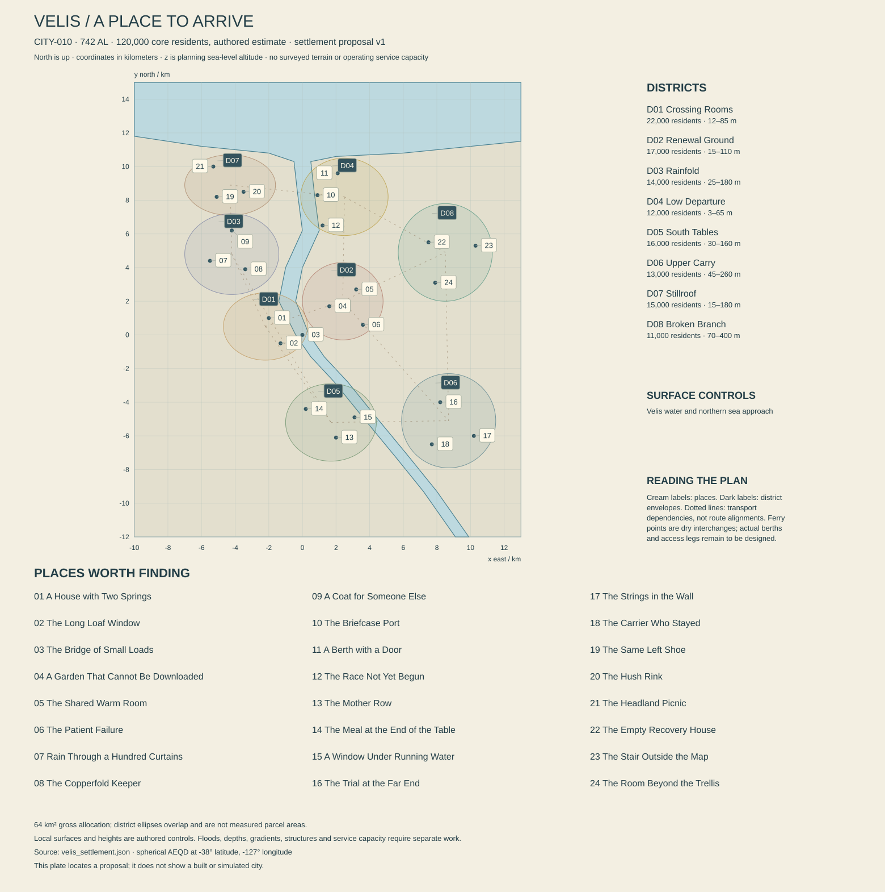

# Velis — a future that must be kept alive

Working city proposal, edition 0.1, 13 October 2026. **CITY-010, REG-016**, at the unchanged atlas anchor **38° S, 127° W**. The resident estimate is **120,000** in **742 AL**. [The settlement record](velis_settlement.json) assigns eight districts and twenty-four places. Local institutions, biographies and dates introduced here are proposals; established history, Iven Sott's teaching story, native ecology and the VCP product constraints remain binding. This dossier describes an authored city, not constructed terrain or demonstrated agricultural capacity.

[Settlement geometry and account checks](VELIS_SETTLEMENT_CHECKS.md) record the relationships tested by the shared checker. The map depicts planning controls, not a flood model, navigable channel or surveyed city.

## 1. Arrival: something small, something enormous

A carrier steps down with a case small enough to fit beneath a dining chair. Behind her, an entire growing house opens its upper vents. The panels lift in sequence, revealing a band of bright interior leaves beneath the dark roof. Farther upstream, native hearthveil curtains move in the rain. The carrier's case, the cultivation hall and the woodland contain different kinds of life. Velis becomes interesting when the visitor learns why they cannot be treated as interchangeable.

The first impression should nevertheless be pleasure rather than a lesson. A bakery window fogs when its inner shutter opens. Someone balances three warm loaves against a sleeve. A tram crosses above brown running water, and a public room beside its stop is full of people watching a boat race taking place somewhere else. A child recognizes a returning crew member before the adults do. This is a small city with a large circle of acquaintances, not a university campus that forgot to build homes.

Velis's characteristic sight is a roof opening onto another roof. Houses step around productive courts; growing structures sit below wind screens; covered stairs emerge into the open before disappearing beneath the next slope. The roofs have practical differences. A domestic room may want a low view and quiet light. A propagation house needs particular light, ventilation and access. A stock store can need darkness, controlled humidity and a service corridor. Their shared craft lies in making transitions legible, not giving every building the same greenhouse skin.

The wider landscape is inviting and difficult. The river comes from the southeast, crosses the city and reaches the sea to the north. Steeper eastern ground contains former recovery houses, present neighborhoods and routes toward incompletely explored cultivation sites. Sheltered woodland occupies selected western slopes. Wind at the coast can differ sharply from air inside a wet garden. A person can leave a warm room and reach a place where a wrong turn matters, without the city turning into a permanent disaster.

Velis's central argument concerns what it means to share a future. A teacher can want another settlement to become independent while her institution depends on selling continued support. A household may preserve a cherished working culture after its biological identity has changed. A carrier can deliver viable material faithfully to a destination unable to use it. The stories emerge from those differences, but residents also want attractive clothes, good games, romantic privacy and enough free time to enjoy the place they maintain.

## 2. Water, coast, cold and sky

The local frame extends **10 km west, 13 km east, 12 km south and 15 km north** of the atlas origin. Coordinates are spherical azimuthal equidistant meters, x east and y north, on the 5,900,000 m reference sphere. z is planning sea-level altitude. It is not the vertical component of a tangent-plane coordinate. The surface drawing uses land as its base and one coherent water polygon for river, widening mouth and northern sea.

The parent geographic record supplies **RIV-008**, Velis water. Its upstream control at **126° W, 39° S, 110 m** is southeast of the city. The local profile enters at **(9,500, −12,000, 23)** and passes through the required **(0, 0, 12)**. It continues through **(−900, 2,000, 9.5)**, **(−500, 4,000, 7)**, **(500, 6,200, 4.5)** and **(200, 8,500, 1.5)** to the exactly projected parent mouth at approximately **(0, 10,297.443, 0)**. The parent coast coordinate is **127° W, 37.9° S**. The water level never rises downstream in this nominal chain.

These are deliberately local refinements between widely spaced watershed controls. They establish the broad incoming direction, central height and outlet position. They do not establish channel depth, velocity, flood stage, bed slope, sediment budget or tidal penetration. A twelve-meter surface drop between city center and coast is consequential: the dossier does not promise that a sea-going ship can simply sail through the central bridge. The lower dispatch harbor and the inland crossings serve different craft and cargo transfers. Future locks, dredging or navigation works require an explicit project; none is silently present.

Low Departure lies beside the lower reach, before the northern mouth. The Briefcase Port marker is a dry dispatch hall near that water, not a completed berth. A continuous sheltered water route from a qualified berth to the open sea still needs bathymetry, clearance and operating limits. The landing point of an arriving passenger can therefore be different from the place where a long-route ship moors. Public maps must show the transfer instead of pretending a large vessel appeared beneath an inland footbridge.

Selected river benches support cultivation; other patches are too wet, unstable, saline or poorly drained. Fine alluvium does not automatically supply safe crop soil. Introduced agriculture uses assessed mineral substrates, managed nutrients and maintained terrestrial partner cultures. Native woodland occupies its own suitable ground. Excavating a drainage trench can change a nearby rooting zone, while an elevated path can preserve surface movement of water if its construction actually allows it. Neither a garden wall nor a pretty rain chain proves that runoff has a destination.

The climatic premise is cool maritime weather with seasonal variation and sheltered productive sites. It does not imply permanent snow, an Earth winter calendar or an unchanging wind direction. Snow and freezing conditions can occur where the later climate model supports them; all roofs need plausible drainage and weather loads regardless. Some visits should be bright and surprisingly mild. Others should reveal the value of a wind screen, dry socks and a room that warms slowly after its door has been opened repeatedly.

The natural solar cycle remains **136.755 hours**, approximately **5.698 civil turns**. At 38° S, nominal daylight varies from about **59.8 to 77.0 hours**, with about 68.4 hours near equinox. The corresponding longest nominal night is about **77.0 hours**. Southern seasons reverse the phase of northern examples, but the adopted effective tilt is about 14.07 degrees; Velis is not an Antarctic outpost. People sleep and work through shorter schedules inside the long light and dark intervals.

**Rauth's entire disc is below Velis's ordinary reference horizon.** It must not appear above the harbor for a dramatic establishing shot. Residents know its image and may travel to see it, but do not position every house around a giant in their own sky. Ilex, cloud, stars, artificial light and the changing river provide sufficient spectacle. A controlled growing room can be brightly lit while the street is dark, and later dark while the star remains above the horizon. That mismatch is a visible working schedule rather than a rendering mistake.

## 3. Histories that leave different kinds of evidence

The planetary history places Velis's growth alongside Tern's expansion during **305–391 AL**. It does not give an exclusive founding instant. Earlier surveys, stopping places and cultivation trials may predate the durable town, but this proposal does not claim an ancient human city hidden beneath every field. A present family can possess an old object without possessing an uninterrupted institutional charter.

**329 AL, the Eight Receiving Rooms — local proposal.** Several cultivation and transport households establish a shared receiving arrangement for living material. The remembered eight rooms are a story about cooperation, not the origin of the current eight planning districts. Surviving records distinguish imported stock from material propagated locally. Later publicity claims the city preserved every line entrusted to it; the original losses make that claim untenable. An honest exhibition can show both useful competence and the limits of early equipment.

**354 AL, the Quiet Census — inherited context.** The census's wider disputes over recognized workers and dependents reach Velis's household cultivation networks. Some people classified as helpers have long made consequential selection and propagation decisions. The city-specific case files remain to be written; the global event is not altered to make Velis its secret origin. Contemporary disputes over credit can refer to that history without assigning one family hereditary moral authority.

**392–468 AL, the broken-links era — inherited interval beginning with the Relay Winter.** The Relay Winter begins in 392 AL, with differing interruptions over several years; it is not the name of every year in this larger era. Different facilities lose different links. One store preserves references while its production partner closes; another saves living plants by sacrificing less urgent work. Material leaves with departing crews. The old recovery houses are therefore incomplete ruins, with stripped fittings and documented removals beside local damage. An empty rack can represent a successful evacuation. The remaining danger comes from actual structure, water, deteriorating equipment and uncertain access, not from every shelf conveniently retaining a centuries-old treasure.

**419–431 AL, the Split Return — local proposal.** A working crop line is restored through exchanges among three settlements after its earlier local form is lost. A bakery keeps the old household name for the revived bread. Later curators disagree over whether the name denotes ancestry, recipe or social continuity. The story is not resolved by finding one genetic file: the file can clarify ancestry while leaving the other meanings intact. Present characters can choose a more accurate label without being forced to stop enjoying the loaf.

**487 AL, the Separate Copies agreement — local proposal.** Rebuilding institutions agree that protected holdings need independent backups and that several containers from one compromised culture are not independent security. The agreement also creates recurrent obligations: someone must test recoverability and maintain the receiving institution. It is remembered through ordinary service rooms rather than a single monumental vault. A distant backup that cannot be reached or grown remains a qualified promise, not an infinite reserve.

**553 AL, the Open Garden season — local proposal.** Households make selected native displays and introduced ornamental rooms available to visitors under scheduled access. The practice remains voluntary. It produces delight, envy and arguments about labor; a neighbor with a less photogenic garden is not failing a civic duty. Later tourism sometimes flattens the separation between native and introduced cultivation, making clear labels and guides valuable without turning every visit into an inspection.

**638 AL, the Left Shoe printing — local proposal.** A popular edition of the established gift-planning tabletop game gives every illustrated character the same left shoe. This develops the existing pleasure-volume anecdote without changing its premise. Collectors later celebrate the mistake, while players continue using inexpensive reprints. A rare original is interesting to particular people; it is not a universally coveted relic that can finance an interplanetary expedition.

**713–719 AL, the Broken Branch closures — local proposal.** A group of older growing and recovery facilities closes after a combination of changed contracts, difficult heating costs and deferred structural work. Several households relocate, others remain nearby. Some buildings receive new uses. This comparatively recent landscape allows living witnesses, contested property and missing objects whose owners may still return, rather than making all exploration archaeological and consequence-free.

The Tern rivalry remains affectionate, competitive and sometimes expensive. Apprenticeship regattas, rescue contributions, professional prestige and marriages connect the cities. Their **2,423.63 km great-circle separation** is a lower-bound geographical fact in the travel study. Its illustrative sea comparison exceeds sixty hours including the stated allowance, before route, coast and weather qualification. A casual same-afternoon boat visit would erase the world scale. A transmitted race commentary can be immediate even when a participant's return takes much longer.

## 4. Eight districts, many ways to make a room

The city allocates **64 km² of gross planning area**, not sixty-four square kilometers of continuous buildings. District ellipses are overlapping orientation envelopes; their stated area allowances are separate planning quantities. Native patches, cultivation ground, streets, service yards and undeveloped slopes share the frame. No one is assigned a social rank by the elevation of their house.

| District | Residents | Gross km² | Planning center x, y, z m | Everyday character |
|---|---:|---:|---|---|
| VEL-D01 Crossing Rooms | 22,000 | 8 | −2,200; 500; 32 | Dense mixed homes, bridge approaches and food streets |
| VEL-D02 Renewal Ground | 17,000 | 8 | 2,400; 2,000; 40 | Teaching, recovery work, public warmth and protected cultivation |
| VEL-D03 Rainfold | 14,000 | 10 | −4,200; 4,800; 90 | Sheltered native woodland mosaics, craft and household courts |
| VEL-D04 Low Departure | 12,000 | 7 | 2,500; 8,200; 14 | Lower-river dispatch, temporary residents and working shore |
| VEL-D05 South Tables | 16,000 | 9 | 1,700; −5,200; 75 | Food growing, regional exchange and upstream observation |
| VEL-D06 Upper Carry | 13,000 | 9 | 8,700; −5,100; 130 | Regional freight, trial facilities, workshops and crew rooms |
| VEL-D07 Stillroof | 15,000 | 7 | −4,300; 8,900; 85 | Family terraces, games, indoor movement and coastal outlooks |
| VEL-D08 Broken Branch | 11,000 | 6 | 8,500; 4,900; 185 | Current homes among retired cultivation sites and higher routes |

**Crossing Rooms** is the strongest place to begin a walk. Houses meet commercial rooms through deep thresholds, and passages widen into shared courts rather than one uninterrupted market corridor. Older bridge approaches are occupied by contemporary work. The supported bridge marker above the central twelve-meter water control represents one public crossing proposal; clearance, foundations and both bank connections remain to be engineered. The river is audible from some rooms and entirely absent from others.

**Renewal Ground** has large practical interiors without becoming a sterile laboratory quarter. Its teaching facilities have visible receiving doors, changing areas, preparation rooms and protected holdings. Staff live nearby, eat in ordinary cafes and resent the assumption that every conversation is an educational opportunity. Public warmth and cultivated beauty are available without entering sensitive rooms. The distinction is spatially readable through thresholds, not an invisible restriction around a generic greenhouse asset.

**Rainfold** follows sheltered slopes with native hearthveil mosaics. Its planted paths retain gaps, mixed ages, damaged ribs and ordinary maintenance. Small workshops use selected qualified native materials, but most walls still depend on mineral products, metal frames and traceable imported or introduced components. The district is not a forest village exempt from utilities. A warm apartment overlooking rain curtains can contain contemporary medical equipment, a bad television program and an argument about laundry.

**Low Departure** is compressed around transfer work. Ships, small craft, land carriers and passengers do not use identical paths. A living-stock case may reach the quay by a careful short journey while bulky construction goods take a different handling route. Temporary rooms belong to the city's housing life, with cooking, privacy and recurring friendships. The sea lies beyond the mouth; water beside a dispatch hall does not establish an unlimited ocean harbor.

**South Tables** mixes productive land with housing and gathering places. Its introduced lines occupy managed media and defined plots, while suitable native river patches remain separate. Large outdoor staple areas principally lie in the wider hinterland, beyond this city diagram. The city's beautiful growing rooms are a visible portion of its food system, not proof that everyone eats only what can be seen from a tourist route. Market confidence can coexist with dependence on a distant harvest.

**Upper Carry** holds the eastern freight connection and some work too bulky or disruptive for the central lanes. It includes trial rooms where an ordinary receiver's conditions can be reproduced, material workshops and independent crews' equipment. New construction here can be spacious and plain. Its memorable image is an opened service wall revealing a precise sequence of rooms, not endless crates and warning stripes. A crew member can live here for years without working in cultivation.

**Stillroof** provides less productive-looking pleasures: a covered movement hall, games, family gatherings and quiet outlooks. Its coastward walks rise above selected sheltered ground; they are not guaranteed safe cliff paths. Sports followers can argue with Tern supporters in a warm room while rain obscures the actual water outside. This district earns its place by making the city desirable even to someone who has no interest in plants.

**Broken Branch** is neither wholly abandoned nor wholly restored. Current homes use serviced streets near former cultivation structures. Public routes end where private or hazardous ground begins. Higher paths open toward the watershed and a landscape larger than the city. Some residents enjoy the quiet; others want investment, tourism, demolition or stricter access. Their disagreement should survive a player's successful exploration of one building.

The architectural working name is **Folded Shelter**. Dark, repairable mineral plinths meet warm interior surfaces and roofs assembled in visible bays. Roof pitches and screens respond to exposure; they are not repeated at one arbitrary angle. Selected sea-green and ochre exterior panels identify domestic thresholds, while growing structures use clear, translucent or opaque assemblies according to their actual function. Bright sailcloth appears in sheltered courts and seasonal events, with tension, drainage and stowage designed. It is not left permanently snapping in every gale.

Detail belongs at transitions: a removable boot seat, a thick inner shutter, a propagation cart that fits the door, a gutter that can be cleaned, a vent actuator with working clearance. Domestic rooms should contain varied furniture and evidence of personal taste. Productive rooms should show different degrees of access and cleanliness without being universally polished. Roofs are compelling traversal surfaces only when structure, permissions, heights and alternatives exist; a visual repetition of slopes does not establish a playable route.

## 5. Households, language and intersecting lives

A housing screen assigns **48,000 occupied dwellings at 2.5 residents each**, plus **1,800 ready vacant** and **2,200 under works or otherwise unavailable**, giving 52,000 units in the proposed stock. At 35 m² of private residential floor per resident, the occupied allowance is 4.2 million m². Adding 30 percent for shared circulation and common rooms gives 5.46 million m²; three effective floors imply about 1.82 km² of footprint. These assumptions illustrate spatial room, not affordability, actual building coverage or uniform household size.

Another **2,000 visitor beds at 75 percent occupancy** represent 1,500 temporary residents in the service screen. They are additional to the core census. Some visitors stay with households instead, so a later occupancy study must avoid counting the same person twice. A berth household can offer continuity across repeated visits without requiring that all guests work for the same carrier. People also leave Velis willingly, return reluctantly or choose never to move despite opportunities elsewhere.

Wake speech carries public conversation, with Shore and other varieties present through migration and work. Specialized stock terminology belongs to practices, not superior intelligence. Frame Sign and local signing communities need sightlines, lighting and ordinary social spaces. Transit Clear belongs on an operational instruction; it does not replace jokes at dinner. Names below are original character proposals except Iven Sott, whose established role is retained. Standard ages are approximate Julian Earth years, calculated from AL birth dates rather than equating a local year with an Earth year.

| Person | Born AL; standard age | Public work and private direction |
|---|---|---|
| VEL-PER-01 Iven Sott | 686; about 49.9 | Propagation teacher; wants receivers to become competent, and wants one evening without being asked to teach |
| VEL-PER-02 Mara Venn | 699; about 38.3 | Household cultivation coordinator and baker; hopes to publish a plainly written account of her family's changed bread line |
| VEL-PER-03 Sen Oril | 703; about 34.7 | Stock carrier; plans to reduce long-route work without losing the friendships it created |
| VEL-PER-04 Tavi Rell | 713; about 25.8 | Race commentary producer and amateur competitor; wants to be recognized for analysis rather than a spectacular old mistake |
| VEL-PER-05 Oren Pell | 676; about 58.8 | Native garden keeper; wants a successor who will improve his methods instead of imitating him |
| VEL-PER-06 Ria Senn | 708; about 30.3 | Tailor and native-material trial maker; is designing a coat for a person she has not decided to forgive |
| VEL-PER-07 Elu Var | 691; about 45.4 | Independent crew mechanic; has stayed longer than intended because ordinary domestic life became attractive |
| VEL-PER-08 Dena Korr | 665; about 68.6 | Former recovery-house manager; wants accurate closure history without losing control of her private letters |
| VEL-PER-09 Celi Aven | 717; about 22.3 | Freshwater observer and movement-hall regular; wants field work without being treated as everyone's junior assistant |
| VEL-PER-10 Noma Irel | 680; about 55.2 | Public-room host and game enthusiast; dislikes how collecting can displace actual play |
| VEL-PER-11 Pera Sol | 700; about 37.4 | Building surveyor and route guide; wants a difficult site stabilized but refuses to promise it can all be saved |
| VEL-PER-12 Jori Tann | 711; about 27.6 | Working-culture technician; writes comic scenes and fears colleagues will recognize themselves |

Iven and Mara are longtime friends who disagree about how much uncertainty belongs on a household product label. Sen carries material for Iven and lodges with Noma when between routes. Tavi and Sen once traveled together; affection remains after their plans diverged. Elu repairs Sen's equipment and shares a household with Mara, whose enthusiasm for a quiet evening sometimes collides with his unexpected visitors. Ria learned workshop discipline from Dena, then rejected her preferred aesthetics. Oren teaches Celi field observation but should not become the gatekeeper of her whole career. Pera surveys the old recovery houses with Dena's practical knowledge and her own authority. Jori works with Iven and wants Noma to stage a comedy that Iven might dislike.

These relationships create overlapping interests, not a mandatory chain of favors. Helping Sen does not purchase Mara's trust. A professional disagreement between Iven and Jori can coexist with affection. Dena may support preservation and still ask that one private room remain closed. No character's sexual identity, household form or assistive device should function as shorthand for political allegiance. Birth dates and public roles provide continuity; intimate details need intentional authoring when they matter.

## 6. Material accounts: meals now, future crops later

All quantities here use a **24-hour civil turn**. They are illustrative demand and process assumptions, not surveyed production, contracted capacity or established environmental permissions. Regional agriculture has a larger boundary than the city's domestic networks. A flow in one account must not be silently reused to supply another.

### Water and return paths

Domestic delivery at **135 liters per resident** is **16,200 m³/turn**. Other municipal uses total **13,800 m³**: 4,100 public and commercial, 6,000 selected city growing and stock facilities, 2,000 manufacture, 1,300 port and carrier services, and 400 visitor accommodation. The last includes the temporary population's 202.5 m³ domestic screen plus associated service use. Total potable-quality delivery is **30,000 m³**. At 20 percent distribution loss, treated input is **37,500 m³**, with 7,500 m³ physical loss.

A source proposal assigns **30,000 m³ treated river supply**, **5,000 groundwater** and **2,500 qualified roof-water product**. These are desired outputs, not guaranteed yields. The river abstraction belongs upstream of sustained saline influence and needs actual rights, flow, chemistry and ecological limits. Groundwater must not be counted as independent supply if it simply captures the same river flow. Roof storage is seasonal and finite; its firm contribution may prove smaller, requiring another qualified source or reduced demand.

Using a uniform 95 percent raw-to-product recovery solely for this screen requires **39,473.684 m³ raw intake** and leaves **1,973.684 m³ process residual** before distribution. Actual source processes will differ. There is no assumed desalination plant quietly erasing a low-river problem. Raw losses, treated distribution losses and end-use returns are different streams. The nominal **90,000 m³ treated reserve** covers **2.4 ordinary distribution-input turns at 37,500 m³/turn**, before inaccessible volume and additional operational margins. Three turns is only its hypothetical zero-loss delivery equivalent at 30,000 m³/turn. This remains a storage target, not evidence of a constructed reservoir.

A reclaimed loop supplies **12,000 m³** to qualified uses, giving **42,000 m³ gross end-use throughput**. A collection screen receives **29,000**, leaving **13,000 consumed or otherwise uncollected**. Treatment partitions collection into **12,000 reuse and 17,000 final residual**, before a detailed process model. The fresh network account closes as 37,500 = 7,500 distribution loss + 13,000 uncollected + 17,000 final residual. Some losses return to the catchment, so this is not a net basin-depletion calculation.

Native and introduced production waste remains separated by chemistry and treatment need. Reclaimed water can carry nutrients useful to one process and unsuitable for another. Quiet sieves do not authorize discharge or certify drinking water. The final treated residual needs a receiving location, load limit and monitoring regime; the estuary is not an infinite sink. Wider farming irrigation, reservoir evaporation, export production and emergency fire demand require additional accounts.

### Food and living-stock exports

The resident allowance is **1.6 kg edible product per person per turn**, or **192 tonnes**: **65 dry, 80 fresh, 32 cultured or fermented, and 15 other preserved foods, oils and condiments**. No native ingredient is needed to close this basket. VCP-03 remains research, with zero saleable native oil assumed. Introduced partner cultures and crop lines sustain the human nutritional base. The mass basket alone does not demonstrate calories, protein, micronutrients, acceptability or equitable access.

| Proposed source | Dry t | Fresh t | Cultured t | Other t | Total t/turn |
|---|---:|---:|---:|---:|---:|
| Facilities within the city planning area | 0 | 35 | 15 | 2 | 52 |
| Wider Velis catchment and sheltered hinterland | 50 | 45 | 10 | 5 | 110 |
| Other qualified Sere production networks | 15 | 0 | 7 | 2 | 24 |
| Selected cross-sea ingredients and preserved goods | 0 | 0 | 0 | 6 | 6 |
| **Core resident total** | **65** | **80** | **32** | **15** | **192** |

The 1,500 screened temporary residents add **2.4 tonnes**, making **194.4 tonnes** before a separate **4-tonne departing ship-store allowance**. These proposals do not consume stock already promised to another city. Seasonal harvest, spoilage, processing conversion, farm seed retention and buffers need additional quantities. A **1,950-tonne dry-food reserve** represents thirty turns of the sixty-five-tonne dry line, not thirty turns of complete nutrition. Regional route loss can change both menus and price without instantly making every larder empty.

The local fresh proposal separates **8 tonnes from explicitly lit controlled cultivation** and **27 from selected sheltered, seasonal or stored production**. The latter is an annualized allocation with actual seasonal gaps to resolve, not uniform output every watch. Selected introduced staples tolerate suitable versions of Nacre's long cycle through fictional centuries of breeding and selection. Sensitive stocks retain artificial photoperiods. No unmodified Earth crop is declared productive merely because the artist placed it beneath glazing.

A distinct viable-stock export screen moves **0.8 tonnes of net biological material per turn on average**: 0.60 dry seed lots, 0.18 clonal or living plant material and 0.02 cultures or tissue holdings. Packaging, containment and conditioning add a proposed 1.2 tonnes, for about 2 tonnes gross dispatched mass. Actual consignments are uneven. These are scale choices, not established sales, productive inventory or universal storage conditions. They do not count as resident food or planetary bulk-grain supply. Export success is measured through recoverable intended service and recipient readiness, with its lead time, not simply a signed delivery.

### Power, warmth and residual material

The electrical demand screen is **110 MW mean, 220 MW peak**. Its average allocation is 32 homes, 18 public and commercial services, 30 selected cultivation and stock work, 12 manufacture and preservation processes, 8 water and waste, and 10 transport and cargo MW. A portfolio to test assigns mean contributions of 40 imports, 45 local dispatchable, 20 wind and 5 solar MW, **net at the end-use boundary**. Gross generation and imports must additionally cover plant auxiliaries, distribution losses and storage losses; that upstream energy account remains unclosed. The net sum establishes neither source availability nor an operating grid. A proposed 100 MW connection rating and 65 MW dispatchable rating need separate contingency analysis.

Within cultivation's thirty megawatts, **18 MW average lighting** corresponds to an explicit screen of **180,000 m² active lit canopy**, 150 W/m² while on, for sixteen hours in each twenty-four. The instantaneous lamp load is 27 MW; its scheduling affects the 220 MW peak. The remainder assigns 5 MW cultivation climate and pumping, 3 active culture work and 4 preservation, recovery and associated handling. These are chosen loads, not a crop-response model. The proposed eight tonnes of fresh controlled output remains unqualified; larger output cannot be inferred by copying the room asset.

Useful heat is a separate candidate account: **60 MW thermal mean, 100 MW thermal peak**, with a mean 35 from combined heat-and-power recovery, 15 heat pumps and 10 recoverable industrial streams. Each source needs usable temperatures and delivery. A screening heat-pump ratio of three would require 5 MW electricity already included across the domestic and public plant allowances; the ratio is not a seasonal guarantee. Fuel and rejected heat from cogeneration still require their own balance. Warm water cannot replace agricultural photons, and summer surplus cannot be moved into winter merely by calling it recovered heat.

With wind and solar absent, the average electrical portfolio leaves a **25 MW deficit**. Over a 77-hour night that consumes **1.925 GWh**. Proposed storage is **3 GWh usable at 40 MW discharge**; charging and peak behavior remain unresolved. Losing another 20 MW of imports produces a 45 MW deficit and **3.465 GWh**, exceeding both limits. These deliberately visible failures prevent the pleasant city from acquiring effortless reliability through a single large battery label.

Municipal solid waste is screened at **105 tonnes/turn**: 90 from residents at 0.75 kg each and 15 visitor or commercial. A proposed partition is 30 repair and dry recovery, 45 qualified introduced organics, 10 separate native or mixed biological handling, 5 controlled special streams and 15 residual. The sum is an accounting boundary, not treatment capacity. Major construction waste, growing substrate replacement, industrial residues and sewage solids are additional. Spoolcrumb does not digest every discarded chair, imported crop residue or human waste stream.

## 7. Stocks, institutions and living ground

Velis should have many stores and working collections, not one omnipotent vault containing the world's future. Accessions need identity, provenance, viable quantity, preservation method, recovery evidence, partners and backup history. Working batches and protected references have separate roles. Loss of a production batch can be expensive without extinguishing a lineage; survival of a lineage does not instantly restore a season's output. An institution can possess excellent records and inadequate staff time.

The distinction has a real research analogy: FAO's genebank standards treat monitoring, regeneration, documentation and safety duplication as continuing work, across different conservation methods. USDA describes different requirements for seed and other plant material, while its microbial collection distinguishes cultures and handling. These sources support the need for specific care; none proves the fictional organisms, storage lifetimes or yields of Velis. [FAO genebank standards](https://www.fao.org/4/i3704e/i3704e.pdf); [USDA plant-resource questions](https://www.ars.usda.gov/plains-area/fort-collins-co/center-for-agricultural-resources-research/paagrpru/docs/plants/pages/nlgrp-faq/); [USDA microbial collection questions](https://apps.ars.usda.gov/index.php/nrrl/faq).

The proposed **Receiving Fellowship** coordinates participating institutions, teachers and carriers; it does not own every seed or command every household. A member can provide a defined recovery service with costs and limits. Public provision supports some strategically useful holdings, while private growers, household networks and regional partners maintain others. Disclosure sufficient to use a stock need not expose a worker's private records. Monopoly can arise from equipment, expertise or contractual access even when genetic descriptions are publicly available.

VCP-01 continues to govern selected mature hearthveil rib fibers as nonfood material. Strength, moisture response, cleaning residues, contact safety and replacement life remain qualification work. VCP-02 governs spoolcrumb-bound inserts on compatible feedstock, with declared living or stabilized state, humidity performance and appropriate use. Neither acquires universal structural or fire performance because it is biological. VCP-03 remains an unqualified native oil program, with no presumed food sale. VCP-04 requires the right introduced accession, viable quantity, receiving conditions and recovery evidence. This chapter supplies institutions and situations around those contracts; it does not announce laboratory success.

Native hearthveil stands occupy sheltered moist ground outside saline inundation. Their fans fold and reserves matter through the long dark interval. Spoolcrumb acts in compatible litter and selected native substrates, not every organic pile. Copperfolds need varied suitable food, partners, juvenile shelters and time; a keeper's familiar animal does not establish species-wide domestication. Quiet sieves belong in oxygenated upstream freshwater with suitable particles and protected flow. The lower port's water is not populated with them simply because their model is attractive.

The four species do not exhaust the ecology. Minor producers, decomposers, consumers and hunters remain to be designed where a scene depends on them. They should not be filled by moving Morrow taxa across the ocean. Native display gardens can preserve mixed ages and local recruitment rather than arranging identical specimens in rows. A path interruption after wind damage may matter to a copperfold even when no human building failed. A quiet-sieve bed can retain adults while losing recruitment, creating an observable change that an attentive visitor can distinguish from immediate death.

Public access should include both guided and independent movement. People can enter maintained routes without seeking a universal permission token. Sensitive growing rooms and private homes retain boundaries; dangerous abandoned structures retain specific hazards. A guide can warn accurately while a landowner exaggerates risk to discourage scrutiny. The player needs evidence, alternative routes and room to refuse. Exploration becomes richer when uncertainty concerns something concrete, rather than a generic danger meter attached to every old door.

## 8. Twenty-four places with lives beyond the visit

Coordinates in the settlement record mark authored focal points, usually dry public approaches or rooms. The Bridge of Small Loads is explicitly supported above water with a dry shore-access control. District envelopes are orientation aids, not legal parcels. Exact stairs, ramps, doors, grades, structures and access rights remain production work. Each place below has a present purpose, a visible inference, choices and a reason to return.

### VEL-POI-001 — A House with Two Springs

**Crossing Rooms.** The name refers to two generations' different ideas about when their household became established, not two unmapped freshwater sources. Mara Venn and Elu Var share a narrow house with a deep common room and separate work corners. A low window frames other people's feet on an elevated passage; a higher one admits a broad piece of sky. Someone has adjusted a chair to use both views.

Elu intended to stay for a short repair contract. His tools gradually acquired fitted storage, then a favorite cup appeared beside Mara's. He now struggles to tell visiting crew friends that they cannot always sleep in the common room. Mara enjoys their stories but resents discovering guests when she has planned a quiet meal. Neither person's preference makes the other selfish.

An invited visitor can help prepare supper, examine a household object with permission or hear an argument reach a small practical agreement. The player may decline an offered confidence or avoid carrying it into later conversations. Details reveal the relationship without a biography lecture: two calendars with different departure assumptions, a repaired chair kept for affection, and a cooking shelf arranged for somebody shorter than its original owner.

Returning can show a guest bed folded away, a newly agreed visiting interval or Elu preparing for a journey he genuinely wants. Assets require a credible compact plan, private doors, usable furniture, varied belongings and changing food preparation. The house should remain desirable even when no quest is available. Its emotional scale is the discovery that staying somewhere can be a consequential adventure too.

### VEL-POI-002 — The Long Loaf Window

**Crossing Rooms.** A protected serving hatch opens onto a short covered queue with seats along one wall. The bakery's long loaves use introduced grain and a cultivated edible seed mixture, preserving the established regional food. Their firm crust protects a soft middle for travel. The important smell comes from a real baking watch, not permanent smoke emitted whenever the player approaches.

Mara is preparing a public account of the household line's replacement after the Split Return. Some relatives worry that a more accurate label will make customers think the bread is inferior. A customer insists the old taste was different; another remembers a loaf that was never produced here. The current bread can be excellent while those memories remain inconsistent. Biological continuity and culinary affection are related but separate questions.

The player can buy ordinary food, taste a clearly identified variation or contribute a remembered account without being asked to determine an authoritative flavor. During a busy interval, observing how dough, finished loaves, payment and empty trays move reveals why one doorway is kept clear. A delivery case may be urgent without giving its carrier permission to push everyone aside.

On return, a seasonal seed mixture or a changed explanation card offers a modest consequence. Some customers adapt; others retain their preferred story. Assets need preparation and cooling space, actual batch variation, clean ingredient storage, worn serving surfaces and comfortable waiting. A late visit can find the hatch closed with tomorrow's arrangement posted, making the empty place legible rather than broken. The bakery belongs to ordinary life as much as travel logistics.

### VEL-POI-003 — The Bridge of Small Loads

**Crossing Rooms.** The focal point is a proposed public deck at **(0, 0, 18)** above the river's twelve-meter nominal surface. The explicit dry western access control is **(−600, 0, 22)**. A broad foot crossing carries people and designated small cargo, while heavier service movement uses separately designed infrastructure. The six-meter nominal deck-to-water difference is not automatically an engineered navigation clearance.

Sen Oril enjoys this crossing because cases become human-sized here. A courier can pause in a widened bay while someone with no cargo leans against the rail. Sen recognizes another carrier's careful grip before seeing the dispatch label. Their conversation may concern a difficult recipient, an old friendship or a coat purchased in Tern. Professional competence appears through small movements rather than a stream of shouted technical terms.

A visitor can cross, wait, watch the surface or choose the quieter parallel street approach. A dropped nonhazardous personal object may create a bounded recovery decision; jumping into unfamiliar water is not the universal solution. The river's slope and flow continue beyond the camera, and closure after an actual structural or weather concern changes routes without declaring the entire city inaccessible.

Returning reveals different loads and light, perhaps Sen traveling without her familiar case. Assets require a continuous structure, plausible supports, both bank connections, protected stopping space and drainage. The current map preserves only a focal deck and one dry access control, so the opposite connection remains explicit engineering work. The bridge should feel generous, busy and physically attached to its banks, not like a scenic platform suspended above a convenient decorative stream.

### VEL-POI-004 — A Garden That Cannot Be Downloaded

**Renewal Ground.** Iven Sott's teaching court preserves the established exchange-volume encounter. A distant settlement has received a genetic description and asks why it should pay for living stock. Instead of treating the question as ignorance, Iven proposes a joint grow-out trial. A public preparation room opens toward a protected demonstration space, allowing conversation without bringing every visitor into the working collection.

The missing elements differ by accession: recoverable material, partner cultures, appropriate media, conditions and practical skill. Iven is careful not to promise that all of them are always necessary in the same combination. A sequence file remains useful even when it is insufficient. The recipient's existing competence matters, and the trial should identify what they can already do rather than manufacture dependence on Velis.

The player may carry a qualified small consignment, help arrange a receiving visit or simply watch a lesson. A successful delivery does not immediately produce food. Recovery, inspection, multiplication and growth continue over actual intervals, with the receiver participating. Refusing an unprepared dispatch can be responsible; finding a workable staged arrangement can be more generous than a blunt refusal.

A later visit might show the recipient teaching someone else, with Iven pleased and slightly displaced. Assets need distinct public and protected circulation, visible batch identity, working samples, changing growth stages and a plausible preparation sequence. Displayed material must be identified as introduced stock or a separate native demonstration. The encounter's reward is a distant community acquiring its own ability, not a permanently grateful customer waiting to praise the city's expertise.

### VEL-POI-005 — The Shared Warm Room

**Renewal Ground.** Noma Irel hosts a public room whose attraction is a comfortable temperature, good seating and no requirement to buy an elaborate experience. A glazed inner court admits selected daylight; thick shutters and mechanical systems support other conditions. The space is not warmed by an unexplained magical greenhouse effect through every long night. A visible service side allows maintenance without making guests sit inside a plant room.

Some people come to read, some to talk, and some because their own crowded house is tiring. Noma reserves a quieter area and dislikes patrons claiming every chair for absent friends. Her difficult judgment concerns how to preserve welcome without turning the room into a succession of corrective announcements. Jori hopes to stage a comic reading here, while regular visitors worry that a loud event will displace their ordinary refuge.

The player can participate in a scheduled gathering, occupy a quiet chair or help compare arrangements that preserve both uses. A social success may mean agreeing on a different time and leaving the present room alone. Sound has spatial limits: a conversation across a partition should not be perfectly audible because the player has activated a dialogue objective.

Returning can reveal new seat covers, a modest exhibition or a separate comedy watch with a clear ending. Assets include different postures, accessible tables, coat storage, dry entry surfaces, controllable light and believable acoustic separation. Visitors need idle activities that are not all work. The place offers rest without pretending that rest must be earned by repairing the heating system first; sometimes everything necessary is already functioning well.

### VEL-POI-006 — The Patient Failure

**Renewal Ground.** A small comparison room contains a trial that did not achieve its intended growth. It is still under observation because the failure's timing and pattern can be useful. The display distinguishes a living but unsuitable result from dead material. Beside it, a successful comparison looks less visually dramatic, a useful reversal of the assumption that the brightest foliage must indicate the best crop.

Jori Tann has written a comic scene about researchers explaining a disappointing result to increasingly impatient visitors. Iven recognizes an exaggerated version of herself and laughs before asking one precise question about whether a colleague will be hurt. Jori's ambition is to write a good play, not expose fraud. The professional work and private art can intersect without either becoming a pretext for a conspiracy.

A visitor can examine the permitted evidence, attend a discussion or hear the draft performance elsewhere. Choosing not to turn an ambiguous observation into a confident rumor preserves a real relationship. A later narrative may involve somebody selling the trial as proven technology, but the room itself should first establish normal, visible uncertainty and the people capable of explaining it.

Time matters because repeated observations distinguish a stalled stage from a genuinely lost batch. Returning before that interval may produce no new conclusion, while a later visit can show a revised method or a discontinued line. Assets need paired conditions, legible records tied to actual specimens, varied staff work and a discreet removal path. The modest spectacle is a community retaining useful knowledge from an outcome it did not want, while somebody nearby turns the experience into an enjoyable evening.

### VEL-POI-007 — Rain Through a Hundred Curtains

**Rainfold.** A maintained path follows a sheltered hearthveil mosaic, alternating close wet fans and openings toward houses. Mature inclined ribs support overlapping living curtains, with gaps where old damage has not regrown. Rain collects, separates and falls in different rhythms as wind moves the fans. The stand should be recognizable in dry weather too, with folded edges, litter and small interior spaces replacing the famous sound.

Oren Pell shows visitors one pruned cultivated form beside an unselected patch. The comparison does not rank the wild form as untidy failure. Different ages and retained dead material support different organisms. Celi Aven asks about an apparently healthy corner with few young plants; Oren admits his earlier explanation may have overlooked a changed drain. Their disagreement is a credible exchange between observers, not a lesson in age determining wisdom.

The player can follow the public path, wait for a change in light or join a permitted close observation. Harvesting every attractive rib would destroy the place being admired. A route detour after damage can reveal a sheltered side court, giving movement an interesting alternative without rewarding the destruction. Native rain interception does not make the runoff safe to drink.

Returning reveals gradual pruning, recruitment or failure, depending on actual conditions rather than an arbitrary instant reset. Assets need several growth stages, anatomically consistent folding fans, damaged and retained ribs, wet and drying surfaces, drains with destinations and small nonhuman activity. The scene should invite quiet attention without becoming motionless. Its beauty is a living structure changing the experience of rain, alongside a city that has learned to leave some of its useful irregularity intact.

### VEL-POI-008 — The Copperfold Keeper

**Rainfold.** A small husbandry enclosure adjoins suitable native planting, with shaded juvenile refuges, separate work space and visitor seating. Its copperfolds are managed animals under a specific care proposal, not proof that the species is fully domesticated. One familiar individual returns to a favored fan margin; another remains concealed. Visitors can see enough anatomy to understand the side folds, limb sequence and protected breathing openings.

Oren is training a successor and discovers that the younger keeper has found a quieter way to offer food. His pride in careful practice competes with the pleasure of seeing it improved. Celi notices that an animal once described as stubborn is responding to a different vibration through its support. This is a bounded observation, not a universal translation of alien feelings.

The player can watch, follow an offered handling instruction or decline contact. A copperfold testing an edge may withdraw without producing a failure state. Food consists of several qualified native components with appropriate partners; a pretty hearthveil display alone does not establish a complete captive diet. Shed films are experimental nonfood material, not edible treats or a limitless crafting resource.

Returning after a breeding interval may reveal new shelters or a changed public schedule, with some animals absent from view. Assets need distinct individual marks, feeding wear, retained old fans, cleaning arrangements and behavior that continues without the player. An overstimulated animal should not become an instant enemy; staff can end a session and preserve everybody's space. The memorable reward is recognizing a living individual's habits while accepting that familiarity does not transfer ownership or abolish its needs.

### VEL-POI-009 — A Coat for Someone Else

**Rainfold.** Ria Senn's workshop places a cutting table beneath diffuse light and keeps a deeper fitting room private. Samples show different drape, seam behavior and weather resistance. A selected native-derived finish or insert appears only as a declared trial under its material contract; ordinary clothing does not depend on a newly qualified alien product. The most beautiful coat in the room can use entirely established materials.

Ria is making it for Dena Korr, who once helped her learn workshop discipline and later dismissed her preferred shapes. Dena has asked for practical alterations rather than an apology. Ria wants the finished object to express something she has not managed to say. A sleeve that fits well may matter more to the relationship than a dramatic gift presentation.

The player can commission a bounded alteration, compare samples or carry a fitting invitation without being told the whole history. An intrusive question can be declined. Observing chalk marks, an altered fastening and a carefully preserved old lining reveals how the garment's intended owner differs from the artist's ideal drawing. Clothing accommodates bodies and preferences; it is not a uniform assigned by faction.

Returning can show the coat in use elsewhere, perhaps with an unanticipated small modification. Ria may be annoyed before appreciating why it was made. Assets need actual garment construction, reusable fitting props, varied body accommodation, private mirrors and believable scraps. A material trial can fail humidity cycling without destroying the personal gift, because good craft includes choosing another appropriate component. The workshop gives the city's technical skill an intimate purpose: making something another person will be comfortable living inside.

### VEL-POI-010 — The Briefcase Port

**Low Departure.** The mapped point is a dry dispatch hall near the lower river, at **(900, 8,300, 8)**. Its dockward doors face a separately required berth approach. It is neither the whole harbor nor evidence that an ocean vessel can reach the central twelve-meter river control. A row of compact cases waits beneath a broad roof while much larger ordinary freight moves through another yard.

Sen checks a consignment's custody and intended recovery conditions. A recipient has prepared the wrong growing arrangement but can potentially correct it before arrival. The decision is not simply whether to send or refuse: a different shipment form, delayed departure or local trial may preserve the purpose. Sen's carrier obligations do not give her authority to rewrite the biological specification herself.

The player can watch loading from a public edge, join an authorized transfer or arrange passage with an actual crew. A sealed case can be biologically compromised; a scuffed outer shell can contain a healthy shipment. The meaningful evidence includes recorded conditions and receiving work, not the object's shine. Physical handling, dispatch queues and staff breaks make delays tangible.

A return may find a recovered empty container, a grateful receiver's practical question or a shipment still waiting for justified reasons. Assets need distinct public and cargo routes, containment appropriate to each holding, staging space, shade, power connections and onward ground transfer. Berths, moorings, vessel draft, estuary access and loading geometry remain explicit design dependencies. The place should make a small parcel feel consequential because of the future labor it can enable, while preserving the enormous sea journey beyond its roof.

### VEL-POI-011 — A Berth with a Door

**Low Departure.** This guest house stands on dry ground above the lower estuary approaches. Its name uses berth in the household sense as well as the maritime one; the mapped room is not a vessel mooring. Separate entrances allow late arrivals without waking every resident. A common kitchen faces a small sheltered court, while private rooms have enough storage for someone whose life travels in several awkward bags.

Noma coordinates the household's recurring guests. Sen has stayed often enough to know which cupboard sticks, but familiarity does not entitle her to leave equipment across everyone else's table. Tavi sometimes arrives with a commentary crew whose schedule conflicts with the house's quieter residents. Their problem can be solved through rooms and timing rather than a judgment that lively people or tired people do not belong.

The player can rent accommodation, meet a crew in the public room or accept a specific invitation upstairs. A private door remains private even when an intriguing voice is audible beyond it. A guest may offer passage that has costs, destination and departure conditions; social welcome should not turn into ownership of their vessel or unrestricted access to their colleagues.

On return, a familiar traveler may be absent while their small repaired object remains in common use. Another may have moved permanently into Velis, changing the room's meaning. Assets require staff facilities, cleaning routes, plausible luggage, mixed occupancy and a real distinction between public hospitality and domestic privacy. The place offers a wider world through people with elsewhere to go, including the possibility that a visitor discovers they would rather remain here for a while.

### VEL-POI-012 — The Race Not Yet Begun

**Low Departure.** A dry viewing terrace near the lower river serves commentary gatherings, practice observation and scheduled small-craft events. The marker does not define a navigable race basin. Any course must fit actual water depth, current, navigation separation and operating conditions. Most visits can use transmitted Tern regatta coverage or local model demonstrations without claiming a full harbor race is always occurring.

Tavi Rell produces careful commentary and is still recognized for an old competition mistake. They would like the story to become funny rather than permanently humiliating. A Tern visitor remembers the same incident differently and possesses a recording that settles one technical point while leaving the emotional memory intact. Rival supporters share food and disagree loudly without becoming automatic enemies.

The player can watch, join an accessible practice activity or help compare an authorized recording. Betting, if later included, needs its own economic and age assumptions; excitement does not require it. A cancelled event can produce a lively indoor alternative, while a successful one should leave real celebrations, tired staff and boats being put away rather than an eternal victory animation.

Returning offers a changed commentary partnership or Tavi attempting a modest competition with better preparation. Assets need public sightlines, comfortable weather shelter, accessible seating, temporary event equipment and ordinary off-event use. Boats belong to coherent craft families with handling limits. The scene's pleasure comes from shared attention and fallible skill, allowing the player to enjoy a regional rivalry without being compelled to win every local sport to become welcome.

### VEL-POI-013 — The Mother Row

**South Tables.** A protected introduced-plant collection keeps living material needed for selected clonal production. Its mother plants are not interchangeable with dry seed packets. A public passage reveals part of the working arrangement through a separated viewing face, while other holdings remain elsewhere. Loss here could interrupt production even if an independent reference survives; the whole city's future is not stored under one roof.

Mara knows a particular line through years of cooking with its produce. Iven knows the same line through propagation behavior, while Jori recognizes a recurring handling problem. Their descriptions can all be accurate without being complete. A visiting grower wants a form suited to a different room and receives a comparison rather than the most prestigious available label.

The player can observe, attend a tasting of identified human-compatible produce or support a specific receiving trial. A cutting taken without authorization can damage stock and omit essential context; possession alone does not grant useful cultivation capacity. Public access remains worthwhile without permitting unrestricted harvesting. Leaf and root condition, actual growth stage and room operation provide clues beyond a glowing plant rarity color.

Returning shows genuine progression, pruning and intervals when little visible change occurs. Assets need distinct accession families, believable spacing, replaceable cultivation hardware, a separate work route and records attached to the right material. Lighting follows a specified schedule; night outside does not guarantee lamps are on. The visual pleasure is disciplined abundance with individual variation, sustained by people whose expertise becomes more interesting as the visitor learns to see differences.

### VEL-POI-014 — The Meal at the End of the Table

**South Tables.** A market-side dining room joins several small tables for occasional shared meals. Its ordinary service remains available to people who do not want a communal experience. Produce arrives from city facilities, the wider catchment and other sources; the menu can proudly name those relationships without claiming everything grew beside the building. Native display plants outside are not ingredients by implication.

Elu brings a visiting crew member who makes an extravagant promise about an onward journey. Mara recognizes the enthusiasm without accepting the schedule. The resulting conversation can reveal a genuine opportunity and the preparation it requires. A shared meal is not a binding contract, and somebody who declines passage remains welcome at the table.

The player can eat, listen or ask about a specific dish. Different courses arrive at different moments because a kitchen has work to do. An unfamiliar introduced crop can be explained through texture and preparation without inventing universal alien edibility. Conversation may move from a serious trade question to a ridiculous argument about whether a loaf should be sliced before being given away.

Returning brings seasonal substitutions, a guest remembered by name or a cook experimenting with an ordinary recipe. Assets need storage, preparation, washing, staff rest, service circulation and varied portions. The room's warmth should come from light, food and social attention rather than perpetual braziers beneath unsafe ceilings. Its value is a moment when a vast world becomes approachable through somebody describing a place they actually visited, then passing a plate.

### VEL-POI-015 — A Window Under Running Water

**South Tables.** The mapped point is a dry observation approach west of the upstream channel, not a submerged room. A later detailed path leads to a removable viewing installation at a qualified freshwater patch. Quiet sieves occupy protected surfaces beneath stones and roots where oxygen, suitable particles and microflow permit them. The surface can appear uneventful while occupied shelves open and close below it.

Celi is comparing old colonies with recruitment. Some shelves survive without visible young, while a neighboring patch has small new growth. She resists a visitor's demand for a simple healthy-or-unhealthy verdict. The difference may reflect sediment, food, flow or the timing of observation; evidence narrows those alternatives over time. Oren contributes local history without supplying an infallible answer.

The player can wait, compare permitted images or help position a removable instrument without blocking the channel. Poking a colony to force motion would change the behavior being studied. A spill plot, if later authored, must specify its substance and pathway; these organisms neither eat all pollutants nor certify safe drinking water. The salinity limit remains real, excluding the lower harbor as an interchangeable habitat.

Returning after a meaningful interval may reveal changed recruitment or an inconclusive record worth keeping. Assets require consistent water depth, clear but imperfect underwater visibility, colony growth stages and a dry visitor route. The window must be maintained and removable rather than a magical transparent section of river. Its wonder is close observation revealing a living architecture that was present before anybody installed a place to watch it.

### VEL-POI-016 — The Trial at the Far End

**Upper Carry.** A receiving trial facility reproduces a bounded set of another settlement's operating conditions. Its rooms are modest, adjustable and sometimes deliberately less capable than Velis's best facilities. That difference is the point. A stock that works only in an expensive local demonstration may be unsuitable for the actual recipient, even if its brochure contains no false statement.

Iven works with a visiting technician whose practical knowledge changes the plan. Sen has carried material to the destination and knows where handling becomes difficult. Their conversation can turn an ambitious order into a smaller, achievable start. The receiver is a collaborator with choices, not an incompetent customer whose only role is to learn gratitude.

The player may transport an approved component, help document a bounded comparison or choose which part of the problem to investigate first. A failed trial can justify a different lineage, method or timetable. There should be no universal button that upgrades every room into identical conditions. Resource differences remain visible through fittings, working space and the time needed to prepare a batch.

Returning can find the visitors teaching a local class or packing equipment for home. Success may reduce future orders from Velis, pleasing Iven while worrying a manager. Assets need configurable but physical equipment, clear reference-versus-working separation, ordinary workshop clutter and lived visiting accommodation nearby. The place makes cooperation feel active: people discover a useful arrangement together, with a future outside the city rather than an endless chain of dependent deliveries.

### VEL-POI-017 — The Strings in the Wall

**Upper Carry.** A material workshop displays selected hearthveil-fiber and spoolcrumb-bound samples beside conventional alternatives. One cutaway preserves the visible strings of the organism's reproductive stage for teaching; finished products declare whether they are living or stabilized. The workshop does not sell a decorative biological block as automatically sterile, fire-safe or suitable for every structural purpose.

Ria is testing an insert for a limited nonfood application. Jori helps distinguish a production problem from damage introduced during a poorly chosen display arrangement. A conventional replacement may perform better, and choosing it need not betray the city's interest in native materials. The argument concerns an actual use, not whether biological manufacture is morally superior to every other process.

The player can compare sound, mass or permitted handling, with test conditions stated. A soft panel cannot become proof of useful insulation merely because it looks porous. The native feedstock requires compatible processing and an actual harvest allowance; imported crop straw is not silently substituted as spoolcrumb food. Rejects have a defined native-material route rather than joining human food compost.

Returning after humidity trials may reveal altered dimensions, a revised sample or a discontinued product. Assets need real mold assemblies, drying or stabilization equipment as chosen, batch separation, sample edges and appropriate contact surfaces. The small spectacle is a material whose internal history remains visible when cut, paired with skilled people willing to say where it should not be used. A successful limited object can be more memorable than another miraculous substance promising everything.

### VEL-POI-018 — The Carrier Who Stayed

**Upper Carry.** A freight-side workshop opens toward a modest crew court rather than directly onto an imagined landing pad. Elu repairs equipment for ground carriers and selected visiting craft through actual transfer arrangements. Large vessels need their own qualified facilities elsewhere. The public room contains route notices, a battered game board and an excellent chair that has outlasted several supposedly permanent contracts.

An old colleague offers Elu a journey he once wanted badly. Mara does not want to become the person who prevents him leaving, but also needs an honest account of how long he might be away. Sen recognizes the problem and refuses to settle it for them. Their relationships continue while a real piece of equipment waits for a decision about repair or replacement.

The player can arrange a bounded service, join a meal or investigate an offered route's practical conditions. A charismatic crew may be competent, unreliable or both in different respects. Independent travel should allow negotiation and refusal, with costs and destinations that exist beyond the invitation. A stolen component is not made legitimate by an appealing story about freedom.

Returning can show Elu departed, delayed or still working by deliberate choice. The court's life must not freeze until the player returns. Assets need believable tools, removed parts, handling space, staff facilities and cargo movement separated from social seating. This place makes mobility tangible through people who could leave and sometimes stay, reminding the player that a home port is an active relationship rather than a reset point on a route menu.

### VEL-POI-019 — The Same Left Shoe

**Stillroof.** Noma keeps a public game collection in a comfortable room above a small shop. The famous early Velis gift-planning deck preserves the established illustration mistake: every character has the same left shoe. A protected original can sit beside affordable playable reproductions. Owning the rare object and enjoying the game are different pleasures, and the room makes space for both without requiring a purchase.

One collector wants a printing flaw verified before paying a large premium. Noma would rather teach the cooperative variant to a visiting family. Jori sees comic potential in a solemn argument about shoe angles and must decide whether borrowing the scene would embarrass someone who trusted him. The stakes are social and material without becoming a secret planetary conspiracy.

The player can play, inspect a permitted comparison or listen to a lively disagreement. Expertise should be demonstrated through specific printing evidence, not a universal appraisal power. A reproduction can be honestly labeled and beautifully made. Discovering that a treasured copy is later than believed changes its market claim, not necessarily the memories attached to it.

Returning brings a different group, a new locally illustrated card or a rule variant someone refuses to adopt. Assets need readable cards, hands that handle them coherently, comfortable mixed-height seating, storage and a table layout supporting actual play. The pleasure comes from people briefly agreeing to care about an invented problem. The room should be enjoyable even when the rare deck is away for conservation and no collectible transaction is available.

### VEL-POI-020 — The Hush Rink

**Stillroof.** This covered movement hall uses a purpose-built smooth surface for wheeled equipment, practice and choreographed group sessions. Its local name does not imply permanent natural ice. Equipment, floor friction and protective arrangements need later qualification under Nacre's gravity. A quiet viewing side allows spectators to enjoy movement without being immersed in every wheel sound or amplified announcement.

Celi comes here to think about something other than rivers. Tavi is technically confident in one activity and awkward in another, a contrast friends enjoy without cruelty. An instructor adapts a sequence for varied bodies and equipment instead of treating the fastest participant as the only legitimate athlete. Competitive and relaxed sessions have different expectations and times.

The player can watch, learn a limited movement pattern or meet someone afterward. A future traversal system should not inherit impossible acceleration because a leisure animation looks graceful. An accessible social route through the hall remains worthwhile even if the player declines the sport. Rivalries can be funny, affectionate or uncomfortable according to the people involved.

Returning may reveal a rehearsal becoming a public performance, a participant recovering from an ordinary injury or a new piece of music changing the same route's character. Assets need coherent equipment contact, changing rooms, storage, spectator circulation and worn surfaces where use actually occurs. The hall gives the city an energetic pleasure unrelated to crop output. Its memorable image is several people choosing a shared rhythm, then breaking formation to laugh at something that went slightly wrong.

### VEL-POI-021 — The Headland Picnic

**Stillroof.** The focal point is a dry upper outlook inland from the mapped coast, not a table hanging over an unmodeled sea cliff. A maintained approach offers broad northern views where local relief permits them. Detailed terrain must establish the actual horizon and safe edges. Rauth remains absent; changing cloud and the sea approach provide the view without importing another city's sky.

Mara and Elu occasionally come here when they want a conversation that their house cannot quietly overhear. Other visitors bring children, food, games or nothing. Noma complains that picturesque picnics always conceal the person carrying everything. A shelter creates a useful choice between a broad exposed view and a smaller comfortable one, with neither automatically superior.

The player can rest, share a specific invitation or observe real vessel movement at a distance. A speck on the water is not identifiable beyond what optics and information support. Wind can make the preferred seat unpleasant while another remains usable. Leaving early is a sensible choice, not failure to appreciate the scenery.

Returning can show clearer weather, a different tide state below or a gathering absent because its members are elsewhere. Assets need actual approach grades, seating, drainage, litter handling and believable vegetation appropriate to exposure. Food uses the established introduced base. The quiet discovery is that a world-scale view can accompany an intimate, unresolved conversation. A player need not uncover buried machinery beneath the picnic ground for the journey to have been worthwhile.

### VEL-POI-022 — The Empty Recovery House

**Broken Branch.** A retired facility from the proposed 713–719 closures retains a public exterior approach and a restricted interior. Its missing equipment records removal, reuse and sale. Empty bolt patterns and differently weathered floor patches allow an attentive visitor to reconstruct part of that sequence. Present nearby homes receive ordinary services; the district is not universally abandoned because this building closed.

Dena Korr helped organize the departure. Pera Sol now surveys a limited reuse proposal and finds that one apparently disposable partition protects a structural or environmental function requiring investigation. Dena's memory is valuable but incomplete. A surviving record can correct her recollection without making her dishonest or turning every earlier decision into negligence.

The player can examine accessible evidence, join an authorized survey or negotiate for a bounded object whose ownership is known. Taking everything loose would erase information and may steal somebody's retained property. Hazardous interior routes require specific communication, equipment and alternatives. A cleared path should remain cleared; a removed fitting should not reappear to supply repeated loot.

Returning may show a stabilized room, an honest decision against reuse or a new activity in only part of the shell. Assets need a credible former process layout, removal scars, water pathways, structural variation and contemporary intervention. The spectacle is scale made strangely quiet: a room once devoted to nurturing life now large enough to hear rain travel across its roof. Its future remains a human choice rather than a predetermined reward for exploring it.

### VEL-POI-023 — The Stair Outside the Map

**Broken Branch.** The marker identifies a dry upper approach at a planning altitude of 270 m. Beyond it, older survey steps and natural ledges lead toward higher ground whose detailed geometry remains unauthored. The title describes a route omitted from an outdated public leaflet, not permission to leave the game's physical rules. A maintained lower section and an uncertain continuation must be visually distinguishable.

Pera wants to document the route before promoting it. An independent crew believes the old service connection could shorten access to a useful site; a nearby household fears visitors will cross its private yard. Celi wants to accompany the survey for her own field interests. These aims can coexist if the route is properly understood, but no friendly agreement removes a real unstable section.

The player can inspect the lower route, arrange a guided extension or choose a longer existing approach. Future climbing should communicate holds, exposure, rest and retreat. An impressive leap is not the only valid expression of freedom. Weather can change traction and visibility without making every surface uniformly slippery or arbitrarily disabling movement.

Returning can reveal a marked alternative, an access agreement or a justified closed segment with another destination still reachable. Assets need convincing rock structure, constructed steps with supports, weathering tied to drainage and distant landmarks visible from several positions. The reward is a growing spatial understanding of the city beneath the player, and the recognition that its serviced roofs occupy only a small portion of a much larger watershed.

### VEL-POI-024 — The Room Beyond the Trellis

**Broken Branch.** A former cultivation building contains a modest rear room screened by an old trellis frame. The frame once supported an introduced crop, not a native hearthveil canopy silently converted to human food. The mapped point is the dry entrance. A detailed interior must establish how a person reaches the room without passing through solid walls or an implausibly intact sealed ruin.

Dena used it to hold correspondence and household objects during the closure. A later temporary occupant left another layer, including evidence of an independent crew's stay. Some material belongs to living people. One letter may clarify a disputed departure; another is simply private. The discovery should offer choices about care, disclosure and ownership rather than treating every secret as an entitlement to public exposure.

The player can seek permission, compare visible evidence or leave an object where it is while recording a nonintrusive description. A suspicious absence may reflect removal by its owner rather than theft. If a later plot involves wrongdoing, it must provide specific evidence and affected people; an unconventional crew or hidden room does not establish guilt.

Returning can find the room emptied responsibly, reused with consent or still awaiting a decision. Assets need coherent layers of occupation, protected and weather-damaged objects, actual entry traces and a clear relationship to the larger retired facility. The pleasure of discovery survives restraint. Learning that a seemingly abandoned place remains part of somebody's life can make the world feel deeper than finding another untouched cache arranged solely for the protagonist.

## 9. A production path through Velis

The first continuous route should join a domestic room and bakery in Crossing Rooms, the supported central crossing and one teaching court in Renewal Ground. It needs convincing scale, water movement, weather transitions, public circulation and people doing things other than speaking to the player. A second route should contrast Rainfold's native curtains with South Tables' introduced cultivation and freshwater observation. Neither requires a simulated agricultural economy to communicate its causal relationships.

The adventure route begins in inhabited Broken Branch, passes the retired recovery house and reaches the upper survey approach. Its value depends on continuous terrain, believable boundaries and multiple ways to proceed or retreat. The harbor route requires the dry dispatch hall, an actual berth, a navigable lower-water connection and a comprehensible transfer to sea-going transport. A dependency line on the planning map is not that journey.

Asset families should share practical interfaces while retaining different use histories: domestic roof bays, growing-house frames, protected stock-room assemblies, cargo cases, cultivation carts, bridge modules, native growth stages, retired facility remnants and private furnishings. The twenty-four places require authored arrangements, not twenty-four unique copies of every chair. Material qualification, crop response, shipping viability, sky, hydrology, heat delivery and access remain separate acceptance questions. The dossier establishes a city worth building and revisiting; runtime construction and observed play must establish that its promises work.
